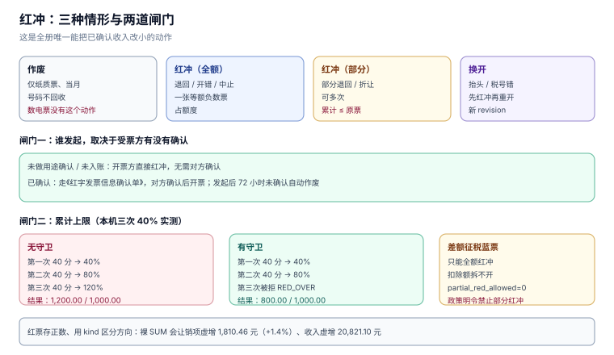

# 红冲与作废：钱已经出去了还能改

开票是单向的：票一旦开出，号码、金额、税额就进了申报口径。要改，只有两种方式——**纸质票当月作废**，或**开红字发票把原票冲掉**。数电发票没有「作废」这个动作，只有红冲（国家税务总局公告 2024 年第 11 号）。

红冲是全册唯一「能把已经确认的收入改小」的动作，所以它的风险不在流程复杂，而在**没有上限**：每次退一部分都合法，累计可以退到超过原票。

本页判据族 `TIR-A` ~ `TIR-H`，共 8 条。



## 一、三种情形，不是一个按钮

| 情形 | 触发条件 | 动作 | 票面 |
| --- | --- | --- | --- |
| **作废** | 纸质票、当月、未认证、全联次收回 | 打孔/标注作废 | 原票保留，号码不回收 |
| **红冲（全额）** | 退回、开错、服务中止 | 开一张等额负数票 | 金额/税额均为原票的负值 |
| **红冲（部分）** | 部分退回、折让 | 开一张部分负数票 | 可多次，累计 ≤ 原票 |
| **换开** | 抬头/税号错 | 先红冲，再按正确信息重开 | 两张新票，一张红一张蓝 |

**数电票只能红冲，不能作废**。这一点在系统里的体现是：`status` 枚举里不应该有 `VOID` 给数电票用，只有纸质票才有。把两者混成一个 `CANCELLED`，会让「这张票到底有没有占用额度」变成一个说不清的问题——作废票不占额度，红冲票占。

## 二、谁发起：看受票方有没有确认

| 受票方状态 | 谁发起 | 需要对方确认 | 时限 |
| --- | --- | --- | --- |
| 未做用途确认、未入账 | 开票方 | 否，直接红冲 | — |
| 已做用途确认或入账确认 | 开票方或受票方 | 是，《红字发票信息确认单》 | 发起后 **72 小时**未确认自动作废 |
| 已用于申报抵扣 | 开票方或受票方 | 是 | 受票方须暂依确认单税额**从当期进项税额中转出**，待取得红票后一并作凭证 |

第三行是本页最重要的一条：**红冲不是「两边同时减」，而是「受票方先转出、开票方后开票」**。这中间有一个时间窗，窗口内两边的账对不上是正常的；对不上而说不清窗口状态，才是缺陷。

系统里必须存 `confirm_state`（`NONE` / `PENDING` / `CONFIRMED` / `EXPIRED`）与 `confirm_deadline`，并在 72 小时后把 `PENDING` 扫成 `EXPIRED`。少了这个扫描，「确认单已过期但红票已开」会同时存在。

## 三、部分红冲与累计上限

单次红冲 40% 永远合法，三次就是 120%。本机实测：

| 守卫 | 三次 40% 的结果 | 累计 |
| --- | --- | --- |
| 无 | 三次全部成功 | **120.00%**（1,200.00 / 1,000.00） |
| 有（本次 + 历史 ≤ 原票） | 前两次成功，第三次被拒 | **80.00%**（800.00 / 1,000.00） |

守卫必须写成 SQL，而不是应用层判断：

```sql
CREATE TRIGGER trg_red_guard BEFORE INSERT ON invoice
WHEN NEW.kind = 'RED'
BEGIN
  SELECT CASE WHEN NEW.gross_cents + COALESCE(
           (SELECT SUM(gross_cents) FROM invoice WHERE orig_id = NEW.orig_id), 0)
         > COALESCE((SELECT gross_cents FROM invoice WHERE id = NEW.orig_id), 0)
  THEN RAISE(ABORT, 'RED_OVER') END;
END;
```

写成应用层的「先 `SELECT SUM` 再 `INSERT`」，在并发下会被穿透——与 [开具](../InvoiceIssue/index.md) 里的号码分配是同一个失效模式（20 线程实测无唯一键时 21 组重号）。

::: danger 注意
守卫只能防「超额」，防不了「冲错票」。红冲请求必须携带 `orig_id` + `orig_no` + 原票金额三个要素，并在事务内校验三者一致；只传 `orig_id` 时，一个 ID 猜测错误就会把别人的票冲掉，而这张红票在账上完全合法。
:::

## 四、差额征税的蓝票：只能全额红冲

差额征税的蓝票票面结构特殊（税率栏 `***`、备注栏打印扣除额），部分红冲会导致「扣除额无法按比例拆分」。12366 2026 年 9 月热点明确：**蓝字发票标签为「差额征税-差额开票」时，不能部分红冲，只能全额红冲**（2026-11-07 核对）。

系统里的落点是 `invoice.partial_red_allowed` 这一列：

| 蓝票类型 | 允许部分红冲 | 理由 |
| --- | --- | --- |
| 普通蓝票 | 是 | 金额可按行/按比例拆 |
| 差额征税蓝票 | **否** | 扣除额与票面绑定，拆不开 |
| 成品油、机动车等特定业务 | 按各自规则 | 有专门的库存/台账联动 |

## 五、跨期红冲：本期冲上期

红冲发生在哪一期，销项就在哪一期减少——**不是把原票那一期改掉**。这带来两个后果：

1. **原期的申报表不动**，红冲在当期体现为负数销项；当期销项不足以冲抵时，形成留抵或退税申请。
2. **账上要冲原期的收入还是当期的收入**，取决于会计政策（资产负债表日后事项 vs 当期差错更正）。这是账票差异的来源之一，见 [比对](../Reconciliation/index.md)。

本机实战库的 12 张红票全部开在 `2026-06`（原票分散在 12 个月），因此：

| 指标 | 读数 |
| --- | --- |
| 红票净额 | **10,410.55 元** |
| 红票税额 | **905.23 元** |
| 若按正数直加，销项虚增 | **1,810.46 元（+1.4%）** |
| 收入虚增 | **20,821.10 元** |

最后两行是同一个错误的两面：`SUM(tax_cents)` 把红票加了进去，而正确写法是 `SUM(CASE kind WHEN 'RED' THEN -tax_cents ELSE tax_cents END)`。

## 六、符号：存正数，算负数

红票在库里存正数（票面金额是正数，`kind='RED'` 表示方向），这是一个**存储约定**，不是一个可选项。它带来一条硬纪律：

> 任何汇总都必须显式处理 `kind`，不允许裸 `SUM`。

三种写法，只有一种是安全的：

| 写法 | 结果 | 评价 |
| --- | --- | --- |
| `SUM(tax_cents)` | 红票被加进去 | 错，虚增 2 倍红票税额 |
| `SUM(tax_cents) * -1`（单独查红票） | 只对红票 | 易漏，且两套 SQL 会漂移 |
| `SUM(CASE kind WHEN 'RED' THEN -tax_cents ELSE tax_cents END)` | 正确 | 推荐，可以包成视图 |

更好的做法是建一个视图 `v_out_tax`，让业务代码只能从这里取数：

```sql
CREATE VIEW v_out_tax AS
SELECT period,
       SUM(CASE kind WHEN 'RED' THEN -tax_cents ELSE tax_cents END) AS output_tax_cents,
       SUM(CASE kind WHEN 'RED' THEN -net_cents  ELSE net_cents  END) AS net_cents
  FROM invoice
 WHERE direction = 'OUT'
 GROUP BY period;
```

## 七、本页判据

| 编号 | 判据 | 为什么要它 | 怎么验证 |
| --- | --- | --- | --- |
| `TIR-A` | 数电票只能红冲，不得出现「作废」状态 | 作废与红冲的额度语义不同 | `kind='RED'` 的票不含 `VOID` 状态 |
| `TIR-B` | 红冲必须校验「本次 + 历史 ≤ 原票」 | 单次合法、累计可超 | 连红三次，第三次报 `RED_OVER`（`N1`） |
| `TIR-C` | 红冲请求必须同时带 `orig_id`、`orig_no`、原票金额 | 只带 ID 会冲错票 | 三者不一致时拒绝 |
| `TIR-D` | 已确认的蓝票必须先有确认单，且 72 小时过期可扫 | 否则「确认单过期但红票已开」并存 | `confirm_deadline` 过期后状态为 `EXPIRED` |
| `TIR-E` | 受票方已抵扣的，先转出、后取票 | 两边不能同时减 | 红冲前 `deduction.transfer_out_cents` 已增加 |
| `TIR-F` | 差额征税蓝票禁止部分红冲 | 扣除额拆不开 | `partial_red_allowed = 0` 时部分红冲被拒 |
| `TIR-G` | 汇总必须带符号，禁止裸 `SUM` | 直加会虚增销项 1.4% | `naive_sum − signed_sum = 2 × 红票税额` |
| `TIR-H` | 红冲所属期 = 开票当期，不回改原期 | 改原期会让已申报数据失真 | 红票 `period` = 红冲日所属期，原票不动 |

## 八、验证方式

```sql
-- 1) 累计不超原票（应返回 0）
SELECT COUNT(*) FROM (
  SELECT orig_id, SUM(gross_cents) s FROM invoice WHERE kind='RED' GROUP BY orig_id
) r JOIN invoice b ON b.id = r.orig_id WHERE r.s > b.gross_cents;

-- 2) 符号差恰好等于两倍红票税额
SELECT (SELECT SUM(tax_cents) FROM invoice WHERE direction='OUT')
     - (SELECT SUM(CASE kind WHEN 'RED' THEN -tax_cents ELSE tax_cents END)
          FROM invoice WHERE direction='OUT') AS diff,
       (SELECT 2*SUM(tax_cents) FROM invoice WHERE direction='OUT' AND kind='RED') AS expect;
-- 预期：diff = expect（本机 1,810.46 = 1,810.46）

-- 3) 确认单过期未处理（应为 0）
SELECT COUNT(*) FROM red_confirm WHERE state='PENDING' AND deadline < datetime('now');
```

负向探针（必须失败）：

```sql
-- 已红冲 30% 的票，再红 100% → RED_OVER
INSERT INTO invoice(no, kind, direction, orig_id, issue_date, period, buyer_no,
                    net_cents, tax_cents, gross_cents)
SELECT 'X1', 'RED', 'OUT', 1, '2026-12-01', '2026-12',
       'B', net_cents, tax_cents, gross_cents FROM invoice WHERE id = 1;
-- 预期：RED_OVER
```

Python 复算累计（可直接跑）：

```python
blue, reds, cum = 100_000, [40_000, 40_000, 40_000], 0
ok = 0
for a in reds:
    if cum + a <= blue:
        cum += a; ok += 1
print(ok, cum)      # 2 80000
```

预期输出：`2 80000`。

## 九、参考资料

- [国家税务总局公告 2024 年第 11 号](https://www.gov.cn/zhengce/zhengceku/202411/content_6989164.htm)：红冲的两种流程、《红字发票信息确认单》、72 小时时限、进项转出
- [国家税务总局 12366 热线 2026 年 9 月热点问题](https://henan.chinatax.gov.cn/2026/10-14/142593.html)：差额征税蓝票不得部分红冲、红冲操作路径
- [《中华人民共和国发票管理办法实施细则》](https://www.chinatax.gov.cn/)：作废与红冲的适用条件
- [SQLite: CREATE TRIGGER](https://www.sqlite.org/lang_createtrigger.html)：`RAISE(ABORT)` 与 `WHEN` 子句
