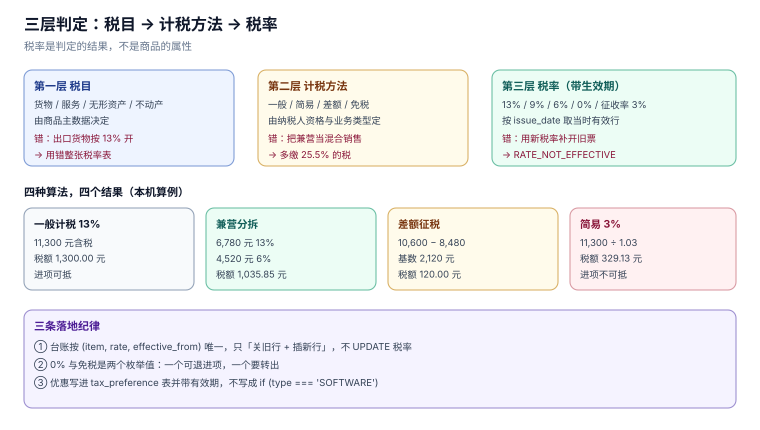

# 税目与税率：一张有生效期的台账

「这条业务几个点？」是税务系统里被问得最多的一句话。它看起来是一次查表，实际是**三层判定**：先定税目（这笔交易属于什么），再定计税方法（一般还是简易），最后才查税率。跳过前两层直接查表，就会在「混合销售」「兼营」「差额征税」这三类业务上系统性地错。

本页把税率做成一张**带生效期的台账**，把三类易混判定写成可复算的表达式，并给出错判的金额代价。

本页判据族 `TIC-A` ~ `TIC-H`，共 8 条。



## 一、三层判定，不是一次查表

| 层 | 回答什么 | 数据落在哪 | 判错的后果 |
| --- | --- | --- | --- |
| 税目 | 这笔交易是货物、服务、无形资产还是不动产 | 商品/服务主数据 | 用错整张税率表 |
| 计税方法 | 一般计税、简易计税、差额征税、免税 | 纳税人资格 + 业务类型 | 进项白抵或多抵 |
| 税率 | 几个点 | `tax_rate` 台账（带生效期） | 金额差 3~7 个点 |

三层的顺序不能反。反过来的典型现象是：主数据里给商品直接挂了一个 `tax_rate = 13`，于是「同一件货物用于出口」也按 13% 开票——而出口适用 0% 税率，属于第二层（计税方法/政策）而不是第一层（税目）。

::: tip 一句话理解
税率是**判定的结果**，不是商品的属性。把税率写进商品表并不算错，但它必须由「税目 × 计税方法 × 政策」推出来，不能由运营手填。
:::

## 二、2026 年的税率与征收率

《中华人民共和国增值税法》自 2026-01-01 施行，维持三档税率不变，并把征收率统一为 3%（2026-11-07 核对）：

| 税率 | 适用范围（摘要） | 备注 |
| --- | --- | --- |
| **13%** | 销售货物、加工修理修配劳务、有形动产租赁、进口货物 | 最常见的一档 |
| **9%** | 交通运输、邮政、基础电信、建筑、不动产租赁、销售不动产、转让土地使用权 | 农产品、自来水、暖气、图书报刊等也在此档 |
| **6%** | 现代服务、金融服务、生活服务、销售无形资产（不含土地使用权） | 服务业主档 |
| **0%** | 出口货物、跨境应税行为（符合条件） | 不是「免税」，可退 |
| **3%** | 简易计税的征收率 | 原 5% 的销售/出租不动产等统一降至 3% |

三处必须写进系统的细节：

1. **0% 与「免税」不是一回事**：0% 有进项可退，免税没有（进项要转出）。库里用两个枚举值 `ZERO_RATED` 与 `EXEMPT`，不要合成一个 `0`。
2. **征收率不是税率**：简易计税下不抵进项，票面仍显示「征收率 3%」，但计算基数是含税销售额，`税额 = 含税 / 1.03 × 3%`。
3. **小规模纳税人有起征点**：未达起征点免征、达到起征点全额计税——临界点两侧的税额不是连续函数，这一点在批量开票时会出现「多开 1 元多缴几百元」。

## 三、有生效期的台账

税率会变，历史单据不能跟着变。所以 `tax_rate` 的键不是 `rate`，而是 `(item, rate, effective_from)`：

```sql
CREATE TABLE tax_rate(
  id INTEGER PRIMARY KEY,
  item TEXT NOT NULL,                -- 税目
  rate INTEGER NOT NULL,             -- 百分数，13 / 9 / 6 / 3 / 0
  method TEXT NOT NULL,              -- GENERAL / SIMPLE / DIFF / EXEMPT
  effective_from TEXT NOT NULL,
  effective_to TEXT,                 -- NULL 表示当前有效
  UNIQUE(item, rate, effective_from)
);
```

三条纪律：

- **开票时按 `issue_date` 查当时有效的行**，不是按「今天」查。补开上月票必须用上月税率。
- **不做 `UPDATE rate`**，只做「关旧行 + 插新行」。改一行会让所有历史票的复算结果漂移。
- **`effective_to` 用『次日』而不是『当日』**，与半开区间一致：`[from, to)`。

[实战](../Practice/index.md) 里用触发器把这条纪律变成硬约束：插入发票行时若税率不在有效期内，直接 `RAISE(ABORT, 'RATE_NOT_EFFECTIVE')`。负向探针 `N3` 实测报出该错误（用 5% 开 2026 年的票）。

## 四、混合销售与兼营：一个判据，两种算法

两者的区别不在金额，在**是不是同一笔交易**：

| 形态 | 定义 | 计税 | 典型场景 |
| --- | --- | --- | --- |
| **混合销售** | 一项交易既涉及货物又涉及服务，二者有主从关系 | 按**主业**的统一税率 | 卖设备并负责安装（以设备为主 → 13%） |
| **兼营** | 两项以上独立交易，可分别计价 | **分别核算、分别适用**税率 | 卖设备（13%）+ 单独签的技术服务（6%） |

判定的关键证据是**合同与计价**：能不能分别计价、客户是否可分离购买、行业惯例以谁为主。系统里能落地的只有一条——**税目主数据上标 `mixed_sale`，开票时只读不选**。

错判的代价（本机算例，含税 11,300.00 元，货物 6,780.00 元 / 服务 4,520.00 元）：

| 算法 | 税额 | 差额 |
| --- | --- | --- |
| 全额按 13% | **1,300.00 元** | +264.15 元（+25.5%） |
| 兼营分拆 13% + 6% | **1,035.85 元** | — |

25.5% 的税额差会直接改变报价竞争力，也会让「毛利」在两张报表上不同：销售看到的是含税回款，财务看到的是不含税收入。

## 五、差额征税：销售额不是合同额

差额征税的公式只有一句：**销售额 = 全部价款和价外费用 − 允许扣除的金额**，税额再按销售额算：

```text
税额 = (含税全部价款 − 含税扣除额) ÷ (1 + 税率) × 税率
```

本机算例（含税 10,600.00 元、可扣除代付 8,480.00 元、6%）：

| 算法 | 税额 | 差额 |
| --- | --- | --- |
| 全额计税 | **600.00 元** | +480.00 元（**80.0%**） |
| 差额计税 | **120.00 元** | — |

三个落地要点：

1. **扣除额必须有凭证**（发票、财政票据、签收单），没有凭证的扣除在稽查时会被全额调回。
2. **差额开票的票面是特殊的**：税率栏显示 `***`，备注栏打印扣除额；且这类蓝票**不能部分红冲，只能全额红冲**（12366 2026-09 热点，2026-11-07 核对）。
3. **政策在收窄**：2026 年配套文件取消了人力资源外包、经纪代理等项目的差额征税，落地前必须查最新配套公告，不能照抄旧系统配置。

## 六、优惠：只登记，不硬编码

免税、即征即退、加计抵减三类优惠的共同点是**有资格条件、有备案、有期限**。系统里只做三件事：

| 做什么 | 表 | 为什么要 |
| --- | --- | --- |
| 登记资格与有效期 | `tax_preference(tax_no, code, valid_from, valid_to)` | 资格过期后仍按优惠开票是最常见的稽查问题 |
| 开票时校验 | 触发器/服务层读 `valid_to` | 到期日次日必须自动回到标准税率 |
| 申报时归集 | 申报表的「免税销售额」「即征即退销售额」栏 | 优惠金额必须能单独统计，否则无法证明适用条件 |

**不要**把优惠写成 `if (customer.type === 'SOFTWARE') rate = 0.03`。这类硬编码在政策调整后没有任何痕迹，只能靠人回忆。

## 七、本页判据

| 编号 | 判据 | 为什么要它 | 怎么验证 |
| --- | --- | --- | --- |
| `TIC-A` | 税率必须来自台账，不得由运营在单据上直接填 | 手填等于放弃一致性 | 单据上的 `rate` 必须能在 `tax_rate` 按日期命中 |
| `TIC-B` | 台账按生效期分段，`effective_to` 为开区间 | 历史单据要用当时税率 | 补开上月票，取到的税率与上月一致 |
| `TIC-C` | 0% 与免税必须是两个枚举值 | 一个可退进项、一个要转出 | 枚举表含 `ZERO_RATED` 与 `EXEMPT` |
| `TIC-D` | 征收率与税率分列，简易计税不参与进项抵扣 | 两者计算基数不同 | 简易计税单据的 `input_tax` 恒为 0 |
| `TIC-E` | 混合销售按主业单一税率，兼营分别核算 | 两者税额差可达 25.5% | 同一合同两种算法复算，差额可解释 |
| `TIC-F` | 差额征税的扣除额必须逐笔留凭证号 | 无凭证的扣除会被调回 | `deduction_base` 每行都有 `voucher_no` |
| `TIC-G` | 差额开票的蓝票不得部分红冲 | 票面结构不支持部分冲 | 尝试部分红冲被拒（或走全额红冲） |
| `TIC-H` | 优惠必须有有效期，到期次日回到标准税率 | 过期仍优惠是高频风险 | 把 `valid_to` 设为昨天，开票税率回到标准档 |

## 八、验证方式

建台账、插两张票、看税率是否被日期约束：

```sql
-- 1) 台账：同一税目两段有效期
INSERT INTO tax_rate(item, rate, method, effective_from, effective_to)
VALUES ('现代服务', 6, 'GENERAL', '2026-01-01', NULL);

-- 2) 用 2026-01-15 开票，命中 6%
INSERT INTO invoice_line(invoice_id, line_no, qty, rate, net_cents, tax_cents, gross_cents)
VALUES (1, 1, 1, 6, 10000, 600, 10600);
-- 预期：Query OK

-- 3) 用一个台账里没有的税率
INSERT INTO invoice_line(invoice_id, line_no, qty, rate, net_cents, tax_cents, gross_cents)
VALUES (1, 2, 1, 5, 10000, 500, 10500);
-- 预期：RATE_NOT_EFFECTIVE
```

```sql
-- 兼营分拆的复算：票面税额应等于按行求和
SELECT i.id,
       i.tax_cents                                   AS header_tax,
       (SELECT SUM(tax_cents) FROM invoice_line l WHERE l.invoice_id = i.id) AS line_tax
  FROM invoice i
 WHERE i.tax_cents <> (SELECT SUM(tax_cents) FROM invoice_line l WHERE l.invoice_id = i.id);
```

预期：`0 行`。

## 九、参考资料

- [《中华人民共和国增值税法》](https://www.chinatax.gov.cn/chinatax/n810219/n810780/c5237361/content.html)：税率、征收率与应税交易的定义（2026-01-01 施行）
- [国家税务总局：增值税抵扣链条更优化](https://www.chinatax.gov.cn/chinatax/n810219/n810780/c5248293/content.html)：三档税率与征收率并存的制度设计
- [国家税务总局公告 2024 年第 11 号](https://www.gov.cn/zhengce/zhengceku/202411/content_6989164.htm)：数电发票的税率/征收率栏与特定业务标签
- [国家税务总局 12366 热线 2026 年 9 月热点问题](https://henan.chinatax.gov.cn/2026/10-14/142593.html)：差额征税蓝票不得部分红冲
- [SQLite: Date And Time Functions](https://www.sqlite.org/lang_datefunc.html)：日期比较与半开区间
