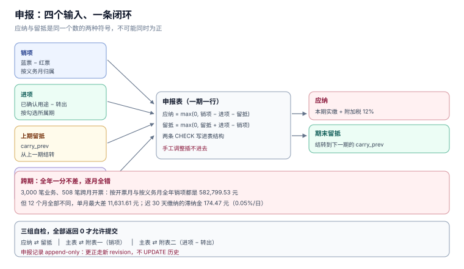

# 申报：销项、进项与留抵的闭环

申报表是一张「已经发生的事的汇总」，不是一次「算一下这个月交多少」。它的每一行都能追到票或凭证，而它最容易错的地方不是加减法，是**哪些票属于这一期**。

本页把申报拆成三件事：归属期怎么定、应纳税额怎么算、表内怎么勾稽。三件事都有可验证的边界。

本页判据族 `TIF-A` ~ `TIF-H`，共 8 条。



## 一、申报表的三行公式

增值税一般纳税人申报表的核心只有三行（其余都是附表）：

```text
销项税额        = Σ(本期销项票税额) − Σ(本期红票税额)
进项税额        = Σ(本期已确认用途的可抵税额) − Σ(本期转出)
应纳税额        = max(0, 销项 − 进项 − 上期留抵)
期末留抵税额    = max(0, 上期留抵 + 进项 − 销项)
```

两条 `max(0, …)` 是关键：**应纳与留抵不可能同时为正**。如果系统里两者同时为正，说明用的是两套独立的算式，而不是一条守恒关系。

## 二、归属期：按义务时点，不按开票时点

纳税义务发生时间的四条规则（[总览](../Overview/index.md) 已给），落地成 `obligation_date` 一列。它与 `issue_date` 的关系决定归属期：

| 情形 | 义务日 | 开票日 | 归属期 |
| --- | --- | --- | --- |
| 现销现开 | 当日 | 当日 | 同月 |
| 预收后发货 | 发货日 | 可能提前（先开票） | 先开票的按开票日 |
| 赊销 | 合同收款日 | 常在发货时 | 同月或跨月 |
| 月末发货、次月开票 | 发货日（本月） | 次月 | **不同月** |

第四行就是跨月的来源。本机 3,000 笔业务、其中 **508 笔**跨月开票：

| 口径 | 全年销项 | 12 个月是否相同 | 单月最大差 |
| --- | --- | --- | --- |
| 按开票月 | **582,799.53 元** | — | — |
| 按义务月 | **582,799.53 元** | **12 个月全不同** | **11,631.61 元**（2026-01） |

全年一分不差，逐月全错。这就是为什么「年度汇算对了」不能证明月度申报是对的：**跨期差异在 12 个月里互相抵消**。

那 11,631.61 元若迟 30 天缴纳，滞纳金 **174.47 元**（0.05%/日）。金额不大，但它是「申报口径错了」的定量证据，而不是「算错了」。

## 三、应纳税额与留抵：一条守恒式

```sql
-- 申报表一行的完整计算
INSERT INTO tax_return(period, output_cents, input_cents, carry_prev, payable, carry_next)
SELECT :period, :output, :input, :carry_prev,
       max(0, :output - :input - :carry_prev),
       max(0, :carry_prev + :input - :output);
```

表上的 `CHECK` 直接把这条守恒式写死，任何「手工调整」都插不进去：

```sql
CHECK(payable    = max(0, output_cents - input_cents - carry_prev)),
CHECK(carry_next = max(0, carry_prev + input_cents - output_cents))
```

实战库 12 个月跑下来：销项 **128,778.69 元**、可抵进项 **5,469.86 元**、全年应纳 **123,308.83 元**、期末留抵 **0.00 元**，`S5` 勾稽失败 **0 行**。

::: tip 一句话理解
留抵不是「这个月不用交税」，是「这笔进项被记在了一个还没有销项与之配对的期间」。它一定会在未来某期变成应纳，或者被退还。
:::

## 四、附加税：三个税率，一个基数

| 税种 | 税率 | 基数 |
| --- | --- | --- |
| 城市维护建设税 | 7% / 5% / 1%（按地区） | 实际缴纳的增值税、消费税 |
| 教育费附加 | 3% | 同上 |
| 地方教育附加 | 2% | 同上 |

合并是 12%（市区），但**分项取整与合计 12% 在多数情况下同额**：本机对 98,765.43 元实测，分项 `7% + 3% + 2%` 各取整后合计 **11,851.85 元**，与直接 12% 的 **11,851.85 元**相同。原因是三档税率的分母相同、且 7+3+2 恰好等于 12，取整误差在分位以下。

但这只在「分项各自取整」时成立。若某一项有减免（如小微企业六税两费减半），就必须分项算，不能合并。

实战库全年应纳 123,308.83 元，附加税 **14,797.06 元**（12%）。

## 五、表内勾稽：三组必须自检的关系

| 关系 | 表达式 | 不成立说明 |
| --- | --- | --- |
| 应纳 ⇄ 留抵 | `payable × carry_next = 0` | 两者同正 → 两套算式 |
| 主表 ⇄ 附表一 | 主表销项 = 附表一各行之和 | 有票没进附表 |
| 主表 ⇄ 附表二 | 主表进项 = 附表二「本期认证相符」− 转出 | 转出漏记 |

这三组关系在系统里应写成三条 `SELECT COUNT(*)`，每次月结前跑一遍，全部返回 `0` 才允许提交。

## 六、预缴与异地：两个容易漏的口子

| 场景 | 预缴地点 | 预缴率 | 申报时 |
| --- | --- | --- | --- |
| 跨县（市）提供建筑服务 | 建筑服务发生地 | 一般计税 2%、简易 3% | 机构所在地申报时抵减已预缴 |
| 异地销售不动产 | 不动产所在地 | 按差额预缴 | 同上 |
| 出租异地不动产 | 不动产所在地 | 3%（简易）或 3% 预征率 | 同上 |

预缴的三条纪律：**预缴不改变义务时点**、**预缴税额要在申报表专列一行**、**预缴凭证是抵减的唯一依据**。把预缴做成「直接在应纳里减掉」，会让申报表与完税凭证对不上。

## 七、滞纳金与更正申报

| 情形 | 处理 | 成本 |
| --- | --- | --- |
| 逾期缴纳 | 按日加收 0.05% | 11,631.61 元迟 30 天 = **174.47 元** |
| 少缴被查 | 补税 + 滞纳金 + 可能的罚款 | 罚款 0.5~5 倍 |
| 多缴 | 申请退还或抵减下期 | 无滞纳金，但占用资金 |

**更正申报不是「改一下数字」**：已申报期间的数据被更正后，后续期间的留抵起点会变，必须**从更正期开始逐期重算**。系统里应把 `tax_return` 做成 append-only（用 `revision` 区分），而不是 `UPDATE`。

## 八、本页判据

| 编号 | 判据 | 为什么要它 | 怎么验证 |
| --- | --- | --- | --- |
| `TIF-A` | 归属期按 `obligation_date`，不按 `issue_date` | 跨月票会让 12 个月全错 | 两种口径跑一遍：全年相等、逐月不等 |
| `TIF-B` | 应纳与留抵用一条守恒式，不得各算各的 | 两者同正说明两套算式 | `payable × carry_next = 0` |
| `TIF-C` | 红票税额按负数进入本期销项 | 直加会虚增 | 本期销项 = 蓝票 − 红票 |
| `TIF-D` | 附加税分项计算，基数 = 实缴增值税 | 有减免时合并会错 | 分项与合计同时可复算 |
| `TIF-E` | 主表与两张附表必须逐行勾稽 | 有票没进附表最隐蔽 | 三条 `COUNT(*)` 全为 0 |
| `TIF-F` | 预缴单独成行，不直接冲减应纳 | 否则与完税凭证对不上 | 申报表含「本期预缴」行 |
| `TIF-G` | 申报记录 append-only，更正走新版本 | 改历史会让留抵起点漂移 | `tax_return` 有 `revision`，无 `UPDATE` |
| `TIF-H` | 申报期限为期满之日起 15 日内 | 逾期即有滞纳金 | 月结任务在 15 日前完成，超期告警 |

## 九、验证方式

```sql
-- 1) 守恒式（应返回 0）
SELECT COUNT(*) FROM tax_return
 WHERE payable   <> max(0, output_cents - input_cents - carry_prev)
    OR carry_next <> max(0, carry_prev + input_cents - output_cents);

-- 2) 应纳与留抵不同时为正（应返回 0）
SELECT COUNT(*) FROM tax_return WHERE payable > 0 AND carry_next > 0;

-- 3) 逐月销项与票表一致（应返回 0 行）
SELECT t.period, t.output_cents,
       (SELECT SUM(CASE kind WHEN 'RED' THEN -tax_cents ELSE tax_cents END)
          FROM invoice WHERE direction='OUT' AND period = t.period) AS from_invoice
  FROM tax_return t
 WHERE t.output_cents <> (SELECT SUM(CASE kind WHEN 'RED' THEN -tax_cents ELSE tax_cents END)
                            FROM invoice WHERE direction='OUT' AND period = t.period);
```

Python 复算跨期差异（可直接跑）：

```python
months = [f"2026-{m:02d}" for m in range(1, 13)]
out_inv = {m: 0 for m in months}
out_obl = {m: 0 for m in months}
# 假设 1 月有一笔 10,000 元（不含税）业务，义务在 1 月、开票在 2 月，税率 13%
out_obl["2026-01"] += 1_300
out_inv["2026-02"] += 1_300
diff = [out_inv[m] - out_obl[m] for m in months]
print(sum(diff), diff[0], diff[1])     # 0 -1300 1300
```

预期输出：`0 -1300 1300`——全年抵消、逐月相反。

## 十、参考资料

- [《中华人民共和国增值税法》](https://www.chinatax.gov.cn/chinatax/n810219/n810780/c5237361/content.html)：计税期间、申报期限、留抵结转或退还
- [国家税务总局：增值税抵扣链条更优化](https://www.chinatax.gov.cn/chinatax/n810219/n810780/c5248293/content.html)：销项减进项、余额为负转留抵的口径
- [《中华人民共和国税收征收管理法》第三十二条](https://www.chinatax.gov.cn/)：滞纳金按日万分之五
- [《征收教育费附加的暂行规定》](https://www.gov.cn/)：教育费附加 3%、地方教育附加 2%
