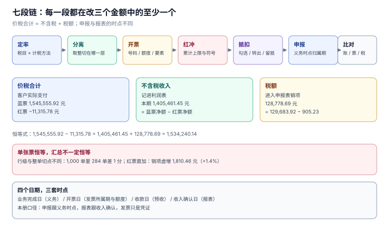

# 税务与发票工程

**同一笔交易在系统里有三个金额：客户付的「价税合计」、账上的「不含税收入」、要交给税务局的「税额」。** 三者在每一张票上必须自洽（`价税合计 = 不含税 + 税额`），在每一期申报上必须闭环（`应纳 = 销项 − 进项 − 上期留抵`），而它们各自的「时点」由三套不同的规则决定——开票日、纳税义务发生日、收入确认日。

这一册只写**一家企业从定价到缴税**要写死的东西：税目与税率怎么管、价税怎么分离、发票怎么开与怎么红冲、进项怎么抵、申报怎么勾稽、账票税三套数怎么对上。十页里有五页的主题是「失败很安静」——行级与整单分离差 0.02 元不会报错（只是每 1000 单累计差 3.07 元）、折扣分摊余数差 2 分不会报错（只是凭证不平）、红冲超原票不会报错（只是收入变成负数）、红票按正数直加不会报错（只是销项虚增 1.4%）、跨月开票不会报错（只是 12 个月没有一个月对）。

## 章节

- [总览：七段链、三个「多少钱」与五个安静的失败](Overview/index.md) —— 三套时点、三条恒等式、失败形态、相邻专题分工
- [税目与税率：一张有生效期的台账](TaxCatalog/index.md) —— 税目、税率与征收率、混合销售与兼营、差额征税、优惠备案
- [价税分离：切分点比公式重要](PriceTaxSplit/index.md) —— 行级与整单、分摊余数、含税定价、精度与舍入
- [开具：号码、额度与要素](InvoiceIssue/index.md) —— 20 位号码、月度总额度、开票幂等、交付与查验
- [红冲与作废：钱已经出去了还能改](RedFlush/index.md) —— 三种情形、72 小时确认单、部分红冲、累计上限、跨期
- [进项抵扣：勾选、转出与留抵](InputDeduction/index.md) —— 用途确认、不得抵扣、进项转出、留抵结转与退还
- [申报：销项、进项与留抵的闭环](TaxFiling/index.md) —— 纳税义务发生时间、应纳税额、附加税、申报表勾稽
- [比对：账、票、税三套数](Reconciliation/index.md) —— 三种口径、四种差异形状、月度闭环、证据链
- [实战：十张表、十八条约束与十六项断言](Practice/index.md) —— 完整 DDL、可运行脚本、逐条读数
- [常见问题与分诊](FAQ/index.md) —— 分诊表、十二问、止血五步、术语表

## 判据族一览

十族共 80 条，每页八条（`-A` ~ `-H`），定义在各页「本页判据」一节：

| 页面 | 族 | 约定 | 条数 |
| --- | --- | --- | --- |
| 总览 | `TIO` | 口径三分、时点三分、失败可归因、边界 | 8 |
| 税目与税率 | `TIC` | 税目唯一、税率有效期、混合与兼营、差额征税 | 8 |
| 价税分离 | `TIP` | 恒等式、切分点、余数归集、精度与定价 | 8 |
| 开具 | `TII` | 号码、额度、要素、幂等与方向 | 8 |
| 红冲与作废 | `TIR` | 三情形、累计上限、确认单、跨期与符号 | 8 |
| 进项抵扣 | `TID` | 用途确认、不得抵扣、转出、留抵 | 8 |
| 申报 | `TIF` | 义务时点、应纳税额、附加税、勾稽 | 8 |
| 比对 | `TIX` | 三套账、四形状、月度闭环、证据 | 8 |
| 实战 | `TIT` | 分层约束、反向探针、断言、验收 | 8 |
| 常见问题 | `TIQ` | 分诊可定位、读数可回溯、止血顺序、术语 | 8 |

## 三个「多少钱」

这是全册的骨架。三句话听起来是同义词，实际是三个不同分母、三个不同时点、三张不同的表：

| 口径 | 定义 | 谁在用它 | 本机实战库（388 张票） |
| --- | --- | --- | --- |
| **价税合计** | 客户实际支付的金额，票面「价税合计」 | 客户、渠道、收款系统 | 蓝票 **1,545,555.92** 元，红票 **−11,315.78** 元 |
| **不含税收入** | 记进利润表的收入，价税分离后的净额 | 财务、报表、业绩考核 | **1,405,461.45** 元 |
| **税额** | 销项税额，扣掉红冲后进入申报表 | 税务、申报、税负分析 | **128,778.69** 元 |

三个数满足一条恒等式：`1,545,555.92 − 11,315.78 = 1,405,461.45 + 128,778.69 = 1,534,240.14`。恒等式在**单张票**上永远成立（因为它是 `CHECK` 约束），但在**汇总**上会失守——只要红票不参与符号运算，或者行级与整单的舍入切在不同的地方。

::: tip 一句话理解
增值税是价外税，所以「收了客户多少钱」和「自己挣了多少钱」之间差的不是一个税率，而是**两次取整和三个时点**。
:::

## 五个安静的失败

选这个专题的理由不是「税复杂」，而是它的错误几乎都不报警：

| 失败 | 为什么安静 | 本册读数 |
| --- | --- | --- |
| 行级与整单分离切在不同位置 | 每张票都能自圆其说，只是汇总差几分 | 1,000 单里 **284 单（28.4%）**不同，累计 **3.07 元**，单笔最大 **0.02 元** |
| 折扣按行四舍五入后不归集余数 | 每行都对，合计比折扣额少几分 | 2,000 单里 **824 单（41.2%）**合计 ≠ 折扣额，最大差 **2 分** |
| 红冲没有累计上限 | 每次都「合法地」退一部分 | 三次 40% 无守卫累计 **120.00%**；有守卫停在 **80.00%** |
| 红票当正数直接求和 | `SUM` 跑得通、报表能出 | 销项虚增 **1,810.46 元（+1.4%）**，收入虚增 **20,821.10 元** |
| 按开票月而不是义务月申报 | 全年总额一分不差 | **12 个月没有一个月相同**，单月最大差 **11,631.61 元**，迟 30 天滞纳金 **174.47 元** |

这五个的共同点是：**它们都发生在「两个口径之间」，而不是「一个口径之内」**。所以本册每一页的写法都一样——先把口径写死成一条能落进 `WHERE` 的判定，再去谈实现。

## 七段链

| 段 | 一句话 | 改的是哪个数 | 页面 |
| --- | --- | --- | --- |
| 定率 | 给每个商品/服务一个税目与税率 | 税额的分母 | [税目与税率](TaxCatalog/index.md) |
| 分离 | 把含税金额拆成不含税与税额 | 收入、税额 | [价税分离](PriceTaxSplit/index.md) |
| 开票 | 把一次交易固化成一张票 | 价税合计 | [开具](InvoiceIssue/index.md) |
| 红冲 | 退回、折让、开错时把票改回来 | 三个数同时反向 | [红冲与作废](RedFlush/index.md) |
| 抵扣 | 采购票的税额抵掉销项 | 应纳 | [进项抵扣](InputDeduction/index.md) |
| 申报 | 按纳税义务期汇总、计算、缴纳 | 应纳、留抵 | [申报](TaxFiling/index.md) |
| 比对 | 把账、票、税三套数对上 | 差异清单 | [比对](Reconciliation/index.md) |

## 三套时点

同一笔业务有四个日期，任何一个用错都会让某一期申报失真：

| 日期 | 由谁决定 | 用在 |
| --- | --- | --- |
| 发货/服务完成日 | 业务系统 | 纳税义务发生时间的主要判据 |
| 收款日 | 资金系统 | 先开票的，为开票日 |
| 开票日 | 发票系统 | 发票所属期、额度占用 |
| 收入确认日 | 会计政策 | 利润表、账票差异 |

本册的口径是：**申报跟义务时点，报表跟收入确认，发票只是凭证**。三者不一致是常态，不一致而说不清来源才是缺陷。

## 与本册相邻的专题

税务横跨定价、结算、账务、合规四个域，本册刻意只写「一次交易怎么变成一张票、一笔税、一次申报」，其余交给相邻专题：

| 这件事 | 本册负责 | 隔壁专题负责 |
| --- | --- | --- |
| 订单与收款 | 只认「价税合计」与付款方抬头 | [Ecommerce](../Ecommerce/index.md) 管下单、支付与退款 |
| 会计分录与对账 | 只产出「收入 / 销项 / 进项」三个科目金额 | [Ledger](../Ledger/index.md) 管借贷平衡与未达账项 |
| 收入确认时点 | 只定义「税额什么时候产生」 | [RevenueRecognition](../RevenueRecognition/index.md) 管履约义务与分摊 |
| 合同条款与价格 | 只读最终成交价 | [ContractEvolution](../ContractEvolution/index.md)、[CPQ](../CPQ/index.md) |
| 供应商与采购 | 只认「进项票能不能抵」 | [ProcureToPay](../ProcureToPay/index.md) |
| 客户主体与税号 | 只校验 18 位与校验位 | [CustomerIdentity](../CustomerIdentity/index.md) |
| 幂等与重试 | 只管开票请求的幂等键 | [IdempotencyStateMachine](../IdempotencyStateMachine/index.md) |
| 数据保留与删除 | 只管发票的留存年限 | [PrivacyEngineering](../../Others/PrivacyEngineering/index.md) |
| 多租户隔离 | 只假设「每张表都有 `tenant_id`」 | [MultiTenantSaaS](../MultiTenantSaaS/index.md) |

::: warning 说明
本册所有 DDL 都以 SQLite 语法给出，便于读者用 `sqlite3` 一条命令复跑；迁移到 PostgreSQL 需要改三处（`AUTOINCREMENT` → `GENERATED`、布尔 `INTEGER` → `boolean`、触发器里的 `RAISE(ABORT)` → `RAISE EXCEPTION`），[实战](Practice/index.md) 第十节给出对照。
:::

## 为什么这一册不建版本目录

本仓的判据是「同一份代码两套写法」才建版本目录——[Spring5](../Java/Frame/Spring/Spring5/index.md) / [Spring6](../Java/Frame/Spring/Spring6/index.md)、[Vue2](../../Frontend/Frame/Vue/Vue2/index.md) / [Vue3](../../Frontend/Frame/Vue/Vue3/index.md) 都是这个理由。税务这一册**不满足**这条判据，三条理由：

1. **换代的是政策条文，不是判据。** 2026 年 1 月 1 日《增值税法》施行，13%/9%/6% 三档税率、价外税、留抵结转或退还都写进了法律，但「价税合计 = 不含税 + 税额」这条恒等式一个字都没变。
2. **并存差异是行业与纳税人身份，不是代际。** 一般计税与简易计税、差额征税与全额计税、混合销售与兼营，差别在「这笔业务适用哪条」，不在版本号。本册把这类差异写成页内对照表，而不是另起目录。
3. **真正需要版本目录的是「同一份代码两套写法」。** 本册没有一处 API 有两条互斥写法——税率、申报表、红冲流程换任何一代系统都是同一套约束，变的只是页面字段名。

政策变更的落点是**行内标注**而不是新目录：凡涉及版本的结论都带核对日期，例如「增值税法自 2026-01-01 施行（2026-11-07 核对）」，存量口径保留在正文、不删除也不覆盖。

## 参考资料

- [《中华人民共和国增值税法》](https://www.chinatax.gov.cn/chinatax/n810219/n810780/c5237361/content.html)：2024-12-25 通过、2026-01-01 施行，三档税率与征收率、价外税、留抵退税
- [国家税务总局公告 2024 年第 11 号](https://www.gov.cn/zhengce/zhengceku/202411/content_6989164.htm)：数电发票全国推广、20 位号码、总额度、红冲与确认单
- [国家税务总局：增值税抵扣链条更优化](https://www.chinatax.gov.cn/chinatax/n810219/n810780/c5248293/content.html)：留抵退税法定化与进项抵扣范围调整
- [国家税务总局 12366 热线 2026 年 9 月热点问题](https://henan.chinatax.gov.cn/2026/10-14/142593.html)：差额征税蓝票不得部分红冲、红冲操作路径
- [RFC 9562](https://www.rfc-editor.org/rfc/rfc9562)：UUIDv7（本册用它做开票请求的幂等键，可排序且不泄露序号）
- [SQLite: CREATE TRIGGER](https://www.sqlite.org/lang_createtrigger.html)：`RAISE(ABORT)` 与 `WHEN` 子句
