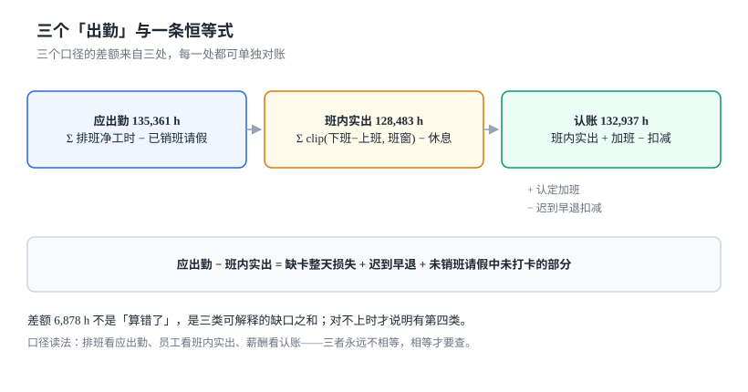

# 总览：七段链与三个「出勤」

一天的考勤，输入是两条打卡记录，输出是薪酬表上的一行。这一行往上有七段作业，每段都产出一个「结论」，而结论之间并不天然一致——排班说该来 8 小时，打卡说待了 9 小时，规则说认 8.5 小时。三个数都对，因为它们回答的是三个不同的问题。

这一页做三件事：把一天的考勤解剖成一条时间轴、把七段链的判定点标出来、把三个「出勤」之间的恒等式写清楚。后面九页都在补这三件事的细节。

## 一、一天的解剖：一条时间轴上的七个点

同一个班次（09:00—18:00，休息 1 小时），在系统里会被七个点切开：

```text
08:56        09:00              12:00   13:00                18:00        19:12
  |            |                   |       |                    |            |
  ●────────────●───────────────────●───────●────────────────────●────────────●
 上班卡      班次开始            午休起   午休止              班次结束      下班卡
  │            │                                                            │
  │            └────────── 班内窗口（可计工时 8 h）──────────────────────────┘
  └─ 早到 4 分钟：不计工时（裁掉）          └──── 窗口外滞留 1 h 12 min ────┘
                                                      └─ 认定加班 1 h（规则后）
```

七个点里只有两个是「设备产生的」（上班卡、下班卡），其余五个是「配置决定的」（班次开始/结束、休息起止）。**配置错一个，工时错一片**，而配置错了不会报错——它只是让所有人的工时整体偏移。

| 点 | 来源 | 错了的表现 | 谁能发现 |
| --- | --- | --- | --- |
| 上班卡 08:56 | 打卡设备 | 缺卡 → 整天算不出 | 员工（发工资时） |
| 班次开始 09:00 | 班次字典 | 写错 30 分钟 → 全员早退 30 分钟 | 几乎没人 |
| 午休 12:00—13:00 | 班次字典 | 忘记扣 → 每月多算 22 小时/人 | 财务（成本异常） |
| 班次结束 18:00 | 班次字典 | 写错 → 加班费整月错 | 财务（加班费异常） |
| 下班卡 19:12 | 打卡设备 | 缺卡 → 整天算不出 | 员工 |
| 窗口裁切 | 计算逻辑 | 不裁 → 早到变工时 | 没人（金额太小） |
| 加班认定 | 规则 + 审批 | 不认 → 员工少拿 | 员工（如果他会算） |

这张表最值得看的是「谁能发现」一列：**只有两行有人能发现，而这两行都是「员工申诉」路径**。也就是说，考勤系统的质量保障实际上依赖员工自己核对工资条——这是它和财务系统最大的区别，后者至少有「借贷必须平」这一条硬约束。

## 二、七段链：每段在判定什么

| 段 | 输入 | 动作 | 产物 | 判定问题 | 失败形态 |
| --- | --- | --- | --- | --- | --- |
| ① 排 | 人力需求、员工可用性 | 排班、发布、员工确认 | `schedule` | 「这一天他该不该来」 | 显性（冲突可拦） |
| ② 班 | 生产班制、法规 | 定义班次、日界、休息 | `shift` | 「一天从几点到几点」 | **安静** |
| ③ 打 | 设备、手机、门禁 | 采集、去重、判定位置 | `punch` | 「他来了没有、凭什么」 | **安静** |
| ④ 假 | 请假申请、额度 | 审批、销班、扣额度 | `leave_req` | 「没来是不是有依据」 | **安静** |
| ⑤ 加 | 滞留时间、申请单 | 认定、取整、封顶、审批 | `ot_req` | 「多待的算不算钱」 | **安静** |
| ⑥ 补 | 异常清单、证据 | 补卡、审批、重算 | `correction` | 「错了能不能改、改完算不算」 | **安静** |
| ⑦ 汇 | 日结、月结 | 汇总、封账、出账 | `day_close` | 「给薪酬报几个小时」 | **安静** |

**为什么只有第 ① 段是显性的**：排班是唯一「外部意图直接进系统」的环节——班次不存在、同一天排两个班、排给已离职的人，这些都能当场拦。从第 ② 段开始，每一段的输入都是**上一段认为对的东西**，上一段错了，这一段没有能力发现。

最典型的例子：第 ② 段把夜班的「一天」定义成 00:00—24:00，那么 23:00 上班、次日 07:00 下班的记录会被切成「今天 1 小时 + 明天 7 小时」。第 ③ 段按日期配对，发现「今天缺下班卡、明天缺上班卡」，于是两天都算异常。第 ⑦ 段照实汇总，两天各 0 小时。全过程没有一处抛错，只在员工发现少了两天工资时才暴露。

## 三、三个「出勤」与一条恒等式

| 口径 | 公式 | 本机读数 | 谁在关心 |
| --- | --- | --- | --- |
| 应出勤 | `Σ 排班净工时 − 已销班请假` | 135,361 h | 排班员、合规 |
| 班内实出 | `Σ clip(下班卡−上班卡, 班次窗口) − 休息` | 128,483 h | 员工、主管 |
| 认账 | `班内实出 + 认定加班 − 迟到早退扣减` | 132,937 h | 薪酬、财务 |



三者之间有一条必须成立的恒等式：

```text
认账 = 班内实出 + 认定加班 − 迟到早退扣减
应出勤 − 班内实出 = 缺卡整天损失 + 迟到早退 + 未销班请假中未打卡的部分
```

本机把这条件等式拆开验证：

| 项 | 数值 | 占比 | 说明 |
| --- | --- | --- | --- |
| 应出勤 | 135,361 h | 100% | 排班 139,905 h 扣掉已销班全天请假 577 人日 |
| 缺口合计 | 6,878 h | 5.08% | `应出勤 − 班内实出` |
| ├ 缺卡整天损失 | 6,377 h | 92.7% | 821 条异常 × 约 7.8 h |
| └ 迟到早退 | 501 h | 7.3% | 1,190 人次迟到 + 318 人次超 30 min |
| 认定加班 | 4,454 h | —— | 在岗滞留 5,716 h 的 77.9% |
| 认账 | 132,937 h | —— | `128,483 + 4,454` |

**92.7% 这个比例是本页最重要的一个数**：它说明考勤系统的工时缺口，几乎全部来自「一条卡 → 一整天 0 小时」这个实现选择，而不是来自「员工真的没来」。

::: danger 三个必须分开存的字段
1. **不要把「应出勤」和「实出勤」放进同一列的不同行**：一旦混在一列里，`sum(hours)` 就同时包含「该来」与「来了」，聚合出来的数没有物理意义。
2. **不要把认定加班并进班内实出**：加班费的计算基数是「班内实出」，加班另按 1.5/2/3 倍计。合并后加班费只能按 1 倍发，员工会算出来。
3. **不要用「认账」反推「实出」**：认账含规则加工（取整、封顶、审批驳回），反推回来的「实出」是规则的回声，不是事实。
:::

### 三个「出勤天数」也要分开

「这个月出勤多少天」这句话，在本机同一份数据上有三个答案：

| 数法 | 定义 | 本机读数 | 用在什么地方 |
| --- | --- | --- | --- |
| 排班日 | `count(schedule)` | 17,753 人日 | 排班覆盖率、合规检查 |
| 有卡日 | 至少一条打卡的日期数 | 17,164 人日 | 异常率、补卡工作量 |
| 满 4 小时 | `actual_h ≥ 4` | 16,786 人日 | 全勤奖、餐补、宿舍水电 |

三者相差 3.3%（约 1,000 人日）。对外报「出勤率」时不写口径，三个数都「对」——这类争议在考勤场景里比金额争议更多，因为它没有凭据可查。

## 四、四个必失接缝

接缝是两段之间的交界，也是「两边都以为对方会管」的地方。

| 接缝 | 左边认为 | 右边认为 | 丢失的东西 | 本机读数 |
| --- | --- | --- | --- | --- |
| ①→② | 「排了班就要上班」 | 「班次只是模板」 | 跨天班次的归属日 | 夜班 2,119 人日，按打卡日期归日 100% 错位 |
| ③→④ | 「假批了就不用来」 | 「排班表才是准的」 | 请假与排班不同步 | 未销班 179 条，虚增 1,092 h |
| ④→⑤ | 「没来就是缺勤」 | 「缺卡要补卡」 | 缺卡被当成缺勤 | 821 条 = 6,377 h |
| ⑥→⑦ | 「改完日结就对了」 | 「月结早算完了」 | 重算没沿链传导 | 补卡 345 条 = 2,760 h 不回流 |

四个接缝的共同点：**它们都不是「数据丢了」，而是「两边各有一半，没人负责拼起来」**。

### 接缝 ⑥→⑦ 的金额

补卡 372 人日、通过 345 条，每条按 8 小时重算 = **2,760 小时**，占月总工时的 **1.97%**。如果补卡只改 `day_close` 而不触发月结重算：

- 日结报表与月结报表差 2,760 小时（当月能发现，因为两份报表放在一起）；
- 月结报表与薪酬实发差 2,760 小时（当月发现不了，因为薪酬不会回看考勤）；
- 年终汇算时两边各自「平」，但两年的月度明细永远对不上。

第 2 条是最危险的：**它有一个完整月的静默期**。

## 五、五个「看起来对」的错误

这类错误的共同特征是「报表是平的、总额差不多」，只有把口径拆开才看得见。

| 错误 | 表现 | 差额 | 为什么难发现 |
| --- | --- | --- | --- |
| 早到计入工时 | 每月多发几分钟 | 8.5% 的人每天早到 6 分钟 ≈ 0.85 h/人/月 | 金额小、方向单一，被当成「人性化」 |
| 不扣休息 | 每班多 1 小时 | 17,753 班 × 1 h = 17,753 h | 集中在班次定义里，改一次全员变 |
| 加班不取整 | 多认 12 分钟/次 | 5,937 次 × 12.8 min = 1,262 h | 员工不反对、财务看不到 |
| 缺卡算缺勤 | 整天 0 小时 | 821 条 = 6,377 h | 只有被扣的人会申诉 |
| 出差路途不算工时 | 少算半天 | 出差人次 × 0.5 天 | 制度上「看起来合理」，法规上不一定 |

最后一条值得展开：**出差路途时间算不算工作时间**，各地口径不同。多数地区认为「单位指派的出差，路途时间属于工作时间」，但企业制度常写「路途不计工时」。两者之差在 800 人规模上是一年上千小时——这不是技术问题，是制度问题，但**系统必须能表达两种口径**，否则制度改了代码跟不上。

## 六、五个角色，五种「对不对」

| 角色 | 关心的判定 | 判据不成立时的后果 |
| --- | --- | --- |
| 员工 | 我这个月到底上了多少小时 | 少算半天不当场发现，下月申诉 |
| 直属主管 | 排班合不合理、加班该不该批 | 排班空洞没人管，加班费失控 |
| 考勤专员 | 异常处理完没有、补卡有没有依据 | 人工池越积越多，最后「批量通过」 |
| 薪酬 | 拿到的工时能不能直接算钱 | 口径不一致，工资与考勤永久差 |
| 合规 / 劳动监察 | 有没有超时、有没有连续超限 | 工时制选错，加班费一次性补几年 |

## 七、判据族 `TMO-A ~ TMO-H`

本页判据族 `TMO-A` ~ `TMO-H`，共 8 条。八条都能被单独判定，任何一条不成立就不算这篇文档写完。

| 判据 | 内容 | 怎么验 |
| --- | --- | --- |
| `TMO-A` | 应出勤、班内实出、认账三个字段分列存 | 查表结构，三者不同名列 |
| `TMO-B` | 班内实出经过班次窗口裁剪 | 早到 40 分钟的人，实出等于净工时 |
| `TMO-C` | 窗口外滞留单独成字段 | 存在 `ot_raw_min` 或等价字段，且 ≥ 0 |
| `TMO-D` | 缺卡不被当作缺勤 | 缺下班卡的人当天实出 ≠ 0，或进人工池 |
| `TMO-E` | 认定加班由「规则 + 审批」两段产生 | 有 `approved_min` 字段且 ≤ `applied_min` |
| `TMO-F` | 出勤天数有三种口径且各有字段 | 能同时查出 17,753 / 17,164 / 16,786 三个数 |
| `TMO-G` | 恒等式可被 SQL 直接验证 | 第 3 节的等式查询返回 0 行残差 |
| `TMO-H` | 未销班请假能被查出 | 第 5 节「请假了但排班仍 PLANNED」SQL 返回 0 行 |

## 八、验证方式

```shell
# 1. 版本确认
python3 -c "import sqlite3, sys; print(sys.version.split()[0], sqlite3.sqlite_version)"

# 2. 恒等式残差（期望 0.0）：认账 − (实出 + 认定加班 − 迟到扣减)
sqlite3 :memory: "
create table d(should_h real, actual_h real, ot_h real, late_ded real, book_h real);
insert into d values (135361, 128483, 4454, 0, 132937);
select round(sum(book_h - (actual_h + ot_h - late_ded)), 4) as residual from d;"
# 期望：0.0

# 3. 缺口分解（期望两项之和等于总缺口）
sqlite3 :memory: "
select 6878 as gap, 6377 as miss_card, 501 as late_early,
       6878 - (6377 + 501) as unexplained;"
# 期望 unexplained = 0

# 4. 检查你的系统有没有把「缺卡」当「缺勤」：找出缺下班卡但实出为 0 的人日
sqlite3 your.db "select count(*) from day_close d
  where not exists (select 1 from punch p where p.emp_no=d.emp_no
                    and p.kind='OUT' and date(p.punch_ts) between d.work_date and date(d.work_date,'+1 day'))
    and d.actual_h = 0;"
# 期望：0（若不为 0，这些就是被白扣的工时）
```

第 4 条命令是 `TMO-D` 的验收：**缺卡应当导致「算不出」，而不是「算成 0」**。两者的差别在报表上是同一个数，在员工工资上是半天钱。

## 与「招聘与人才获取工程」专题的分工（第 253 天补充）

招聘册的最后一格是「人到岗了」，本册的第一格是「这个人今天该几点来」。这两件事看起来只差一个时间点，实际差一整套档案：排班规则、班次、打卡设备绑定、假期余额起算日。

| 问题 | 本册（时间与考勤） | 招聘与人才获取册 |
| --- | --- | --- |
| 今天该几点上班 | **判**：排班表 + 班次 + 节假日日历 | 不判 |
| 打卡有没有效 | **判**：时间轴七点，设备与地理围栏 | 不判 |
| 档案从哪天起 | **判**：以用工日为档案生效日，当日无排班则按默认班次 | 只提供「预计到岗日」用于提前建档案 |
| 面试到场算不算出勤 | 不判（面试不是劳动关系） | **判**：面试六状态里的 `no_show` |
| 爽约怎么记 | 不判 | **判**：爽约三类型（真爽约 / 改约 / 招聘方取消），本机 9 人 |

关键边界：**面试的「到场」与考勤的「出勤」是两个词，不能共用一个字段**。面试 `no_show` 发生在劳动关系成立之前，不产生任何考勤记录；考勤的缺勤发生在劳动关系存续期间，会产生扣款。若把面试爽约写进考勤异常表，本册的异常率会被一批不存在劳动关系的人污染。

::: danger 一个只在本页成立的坑
**按 `offer.start_date` 提前初始化考勤档案。** 为了让新人「第一天就能打卡」，常见的做法是在 Offer 接受时就建好档案并挂上默认班次。但 171 人接受、159 人实际到岗，这 12 条（7.02%）提前建好的档案在报到日之后会变成「有人有档案、永远没有打卡」——每天生成一条缺勤异常，考勤员手工核销，日积月累异常表里全是幽灵。更麻烦的是这 12 条档案带走了 12 个工号段与 12 份排班，回收时若已排过班，历史排班表会出现「无对应在职记录」的孤儿行。

本册的立场是：**档案随用工日建，宁可当天补录，不提前占位**。提前占位的收益只有「省一次手工操作」，代价是每天都要清一次账。
:::

延伸阅读：[入职交接的 T−7 / T−3 / T−1 / T+0](../../Recruiting/Handoff/index.md)、[面试排期：20 个时段的全不中概率](../../Recruiting/Interview/index.md)。

## 参考资料

- 《中华人民共和国劳动法》第三十六、四十一、四十四条：工时上限、加班时长上限与 150%/200%/300% 的支付标准。
- 《国务院关于职工工作时间的规定》（国务院令第 174 号）：每日 8 小时、每周 40 小时。
- 《工资支付暂行规定》（劳部发〔1994〕489 号）第十三条：加班工资基数。
- 原劳动部《关于企业实行不定时工作制和综合计算工时工作制的审批办法》（劳部发〔1994〕503 号）：综合计算工时制的适用岗位与周期。
- ISO 8601-1:2019《日期和时间 信息交换表示法》：时间点与时区的表示，本文所有时间戳按 UTC 存储、按班次所属时区解释。
