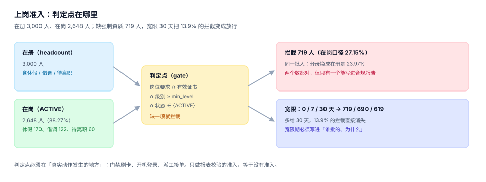

# 上岗准入：判定点在哪里

「有证才能上岗」这句话在系统里必须落成一个**具体的位置**：门禁刷卡那一刻、开机登录那一刻、派工接单那一刻。落在报表里的准入不是准入，它只能事后指责。这一页讲三件事：判定点放哪、分母用谁、宽限怎么给。



## 一、先在岗，再谈资质

「谁缺证」这个问题的答案完全取决于分母：

| 口径 | 人数 | 说明 |
| --- | --- | --- |
| 在册（headcount） | 3,000 | 含休假、借调、待离职 |
| 在岗（`ACTIVE`） | 2,648（**88.27%**） | 今天真的会来上班的人 |
| 休假 / 借调 / 待离职 | 170 / 122 / 60 | 共 352 人（11.73%） |

本机读数：缺强制资质的 **719 人**，用「在岗」做分母是 **27.15%**，用「在册」是 **23.97%**。两个数都对，但只有一个能写进合规报告——报告的口径必须与监管部门的口径一致，且**在报表标题里写清分母**。

::: danger 分母混用最典型的三种表现
1. 覆盖率用「在册」做分母（数字好看），拦截率用「在岗」做分母（数字也好看），两个数放在同一页上互相矛盾。
2. 借调人员在原部门和新部门各被统计一次，覆盖率分子被重复计入。
3. 待离职人员仍在册，但已不排班，长期缺证也不会被处理——直到离职清算时才暴露。
:::

## 二、判定点：四元组 + 一个时间

一次准入判定需要五个输入：

| 输入 | 来源 | 缺失时的表现 |
| --- | --- | --- |
| `emp_no` | 身份（工卡 / 账号） | 判定不了「谁」 |
| `position_id` | 组织（生效中的任职） | 判定不了「该会什么」 |
| `qual_id` + `min_level` | 矩阵（按业务日期取版本） | 判定标准漂移 |
| 有效证书集合 | `cert`（半开区间） | 判定不了「有没有」 |
| `as_of` | **业务时间**，不是 `now()` | 补录/回放会改写历史结论 |

```sql
-- 一次判定：这个人此刻能不能干这个岗位要求的活
SELECT r.qual_id, r.min_level,
       EXISTS(SELECT 1 FROM cert c
               WHERE c.emp_no = :emp AND c.qual_id = r.qual_id
                 AND c.issue_date <= :as_of AND :as_of < c.expire_date
                 AND c.cert_level >= r.min_level
                 AND (c.revoked_at IS NULL OR :as_of < c.revoked_at)) AS ok
FROM position_req r
JOIN employee e ON e.position_id = r.position_id
WHERE e.emp_no = :emp AND r.is_mandatory = 1
  AND r.effective_from <= :as_of;
-- 期望：每个强制项一行，ok = 0 的那一行就是拦截原因
```

::: warning 判定点必须在「动作发生的地方」
| 判定点位置 | 效果 | 代价 |
| --- | --- | --- |
| 报表里 | 事后发现 | 已经违规作业了 |
| 排班系统里 | 排不进去 | 人可以线下被叫来 |
| 门禁 / 派工 App | 当场拦住 | 需要离线可用 |
| 作业设备（如叉车钥匙柜） | 最硬 | 改造成本高 |

至少要做到「派工 App 当场拦住」，因为那是作业指令真正下发的地方。
:::

## 三、宽限：0 / 7 / 30 天的代价

「证刚过期两天，能不能先干着」是业务每天都会问的问题。宽限必须有，但必须被量化：

| 宽限 | 拦截人数 | 相对 0 宽限的变化 |
| --- | --- | --- |
| 0 天 | 719 | — |
| 7 天 | 690 | −29 人（−4.0%） |
| 30 天 | 619 | −100 人（**−13.9%**） |

30 天宽限会让 **13.9% 的拦截直接消失**。这不是「灵活」，这是把 100 个人的风险转移给了现场。因此宽限必须满足三条：

1. **有期限**：`grace_until` 落库，不是「一直放宽」；
2. **有责任人**：谁批的、为什么批（`approved_by` / `reason_code`）；
3. **有兜底动作**：宽限期内必须已排入最近一期复训班次（否则宽限期结束还是过不了）。

## 四、替代资质与级别的判定顺序

判定顺序错了，结论会反过来：

```text
1. 先按 qual_id 精确匹配（同级或更高级）
2. 再查 qual_substitute：from_qual 能否替代 to_qual（按 as_of 取生效关系）
3. 再查级别：cert_level >= min_level
4. 最后查状态：未吊销、区间覆盖 as_of
```

四个步骤**都必须过**，不能「任一命中即可」——那会让「有替代资质但级别不够」的人被误放行。

## 五、离线名单：缓存失效是这一页最贵的坑

门禁与 App 通常离线可用，靠一份每天同步的「可上岗名单」。三个必做项：

| 项 | 做法 | 不做的后果 |
| --- | --- | --- |
| 名单带版本与生成时间 | `roster_ver` + `generated_at` | 无法判断现场用的是哪一版 |
| 吊销/到期触发立即失效 | 事件推送到设备 | 主库已拦，现场照放 |
| 名单差异可对比 | 保存每日名单快照 | 「为什么昨天能进今天不能」无法回答 |

本机主题读数的量级：证书 6,598 张、每天到期约 7.5 张（30 天窗口 274 张 / 30 天）。也就是说**每天都有约 8 个人的准入状态会变**，日更名单是底线。

## 六、拦截必须产生待办

拦截记录里只写「拦住」是没有价值的，必须带三样：

```sql
CREATE TABLE gate_block (
  block_id    INTEGER PRIMARY KEY,
  emp_no      TEXT NOT NULL,
  position_id INTEGER NOT NULL,
  qual_id     TEXT NOT NULL,
  as_of       TEXT NOT NULL,
  gate_point  TEXT NOT NULL CHECK (gate_point IN ('DOOR','APP','DISPATCH','DEVICE')),
  followup_owner TEXT NOT NULL,
  due_date    TEXT NOT NULL,
  closed_at   TEXT
);
```

- `gate_point`：在哪个判定点拦的（决定由谁处置）；
- `followup_owner` + `due_date`：谁在什么时候之前必须解决；
- `closed_at`：什么时候真正解决（不是「标记已读」）。

没有后两项，拦截就只是一份漂亮的统计。本机 719 名在岗缺证者，如果每天产生 100 条拦截、却没有一条待办，一周后这 700 条记录会变成「已知问题」，然后被忽略。

## 七、判据清单

本页判据族 `TQG-A` ~ `TQG-H`，共 8 条。

| 编号 | 判据 | 判定方式 |
| --- | --- | --- |
| `TQG-A` | 判定带业务时间 | 函数签名含 `as_of`，SQL 中不出现 `date('now')` |
| `TQG-B` | 分母显式标注 | 报表返回 `basis`（在册 / 在岗 / 应培） |
| `TQG-C` | 宽限有期限与责任人 | 存在 `grace_until`、`approved_by` |
| `TQG-D` | 判定点前移 | 拦截记录含 `gate_point`，且非 `REPORT` |
| `TQG-E` | 替代关系按生效日取 | 查询含 `effective_from <= as_of` |
| `TQG-F` | 四项校验全过 | 判定 SQL 中无 `OR` 连接的条件分支 |
| `TQG-G` | 拦截生成待办 | `gate_block` 的 `followup_owner` 非空率 100% |
| `TQG-H` | 名单可对账 | 存在 `roster_ver` 与每日快照 |

## 八、验证方式

```shell
cd /tmp && rm -f tqg.db
sqlite3 tqg.db "CREATE TABLE employee(emp_no TEXT, position_id INT, emp_status TEXT);
CREATE TABLE position_req(position_id INT, qual_id TEXT, min_level INT, is_mandatory INT, effective_from TEXT);
CREATE TABLE cert(emp_no TEXT, qual_id TEXT, issue_date TEXT, expire_date TEXT, cert_level INT, revoked_at TEXT);
INSERT INTO employee VALUES('E001',10,'ACTIVE'),('E002',10,'LEAVE');
INSERT INTO position_req VALUES(10,'Q01',2,1,'2025-01-01');
INSERT INTO cert VALUES('E001','Q01','2024-01-10','2027-01-10',2,NULL),
                       ('E002','Q01','2024-01-10','2027-01-10',2,NULL);"

# 1) 在岗者通过、休假者不在判定范围
sqlite3 tqg.db "SELECT e.emp_no, EXISTS(SELECT 1 FROM position_req r JOIN cert c
  ON c.emp_no=e.emp_no AND c.qual_id=r.qual_id
  WHERE r.position_id=e.position_id AND r.is_mandatory=1
    AND c.issue_date<='2026-11-03' AND '2026-11-03'<c.expire_date AND c.cert_level>=r.min_level)
  FROM employee e WHERE e.emp_status='ACTIVE';"
# 期望：E001|1

# 2) 级别不足时拦截
sqlite3 tqg.db "UPDATE cert SET cert_level=1 WHERE emp_no='E001';
SELECT EXISTS(SELECT 1 FROM position_req r JOIN cert c ON c.emp_no='E001' AND c.qual_id=r.qual_id
  WHERE r.position_id=10 AND r.is_mandatory=1 AND c.cert_level>=r.min_level);"
# 期望：0（拦截）

# 3) 分母差异（在岗 2648 vs 在册 3000）
python3 -c "print(round(719/2648*100,2), round(719/3000*100,2))"
# 期望：27.15 23.97
```

## 参考资料

- [证书与有效期：四种结局](../Certificate/index.md)
- [度量与合规报表：四个分母](../Metrics/index.md)
- 库内同类问题：[权限与授权](../../Auth/Authorization/index.md) 的「判定点必须在服务端」讨论，本页的「判定点必须在动作发生处」是它在物理世界的对应
- 库内同类问题：[客服工单 SLA 时钟](../../SupportTicket/SLAClock/index.md) 的「两把尺」——准入的「证有效期」与「宽限期」同样是两把尺
