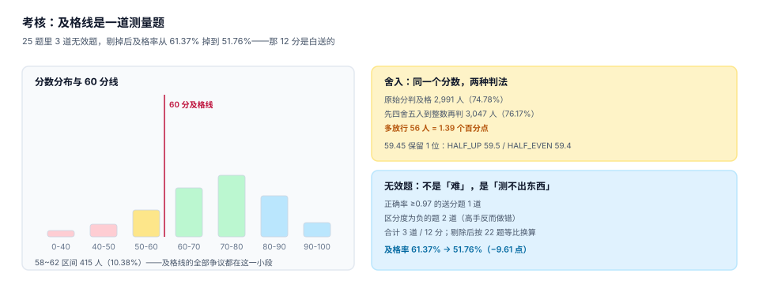

# 考核与题库：及格线是一道测量题

「60 分及格」是四个决定叠出来的结果：及格线画在哪、分数保留几位、题目能不能测出差异、不同卷次之间能不能比。四个决定各自看起来都很小，合起来可以让同一个人的「过没过」翻转两次。



## 一、及格线的争议只在一小段

本机 4,000 份成绩（均值 68、标准差 12）：

| 指标 | 值 |
| --- | --- |
| 落在 58~62 区间 | 415 人（**10.38%**） |
| 原始分判及格（≥60） | 2,991 人（74.78%） |
| 先四舍五入到整数再判及格 | 3,047 人（76.17%） |
| 差异 | **+56 人 = 1.39 个百分点** |

也就是说，及格线附近 10 分之一的样本，承载了全部判定风险。**及格线画在哪里，本质上是「你愿意让多少人靠舍入过线」的问题。**

::: danger 三个舍入写法，结论差一个人
1. `score >= 60`：59.99 不过。
2. `round(score) >= 60`：59.5 过（HALF_UP 与 HALF_EVEN 都得 60）。
3. `round(score, 1) >= 60`：59.45 → HALF_UP 59.5（不过）、HALF_EVEN 59.4（不过），但若再取整一次就变成 60（过）。

同一个 59.45，在不同写法下过或不过。**先舍入再比较**与**先比较再舍入**是两件事，必须写死一条并全库统一。
:::

## 二、题目难度与区分度

只统计「及格率」会掩盖一个事实：题目可能根本测不出东西。两个指标必须一起看：

- **难度（正确率 p）**：太低说明太难，太高说明太简单。
- **区分度（D）**：`P(答对 | 高分组前 27%) − P(答对 | 低分组后 27%)`。D ≤ 0 表示「高手反而错」，这道题在扣分而不是在测量。

本机 25 题的读数（前 18 题为 1PL 模型生成，后 3 道为刻意注入的无效题）：

| 题号 | 1 | 2 | 3 | 4 | 5 | 6 | 7 | 8 | 9 |
| --- | --- | --- | --- | --- | --- | --- | --- | --- | --- |
| 正确率 | 0.92 | 0.86 | 0.82 | 0.77 | 0.74 | 0.69 | 0.66 | 0.62 | 0.60 |
| 区分度 | 0.16 | 0.27 | 0.31 | 0.40 | 0.39 | 0.44 | 0.49 | 0.48 | 0.51 |

| 题号 | 10 | 11 | 12 | 13 | 14 | 15 | 16 | 17 | 18 |
| --- | --- | --- | --- | --- | --- | --- | --- | --- | --- |
| 正确率 | 0.55 | 0.54 | 0.50 | 0.45 | 0.41 | 0.35 | 0.30 | 0.26 | 0.23 |
| 区分度 | 0.52 | 0.50 | 0.50 | 0.53 | 0.49 | 0.49 | 0.43 | 0.38 | 0.38 |

| 题号 | 19 | 20 | 21 | 22 | 23 | 24 | 25 |
| --- | --- | --- | --- | --- | --- | --- | --- |
| 正确率 | 0.89 | 0.84 | 0.79 | 0.72 | **1.00** | **0.40** | **0.63** |
| 区分度 | 0.19 | 0.25 | 0.34 | 0.44 | **0.00** | **−0.47** | **−0.05** |

三道无效题：

| 题 | 症状 | 为什么无效 | 处理 |
| --- | --- | --- | --- |
| 23 | 正确率 1.00、区分度 0.00 | 送分题，谁都对 | 剔除或重写 |
| 24 | 区分度 −0.47 | 题干有歧义，高水平考生想太多反而错 | 立即停用并复核已判分 |
| 25 | 区分度 −0.05 | 答案与教材版本不一致 | 核对题库版本 |

**影响有多大**：含无效题时及格率 61.37%，剔掉这 3 道（12 分）按 22 题等比换算后 51.76%——**虚高 9.61 个百分点**。

::: warning 剔除无效题 ≠ 直接减分
不能简单地「减掉 12 分」。正确做法是**按剩余题数等比换算**（`score * 100 / (5 * kept)`），否则题量不同的卷次之间无法比较。本页读数用的就是等比换算。
:::

## 三、不同卷次之间能不能比

同一个资质，1 月用的 A 卷、6 月用的 B 卷，及格率 72% vs 58%。是这半年学员变差了，还是 B 卷更难？

这就是**等值化（equating）**问题。三种可落地的做法，从弱到强：

| 做法 | 前提 | 强度 |
| --- | --- | --- |
| 共同锚题（anchor items） | 两卷有 20% 以上的共同题 | 中：可算难度差并平移分数 |
| 同一批人两卷都考 | 有足够的重复考生 | 中：可直接估计卷间差 |
| 题库 + IRT 参数 | 有足够样本估出每题难度 | 强：能力估计与卷次无关 |

没有等值化时，唯一诚实的写法是**不跨卷次比较及格率**，只在同一卷次内做趋势——报表里必须标出卷次。

## 四、补考与多次机会

| 策略 | 写入证书的分数 | 风险 |
| --- | --- | --- |
| 取最高分 | `max(score)` | 反复刷分，通过率虚高 |
| 取最近一次 | `order by taken_at desc limit 1` | 一次失手就前功尽弃 |
| 取首次 | `order by taken_at asc limit 1` | 补考形同虚设 |
| 取最高分但限次数 | `max(score) where attempt <= 3` | 最常用，但要**记录尝试次数** |

无论选哪种，`exam` 表必须保留**全部尝试**，不能只留最终成绩——补考记录本身就是审计要看的证据（「他考了几次才过」是资质风险的一部分）。

## 五、作弊与异常信号

不追求「检测作弊」，只追求「留下可复核的痕迹」：

| 信号 | 阈值示例 | 复核动作 |
| --- | --- | --- |
| 作答时长过短 | < 题数 × 6 秒 | 人工抽查前 5 题作答顺序 |
| 全班同时提交 | 同一分钟内 >30% 提交 | 检查是否统一收卷 |
| 答案雷同 | 错题集合完全相同 | 比对座位/设备 |
| 分数与平时差 >2σ | 历史均值 + 2 倍标准差 | 加试一场 |
| 单题用时为 0 | 跳答后回填 | 看是否有人代答 |

关键在于**每条信号都要落一条记录**，否则「怀疑」无法变成「处置」。

## 六、判据清单

本页判据族 `TQA-A` ~ `TQA-H`，共 8 条。

| 编号 | 判据 | 判定方式 |
| --- | --- | --- |
| `TQA-A` | 及格判定只有一处实现 | 全库只有一个 `is_pass()` 或等价函数 |
| `TQA-B` | 舍入规则写死并注明 | 代码中含 `ROUND_HALF_UP` 或等价显式常量 |
| `TQA-C` | 保留全部尝试 | `exam` 无 `UNIQUE(enroll_id)`，允许多行 |
| `TQA-D` | 题库带版本 | `exam` 记录 `paper_id` 或 `item_ver` |
| `TQA-E` | 无效题可停用 | 题目表有 `is_active`，停用不改历史分数 |
| `TQA-F` | 剔除无效题按等比换算 | 换算公式中分母是剩余题数 |
| `TQA-G` | 跨卷次比较需标注 | 报表返回 `paper_id` |
| `TQA-H` | 异常信号落记录 | 存在 `exam_flag` 类记录表 |

## 七、验证方式

```shell
# 1) 同一分数，两种舍入都过线（59.5 的边界）
python3 -c "
from decimal import Decimal, ROUND_HALF_UP, ROUND_HALF_EVEN
x = Decimal('59.5')
print(x.quantize(Decimal('1'), rounding=ROUND_HALF_UP), x.quantize(Decimal('1'), rounding=ROUND_HALF_EVEN))"
# 期望：60 60

# 2) 59.45 保留 1 位时两种舍入不同
python3 -c "
from decimal import Decimal, ROUND_HALF_UP, ROUND_HALF_EVEN
x = Decimal('59.45')
print(x.quantize(Decimal('0.1'), rounding=ROUND_HALF_UP), x.quantize(Decimal('0.1'), rounding=ROUND_HALF_EVEN))"
# 期望：59.5 59.4

# 3) 剔除 3 道无效题后按 22 题等比换算
python3 -c "
score, kept = 70, 22
print(round(score * 100 / (5 * kept), 2))"
# 期望：63.64

# 4) 本页判据条数
grep -o "TQA-[A-H]" docs/Backend/TrainingQualification/Assessment/index.md | sort -u | wc -l
# 期望：8
```

## 参考资料

- [排期、报名与学时：三个口径](../Delivery/index.md)
- [证书与有效期：四种结局](../Certificate/index.md)
- 经典测验理论的区分度定义（前 27% / 后 27%）：Ebel & Frisbie, *Essentials of Educational Measurement*
- 项目反应理论 1PL / Rasch 模型入门：<https://en.wikipedia.org/wiki/Rasch_model>
- 库内同类问题：[数据合成](../../../AI/SyntheticData/Agreement/index.md) 的 κ 与 PABAK 讨论，同属「一致性指标怎么选」
