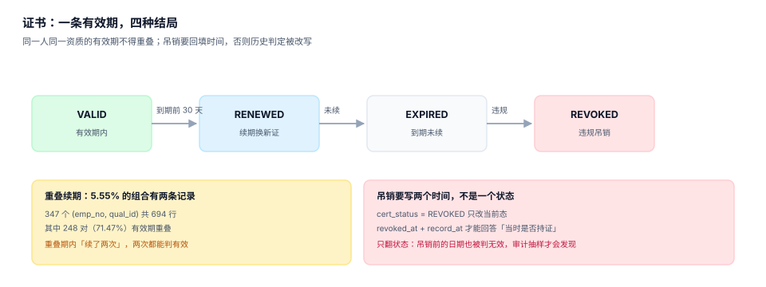

# 证书与有效期：四种结局

一张证书只有四种结局：还在有效期内、续期换了新证、到期没续、因违规被吊销。前两种是正常路径，后两种是异常——但**异常不会自己宣布**：到期那天不报错，状态字段仍然写着 `VALID`（本机 919 张），吊销只翻状态的话，历史判定会被一起改写。



## 一、表结构：一条记录就是一段区间

```sql
CREATE TABLE cert (
  cert_id     TEXT PRIMARY KEY,
  emp_no      TEXT NOT NULL REFERENCES employee(emp_no),
  qual_id     TEXT NOT NULL REFERENCES qual_type(qual_id),
  issue_date  TEXT NOT NULL,
  expire_date TEXT NOT NULL,
  cert_level  INTEGER NOT NULL DEFAULT 1,
  source      TEXT NOT NULL CHECK (source IN ('INTERNAL','EXTERNAL')),
  cert_status TEXT NOT NULL CHECK (cert_status IN ('VALID','EXPIRED','REVOKED')),
  record_at   TEXT NOT NULL,
  revoked_at  TEXT,
  CHECK (expire_date > issue_date)
);
CREATE INDEX idx_cert_emp ON cert(emp_no, qual_id, expire_date);
```

三个字段的含义必须咬死：

| 字段 | 业务含义 | 常见误用 |
| --- | --- | --- |
| `issue_date` / `expire_date` | 一个**半开区间** `[issue, expire)` | 用 `<=` 判到期日，导致到期当天仍有效、或多失效一天 |
| `cert_status` | 当前态 | 用它替代时间区间（`status='VALID'` 就认为一直有效） |
| `record_at` | 这条记录**写入系统**的时间 | 与 `issue_date` 混用（补录一张去年的证，`record_at` 是今天，`issue_date` 是去年） |

::: danger 半开区间写错的两种典型
1. 判定写成 `expire_date >= today`：到期当天仍判有效，且「到期」这件事被推迟了一天。
2. 判定写成 `issue_date <= today AND expire_date >= today`，但续期新证的 `issue_date` 正好等于老证 `expire_date`：当天两张证同时有效，去重逻辑如果按 `count(*) = 1` 判，直接报错。

正确写法只有一种：`issue_date <= as_of AND as_of < expire_date`。
:::

## 二、发证：四个条件缺一不可

```sql
-- 发证前置校验（返回 0 行才允许插入 cert）
SELECT
  (SELECT count(*) FROM enrollment e
    WHERE e.emp_no = :emp AND e.sess_id IN (
      SELECT s.sess_id FROM sess s JOIN course c ON c.course_id = s.course_id
       WHERE c.qual_id = :qual) AND e.enroll_status = 'ATTENDED') AS attended,
  (SELECT count(*) FROM exam x
    WHERE x.enroll_id IN (SELECT enroll_id FROM enrollment e
                           WHERE e.emp_no = :emp) AND x.score >= 60) AS passed,
  (SELECT count(*) FROM cert c
    WHERE c.emp_no = :emp AND c.qual_id = :qual
      AND c.cert_status = 'VALID' AND c.expire_date > :as_of) AS already_valid;
-- 期望：attended >= 1 且 passed >= 1 且 already_valid >= 1（或允许续期时 = 1）
```

四个条件：

1. **到场证据**：有 `ATTENDED` 报名（配合逐日签到）；
2. **考核证据**：有一次及格的 `exam`；
3. **无重复有效证**：同一 (人, 资质) 当前不应已有有效证；
4. **资质类型允许发证**：某些 `qual_type` 只能外部录入（例如监管机关直接发证），系统内不允许发。

第 4 条最容易被漏：内部培训满分，也不能发一张本该由监管机关签发的证。

## 三、续期：插入新行，不改旧行

本机读数：

| 指标 | 值 |
| --- | --- |
| `(emp_no, qual_id)` 组合 | 6,251 个 |
| 有 2 条以上记录的组合 | 347 个（**5.55%**），共 694 行 |
| 其中相邻两条有效期重叠 | 248 对（占多证组合 **71.47%**） |

71.47% 的重叠率说明一件事：**「续期」在实现上不是「新证接在老证后面」，而是「提前发了一张新证」**。这带来两个问题：

1. 重叠期内两张证都有效，`count(*) = 1` 的判定会挂；
2. 到期提醒会按老证的 `expire_date` 发出，而人其实已经有新证——制造无效应答。

处置只有两条路：要么**允许重叠但判定取「最晚到期的那张」**，要么**用触发器禁止重叠**（本专题实战页采用后者：`E_OVERLAP`）。前者宽容、后者严格，但都必须明确写下来。

```sql
CREATE TRIGGER trg_cert_no_overlap
BEFORE INSERT ON cert
BEGIN
  SELECT RAISE(ABORT, 'E_OVERLAP')
  WHERE EXISTS (
    SELECT 1 FROM cert c
    WHERE c.emp_no = NEW.emp_no AND c.qual_id = NEW.qual_id
      AND c.cert_status <> 'REVOKED'
      AND NEW.issue_date < c.expire_date
      AND NEW.expire_date > c.issue_date
  );
END;
```

## 四、到期：状态翻不翻，是两个口径

本机 6,598 张证里，`cert_status = 'VALID'` 但 `expire_date < today` 的有 **919 张**。这不是 bug，而是**「状态字段」与「时间区间」两个口径并存**的必然结果：

| 口径 | 查询 | 结果 | 用途 |
| --- | --- | --- | --- |
| 时间区间 | `issue <= as_of < expire` | 5679 张有效 | 判定「当时是否持证」，必须用这个 |
| 状态字段 | `cert_status = 'VALID'` | 6598 张 | 只看「是否被吊销」，不能判有效 |

**两者不能互相替代**。状态字段只回答「有没有被吊销」，时间区间才回答「当时有没有效」。如果一个报表用 `cert_status='VALID'` 数有效证书，会多出 919 张。

::: tip 一个定时任务要做的事
每天把 `expire_date < today AND cert_status = 'VALID'` 的行翻成 `EXPIRED`，并**同时**写一条 `cert_event`（`event_type='EXPIRED'`, `event_at`）。翻状态是为了让索引查询快，写事件是为了留下「什么时候翻的」。
:::

## 五、吊销：必须写两个时间

吊销比到期复杂，因为它**追溯**：一张 2025 年发的证，2026 年 8 月因违规被吊销，那么「2026 年 3 月他是否持证」的答案是什么？

监管上的通行处理是**自吊销之日起失效**，但证书本身可能被判定「自始无效」（例如考试作弊取得）。两种语义必须由业务明确，代码上表现为两个字段：

| 字段 | 含义 | 用途 |
| --- | --- | --- |
| `revoked_at` | 吊销**生效**的业务日期 | 时点查询用它截断区间 |
| `record_at` / 事件时间 | 吊销**被记录**的系统时间 | 回答「我们什么时候知道的」 |

本机模拟：2% 的证书（131 张）被吊销。如果只把 `cert_status` 改成 `REVOKED` 而不写 `revoked_at`：

- 「今天是否持证」查询正确（因为状态变了）；
- 「2026-06-01 是否持证」查询**也返回无效**——把吊销前的日期一起否掉了，历史被改写；
- 两个口径不会同时报错，只有审计抽样才会发现。

```sql
-- 时点查询：吊销日之后一律无效，吊销日之前仍按原区间
SELECT count(*) FROM cert
WHERE emp_no = :emp AND qual_id = :qual
  AND issue_date <= :as_of AND :as_of < expire_date
  AND (revoked_at IS NULL OR :as_of < revoked_at);
-- 期望：1 表示当时持证
```

## 六、外部证书：录入比签发更容易出错

本机 1,471 张（22.3%）是外部录入。三个必查项：

| 检查 | 为什么 | 做法 |
| --- | --- | --- |
| 证书编号唯一 | 同一张证录两次会变成两张有效证 | `UNIQUE (issuer, cert_no)` |
| 发证机关在名单内 | 假证最常见的特征是机关名不存在 | `issuer` 外键到白名单表 |
| 有效期不超资质上限 | 有人把 3 年证录成 30 年 | `CHECK (expire_date <= issue_date + months * 31)` |

第三条是「软约束」：跨辖区时上限可能不同，所以更适合放触发器并允许人工豁免（记录豁免人）。

## 七、判据清单

本页判据族 `TQC-A` ~ `TQC-H`，共 8 条。

| 编号 | 判据 | 判定方式 |
| --- | --- | --- |
| `TQC-A` | 有效判定用半开区间 | 查询含 `issue <= as_of < expire`，无 `>= today` 写法 |
| `TQC-B` | 状态与区间分离 | 报表判有效不只看 `cert_status` |
| `TQC-C` | 续期插入新行 | 无 `UPDATE cert SET expire_date` |
| `TQC-D` | 重叠有明确策略 | 要么 `E_OVERLAP` 触发器，要么判定取最晚到期 |
| `TQC-E` | 吊销写业务时间 | `revoked_at` 存在且吊销时写入 |
| `TQC-F` | 外部证书编号唯一 | `UNIQUE (issuer, cert_no)` |
| `TQC-G` | 到期翻状态并留事件 | 存在 `cert_event` 或等价审计表 |
| `TQC-H` | 发证校验四条件 | 发证前有到场 + 考核 + 去重 + 类型允许四项校验 |

## 八、验证方式

```shell
cd /tmp && rm -f tqc.db
sqlite3 tqc.db "CREATE TABLE cert(cert_id TEXT PRIMARY KEY, emp_no TEXT, qual_id TEXT, issue_date TEXT, expire_date TEXT,
  cert_status TEXT CHECK(cert_status IN ('VALID','EXPIRED','REVOKED')), revoked_at TEXT, CHECK(expire_date > issue_date));"

# 1) 反向区间被拒
sqlite3 tqc.db "INSERT INTO cert VALUES('C9','E1','Q1','2027-01-01','2026-01-01','VALID',NULL);"
# 期望：CHECK constraint failed: expire_date > issue_date

# 2) 半开区间：到期当天不算有效
sqlite3 tqc.db "INSERT INTO cert VALUES('C1','E1','Q1','2024-01-10','2027-01-10','VALID',NULL);
SELECT (SELECT count(*) FROM cert WHERE cert_id='C1' AND issue_date<='2027-01-10' AND '2027-01-10'<expire_date) AS on_expire_day,
       (SELECT count(*) FROM cert WHERE cert_id='C1' AND issue_date<='2027-01-09' AND '2027-01-09'<expire_date) AS day_before;"
# 期望：0|1

# 3) 吊销只翻状态 vs 写 revoked_at 的差别
sqlite3 tqc.db "UPDATE cert SET cert_status='REVOKED' WHERE cert_id='C1';
SELECT count(*) FROM cert WHERE cert_id='C1' AND issue_date<='2026-06-01' AND '2026-06-01'<expire_date;"
# 期望：1（只看区间：历史查询仍认为当时有效）
sqlite3 tqc.db "UPDATE cert SET revoked_at='2026-08-01' WHERE cert_id='C1';
SELECT count(*) FROM cert WHERE cert_id='C1' AND issue_date<='2026-06-01' AND '2026-06-01'<expire_date AND (revoked_at IS NULL OR '2026-06-01'<revoked_at);"
# 期望：1（吊销日在查询日之后，当时确实有效）
```

## 参考资料

- [上岗准入：判定点在哪里](../AccessGate/index.md)
- [到期与复训：波峰与提前期](../Recert/index.md)
- 库内同类问题：[TLS 证书生命周期](../../../Ops/CertificateLifecycle/Expiry/index.md) 的「过期不等于不可用」讨论，本页的「状态字段不等于有效」与之同构
- SQLite 触发器语法：<https://www.sqlite.org/lang_createtrigger.html>
- 《特种作业操作证》复审与换发要求（现行版），用于对照「续期提前期」的取值
