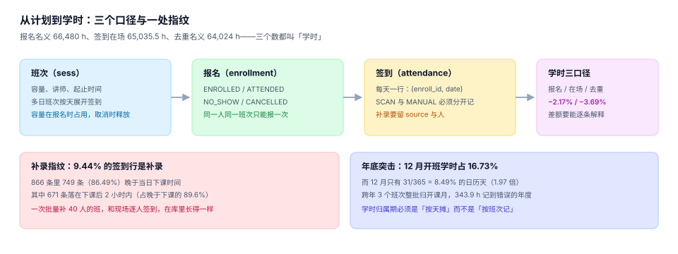

# 排期、报名与学时：三个口径

「这个人今年学了 24 学时」——这句话里至少有四个可选项：算报名时长还是实际在场？同一门课听了两遍算 24 还是 48？跨月的班次记在哪个月？签到是刷的还是补的？每一个选项都能让同一个人的学时分差出 10% 以上，而且四个数都叫「学时」。



## 一、班次与容量

班次（`sess`）是一次具体的开课：某门课、某个讲师、某个时间段、多少席位。

```sql
CREATE TABLE course (
  course_id TEXT PRIMARY KEY,
  qual_id   TEXT NOT NULL,
  hours     REAL NOT NULL CHECK (hours > 0)
);

CREATE TABLE sess (
  sess_id   TEXT PRIMARY KEY,
  course_id TEXT NOT NULL REFERENCES course(course_id),
  trainer   TEXT NOT NULL,
  start_at  TEXT NOT NULL,
  end_at    TEXT NOT NULL,
  cap       INTEGER NOT NULL CHECK (cap > 0),
  CHECK (end_at > start_at)
);
```

三条容易写错的规则：

1. **容量占用要区分状态**。`CANCELLED` 的报名必须释放席位，否则班次永远显示满员。判定写法是 `count(*) where enroll_status <> 'CANCELLED'`，而不是 `count(*)`。
2. **同一人同一班次只能报一次**。靠 `UNIQUE (emp_no, sess_id)`，不要靠应用层 `SELECT` 再 `INSERT`——两次点击就穿过。
3. **讲师冲突是时间区间重叠**，不是「同一天」。`[9:00, 12:00]` 与 `[10:00, 11:00]` 在日历上是同一天但不冲突；`[9:00, 12:00]` 与 `[11:30, 14:00]` 才冲突。用半开区间判 `new.start < old.end AND new.end > old.start`。

```sql
-- 讲师在给定时段是否已有班次（半开区间重叠）
SELECT count(*) FROM sess
WHERE trainer = :trainer
  AND :start < end_at AND :end > start_at;
-- 期望：0 才能排
```

::: danger 容量校验的三个写法，只有一个对
1. **先查后插**：`SELECT count(*) < cap` 然后 `INSERT`。并发下 20 个请求同时通过检查，最终 40 人挤进 30 个席位。
2. **插入后修正**：先插再查，超了就删。删哪一条？先到的那条被删，业务上无法解释。
3. **由库拒绝**：`BEFORE INSERT` 触发器或 `INSERT ... SELECT WHERE (SELECT count(*)...) < cap`，让超容量的插入根本不存在。
:::

## 二、报名与候补

| 状态 | 含义 | 是否占席位 | 是否计学时 |
| --- | --- | --- | --- |
| `ENROLLED` | 已报名未开课 | 是 | 否 |
| `ATTENDED` | 已到场 | 是（历史） | 是（按签到） |
| `NO_SHOW` | 未到场 | 否（应释放给候补） | 否 |
| `CANCELLED` | 主动取消 | 否 | 否 |

本机读数：5,950 条报名中到场 5,117（86.00%）、未到 588、取消 245。**未到的 588 条如果不释放席位，等于 588 个席位被浪费在不会来的人身上。**

候补队列要解决的是顺序问题：谁先补上？按报名时间排，看起来最公平，但会造成「老早报名的人一直占着候补第一位」。更稳的做法是候补也带有效期（例如释放后 4 小时内确认，过期顺延给下一位）。

## 三、逐日签到：多日班次必须按天记

一个 24 学时的班次通常排 3 天。如果只在开班时刷一次卡，后面两天来没来系统完全不知道——这也是「代打卡」最常发生的位置。

```sql
CREATE TABLE attendance (
  att_id    TEXT PRIMARY KEY,
  enroll_id TEXT NOT NULL REFERENCES enrollment(enroll_id),
  att_date  TEXT NOT NULL,
  minutes   INTEGER NOT NULL CHECK (minutes BETWEEN 0 AND 480),
  source    TEXT NOT NULL CHECK (source IN ('SCAN','MANUAL')),
  UNIQUE (enroll_id, att_date)
);
```

`UNIQUE (enroll_id, att_date)` 是这一页最重要的约束：它把「一天只能有一条签到」写进库里，从而让「重复刷两次凑学时」不可能发生。本机 5,117 条到场报名产生 **9,170 行**签到，说明多日班次确实按天展开了。

## 四、学时的三个口径

| 口径 | 怎么算 | 本机读数 | 差的来源 |
| --- | --- | --- | --- |
| 报名名义 | `sum(course.hours)` | **66,480 h** | 课程排了多久 |
| 签到在场 | `sum(attendance.minutes)/60` | **65,035.5 h**（−2.17%） | 迟到早退，本机 2.77% 的扫码签到迟到 >15 分钟 |
| 去重名义 | 同一人同一课程只计一次 | **64,024 h**（−3.69%） | 194 人重复读同一门课，重复 2,456 h |

三个数的用途完全不同：

- **对外报送**用「去重名义」——同一门课学两遍不应算两倍学时；
- **发证门槛**用「签到在场」（配合封顶：单日上限 480 分钟）；
- **排期与预算**用「报名名义」。

::: warning 学时不能超过课程名义时长
本机有一处真实缺陷：某次补录把 24 学时的课记成 30 学时，原因是补录时按「上午 4 + 下午 4 + 晚上 2」手工填了三行，而 `UNIQUE(enroll_id, att_date)` 允许一天一行、三行落在三天。修法是加封顶判定：`sum(minutes) <= course.hours * 60`。
:::

## 五、补录指纹：9.44% 的签到是补的

补录本身不是问题（签到机坏了要能补），问题是**补录无法与真实签到区分**。本机读数：

| 指标 | 值 |
| --- | --- |
| 补录行数 / 占比 | 866 行 / 9.44% |
| 晚于当日下课时间的补录 | 749 行（86.49%） |
| 其中落在下课后 2 小时内 | 671 行（占晚于下课的 89.6%） |
| 扫码签到里迟到 >15 分钟 | 230 行（2.77%） |

这个分布就是**指纹**：真实签到的时间戳是分散的（9:00 前后各有分布），而补录高度集中在「下课后不久」。一次补 40 人的班，会留下 40 条时间戳落在同一分钟的记录——这在库里和逐人扫码长得一样，只有分布能看出来。

::: tip 补录要留三样东西
`source='MANUAL'`、`operator`（谁补的）、`reason_code`（签到机故障 / 忘带卡 / 系统迁移）。少了任何一样，事后都无法区分「补录」与「伪造」。
:::

## 六、线上学习：进度不等于学时

线上课的学时有两个额外陷阱：

1. **挂机刷课**。播放器每秒上报一次 `heartbeat`，人不在也会上报。可用的防线是「交互证据」：随机弹题、拖动进度、切换窗口计数，任一缺失则那一段不计学时。
2. **倍速播放**。2 倍速看 4 小时课，真实在场 2 小时。学时应按**墙钟时间**计（同一段视频重复观看不叠加），而不是按进度条。

## 七、学时归属期：整批记 vs 按天摊

本机 400 个班次里，12 月开班学时 11,124 h 占全年 16.73%，而 12 月只有 31/365 = 8.49% 的日历天——**年底突击是真实存在的**（1.97 倍）。这带来一个归属问题：

| 写法 | 结果 | 问题 |
| --- | --- | --- |
| 整批记在「结课日」 | 跨年班次全落在次年 | 上年学时虚减 |
| 整批记在「开课日」 | 跨年 3 个班次 343.9 h 记到错误的年度（占 0.52%） | 次年学时虚减 |
| 按天摊（每天 8 h） | 与上课日一一对应 | 计算量略大，但是唯一能对账的写法 |

0.52% 听起来很小，但如果合规线的判定是「每年不少于 24 学时」，这 0.52% 恰好可能把一批人从「达标」推到「不达标」——差异集中在 12 月底开课的那几个班。

## 八、判据清单

本页判据族 `TQD-A` ~ `TQD-H`，共 8 条。

| 编号 | 判据 | 判定方式 |
| --- | --- | --- |
| `TQD-A` | 容量校验由库拒绝 | 存在触发器或带 `WHERE` 的条件插入 |
| `TQD-B` | 取消释放席位 | 计数查询排除 `CANCELLED` |
| `TQD-C` | 同一人同一班次唯一 | `UNIQUE (emp_no, sess_id)` |
| `TQD-D` | 多日班次按天签到 | `attendance` 有 `att_date` 且 `UNIQUE (enroll_id, att_date)` |
| `TQD-E` | 单日学时有封顶 | `minutes <= 480`，且合计不超课程名义 |
| `TQD-F` | 补录留痕 | `attendance` 有 `source`，`MANUAL` 行带操作人与原因 |
| `TQD-G` | 三口径都可查 | 能分别查出报名 / 在场 / 去重三个学时 |
| `TQD-H` | 学时按天归属 | 跨月班次的学时能按日拆分 |

## 九、验证方式

```shell
cd /tmp && rm -f tqd.db
sqlite3 tqd.db "CREATE TABLE sess(sess_id TEXT PRIMARY KEY, cap INTEGER NOT NULL CHECK(cap>0));
CREATE TABLE enrollment(enroll_id TEXT PRIMARY KEY, emp_no TEXT, sess_id TEXT, enroll_status TEXT, UNIQUE(emp_no, sess_id));
INSERT INTO sess VALUES('S1',2);"

# 1) 第三人报名应被唯一约束挡住（同一人重复报名）
sqlite3 tqd.db "INSERT INTO enrollment VALUES('N1','E1','S1','ENROLLED');"
sqlite3 tqd.db "INSERT INTO enrollment VALUES('N1b','E1','S1','ENROLLED');"
# 期望：UNIQUE constraint failed: enrollment.emp_no, enrollment.sess_id

# 2) 取消的报名不占席位（容量 2 时应能再接 2 人）
sqlite3 tqd.db "INSERT INTO enrollment VALUES('N2','E2','S1','CANCELLED');INSERT INTO enrollment VALUES('N3','E3','S1','ENROLLED');INSERT INTO enrollment VALUES('N4','E4','S1','ENROLLED');
SELECT count(*) FROM enrollment WHERE sess_id='S1' AND enroll_status<>'CANCELLED';"
# 期望：2

# 3) 学时三口径已在本机量过（见正文表格），复算去重口径
sqlite3 :memory: "SELECT 66480.0 AS nominal, 65035.5 AS onsite, 64024.0 AS dedup;"
# 期望：66480.0|65035.5|64024.0
```

## 参考资料

- [考核与题库：及格线是一道测量题](../Assessment/index.md)
- [证书与有效期：四种结局](../Certificate/index.md)
- SQLite 触发器的 `BEFORE INSERT` 语义：<https://www.sqlite.org/lang_createtrigger.html>
- 库内同类问题：[仓储作业](../../WarehouseOps/Overview/index.md) 的「作业完成有三种含义」，本页的「学时三个口径」与它是同一种错法
