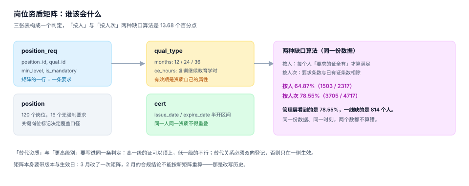

# 岗位资质矩阵：谁该会什么

矩阵是整条链的第一段，也是唯一「配错了会连累后面全员」的一段。它的形式极简——三列（岗位、资质、是否强制），但每一列的口径都藏着一个能差出十几个百分点的选择：**要求按人次还是按人算**、**有效期按发证日还是按自然年末**、**高级证能不能顶低级证**。



## 一、三张表与它们的职责

```sql
-- 岗位（本页只用 position_id，组织归属留在 OrgPeople）
CREATE TABLE position (
  position_id INTEGER PRIMARY KEY,
  pos_name    TEXT NOT NULL,
  is_critical INTEGER NOT NULL DEFAULT 0 CHECK (is_critical IN (0,1))
);

-- 资质类型：有效期与继续教育学时是资质自己的属性，不是岗位的
CREATE TABLE qual_type (
  qual_id   TEXT PRIMARY KEY,
  qual_name TEXT NOT NULL,
  months    INTEGER NOT NULL CHECK (months IN (12, 24, 36)),
  ce_hours  REAL NOT NULL DEFAULT 0
);

-- 要求项：矩阵的一行 = 「这个岗位需要这项资质，最低级别 N 级，是否强制」
CREATE TABLE position_req (
  position_id  INTEGER NOT NULL REFERENCES position(position_id),
  qual_id      TEXT NOT NULL REFERENCES qual_type(qual_id),
  min_level    INTEGER NOT NULL DEFAULT 1,
  is_mandatory INTEGER NOT NULL CHECK (is_mandatory IN (0,1)),
  ver          INTEGER NOT NULL DEFAULT 1,
  effective_from TEXT NOT NULL,
  PRIMARY KEY (position_id, qual_id, ver)
);
```

三张表的边界必须清楚：

| 属性 | 属于谁 | 放错位置的后果 |
| --- | --- | --- |
| 有效期几个月 | `qual_type` | 放进 `position_req` 后，同一张证在不同岗位「有效期不同」，续期任务无法统一 |
| 最低级别 | `position_req` | 放进 `qual_type` 后，所有岗位都要求最高级 |
| 是否强制 | `position_req` | 放进 `qual_type` 后，取消强制项等于把资质类型删掉 |
| 继续教育学时 | `qual_type` | 放到课程上，则「复训要求」随课程改版而漂移 |

## 二、有效期的两种口径：1.19 与 12.00

「证书什么时候到期」看起来是数据问题（`expire_date` 就在那里），但它其实是**制度问题**：有效期从哪天起算。

| 口径 | 到期日怎么落 | 2027 年逐月到期数 | 峰均比 | 运维后果 |
| --- | --- | --- | --- | --- |
| 发证日制 | 发证日 + N 个月，逐月摊开 | `[251, 229, 234, 259, 251, 249, 283, 274, 256, 291, 222, 125]` | **1.19** | 每月都有人到期，工作量平滑 |
| 自然年末制 | 统一落在当年 12-31 | `[0, 0, 0, 0, 0, 0, 0, 0, 0, 0, 0, 2924]` | **12.00** | 2,924 张挤在一个月，必须提前 3 个月启动 |

本机读数：同一批 2,924 张 2027 年到期的证书，两种口径的**总量一致**，峰值差 10 倍。

::: danger 三个容易踩的坑
1. **把「有效期 N 年」写成 `+365 * N` 天**：闰年会漂一天。用 `add_months()` 按月推进，2 月 29 日发证要落到 2 月 28 日。
2. **到期日取 12-31 23:59:59 却用 `date` 类型**：时间部分被截断，判定「当天是否有效」时又多出一天。
3. **续期直接改老记录的 `expire_date`**：老证的历史区间消失了，去年审计要的「当时有效期到哪天」永远查不出来。续期必须**插入新行**，老行保留。
:::

## 三、替代资质与级别

「高压证能不能顶低压证」这种问题，业务上常有，代码里常无。三种写法：

| 写法 | 表达力 | 风险 |
| --- | --- | --- |
| 只比 `cert_level >= min_level` | 弱：同资质内可比，跨资质不可比 | 跨资质替代只能硬编码 |
| `qual_substitute(from_qual, to_qual)` 单表 | 中：可表达替代关系 | 只登记单向时，B 能顶 A、A 不能顶 B，两侧结论不一致 |
| 级别 + 替代表 + 生效日 | 强 | 表多、判定慢（可加物化视图） |

替代关系必须**成对登记**并带生效日。只写单向关系时，最典型的故障是：HR 系统认为「高压可以顶低压」（查 `from=高压`），门禁系统认为「不能」（查 `to=低压`），两个系统都对，合起来打架。

```sql
CREATE TABLE qual_substitute (
  from_qual TEXT NOT NULL REFERENCES qual_type(qual_id),
  to_qual   TEXT NOT NULL REFERENCES qual_type(qual_id),
  effective_from TEXT NOT NULL,
  effective_to   TEXT,
  PRIMARY KEY (from_qual, to_qual, effective_from),
  CHECK (from_qual <> to_qual)
);
```

## 四、两种缺口算法：64.87% 与 78.55%

同一份数据、同一时刻，两种算法给出两个都不算错的数：

| 算法 | 定义 | 本机读数 | 适用场景 |
| --- | --- | --- | --- |
| 按人 | 一个人「所有强制项都有证」才算满足 | **64.87%**（1503 / 2317） | 对外合规报告、上岗判定 |
| 按人次 | 满足的要求条数 / 总要求条数 | **78.55%**（3705 / 4717） | 内部培训计划排期 |

差 13.68 个百分点，换算成人数是 **814 人**。管理层看到 78.55% 会认为「基本达标」，一线缺的是 814 个具体的人。

::: tip 一句话理解
**覆盖率必须带分母出数**，而且分母要写明是「人」还是「人次」。只报一个百分比的报表，读者无法判断它能不能用。
:::

## 五、矩阵版本化：改一条要求会发生什么

```sql
-- 3 月把「信息安全意识」从建议项改成强制项
INSERT INTO position_req (position_id, qual_id, min_level, is_mandatory, ver, effective_from)
VALUES (10, 'Q03', 1, 1, 2, '2026-03-01');
```

如果只在原行上 `UPDATE is_mandatory = 1`，会同时发生三件事：

1. 2026 年 2 月的合规报告，重算后变成「不达标」（历史上其实是达标的）；
2. 那些在 2 月被判定「合规」的人，反查时找不到依据；
3. 回滚这次变更时，无法区分「原本就是强制」与「3 月才改成强制」。

正确写法是**新增版本行**，判定时按业务日期选版本：

```sql
SELECT r.qual_id, r.min_level, r.is_mandatory
FROM position_req r
WHERE r.position_id = :pos
  AND r.effective_from <= :as_of
  AND r.ver = (SELECT max(ver) FROM position_req
               WHERE position_id = r.position_id AND qual_id = r.qual_id
                 AND effective_from <= :as_of);
```

## 六、判据清单

本页判据族 `TQM-A` ~ `TQM-H`，共 8 条。

| 编号 | 判据 | 判定方式 |
| --- | --- | --- |
| `TQM-A` | 有效期属于资质类型 | `months` 只在 `qual_type` 上出现 |
| `TQM-B` | 到期日按月推进 | 代码中无 `days=365` 之类的硬编码 |
| `TQM-C` | 续期插入新行 | `cert` 无 `UPDATE ... SET expire_date` 的写法 |
| `TQM-D` | 替代关系成对登记 | `qual_substitute` 双向各一行，或判定函数两侧都查 |
| `TQM-E` | 矩阵带版本与生效日 | `position_req` 有 `ver` 与 `effective_from` |
| `TQM-F` | 判定按业务日期取版本 | 查询含 `effective_from <= :as_of` |
| `TQM-G` | 覆盖率返回两组数 | 报表列含 `numerator`、`denominator` |
| `TQM-H` | 关键岗位可单独统计 | `position.is_critical` 存在且被打标 |

## 七、验证方式

```shell
cd /tmp && rm -f tqm.db

# 1) 建表
sqlite3 tqm.db "CREATE TABLE qual_type(qual_id TEXT PRIMARY KEY, months INTEGER NOT NULL CHECK (months IN (12,24,36)));
CREATE TABLE position_req(position_id INTEGER, qual_id TEXT, min_level INTEGER, is_mandatory INTEGER, ver INTEGER, effective_from TEXT, PRIMARY KEY(position_id, qual_id, ver));"
# 期望：无输出（成功）

# 2) 按月推进会落在月末正确的一天（2026-02-28 + 12 个月）
python3 -c "
import datetime as dt
d = dt.date(2026, 2, 28)
print(d.replace(year=d.year + 1))"
# 期望：2027-02-28

# 3) 同日 2 月 29 日发证（闰年）应落到 2 月 28 日
python3 -c "
import datetime as dt
d = dt.date(2024, 2, 29)
print(d.replace(year=2025))"
# 期望：报错 ValueError: day is out of range for month —— 所以必须用 add_months() 而不是 replace()

# 4) 版本化矩阵：同一岗位同一资质两个版本
sqlite3 tqm.db "INSERT INTO position_req VALUES (10,'Q03',1,0,1,'2025-01-01'),(10,'Q03',1,1,2,'2026-03-01');
SELECT ver, is_mandatory FROM position_req WHERE position_id=10 AND qual_id='Q03' AND effective_from <= '2026-02-15' ORDER BY ver DESC LIMIT 1;"
# 期望：1|0（2 月按旧版：建议项）
```

## 参考资料

- [总览：七段链与三个「会了」](../Overview/index.md)
- [上岗准入：判定点在哪里](../AccessGate/index.md)
- SQLite 日期函数与 `date()` 的边界：<https://www.sqlite.org/lang_datefunc.html>
- 库内同类问题：[组织与任职异动](../../OrgPeople/Employment/index.md) 的「双时态」写法，本页的矩阵版本与它同构
- 《特种作业人员安全技术培训考核管理规定》关于操作证复审周期的条款（现行版）
