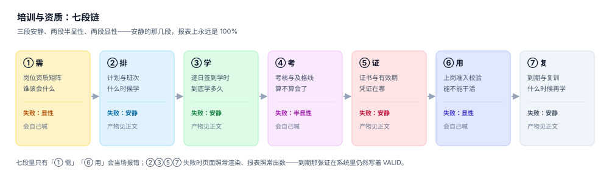

# 总览：七段链与三个「会了」

一个资质系统坏掉的时候，通常不是「报错」，而是「所有人都以为自己有证」。员工看到课程已完成、HR 看到覆盖率 83%、门禁看到一张还在有效期内的证——三个界面三个答案，只有监管来查的那天才会对上一次。

这一页把七段链摊开，标出每段的产物、失败是否安静，以及四个一定会失接的接缝。

## 一、七段链与每段的产物



| 段 | 动作 | 这一段的产物 | 失败是否安静 | 典型代价 |
| --- | --- | --- | --- | --- |
| ① 需 | 岗位 → 资质要求 | `position_req` 的 277 行 | 显性（没配矩阵就没人该培训） | 配错则全员培训白做 |
| ② 排 | 计划 → 班次 → 报名 | `sess` + `enrollment` | 安静（报名成功不等于到场） | 到场率 86.00%，14% 的席位浪费 |
| ③ 学 | 逐日签到 → 学时 | `attendance` 每天一行 | 安静（补录与扫码在库里长得一样） | 9.44% 的签到行是补录 |
| ④ 考 | 作答 → 判分 → 及格 | `exam.score` | 半显性（不及格会拦，无效题不会） | 3 道无效题让及格率虚高 9.61 点 |
| ⑤ 证 | 发证 → 有效期 | `cert` 一条半开区间 | 安静（到期那天不报错） | 919 张证已过期但状态仍是 VALID |
| ⑥ 用 | 判定点 → 放行/拦截 | 一次拦截记录 | 显性（拦住的人会来吵） | 719 名在岗者缺强制资质 |
| ⑦ 复 | 到期 → 复训 → 新证 | 复训任务与新证 | 安静（任务跑一半也不报错） | 单轮 200 条，只跑一轮漏 27.01% |

七段里只有 ① 和 ⑥ 会自己喊。②③⑤⑦ 失败时，页面上一切正常——这就是为什么资质系统的第一性问题不是「功能有没有」，而是「哪一段的证据是可对账的」。

::: tip 一句话理解
**每段都要有一份能拿给外部看的证据**：矩阵是一张表、学时是一行行签到、考核是一次带题库版本的分数、证书是一条带时间的区间、准入是一条拦截记录。缺证据的那一段，等于没做。
:::

## 二、三个「会了」不能互推

| 说法 | 系统里的样子 | 不能推出的结论 | 反例 |
| --- | --- | --- | --- |
| 学过了 | `enrollment.enroll_status = 'ATTENDED'` | 不能说「他会了」 | 签到 8 小时但全程在回消息 |
| 考过了 | `exam.score >= 60` | 不能说「他有证」 | 考过了但证还没制卡 |
| 有证 | `cert` 在有效期内 | 不能说「他学过」 | 外部证书录入，公司内零学时 |

反过来也不成立：有证的人可能因为矩阵新增了一条要求而立刻不合规；考过的人可能因为题库换版而要重考。**三个状态各有自己的时间轴**，任何把它们合并成一个 `completed` 字段的设计，都会在某次矩阵变更或题库改版后集体失真。

## 三、四个必失接缝

### 3.1 矩阵改了，老证没重判

3 月把「高压电工作业」从建议项改成强制项，`position_req.is_mandatory` 从 0 变 1。此时库里 6,598 张证一张没变，但合规结论全变了。如果矩阵不带版本与生效日，「2 月的合规报告」会被按新矩阵重算——那不是更新，是**改写历史**。

正确做法：`position_req` 带 `version` 与 `effective_from`，判定时按「业务日期」取当时生效的那一版。

### 3.2 学时够了不等于会了

学时是**投入证据**，考核是**产出证据**。用学时直接换资质（常见于「在线学习满 8 学时自动发证」）时，唯一的防线是考核；而考核本身如果题库里 12% 的题是无效题，等于这道防线有 12% 的洞——本机读数里，剔掉 3 道无效题后及格率从 61.37% 掉到 51.76%。

### 3.3 证在库里，判定点读的是缓存

门禁、工牌、派工 App 为了响应速度，通常缓存一份「可上岗人员名单」。证书被吊销或到期时，如果只更新了主库、没有让名单失效，判定点会继续放行——而主库的报表已经显示「已拦截」。**两个界面各自都对，合起来是错的**。

### 3.4 拦截了，但不触发复训

最隐蔽的一条：判定点拦住了一个证过期的人，系统记了一条拦截，然后……没有然后。人第二天照样来上班，因为「拦截」只是一个日志。拦截必须产生一个**带责任人和期限的待办**（复训报名或调岗），否则它只是一份漂亮的统计。

## 四、七段的量级：本机读数

| 读数 | 值 | 说明 |
| --- | --- | --- |
| 强制资质满足率（按人 / 按人次） | 64.87% / 78.55% | 同一份数据，差 13.68 点 |
| 报名到场率 | 86.00%（5,117 / 5,950） | 未到 588、取消 245 |
| 学时三口径 | 66,480 / 65,035.5 / 64,024 h | 报名名义 / 在场 / 去重 |
| 补录占比 | 9.44%（866 行） | 其中 86.49% 晚于当日下课 |
| 无效题让及格率虚高 | 9.61 点 | 61.37% → 51.76% |
| 证书有效期重叠 | 248 对（71.47% 的多证组合） | 347 个组合有 2 条以上记录 |
| 在岗缺强制资质 | 719 人（27.15% 在岗口径） | 在册口径 23.97% |
| 到期提醒单轮漏 | 27.01%（74 张） | 单轮上限 200，窗口 274 张 |

::: danger 三个把整条链做坏的做法
1. **把「完成」做成一个布尔值**：`employee.completed = true` 一旦写入就再也不改。矩阵新增要求、证书到期、题库改版，这个字段全都感知不到。
2. **用业务时间之外的时间做判定**：所有判定都用 `datetime('now')`，于是「补录一张去年的证」会立刻把去年的合规结论改掉。判定必须带「业务日期」参数。
3. **证书没有半开区间**：用 `expire_date >= today` 判有效，同时另一处写 `expire_date > today`。到期当天两个查询给出不同答案，且没人能说清哪个对。
:::

## 五、判据清单

本页判据族 `TQO-A` ~ `TQO-H`，共 8 条。

| 编号 | 判据 | 判定方式 |
| --- | --- | --- |
| `TQO-A` | 三个「会了」分表存 | `enrollment` / `exam` / `cert` 三张独立表，无合并的 `completed` 字段 |
| `TQO-B` | 证书是半开区间 | 存在 `issue_date` 与 `expire_date`，且判定统一用 `[issue, expire)` |
| `TQO-C` | 矩阵带版本与生效日 | `position_req` 有 `version` 与 `effective_from` |
| `TQO-D` | 判定带业务日期 | 准入查询的函数签名含 `as_of` 参数，不直接读 `now()` |
| `TQO-E` | 拦截产生待办 | 拦截表有 `followup_owner` 与 `due_date`，非空率 100% |
| `TQO-F` | 学时与考核不互相替代 | 发证函数校验 `exam` 与 `attendance` 两个来源 |
| `TQO-G` | 七段各有可对账产物 | 每段都能查出一张表或一条记录，无「只在日志里」的段 |
| `TQO-H` | 覆盖率带分母出数 | 报表返回 `numerator` / `denominator` 两列 |

## 六、验证方式

```shell
cd /Users/cuifendemac/WorkBuddy/docs-website

# 1) 三个「会了」是三张表，不是一个布尔字段
grep -rn "completed\|passed_all" docs/Backend/TrainingQualification/ | grep -v "判定\|判据\|不能" | wc -l
# 期望：0

# 2) 本页判据 8 条，族前缀无重复
grep -o "TQO-[A-H]" docs/Backend/TrainingQualification/Overview/index.md | sort -u | wc -l
# 期望：8

# 3) 全专题判据合计 80 条
grep -roh "TQ[A-Z]-[A-H]" docs/Backend/TrainingQualification | sort -u | wc -l
# 期望：80

# 4) 交叉校验：判据编号撞号应为 0
python3 utils/audit/judgeidcheck.py --root . 2>&1 | grep TrainingQualification | wc -l
# 期望：0
```

## 参考资料

- [岗位资质矩阵：谁该会什么](../Matrix/index.md)
- [上岗准入：判定点在哪里](../AccessGate/index.md)
- [到期与复训：波峰与提前期](../Recert/index.md)
- 《安全生产法》（2021 修正）第二十八条、第九十七条（未培训的罚则）
- ISO 21001:2018 第 8.5 条「交付」：把「能力证据」与「培训活动」分开描述，与本页的「三个会了」同构
