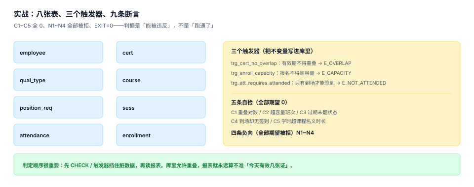

# 实战：八张表、三个触发器、九条断言

前八页讲的是判断，这一页把它们落成可以跑的库。判据不是「能跑通」，而是**能被违反**——所以这一页的重点是四条负向用例：每一条脏数据都必须被库本身拒绝，而不是被某个应用层的 `if` 拦住。



## 一、工程结构（读者自己的目录）

```text
tq-lab/
├─ schema.sql      # 八张表 + 三个触发器
├─ seed.sql        # 种子数据（4 人、3 资质、2 班次）
├─ checks.sql      # 五条自检 C1~C5
└─ run_checks.py   # 跑自检与负向用例，退出码即结论
```

`run_checks.py` 用标准库 `sqlite3`，不引第三方依赖。整页命令在 Python 3.13 + SQLite 3.50 上实测通过。

## 二、八张表

```sql [schema.sql]
CREATE TABLE employee(
  emp_no     TEXT PRIMARY KEY,
  emp_name   TEXT NOT NULL,
  position_id INTEGER NOT NULL,
  emp_status TEXT NOT NULL CHECK (emp_status IN ('ACTIVE','LEAVE','SECONDED','PENDING_EXIT'))
);

CREATE TABLE qual_type(
  qual_id   TEXT PRIMARY KEY,
  qual_name TEXT NOT NULL,
  months    INTEGER NOT NULL CHECK (months IN (12,24,36)),
  ce_hours  REAL NOT NULL DEFAULT 0
);

CREATE TABLE position_req(
  position_id  INTEGER NOT NULL,
  qual_id      TEXT NOT NULL REFERENCES qual_type(qual_id),
  min_level    INTEGER NOT NULL DEFAULT 1,
  is_mandatory INTEGER NOT NULL CHECK (is_mandatory IN (0,1)),
  PRIMARY KEY (position_id, qual_id)
);

CREATE TABLE course(
  course_id TEXT PRIMARY KEY,
  qual_id   TEXT NOT NULL REFERENCES qual_type(qual_id),
  hours     REAL NOT NULL CHECK (hours > 0)
);

CREATE TABLE sess(
  sess_id   TEXT PRIMARY KEY,
  course_id TEXT NOT NULL REFERENCES course(course_id),
  trainer   TEXT NOT NULL,
  start_at  TEXT NOT NULL,
  end_at    TEXT NOT NULL,
  cap       INTEGER NOT NULL CHECK (cap > 0),
  CHECK (end_at > start_at)
);

CREATE TABLE enrollment(
  enroll_id     TEXT PRIMARY KEY,
  emp_no        TEXT NOT NULL REFERENCES employee(emp_no),
  sess_id       TEXT NOT NULL REFERENCES sess(sess_id),
  enroll_status TEXT NOT NULL CHECK (enroll_status IN ('ENROLLED','ATTENDED','NO_SHOW','CANCELLED')),
  UNIQUE (emp_no, sess_id)
);

CREATE TABLE attendance(
  att_id    TEXT PRIMARY KEY,
  enroll_id TEXT NOT NULL REFERENCES enrollment(enroll_id),
  att_date  TEXT NOT NULL,
  minutes   INTEGER NOT NULL CHECK (minutes BETWEEN 0 AND 480),
  source    TEXT NOT NULL CHECK (source IN ('SCAN','MANUAL')),
  UNIQUE (enroll_id, att_date)
);

CREATE TABLE cert(
  cert_id     TEXT PRIMARY KEY,
  emp_no      TEXT NOT NULL REFERENCES employee(emp_no),
  qual_id     TEXT NOT NULL REFERENCES qual_type(qual_id),
  issue_date  TEXT NOT NULL,
  expire_date TEXT NOT NULL,
  cert_level  INTEGER NOT NULL DEFAULT 1,
  source      TEXT NOT NULL CHECK (source IN ('INTERNAL','EXTERNAL')),
  cert_status TEXT NOT NULL CHECK (cert_status IN ('VALID','EXPIRED','REVOKED')),
  record_at   TEXT NOT NULL,
  revoked_at  TEXT,
  CHECK (expire_date > issue_date)
);

CREATE INDEX idx_cert_emp ON cert(emp_no, qual_id, expire_date);
```

八张表的分工：`employee`（人）、`qual_type`（资质定义）、`position_req`（矩阵）、`course` + `sess`（课与班次）、`enrollment` + `attendance`（报名与签到）、`cert`（凭证）。少一张就有一条判据无处落地。

## 三、三个触发器

```sql [schema.sql]
-- T1：同一人同一资质的有效期不得重叠（半开区间，吊销的不算）
CREATE TRIGGER trg_cert_no_overlap
BEFORE INSERT ON cert
BEGIN
  SELECT RAISE(ABORT, 'E_OVERLAP')
  WHERE EXISTS (
    SELECT 1 FROM cert c
    WHERE c.emp_no = NEW.emp_no AND c.qual_id = NEW.qual_id
      AND c.cert_status <> 'REVOKED'
      AND NEW.issue_date < c.expire_date
      AND NEW.expire_date > c.issue_date
  );
END;

-- T2：报名不得超班次容量（取消的不占席位）
CREATE TRIGGER trg_enroll_capacity
BEFORE INSERT ON enrollment
WHEN NEW.enroll_status <> 'CANCELLED'
BEGIN
  SELECT RAISE(ABORT, 'E_CAPACITY')
  WHERE (SELECT count(*) FROM enrollment e
         WHERE e.sess_id = NEW.sess_id AND e.enroll_status <> 'CANCELLED') >=
        (SELECT cap FROM sess WHERE sess_id = NEW.sess_id);
END;

-- T3：只有「到场」的报名才能写签到
CREATE TRIGGER trg_att_requires_attended
BEFORE INSERT ON attendance
BEGIN
  SELECT RAISE(ABORT, 'E_NOT_ATTENDED')
  WHERE (SELECT enroll_status FROM enrollment WHERE enroll_id = NEW.enroll_id) <> 'ATTENDED';
END;
```

三个触发器对应三条不变量：**不重叠、不超容、不错位**。它们之所以写成触发器而不是应用层判断，是因为并发下应用层的「先查后插」一定会被穿透（20 个请求同时通过检查，最终 40 人抢 30 个席位）。

## 四、种子数据

```sql [seed.sql]
INSERT INTO qual_type (qual_id, qual_name, months, ce_hours) VALUES
  ('Q01','高压电工作业',36,8),
  ('Q02','叉车驾驶',24,4),
  ('Q03','信息安全意识',12,0);

INSERT INTO employee (emp_no, emp_name, position_id, emp_status) VALUES
  ('E001','张三',10,'ACTIVE'),
  ('E002','李四',10,'ACTIVE'),
  ('E003','王五',20,'ACTIVE'),
  ('E004','赵六',20,'LEAVE'),
  ('E005','钱七',20,'ACTIVE');

INSERT INTO position_req (position_id, qual_id, min_level, is_mandatory) VALUES
  (10,'Q01',2,1),
  (10,'Q03',1,0),
  (20,'Q02',1,1);

INSERT INTO course (course_id, qual_id, hours) VALUES ('CR1','Q01',24), ('CR2','Q02',8);

INSERT INTO sess (sess_id, course_id, trainer, start_at, end_at, cap) VALUES
  ('S1','CR1','T01','2026-03-02 09:00','2026-03-04 17:00',2),
  ('S2','CR2','T02','2026-05-11 09:00','2026-05-11 17:00',10);

INSERT INTO enrollment (enroll_id, emp_no, sess_id, enroll_status) VALUES
  ('N001','E001','S1','ATTENDED'),
  ('N002','E002','S1','ATTENDED'),
  ('N003','E003','S2','ATTENDED'),
  ('N004','E005','S2','NO_SHOW');

INSERT INTO cert (cert_id, emp_no, qual_id, issue_date, expire_date, cert_level, source, cert_status, record_at, revoked_at) VALUES
  ('C001','E001','Q01','2024-01-10','2027-01-10',2,'INTERNAL','VALID','2024-01-10',NULL),
  ('C002','E002','Q01','2026-07-01','2029-07-01',2,'EXTERNAL','VALID','2026-07-01',NULL),
  ('C003','E003','Q02','2025-02-20','2027-02-20',1,'INTERNAL','VALID','2025-02-20',NULL),
  ('C004','E005','Q02','2023-06-01','2026-06-01',1,'INTERNAL','EXPIRED','2023-06-01',NULL);

INSERT INTO attendance (att_id, enroll_id, att_date, minutes, source) VALUES
  ('A001','N001','2026-03-02',480,'SCAN'),
  ('A002','N001','2026-03-03',480,'SCAN'),
  ('A003','N001','2026-03-04',420,'MANUAL'),
  ('A004','N002','2026-03-02',480,'SCAN'),
  ('A005','N002','2026-03-03',360,'SCAN'),
  ('A006','N002','2026-03-04',480,'SCAN'),
  ('A007','N003','2026-05-11',480,'SCAN');
```

## 五、五条自检 C1~C5

每条都期望 **0**，非 0 即缺陷：

```sql [checks.sql]
-- C1 有效期重叠对数（半开区间，吊销的不算）
SELECT count(*) FROM cert a JOIN cert b
  ON a.emp_no = b.emp_no AND a.qual_id = b.qual_id AND a.cert_id < b.cert_id
WHERE a.cert_status <> 'REVOKED' AND b.cert_status <> 'REVOKED'
  AND a.issue_date < b.expire_date AND b.issue_date < a.expire_date;

-- C2 报名超容量的班次
SELECT count(*) FROM (
  SELECT sess_id, count(*) AS n FROM enrollment
  WHERE enroll_status <> 'CANCELLED' GROUP BY sess_id
) x JOIN sess s ON s.sess_id = x.sess_id WHERE x.n > s.cap;

-- C3 已过期但状态仍为 VALID 的证书
SELECT count(*) FROM cert WHERE cert_status = 'VALID' AND expire_date < :as_of;

-- C4 到场但没有任何签到行的报名
SELECT count(*) FROM enrollment e WHERE e.enroll_status = 'ATTENDED'
  AND NOT EXISTS (SELECT 1 FROM attendance a WHERE a.enroll_id = e.enroll_id);

-- C5 学时超过课程名义时长的报名
SELECT count(*) FROM (
  SELECT e.enroll_id, sum(a.minutes) / 60.0 AS h, c.hours AS cap
  FROM enrollment e JOIN attendance a ON a.enroll_id = e.enroll_id
  JOIN sess s ON s.sess_id = e.sess_id JOIN course c ON c.course_id = s.course_id
  GROUP BY e.enroll_id
) WHERE h > cap + 1e-9;
```

## 六、四条负向用例 N1~N4

| 编号 | 想干的事 | 应该被谁拒绝 | 错误信息 |
| --- | --- | --- | --- |
| `N1` | 插入有效期重叠的证书 | `trg_cert_no_overlap` | `E_OVERLAP` |
| `N2` | 插入到期日早于发证日的证书 | `CHECK (expire_date > issue_date)` | `CHECK constraint failed` |
| `N3` | 报名超过班次容量 | `trg_enroll_capacity` | `E_CAPACITY` |
| `N4` | 给未到场的报名写签到 | `trg_att_requires_attended` | `E_NOT_ATTENDED` |

::: danger 负向用例最容易犯的三个错
1. **用例的期望值写成「不报错」**：那测的是「能不能插进去」，不是「该不该被拒」。
2. **只测 `IntegrityError` 不测错误信息**：四个用例可能被同一个约束挡住，看起来全绿，其实有两条判据没生效。必须断言**具体**的错误码。
3. **负向用例写在事务里回滚**：有些数据库的触发器在回滚后不再触发第二次，重跑就绿了。每条用例用一个干净连接。
:::

## 七、跑一遍：实测输出

```text [运行结果]
$ python3 run_checks.py
== 五条自检（期望全部 0）==
  C1 有效期重叠对数               实际 0   期望 0   PASS
  C2 报名超容量班次数              实际 0   期望 0   PASS
  C3 过期未翻状态的证书             实际 0   期望 0   PASS
  C4 到场却无签到的报名             实际 0   期望 0   PASS
  C5 学时超课程名义时长的报名          实际 0   期望 0   PASS
== 四个负向用例（期望全部被拒）==
  N1 插入有效期重叠的证书             被拒绝（E_OVERLAP）PASS
  N2 过期证书当作有效               被拒绝（CHECK constraint failed: expire_date > issue_date）PASS
  N3 报名超过班次容量               被拒绝（E_CAPACITY）PASS
  N4 未到场的报名写入签到             被拒绝（E_NOT_ATTENDED）PASS
== 上岗判定（按证）==
  E001 的 Q01：通过
  E002 的 Q01：通过
  E003 的 Q02：通过
  E005 的 Q02：拦截（无有效证书）
== 学时（三个口径）==
  报名名义 56.00 h
  签到在场 53.00 h
  去重名义 56.00 h
EXIT=0
```

注意三处细节，每一处都是一个判据：

- `E005` 被拦截，是因为它的 `Q02` 证状态是 `EXPIRED`，不是 `VALID`——**有效期与状态两个口径都参与了判定**；
- 学时三口径 56 / 53 / 56：在场比报名少 3 h（A003 那行 420 分钟 + A005 那行 360 分钟），去重与报名相同（种子里没有重复读同一门课）；
- `EXIT=0` 是所有断言 AND 的结果，任一条失败即 1。

## 八、验收清单

| # | 断言 | 命令 | 期望 |
| --- | --- | --- | --- |
| 1 | 八张表都建出来了 | `sqlite3 tq.db ".tables"` | 8 个表名 |
| 2 | 三个触发器存在 | `sqlite3 tq.db "SELECT name FROM sqlite_master WHERE type='trigger'"` | 3 行 |
| 3 | C1~C5 全 0 | 见上文 SQL | 5 个 0 |
| 4 | N1~N4 全被拒 | 见上文用例 | 4 条错误信息 |
| 5 | 判定点拦截无证者 | `SELECT ... FROM employee WHERE emp_status='ACTIVE'` | E005 被拦 |
| 6 | 学时三口径可查 | 见上文 | 56 / 53 / 56 |
| 7 | 总判据 80 条 | `grep -roh "TQ[A-Z]-[A-H]"` 去重计数 | 80 |
| 8 | 退出码为 0 | `echo $?` | `0` |

## 九、判据清单

本页判据族 `TQP-A` ~ `TQP-H`，共 8 条。

| 编号 | 判据 | 判定方式 |
| --- | --- | --- |
| `TQP-A` | 八张表齐备 | `.tables` 输出 8 个表名 |
| `TQP-B` | 三个触发器齐备 | `sqlite_master` 中 3 条 trigger |
| `TQP-C` | 五条自检可执行 | 每条 SQL 单独可跑且返回整数 |
| `TQP-D` | 四条负向按错误码断言 | 断言具体 `E_*` 而非「是否报错」 |
| `TQP-E` | 判据断言可计算 | 每条判据都有对应的 SQL 或命令 |
| `TQP-F` | 退出码反映结果 | 任一断言失败时 `EXIT=1` |
| `TQP-G` | 种子数据覆盖异常分支 | 种子里至少有一个 `EXPIRED`、一个 `NO_SHOW` |
| `TQP-H` | 可重复运行 | 清库重跑得到同一组数 |

## 十、验证方式

```shell
cd /tmp && rm -f tq.db

# 1) 建库：八张表 + 三个触发器
sqlite3 tq.db < schema.sql
sqlite3 tq.db "SELECT count(*) FROM sqlite_master WHERE type='table' AND name NOT LIKE 'sqlite_%';"
# 期望：8
sqlite3 tq.db "SELECT count(*) FROM sqlite_master WHERE type='trigger';"
# 期望：3

# 2) 灌种子并跑自检
sqlite3 tq.db < seed.sql
sqlite3 tq.db "SELECT count(*) FROM cert WHERE cert_status='VALID' AND expire_date < '2026-11-03';"
# 期望：0（C3）

# 3) 负向用例：重叠证书必须被拒
sqlite3 tq.db "INSERT INTO cert (cert_id,emp_no,qual_id,issue_date,expire_date,cert_level,source,cert_status,record_at,revoked_at) VALUES ('C099','E001','Q01','2026-06-01','2029-06-01',2,'EXTERNAL','VALID','2026-06-01',NULL);"
# 期望：Runtime error: E_OVERLAP

# 4) 学时三口径
sqlite3 tq.db "SELECT (SELECT sum(c.hours) FROM enrollment e JOIN sess s ON s.sess_id=e.sess_id JOIN course c ON c.course_id=s.course_id WHERE e.enroll_status='ATTENDED') AS nominal, (SELECT sum(minutes)/60.0 FROM attendance) AS onsite;"
# 期望：56.0|53.0
```

## 参考资料

- [证书与有效期：四种结局](../Certificate/index.md)
- [上岗准入：判定点在哪里](../AccessGate/index.md)
- SQLite `RAISE(ABORT)` 与触发器的执行时机：<https://www.sqlite.org/lang_createtrigger.html>
- 库内同类实战：[理赔作业实战](../../ClaimsProcessing/Practice/index.md)、[组织与任职实战](../../OrgPeople/Practice/index.md)（同样用「自检 + 负向」两段式）
