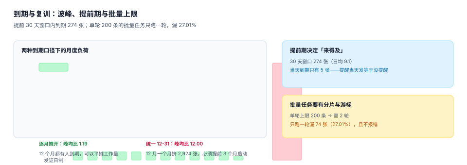

# 到期与复训：波峰与提前期

到期提醒这件事看起来最像「定时任务 + 发邮件」，实际它决定了整个资质体系能不能自我修复：**提前期太短来不及补，太长会制造噪声，而批量任务只跑一半时不报错**。



## 一、到期负荷的两种形状

| 口径 | 2027 年逐月到期 | 峰均比 | 对复训计划的要求 |
| --- | --- | --- | --- |
| 发证日制 | `[251, 229, 234, 259, 251, 249, 283, 274, 256, 291, 222, 125]` | 1.19 | 每月开班，师资与场地按月平摊 |
| 自然年末制 | `[0, 0, 0, 0, 0, 0, 0, 0, 0, 0, 0, 2924]` | 12.00 | 必须提前 3 个月启动，否则 12 月挤爆 |

自然年末制的 2,924 张证集中在 12 月，意味着：如果复训班次按「每月 250 个席位」准备，12 月要 11.7 倍容量——现实中做不到，于是必然有一批人「到期了但排不上班」，然后靠宽限期糊过去。

::: tip 一句话理解
**到期日不是数据，是产能约束。** 设计有效期规则的那一天，就决定了三年后某个 12 月的加班量。
:::

## 二、提前期：30 天窗口 274 张，当天只有 5 张

本机读数（基准日 2026-11-03）：

| 提前期 | 窗口内到期数 | 日均 | 说明 |
| --- | --- | --- | --- |
| 当天 | 5 张 | — | 当天提醒等于没提醒：来不及报名、考试、制证 |
| 30 天 | 274 张 | 9.1 张 | 常规复训周期的最小可行值 |
| 90 天 | 约 820 张 | 9.1 张 | 适合需要外部培训机构的资质 |

提前期不该是全局常量，应按资质类型的「补齐周期」定：

```sql
-- 每种资质的提前期 = 报名提前期 + 培训时长 + 考试 + 制证
CREATE TABLE recert_policy (
  qual_id        TEXT PRIMARY KEY,
  lead_days      INTEGER NOT NULL,   -- 提前多少天发起
  retrain_days   INTEGER NOT NULL,   -- 复训本身要几天
  exam_days      INTEGER NOT NULL,   -- 考试到出分
  issue_days     INTEGER NOT NULL,   -- 出分到发证
  CHECK (lead_days >= retrain_days + exam_days + issue_days)
);
```

`lead_days` 必须不小于三段之和（本机按 14 + 3 + 5 = 22 天建模，取整到 30）。这个 `CHECK` 是这一页最值钱的一行约束：它把「提前期不够」变成了一条插不进去的数据，而不是三年后才发现的问题。

## 三、批量任务：只跑一轮会漏 27.01%

本机 30 天窗口 274 张，批量任务单轮上限 200 条：

| 策略 | 结果 |
| --- | --- |
| 只跑一轮 | 处理 200 张，**漏 74 张（27.01%）**，且任务状态显示「成功」 |
| 分片 + 游标（2 轮） | 处理 274 张，覆盖 100% |
| 按 `cert_id` 分页（每页 100） | 处理 274 张，可中断续跑 |

「任务成功」这四个字是这里最大的陷阱：单轮任务在 200 条处正常结束，退出码 0，日志无异常。**唯一的信号是「本轮处理数 == 上限」**——这应该被当成告警，而不是正常。

```sql
-- 到期任务必须能回答「还有多少没处理」
SELECT count(*) AS pending
FROM cert
WHERE cert_status = 'VALID'
  AND julianday(expire_date) BETWEEN julianday(:as_of) AND julianday(:as_of) + 30
  AND cert_id > :last_cert_id;   -- 游标
-- 期望：0 才算本轮真正跑完
```

::: danger 三个把复训做坏的做法
1. **用 `LIMIT 200` 且不做游标**：每次跑都处理同一批前 200 条，后面的人永远轮不到。
2. **每轮都重新发通知**：没有幂等键（`(cert_id, notice_type, window)`），同一张证每天被提醒一次，两周后所有人屏蔽通知。
3. **到期即拉黑**：没有宽限也没有待办，人到岗才发现进不去门——业务侧的应对是「借别人的卡」，风险反而更大。
:::

## 四、豁免：不是所有人都需要复训

复训名单里通常有三类「不该被提醒」的人，必须显式排除，否则通知打开率会掉到个位数：

| 类型 | 判据 | 处理 |
| --- | --- | --- |
| 已不在该岗位 | 当前任职岗位无此资质要求 | 移出名单，不提醒 |
| 有替代资质且有效 | `qual_substitute` 命中且新证未过期 | 移出名单，标注「已替代」 |
| 长期不在岗 | 休假 / 借调 / 待离职 | 保留记录但不催，改为 HR 待办 |

```sql
-- 复训名单：只留「有要求 + 无有效证 + 在岗 + 无替代」的人
SELECT DISTINCT e.emp_no, r.qual_id
FROM employee e
JOIN position_req r ON r.position_id = e.position_id AND r.is_mandatory = 1
                    AND r.effective_from <= :as_of
WHERE e.emp_status = 'ACTIVE'
  AND NOT EXISTS (SELECT 1 FROM cert c
                   WHERE c.emp_no = e.emp_no AND c.qual_id = r.qual_id
                     AND c.issue_date <= :as_of AND :as_of < c.expire_date
                     AND (c.revoked_at IS NULL OR :as_of < c.revoked_at))
  AND NOT EXISTS (SELECT 1 FROM qual_substitute s
                   JOIN cert c2 ON c2.emp_no = e.emp_no AND c2.qual_id = s.from_qual
                   WHERE s.to_qual = r.qual_id AND s.effective_from <= :as_of
                     AND (s.effective_to IS NULL OR :as_of < s.effective_to)
                     AND c2.issue_date <= :as_of AND :as_of < c2.expire_date);
-- 期望：每行 = 一个「该催的人 + 该补的资质」
```

## 五、跨年归属：0.52% 也是钱

本机 400 个班次里，3 个跨年班次（12 月底开课、1 月初结课），整批记在开课年会让 **343.9 h（0.52%）** 落到错误的年度。

为什么值得单独处理：

- 合规线常按自然年算（「每年不少于 24 学时」），0.52% 集中在 12 月底那批人身上；
- 培训预算按年结算，跨年学时记错会让次年预算算少；
- 复训触发条件里的「本年度已复训」会因归属错误判错。

处理方式与学时页一致：**按天摊**，每天 8 小时，落在实际上课的那一天。

## 六、通知：三类消息、三种节奏

| 消息 | 触发 | 频控 |
| --- | --- | --- |
| 到期预警 | 进入提前期 | 每张证最多 3 次（T-30 / T-14 / T-7） |
| 复训排班通知 | 班次开放报名 | 每次开班 1 次，未读再提醒 1 次 |
| 逾期告知 | 已过期且未复训 | 每天 1 次，7 天后转为 HR 待办，停止打扰本人 |

三类消息必须有幂等键：`UNIQUE (cert_id, notice_type, window_code)`。本机 274 张到期证，如果每轮任务都发一次，两周就是 3,836 条通知——比证本身多 14 倍。

## 七、判据清单

本页判据族 `TQR-A` ~ `TQR-H`，共 8 条。

| 编号 | 判据 | 判定方式 |
| --- | --- | --- |
| `TQR-A` | 提前期按资质配置 | 存在 `recert_policy.lead_days` |
| `TQR-B` | 提前期不小于三段之和 | `CHECK (lead_days >= retrain_days + exam_days + issue_days)` |
| `TQR-C` | 批量任务有游标 | 查询含 `cert_id > :last` 或等价分页 |
| `TQR-D` | 触顶告警 | 处理数 == 上限时产生告警记录 |
| `TQR-E` | 通知幂等 | `UNIQUE (cert_id, notice_type, window_code)` |
| `TQR-F` | 豁免显式排除 | 名单 SQL 含「无替代资质」条件 |
| `TQR-G` | 学时按天归属 | 跨年班次能按日拆分 |
| `TQR-H` | 逾期转待办 | 存在把逾期者转 HR 待办的路径 |

## 八、验证方式

```shell
cd /tmp && rm -f tqr.db
sqlite3 tqr.db "CREATE TABLE recert_policy(qual_id TEXT PRIMARY KEY, lead_days INT, retrain_days INT, exam_days INT, issue_days INT,
  CHECK (lead_days >= retrain_days + exam_days + issue_days));"

# 1) 合法配置
sqlite3 tqr.db "INSERT INTO recert_policy VALUES('Q01',30,14,3,5);SELECT lead_days FROM recert_policy;"
# 期望：30

# 2) 提前期不够应被拒（30 < 14+3+20）
sqlite3 tqr.db "INSERT INTO recert_policy VALUES('Q02',30,14,3,20);"
# 期望：CHECK constraint failed: lead_days >= retrain_days + exam_days + issue_days

# 3) 单轮 200 条 vs 窗口 274 张的漏检率
python3 -c "print(round((1-200/274)*100,2), 274-200)"
# 期望：27.01 74

# 4) 通知放大倍数（每轮都发 vs 幂等）
python3 -c "print(274*14, round(274*14/274,1))"
# 期望：3836 14.0
```

## 参考资料

- [证书与有效期：四种结局](../Certificate/index.md)
- [度量与合规报表：四个分母](../Metrics/index.md)
- 库内同类问题：[消息通知与触达](../../NotificationDelivery/Overview/index.md) 的「频控三种窗口」，本页的三类消息节奏与它同构
- 库内同类问题：[设备维护](../../EquipmentMaintenance/Inspection/index.md) 的「点检补录指纹」，同属「批量补录会留下分布特征」
