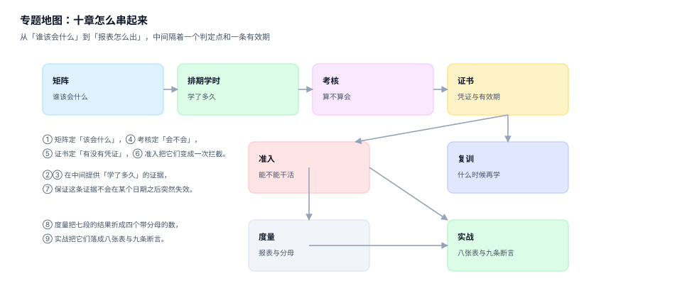

# 培训与资质认证工程

培训不是「上过课」，而是「某项资质在某个日期上是有效的」。一节课上没上、一次考试过没过、一张证到期没续，是三件互不推导的事；把它们混成一个「已完成」状态，是这类系统最常见、也最安静的错。

<p style="text-align:center;"></p>

本专题讲的是一条链：**谁该会什么（矩阵）→ 什么时候学（排期）→ 到底学多久（学时）→ 算不算会（考核）→ 凭证在哪（证书）→ 能不能干活（准入）→ 什么时候再学（复训）**。七段里只有「矩阵」和「准入」会当场报错，其余五段失败时页面照常渲染、报表照常出数。

## 一、十章构成

| # | 章节 | 判据族 | 条数 | 这一页回答什么 |
| --- | --- | --- | --- | --- |
| 1 | [总览：七段链与三个「会了」](Overview/index.md) | `TQO` | 8 | 七段各段的产物、失败是否安静、四个必失接缝 |
| 2 | [岗位资质矩阵：谁该会什么](Matrix/index.md) | `TQM` | 8 | 三张表、替代资质、按人/按人次两种缺口 |
| 3 | [排期、报名与学时：三个口径](Delivery/index.md) | `TQD` | 8 | 容量与候补、逐日签到、补录指纹、学时归属 |
| 4 | [考核与题库：及格线是一道测量题](Assessment/index.md) | `TQA` | 8 | 及格线、舍入、难度与区分度、无效题 |
| 5 | [证书与有效期：四种结局](Certificate/index.md) | `TQC` | 8 | 编号唯一、续期重叠、到期、吊销与时间点 |
| 6 | [上岗准入：判定点在哪里](AccessGate/index.md) | `TQG` | 8 | 在岗 vs 在册、宽限、拦截证据、离线名单 |
| 7 | [到期与复训：波峰与提前期](Recert/index.md) | `TQR` | 8 | 提前期、批量分片、豁免、跨年归属 |
| 8 | [度量与合规报表：四个分母](Metrics/index.md) | `TQX` | 8 | 覆盖率、及时率、到期风险、审计抽样 |
| 9 | [实战：八张表、三个触发器、九条断言](Practice/index.md) | `TQP` | 8 | 完整 DDL、C1~C5 自检、N1~N4 负向 |
| 10 | [常见问题与分诊](FAQ/index.md) | `TQQ` | 8 | 十二行分诊、止血五步、十二问、术语表 |

10 章 × 8 条 = **80 条判据**。



## 二、主张：三个「会了」必须分开存

| 说法 | 实际含义 | 证据 | 会不会自己报错 |
| --- | --- | --- | --- |
| 「他学过了」 | 有一张报名记录，状态是 `ATTENDED` | `enrollment` + 逐日 `attendance` | 不会 |
| 「他考过了」 | 有一次考核分数 ≥ 及格线 | `exam.score` + 题库版本 | 不会（题库换了也算过） |
| 「他有证」 | 有一条在有效期内的 `cert` | `issue_date` / `expire_date` / `cert_status` | 到期那天不会报错 |

这三个说法在口语里等价，在系统里**不可互推**：有证的人可能从没在本公司上过课（外部证书录入）；上过课考过试的人可能证还没发；证发了也可能因为违规被吊销。把它们折叠成一个 `completed` 布尔值，就等于承认「这三件事永远同步」——而它们几乎从不同步。

::: tip 一句话理解
**资质不是一个人的属性，是一个 (人, 资质, 日期) 三元组的判断。** 少了日期那一维，所有报表都会在某一天之后集体失真。
:::

## 三、边界：本专题不判什么

| 相邻专题 | 它判什么 | 本专题为什么不重复 |
| --- | --- | --- |
| [组织与任职异动](../../Backend/OrgPeople/Overview/index.md) | 人在哪个部门、占多少编制、向谁汇报 | 组织归属正确的人，照样可能没有上岗资质 |
| [薪酬核算](../../Backend/Payroll/GrossToNet/index.md) | 这个月发多少钱 | 学时影响的是「能不能上岗」，不是「发多少」 |
| [客服工单分派](../../Backend/SupportTicket/Dispatch/index.md) | 谁有空、谁技能匹配、派给谁 | 技能路由是「优先级」，资质是「能不能」 |
| [TLS 证书生命周期](../../Ops/CertificateLifecycle/Overview/index.md) | 服务端证书的签发、轮换、过期告警 | 同名不同物：那边的主语是服务，这边是人 |
| [采购寻源与准入](../../Backend/ProcureToPay/Sourcing/index.md) | 供应商资质到期后能否下单 | 主体是供应商，不是员工 |
| [生产质量](../../Backend/Manufacturing/Quality/index.md) | 过程良率、AQL 抽样 | 判的是产品合格率，不是人的资质 |
| [设备维护](../../Backend/EquipmentMaintenance/WorkOrder/index.md) | 设备修没修好、停机多久 | 不回答「谁有资格去修」 |
| [权限与授权](../../Backend/Auth/Authorization/index.md) | 能访问哪些资源 | 有账号权限 ≠ 有上岗资格，前者是访问控制，后者是作业准入 |
| [理赔作业](../../Backend/ClaimsProcessing/Overview/index.md) | 赔多少、谁的责任 | 无交集，仅在「核赔人资质」处引用本专题的准入判定 |

## 四、版本组织说明

本专题**不建版本目录**（没有 `TrainingQualification/V1` 之类），三条理由：

1. **换代的是法规条目与课时标准，判据一字未变。** 《安全生产法》修订、特种作业目录调整、继续教育学时从 8 学时改成 12 学时，改的是 `qual_type` 表里的 `months` 与 `ce_hours` 两列，不是「有效期不得重叠」这条判据。
2. **并存差异是辖区与工种，不是代际。** 同一时刻，高压电工证在 A 省 3 年一审、在 B 省 6 年一审，叉车证与信息安全意识培训的有效期完全不同——这是配置维度上的并存，不是版本演进。
3. **真正需要版本目录的是「同一份代码两套写法」。** 对照库内先例：[Spring5](../Java/Frame/Spring/Spring5/index.md) 与 [Spring6](../Java/Frame/Spring/Spring6/index.md) 因为注入与 AOT 语义不兼容才必须双份维护；[Vue2](../../Frontend/Frame/Vue/Vue2/index.md) 与 [Vue3](../../Frontend/Frame/Vue/Vue3/index.md) 因为响应式模型换了才必须双份维护。本专题没有这种「语义不兼容的两套写法」。

::: info 旧内容怎么办
若将来出现「必须双份」的情形（例如某地监管要求完全不同的举证流程），再按 [`AGENTS.md`](../../../AGENTS.md) 第 3 节建 `V1/`、`V2/` 目录，**旧目录保留并标注维护状态，不覆盖旧内容**。在此之前，同一页内用表格对照不同辖区即可。
:::

## 五、本机读数从哪来

全专题的数字来自一台机器上的一次可复跑测量（Python 3.13.12 + SQLite 3.50.4，固定种子 `20261103`，脚本不入库）：

| 项 | 规模 |
| --- | --- |
| 员工 | 3,000 人（在岗 2,648、休假 170、借调 122、待离职 60） |
| 岗位 / 资质类型 | 120 个（16 个无强制要求）/ 40 类 |
| 岗位资质要求 | 277 条，其中强制 188 条（67.9%） |
| 证书 | 6,598 张（内部签发 5,127、外部录入 1,471） |
| 班次 / 报名 / 签到行 | 400 个 / 5,950 条 / 9,170 行 |

::: warning 这些数字不是行业基准
它们只说明「同一份数据在不同口径下能差出多少」。你在自己系统里量到的绝对值会不同，但**差的方向与量级**通常一致——那才是这一专题要讲的东西。
:::

## 六、验证方式

```shell
# 1) 目录页列出的十章都存在
ls docs/Backend/TrainingQualification/*/index.md | wc -l
# 期望：10

# 2) 十章判据族各 8 条，合计 80 条
grep -roh "TQ[A-Z]-[A-H]" docs/Backend/TrainingQualification | sort -u | wc -l
# 期望：80

# 3) 每章都有一张自己的配图，且路径是相对写法
grep -c "](\.\./assets/tq-\|](assets/tq-" docs/Backend/TrainingQualification/*/index.md
# 期望：每行 1（十章各 1 张）

# 4) 本专题不建版本目录
ls -d docs/Backend/TrainingQualification/V* 2>/dev/null | wc -l
# 期望：0
```

## 参考资料

- [总览：七段链与三个「会了」](Overview/index.md)
- [实战：八张表、三个触发器、九条断言](Practice/index.md)
- 《安全生产法》（2021 修正）第二十八条：从业人员安全生产教育和培训要求，<https://www.gov.cn/>
- 《特种作业人员安全技术培训考核管理规定》（应急管理部令，现行版）
- ISO 21001:2018《教育组织管理体系》，用于对照「培训有效性评价」的通用框架
- 库内相关：[组织与任职异动](../../Backend/OrgPeople/Overview/index.md)、[客户身份归并](../../Backend/CustomerIdentity/Overview/index.md)（同属「同一个主体怎么被判定」的一类问题）
