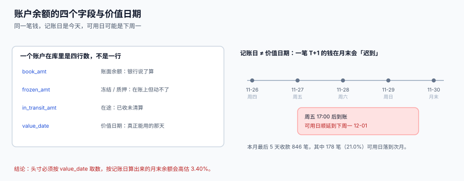

# 账户、余额与价值日期

<p style="text-align:center;"></p>

资金系统的第一张表不是「余额」，而是「账户」。因为**余额是会变的，账户不会**——同一个账号在系统里只能是一个实体，否则冻结、质押、限额、归集全部会挂到两个不同的东西上，而账面上看不出来。

本页判据族 `TRM-A` ~ `TRM-H`，共 8 条，定义在最后一节。

## 一、账户是实体，不是「一个字符串」



一个真实的银行账户至少有六个属性，缺一个都会在某个环节出事：

| 属性 | 为什么必须有 | 缺了会怎样 |
| --- | --- | --- |
| `acct_kind` | 基本户 / 一般户 / 专户 / 归集户，性质决定能不能取现、能不能透支 | 把一般户当基本户取现，被银行退回 |
| `currency` | 同一账号可能多币种，也可能同币种多账号 | 用人民币额度去算美元头寸 |
| `status` | `OPEN` / `FROZEN` / `CLOSED`，冻结期间不能出款 | 向已冻结账户发起付款，全部退回 |
| `bank_name` | 同一账号在不同银行可能重号，唯一键必须带银行 | 两家银行的 `6222...` 撞成一个账户 |
| `pledge_rate` | 保证金比例，决定账面里有多少被质押 | 可用余额虚高 |
| `overdraft_limit` | 透支额度，决定负余额是不是「正常」 | 透支被当成账务差错去查 |

```sql
-- 唯一键必须是「银行 + 账号 + 币种」，不是账号本身
CREATE TABLE tre_account (
  acct_id      TEXT PRIMARY KEY,
  bank_name    TEXT NOT NULL,
  acct_no      TEXT NOT NULL,
  currency     TEXT NOT NULL,
  acct_kind    TEXT NOT NULL CHECK (acct_kind IN ('BASIC','GENERAL','PLEDGE','POOL')),
  status       TEXT NOT NULL DEFAULT 'OPEN' CHECK (status IN ('OPEN','FROZEN','CLOSED')),
  UNIQUE (bank_name, acct_no, currency)
);
```

::: danger 用账号当主键的四个后果
1. **销户再开户会复用账号**：银行回收对公账号后重新放出，历史数据会被新实体「继承」，对账直接把两家的钱对上。
2. **多币种账户无法表达**：一个 USD/CNY 双币种账户，用账号当主键就只能记一个币种，另一个币种的余额永远凭空多出来。
3. **跨行重号**：不同银行的内部账号规则不同，`6222` 开头在两家银行都能存在。
4. **账户变更无法留痕**：账号是什么，历史就跟着变；正确做法是 `acct_id` 不变，`acct_no` 变更走 `tre_account_change`。
:::

## 二、余额是四列数，不是一列

```sql
CREATE TABLE tre_balance_snapshot (
  acct_id        TEXT NOT NULL REFERENCES tre_account(acct_id),
  biz_date       TEXT NOT NULL,
  book_amt       NUMERIC NOT NULL,
  frozen_amt     NUMERIC NOT NULL DEFAULT 0,
  in_transit_amt NUMERIC NOT NULL DEFAULT 0,
  PRIMARY KEY (acct_id, biz_date),
  CHECK (frozen_amt >= 0 AND in_transit_amt >= 0)
);
```

四列的关系只有一条，但必须**在查询里算，不在表里存**：

```text
available = book_amt − frozen_amt − in_transit_amt
```

| 列 | 来源 | 典型值（本机样例） |
| --- | --- | --- |
| `book_amt` | 银行对账单 / 网银余额 | 1,000,000.00 |
| `frozen_amt` | 保证金、司法冻结、承兑保证金 | 120,000.00 |
| `in_transit_amt` | 已收未清算（T+1 在途）、已付未记账 | 80,000.00 |
| `available`（算出来） | 上面三列的减法 | **800,000.00** |

::: warning 为什么不在表里存 `available_amt`
存了就要维护：每次冻结变化、每笔在途入账，都要 `UPDATE` 一次。而**冻结和在途是两条独立的事实流**，只要有一路漏更新，`available_amt` 就和三列对不上，且没有任何一条约束能发现它。算出来的列不可能不一致——这是「不存冗余」在这个场景下唯一正确的理由。
:::

### 日终快照必须可重跑

日终快照是**可重算的派生数据**，不是流水。取数脚本可能因为银行文件迟到而在半夜重跑一次，如果每次 `INSERT` 一行，同一个账户同一天就会有两行，之后所有聚合都会翻倍。

```sql
-- 幂等写法：同一天同一个账户只留一行
INSERT INTO tre_balance_snapshot(acct_id, biz_date, book_amt, frozen_amt, in_transit_amt)
VALUES (:acct_id, :biz_date, :book, :frozen, :transit)
ON CONFLICT (acct_id, biz_date) DO UPDATE SET
  book_amt       = excluded.book_amt,
  frozen_amt     = excluded.frozen_amt,
  in_transit_amt = excluded.in_transit_amt;
```

本机实测：无主键时重跑三次，`SELECT count(*)` 从 4 行变 12 行，`SUM(book_amt)` 从 1,420,000 变 4,260,000（正好 3 倍）；有 `PRIMARY KEY (acct_id, biz_date)` 时始终 4 行。

## 三、价值日期：钱什么时候才能用

银行说「已到账」，不等于「今天能付出去」。中间隔着清算：

| 场景 | 记账日 | 价值日期 | 差几天 |
| --- | --- | --- | --- |
| 同行转账 | 当日 | 当日 | 0 |
| 跨行小额（工作日 16:00 前） | 当日 | 当日 | 0 |
| 跨行大额（工作日 17:00 后） | 当日 | 次一工作日 | 1 |
| 周五 17:00 后到账 | 周五 | **下周一** | 3 |
| 月末最后一天到账 | 月末 | 次月 1 日 | 跨月 |

本机读数（5,000 笔收款，T+1 且跨周末顺延）：

| 口径 | 落在 11 月的金额 |
| --- | --- |
| 按记账日（T+0） | 199,803,236.24 |
| 按可用日（T+1 / 顺延） | 193,010,032.08 |
| **月末被高估** | **6,793,204.16（3.40%）** |

月末最后 5 天的 846 笔收款里，有 **178 笔（21.0%）** 的可用日落到 12 月。这 178 笔在 11 月的「可用余额」里一分钱都不该出现，但它们在「账面余额」里全额出现。

::: danger 用 `created_at` 或「到账日」代替价值日期的三种错法
1. **按 `created_at` 取数**：系统重放历史数据时，`created_at` 是重放那天，整个月的头寸会被搬到一天里。
2. **按银行「交易日期」取数**：那是银行的记账日，不是你的可用日；跨行大额在银行侧是当天，在你侧是次日。
3. **自己算「T+1」**：T+1 遇到周末、节假日、跨月都要顺延，而每个银行的顺延规则不同（有的周六半天营业）。**规则要落成表，不要写进代码**。
:::

**正确写法**：清算日历单独一张表，价值日期由「记账日 + 日历」推出，且结果落库（不能每次重算，因为日历会变）。

```sql
CREATE TABLE tre_clearing_calendar (
  calendar_id TEXT NOT NULL,        -- 'CNY-HVPS' / 'CNY-BEPS' / 'USD-FED'
  cal_date    TEXT NOT NULL,
  is_open     INTEGER NOT NULL CHECK (is_open IN (0,1)),
  PRIMARY KEY (calendar_id, cal_date)
);

-- 取某账户某天的「可用余额」，只认 value_date <= 当天
SELECT SUM(r.amt)
  FROM tre_receipt r
 WHERE r.acct_id = :acct_id
   AND r.value_date <= :biz_date
   AND r.status IN ('UNAPPLIED','PARTIAL','APPLIED');
```

### 多时区的日终切点

集团有 USD 账户时，「日终」到底是哪一个日终，必须先定死再谈头寸。本机样例（三笔几乎同时发生的交易）：

| 账户币种 | 当地时刻 | UTC 时刻 | 集团日终（UTC 00:00 切）归属 |
| --- | --- | --- | --- |
| CNY | 11-30 23:40 | 11-30 15:40 | 11-30 |
| USD（纽约） | 11-30 23:40 | **12-01 12:40** | **12-01** |
| HKD | 12-01 00:10 | 11-30 16:10 | 11-30 |

同一笔 USD 付款，在「当地日终」口径下属于 11-30，在「集团日终」口径下属于 12-01。**两个口径都可以，但一个集团只能用一个**，且要在报表上写明是哪一个。

## 四、账户变更要留痕

```sql
CREATE TABLE tre_account_change (
  change_id   INTEGER PRIMARY KEY,
  acct_id     TEXT NOT NULL REFERENCES tre_account(acct_id),
  field_name  TEXT NOT NULL,
  old_value   TEXT,
  new_value   TEXT NOT NULL,
  effective_on TEXT NOT NULL,       -- 生效日，不是录入日
  approved_by TEXT NOT NULL,
  created_at  TEXT NOT NULL DEFAULT (datetime('now'))
);
```

两条纪律：

1. **`effective_on` 可以不等于录入日**。银行侧改账号往往提前三天通知、T 日生效，中间这三天必须仍按旧账号付款。
2. **`approved_by` 不能为空**。收款账号变更与「改联系电话」共用表单，是资金诈骗最常见的入口（见 [付款工厂与账号白名单](../Outflow/index.md)）。

## 五、判据清单

| 编号 | 判据 | 怎么验 |
| --- | --- | --- |
| `TRM-A` | 账户主键与银行账号解耦，唯一键含银行与币种 | `UNIQUE (bank_name, acct_no, currency)` 存在且账号不是主键 |
| `TRM-B` | 余额四列分列，`available` 只出现在视图或查询里 | `pragma_table_info` 里没有 `available_amt` |
| `TRM-C` | 账户 × 日唯一，重跑覆盖 | `PRIMARY KEY (acct_id, biz_date)` + `ON CONFLICT DO UPDATE` |
| `TRM-D` | 所有时点判断只认 `value_date` | 余额与头寸查询不含 `created_at` / `trans_date` |
| `TRM-E` | 清算日历独立成表，顺延规则不写死在代码里 | `tre_clearing_calendar` 存在且有跨周末样例 |
| `TRM-F` | 冻结与在途金额非负 | `CHECK (frozen_amt >= 0 AND in_transit_amt >= 0)` |
| `TRM-G` | 账户变更留痕且带生效日与审批人 | `tre_account_change` 三列非空 |
| `TRM-H` | 多时区账户的日终口径在报表上写明 | 头寸报表有 `tz_basis` 字段或页内说明 |

## 验证方式

```shell
# 1) 余额表不得存 available：应输出 0
sqlite3 /tmp/tre.db "SELECT count(*) FROM pragma_table_info('tre_balance_snapshot')
                      WHERE name LIKE '%available%';"
# 期望：0

# 2) 同一天重跑不新增：连插两次，行数应保持 1
sqlite3 /tmp/tre.db "INSERT INTO tre_balance_snapshot VALUES('A001','2026-12-01',100,0,0)
                     ON CONFLICT(acct_id,biz_date) DO UPDATE SET book_amt=excluded.book_amt;
                     INSERT INTO tre_balance_snapshot VALUES('A001','2026-12-01',200,0,0)
                     ON CONFLICT(acct_id,biz_date) DO UPDATE SET book_amt=excluded.book_amt;
                     SELECT count(*) FROM tre_balance_snapshot WHERE acct_id='A001' AND biz_date='2026-12-01';"
# 期望：1

# 3) 负的在途必须被拒：应报 CHECK 失败
sqlite3 /tmp/tre.db "INSERT INTO tre_balance_snapshot VALUES('A001','2026-12-02',100,0,-5);"
# 期望：CHECK constraint failed: frozen_amt >= 0 AND in_transit_amt >= 0

# 4) 价值日期口径：只算 value_date 落在当月的收款
sqlite3 /tmp/tre.db "SELECT ROUND(SUM(CASE WHEN value_date<='2026-11-30' THEN amt END),2) AS by_value,
                            ROUND(SUM(amt),2) AS by_booking
                       FROM tre_receipt;"
# 期望：by_value < by_booking（差额即月末在途）
```

## 参考资料

- [总览：七段资金链与三个「有多少钱」](../Overview/index.md)：三个余额的定义与差别
- [头寸、多银行与资金归集](../Positioning/index.md)：多账户汇总时的切点问题
- [银行对账与对账单解析](../Statement/index.md)：`camt.053` 里的 `Bal` 与 `ValDt`
- ISO 20022 `camt.053` 账户报表报文定义：<https://www.iso20022.org/iso-20022-message-definitions>
- 中国人民银行：大额支付系统与小额批量支付系统的运行时间与单笔限额：<http://www.pbc.gov.cn/>
