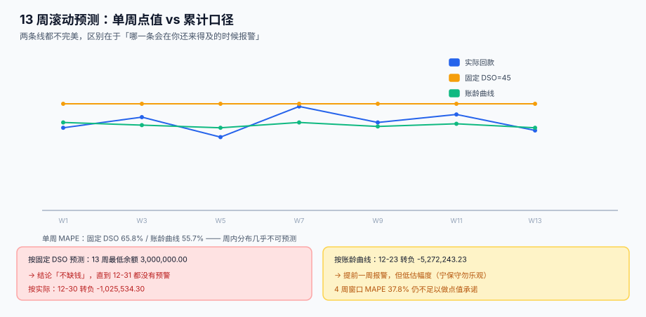

# 13 周滚动预测与现金缺口

<p style="text-align:center;"></p>

13 周滚动预测是资金部最像「算命」的一张表：它每周重出一次，每次都换一个数字，而没有人回头核对上一次准不准。它的价值不在「准」，而在**在还来得及的时候报警**——一个偏低 10% 的预测能救你，一个偏高 10% 的预测会害你。

本页判据族 `TRL-A` ~ `TRL-H`，共 8 条，定义在最后一节。

## 一、预测的单位是「周」，不是「日」

| 粒度 | 可预测性 | 用途 |
| --- | --- | --- |
| 日 | 几乎不可预测（客户的付款日是随机的） | 只用于未来 3 天 |
| 周 | 部分可预测（结算周期、账期、工资日） | 13 周滚动的主粒度 |
| 月 | 较可预测（与账期高度相关） | 与预算、报表对齐 |

本页所有读数都按周聚合。这不是偷懒：**日粒度的预测误差会大到无法使用**，而周粒度恰好能覆盖「工资日、税期、供应商账期」这三种真正有规律的事件。

## 二、三种做法，误差差一倍



| 做法 | 规则 | 优点 | 缺点 |
| --- | --- | --- | --- |
| 固定 DSO | 每张发票按「开票日 + 45 天」回款 | 一句话能说清 | 把波动抹平，永远「不缺钱」 |
| 账龄回款曲线 | 按历史各账龄区间的条件回款率逐周摊 | 反映真实节奏 | 低估尾部（长期拖欠的票） |
| 自下而上 | 逐张票逐笔应付排程 | 最准 | 工作量大，依赖应收明细质量 |

本机读数（800 张发票，观测截止 2026-09-30，预测未来 13 周）：

账龄曲线的条件回款率（每一档 = 该档内回款额 / 该档初未回款额）：

| 账龄区间 | 条件回款率 |
| --- | --- |
| 0~7 天 | 1.1% |
| 7~14 天 | 1.8% |
| 14~21 天 | 4.8% |
| 21~28 天 | 7.4% |
| 28~35 天 | 17.0% |
| 35~42 天 | **25.7%** |

35~42 天这一档是峰值——这正好是「账期 30 天 + 客户内部审批 10 天」的现实节奏。任何假设「均匀回款」的模型都会在这一档上错得最厉害。

| 指标 | 固定 DSO | 账龄曲线 |
| --- | --- | --- |
| 单周 MAPE | **65.8%** | **55.7%** |
| 4 周滚动窗口 MAPE | 51.5% | **37.8%** |
| 13 周合计回款 | 52,076,711.93 | 43,727,756.77 |
| 与实际（47,974,465.70）偏差 | **+8.55%** | **−8.85%** |
| 累计最大偏离 | 7,155,295.16 | 5,528,936.26 |

::: danger 三个把预测做「好看」的做法
1. **按 DSO 平均**：单周 MAPE 65.8%，但曲线平滑、报表漂亮。它的真正问题是**永远报「不缺钱」**（见下节），所以从来不会有人质疑它。
2. **用上个月实际数平移**：看起来贴合历史，但一旦有大额一次性收款或付款，就会被完整复制到下个月。
3. **按目标倒推**：先定「本月必须回款 5,000 万」，再反推每张票的回款日。这不是预测，是给自己发奖状。
:::

## 三、真正要看的不是点值，是累计与缺口

单周 MAPE 超过 50%，意味着**任何单周的点值承诺都没有意义**。流动性的判据应该换成两条：

1. **滚动 4 周累计偏差** ≤ 5%（本机 37.8% 仍不达标——说明样本波动过大，或方法仍需改进）；
2. **13 周内最低现金余额** ≥ 安全垫。

第 2 条才是真正会救命的。本机模拟：期初 3,000,000，每周固定支出 4,000,000（工资 + 到期货款），13 周：

| 口径 | 13 周最低余额 | 首次为负 |
| --- | --- | --- |
| 按固定 DSO 预测 | **3,000,000.00** | **未出现** |
| 按账龄曲线预测 | −5,272,243.23 | **12-23** |
| 按实际回款 | −1,025,534.30 | 12-30 |

固定 DSO 的预测让余额**一周都没有跌破期初值**——因为它的周均回款正好是 400 万，把支出完美抵消。真实世界从不这么配合：曲线预测在 12-23 报出缺口，比实际早了 7 天；虽然它低估了缺口规模（−5.27M vs 实际 −1.03M），但**早 7 天知道，比准确知道更重要**。

::: tip 预测的偏差方向要选「保守」
既然误差不可避免，就要选一个**错也错在安全侧**的方法。账龄曲线低估回款（−8.85%），固定 DSO 高估回款（+8.55%）——前者会让你提前融资（多一点利息），后者会让你在 12-30 那天发现付不出工资。选前者。
:::

## 四、预测表的版本规则

```sql
CREATE TABLE tre_forecast (
  version_no  INTEGER NOT NULL,       -- 每周一个版本，只增不改
  week_start  TEXT NOT NULL,
  bucket      TEXT NOT NULL CHECK (bucket IN ('AR','AP','TAX','PAYROLL','OTHER')),
  amt         NUMERIC NOT NULL,       -- 正数=流入，负数=流出
  method      TEXT NOT NULL,          -- 'DSO45' / 'AGING' / 'BOTTOM_UP'
  created_at  TEXT NOT NULL DEFAULT (datetime('now')),
  PRIMARY KEY (version_no, week_start, bucket)
);
```

三条规则：

1. **版本只增不改**。要修正，出 `version_no + 1`。否则「上周预测多少」永远查不到，准确率也就永远算不出来。
2. **`method` 必须落库**。同一份预测里 AR 用账龄曲线、AP 用自下而上，是完全正常的；不记录方法，偏差归因时无法区分「模型错」和「数据错」。
3. **流入为正、流出为负**。不要用两列（`inflow` / `outflow`）——两列在汇总时要记得相减，忘一次就是两倍。

### 准确率的算法要固定

```sql
-- 单周准确率：预测 vs 实际的绝对百分比误差，按周、按 bucket
WITH p AS (SELECT week_start, SUM(amt) AS pred FROM tre_forecast
            WHERE version_no = :v GROUP BY week_start),
     a AS (SELECT week_start, SUM(amt) AS act  FROM tre_actual_cashflow
            WHERE week_start BETWEEN :d0 AND :d1 GROUP BY week_start)
SELECT p.week_start,
       p.pred, a.act,
       ROUND(ABS(p.pred - a.act) / NULLIF(ABS(a.act), 0) * 100, 2) AS mape_pct
  FROM p JOIN a USING (week_start)
 ORDER BY p.week_start;
```

**分母必须用实际值**。用预测值当分母会系统性地偏袒「高估」：预测 1,000、实际 100 时，误差是 90%（实际作分母）；预测 100、实际 1,000 时，误差是 900%（预测作分母）与 90%（实际作分母）。同一套数据集里混用分母，两类偏差就不可比了。

## 五、DSO / DPO / CCC：三个数，九个口径

| 指标 | 公式 | 本机（期末/含税） | 本机（平均/含税） |
| --- | --- | --- | --- |
| DSO | 应收账款 / 营业收入 × 天数 | 41.8 天 | 37.8 天 |
| DPO | 应付账款 / 营业成本 × 天数 | 45.0 天 | 41.5 天 |
| DIO | 存货 / 营业成本 × 天数 | 51.9 天 | 48.5 天 |
| CCC | DSO + DIO − DPO | **48.7 天** | **44.8 天** |

同一家公司、同一个季度，**CCC 可以是 48.7 天也可以是 44.8 天**，差 4.0 天。三个开关决定这个数：

| 开关 | 选项 A | 选项 B | 本机差异 |
| --- | --- | --- | --- |
| 收入含不含税 | 不含税 47.2 天 | 含税 41.8 天 | **5.4 天** |
| 余额用期末还是平均 | 期末 41.8 天 | 平均 37.8 天 | 4.0 天 |
| 天数用 90 还是 365 | 季度 90 天 | 年化 365 天 | 取决于口径混用 |

::: danger 混用口径的两种典型错法
1. **分子含税、分母不含税**：DSO 会凭空少 5.4 天，看起来收款更快。这个错误在跨部门汇报时几乎必然发生，因为收入表通常给不含税、应收表通常给含税。
2. **季度用 365 天**：DSO 直接变成 4 倍。这类错误通常出现在「年化」这一步——把季度指标乘 4 是错的，应该重算而不是乘。
:::

**正确写法**：三个开关写进指标定义表，一次定义、全局引用。

```sql
CREATE TABLE tre_metric_def (
  metric_code TEXT PRIMARY KEY,        -- 'DSO' / 'DPO' / 'DIO' / 'CCC'
  numerator   TEXT NOT NULL,           -- 'AR_END' / 'AR_AVG'
  denominator TEXT NOT NULL,           -- 'REV_EX_VAT' / 'REV_INC_VAT'
  days_basis  INTEGER NOT NULL,        -- 90 / 365
  note        TEXT
);
```

CCC 差 1 天值多少钱？按本机数据，日均销售成本 28,889 元——1 天就是 **44,444 元**（按日均收入口径）的营运资金占用。4 天的口径差 = 17.8 万，超过很多中小企业的月度利润。

## 六、判据清单

| 编号 | 判据 | 怎么验 |
| --- | --- | --- |
| `TRL-A` | 预测按周聚合，粒度统一 | `week_start` 全部为周一，且相邻差 7 天 |
| `TRL-B` | 版本只增不改，历史可查 | 无 `UPDATE tre_forecast`，只有 `INSERT` |
| `TRL-C` | 每个 bucket 记录方法 | `method` 非空 |
| `TRL-D` | 流入为正、流出为负 | 全部 `AP` / `TAX` / `PAYROLL` 行 `amt < 0` |
| `TRL-E` | 准确率分母用实际值 | 计算 SQL 里 `ABS(act)` 作分母 |
| `TRL-F` | 13 周内最低余额与缺口日可算 | 有余额模拟查询，输出最低值与首次为负日期 |
| `TRL-G` | 指标定义集中管理，三个开关明确 | `tre_metric_def` 存在且 DSO/DPO/DIO/CCC 四行齐全 |
| `TRL-H` | 预测偏差方向可选择「保守」 | 报表能同时给出 DSO 与账龄曲线两版 |

## 验证方式

```shell
# 1) 版本只增不改：应输出 0（没有任何 UPDATE 触发器或语句）
grep -rn "UPDATE tre_forecast" docs/Backend/Treasury/ | wc -l
# 期望：0

# 2) 流入为正、流出为负：应输出 0
sqlite3 /tmp/tre.db "SELECT count(*) FROM tre_forecast
                      WHERE bucket IN ('AP','TAX','PAYROLL') AND amt > 0;"
# 期望：0

# 3) 周粒度对齐：相邻周应正好差 7 天
sqlite3 /tmp/tre.db "SELECT count(*) FROM (
  SELECT week_start, julianday(week_start) - julianday(lag(week_start) OVER (ORDER BY week_start)) d
    FROM (SELECT DISTINCT week_start FROM tre_forecast)) WHERE d IS NOT NULL AND d <> 7;"
# 期望：0

# 4) 指标定义齐全：应输出 4
sqlite3 /tmp/tre.db "SELECT count(*) FROM tre_metric_def
                      WHERE metric_code IN ('DSO','DPO','DIO','CCC');"
# 期望：4

# 5) 缺口模拟：应输出最低余额与首个为负的周
sqlite3 /tmp/tre.db "WITH f AS (
  SELECT week_start, SUM(amt) amt FROM tre_forecast WHERE version_no=:v GROUP BY 1),
r AS (SELECT week_start, 3000000 + SUM(amt) OVER (ORDER BY week_start) AS bal FROM f)
SELECT ROUND(MIN(bal),2), MIN(CASE WHEN bal<0 THEN week_start END) FROM r;"
# 期望：一个负数与一个日期（若全为正，第二列为 NULL，说明「不缺钱」——请先怀疑方法）
```

## 参考资料

- [头寸、多银行与资金归集](../Positioning/index.md)：预测的起点是今天的头寸
- [收款认领与未认领池](../Inflow/index.md)：认领率直接决定回款曲线
- [短期融资、额度与计息基准](../Funding/index.md)：缺口出现后用什么钱补
- [订阅计费与周期账单](../../SubscriptionBilling/Overview/index.md)：可预测性最高的那类收入
- 财政部：《企业会计准则第 31 号——现金流量表》：<https://www.mof.gov.cn/>
