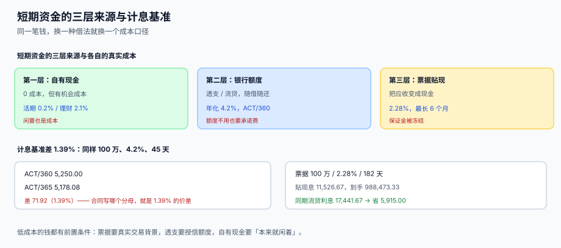

# 短期融资、额度与计息基准

<p style="text-align:center;"></p>

预测告诉你「12 月 23 日会缺 527 万」，接下来要回答的是「用哪种钱补、补多久、多贵」。资金成本不是一个利率，而是**三个变量**：来源、期限、计息基准。同一个 4.2%，写 ACT/360 还是 ACT/365，一年差 1.39%。

本页判据族 `TRD-A` ~ `TRD-H`，共 8 条，定义在最后一节。

## 一、三层来源，三种「不明显的成本」



| 层 | 来源 | 名义成本 | 不明显的成本 |
| --- | --- | --- | --- |
| 第一层 | 自有现金 / 活期 | 0 | **机会成本**：活期 0.2%，理财 2.1%，差 1.9% |
| 第二层 | 银行授信（透支 / 流贷） | 4.2% | **承诺费**：额度不用也要付 0.2%~0.5% |
| 第三层 | 票据贴现 | 2.28% | **保证金被冻结**：120,000 冻 182 天，活期利息 119.67 |

本机读数（保证金 120,000，182 天）：

| 计息方式 | 利息 |
| --- | --- |
| 按活期 0.2% | 119.67 |
| 按理财 2.1% | **1,256.55** |
| 差 | 1,136.88 |

这笔差不出现在任何一张报表上——它既不是费用也不是损失，只是「钱放错了地方」。

::: tip 一句话结论
**短期融资的成本要按「全成本」算：利息 + 承诺费 + 被冻结资金的机会成本。** 只看票面利率，会得出「票据最便宜」的结论，而票据往往是最贵的那一层。
:::

## 二、计息基准：分母决定 1.39%

| 基准 | 分母 | 用在哪 |
| --- | --- | --- |
| ACT/360 | 360 | 美元贷款、票据贴现、多数跨境产品 |
| ACT/365 | 365 | 人民币贷款（部分）、存款 |
| 30/360 | 每月 30 天、每年 360 天 | 债券、部分固息贷款 |

本机读数（本金 1,000,000，年利率 4.2%）：

| 天数 | ACT/360 | ACT/365 | 差 | 差幅 |
| --- | --- | --- | --- | --- |
| 30 天 | 3,500.00 | 3,452.05 | 47.95 | 1.39% |
| 45 天 | 5,250.00 | 5,178.08 | 71.92 | 1.39% |
| 90 天 | 10,500.00 | 10,356.16 | 143.84 | 1.39% |

1.39% = 365/360 − 1，是一个**与本金、天数、利率都无关的固定比例**。所以它不会「金额小到可以忽略」——本金越大，绝对差越大。

```sql
-- 计息：基准进表，不进代码
CREATE TABLE tre_loan (
  loan_id     TEXT PRIMARY KEY,
  lender      TEXT NOT NULL,
  kind        TEXT NOT NULL CHECK (kind IN ('OVERDRAFT','TERM_LOAN','DISCOUNT','FACTORING')),
  principal   NUMERIC NOT NULL,
  rate        NUMERIC NOT NULL,
  day_basis   INTEGER NOT NULL CHECK (day_basis IN (360,365)),
  start_date  TEXT NOT NULL,
  due_date    TEXT NOT NULL,
  ccy         TEXT NOT NULL
);

-- 一段期间的应计利息
SELECT loan_id,
       ROUND(principal * rate * (:days) / day_basis, 2) AS interest
  FROM tre_loan
 WHERE :asof BETWEEN start_date AND due_date;
```

::: danger 三种计息错误
1. **把 `day_basis` 写死成 365**：跨境贷款全部少算 1.39%，一年下来是一笔可观的差异，而且**银行对账单上是对的、你的账上是错的**，对账时找不到原因。
2. **天数用「月数 × 30」**：2 月只有 28 天，跨 2 月的贷款会多算 2~3 天利息。
3. **起息日含头不含尾搞反**：`(due − start)` 与 `(due − start + 1)` 差一天，一天就是本金 × 利率 / 360，1000 万贷款一天 1,167 元。
:::

## 三、透支：日计息、月结息、还有承诺费

| 概念 | 计算 | 注意 |
| --- | --- | --- |
| 透支利息 | 日终透支余额 × 日利率，按日累加 | 用**日终**余额，不是日间峰值 |
| 结息日 | 每月 20 日或月末 | 结息日当天的余额也会计息 |
| 承诺费 | 授信额度 × 费率 × 未用天数 / 360 | 有的银行按「额度 − 日均用信」收 |
| 额度占用 | 已用额度 = 透支余额 + 未到期票据 + 保函 | 三类共用一条额度时最容易超占 |

```sql
-- 日均透支与利息：按日终余额算，不用日间峰值
SELECT acct_id,
       ROUND(AVG(CASE WHEN book_amt < 0 THEN -book_amt ELSE 0 END), 2) AS avg_overdraft,
       ROUND(SUM(CASE WHEN book_amt < 0 THEN -book_amt * :rate / 360.0 ELSE 0 END), 2) AS interest
  FROM tre_balance_snapshot
 WHERE biz_date BETWEEN :d0 AND :d1
 GROUP BY acct_id;
```

## 四、票据：6 个月上限与贴现息

2023-01-01 起施行的《商业汇票承兑、贴现与再贴现管理办法》把商业汇票最长付款期限从 **1 年缩短到 6 个月**，并对银行承兑汇票的最高承兑余额设置比例上限（不超过承兑人总资产的 15%）。这条对工程的直接影响是：**票据台账的期限校验要按 6 个月，而不是按经验值 1 年**。

本机读数（票面 1,000,000，贴现率 2.28%，ACT/360）：

| 期限 | 天数 | 贴现息 | 到手 | 同期流贷利息（3.45%） | 省 |
| --- | --- | --- | --- | --- | --- |
| 3 个月 | 91 | 5,763.33 | 994,236.67 | 8,720.83 | **2,957.50** |
| 6 个月 | 182 | 11,526.67 | 988,473.33 | 17,441.67 | **5,915.00** |

如果按旧口径的 1 年（365 天）出票，多出的 183 天要多付 **11,590.00** 的贴现息——这不是「票据更贵」，而是**这张票本身就不该开这么长**。

```sql
CREATE TABLE tre_draft (
  draft_id    TEXT PRIMARY KEY,
  draft_kind  TEXT NOT NULL CHECK (draft_kind IN ('BANK_ACCEPT','COMMERCIAL_ACCEPT')),
  face_amt    NUMERIC NOT NULL CHECK (face_amt > 0),
  issue_date  TEXT NOT NULL,
  due_date    TEXT NOT NULL,
  margin_amt  NUMERIC NOT NULL DEFAULT 0,
  status      TEXT NOT NULL DEFAULT 'HELD'
              CHECK (status IN ('HELD','DISCOUNTED','MATURED','DISHONORED')),
  -- 6 个月上限：用 julianday 校验，允许 6 个自然月的浮动
  CHECK (julianday(due_date) - julianday(issue_date) <= 190)
);
```

::: warning 190 天不是「6 个月」
6 个自然月最长是 31 + 28 + 31 + 30 + 31 + 30 = 181 天（8 月出票跨 2 月），但跨闰年 2 月可到 182 天；再算上「到期日遇节假日顺延」，留 8 天余量到 190 天是合理的工程取值。**不要写成 180**——那会把合法的 181 天票据判成违规。
:::

## 五、授信台账：不存「剩余额度」

```sql
CREATE TABLE tre_credit_facility (
  facility_id TEXT PRIMARY KEY,
  bank_name   TEXT NOT NULL,
  total_amt   NUMERIC NOT NULL,
  ccy         TEXT NOT NULL,
  start_date  TEXT NOT NULL,
  end_date    TEXT NOT NULL,
  commit_rate NUMERIC NOT NULL DEFAULT 0     -- 承诺费率，未用部分按此收
);

CREATE TABLE tre_credit_usage (
  usage_id    INTEGER PRIMARY KEY,
  facility_id TEXT NOT NULL REFERENCES tre_credit_facility(facility_id),
  usage_kind  TEXT NOT NULL CHECK (usage_kind IN ('OVERDRAFT','LOAN','DRAFT','GUARANTEE')),
  ref_id      TEXT NOT NULL,                 -- 借据号 / 票号 / 保函号
  amt         NUMERIC NOT NULL CHECK (amt > 0),
  start_date  TEXT NOT NULL,
  end_date    TEXT
);
```

**剩余额度必须算出来**：

```sql
SELECT f.facility_id, f.total_amt,
       COALESCE(SUM(u.amt), 0)                AS used_amt,
       f.total_amt - COALESCE(SUM(u.amt), 0)  AS available_amt
  FROM tre_credit_facility f
  LEFT JOIN tre_credit_usage u
         ON u.facility_id = f.facility_id
        AND (u.end_date IS NULL OR u.end_date >= :today)
 GROUP BY f.facility_id;
```

存一个 `available_amt` 字段的后果：某笔借据提前还款、某张票到期解付、某笔保函撤销——三件事都要记得回来 `UPDATE` 一次，漏一次就永久错。而这三件事分别由三个不同的人做。

## 六、闲置资金：T+0 与 T+1 的差别就是头寸

| 产品 | 赎回到账 | 对头寸的影响 |
| --- | --- | --- |
| 活期 | T+0 实时 | 随时可用 |
| 通知存款 | T+0（提前 7 天通知） | 未通知就取按活期计息 |
| 货币基金 T+0 快取 | T+0，单日限额 1 万~5 万 | 超出部分 T+1 |
| 货币基金普通赎回 | T+1 | **当天不能用** |
| 银行理财 | T+1 / T+2 | 到期日不等于可用日 |

理财的「到期日」和「可用日」经常差 1~2 天。做头寸时如果按到期日算，会在到期当天出现一个**凭空多出来的缺口**——而系统里那笔钱的状态是「已到期」。

## 七、判据清单

| 编号 | 判据 | 怎么验 |
| --- | --- | --- |
| `TRD-A` | 计息基准（360/365）入库，不写死在代码 | `day_basis IN (360,365)` 且计息 SQL 引用该列 |
| `TRD-B` | 天数按实际日历算，不用「月数 × 30」 | 计息 SQL 用 `julianday` 差值 |
| `TRD-C` | 票据期限 ≤ 6 个月（工程取值 190 天） | `CHECK` 约束 + 出票时校验 |
| `TRD-D` | 票据保证金计入冻结，不算可用 | 快照 `frozen_amt` 含 `margin_amt` |
| `TRD-E` | 授信额度不存「剩余」，一律现算 | 无 `available_amt` 列在 `tre_credit_facility` |
| `TRD-F` | 承诺费按未用额度与未用天数计算 | 有 `commit_rate` 且月度报表给出金额 |
| `TRD-G` | 理财产品的「到期日」与「可用日」分列 | 台账有 `mature_date` 与 `value_date` 两列 |
| `TRD-H` | 全成本可复算（利息 + 承诺费 + 机会成本） | 月度资金成本报表三项齐全 |

## 验证方式

```shell
# 1) 计息基准必须入库：应输出 2（360 与 365 各一行）
sqlite3 /tmp/tre.db "SELECT count(DISTINCT day_basis) FROM tre_loan;"
# 期望：2

# 2) ACT/360 与 ACT/365 的差应为 1.39%：期望比值 1.0139
sqlite3 /tmp/tre.db "SELECT ROUND(
    (1000000*0.042*45/360.0) / (1000000*0.042*45/365.0), 4);"
# 期望：1.0139

# 3) 超过 6 个月的票据必须被拒
sqlite3 /tmp/tre.db "INSERT INTO tre_draft(draft_id,draft_kind,face_amt,issue_date,due_date)
                     VALUES('D001','BANK_ACCEPT',1000000,'2026-01-01','2026-12-31');"
# 期望：CHECK constraint failed（超过 190 天）

# 4) 剩余额度不得落库：应输出 0
sqlite3 /tmp/tre.db "SELECT count(*) FROM pragma_table_info('tre_credit_facility')
                      WHERE name LIKE '%available%';"
# 期望：0
```

## 参考资料

- [头寸、多银行与资金归集](../Positioning/index.md)：透支账户与归集的关系
- [13 周滚动预测与现金缺口](../Forecast/index.md)：缺口从哪来
- [付款工厂与账号白名单](../Outflow/index.md)：付款排程与折扣决策
- 中国人民银行、原银保监会：《商业汇票承兑、贴现与再贴现管理办法》（2023-01-01 施行，最长付款期限 6 个月）：<https://www.gov.cn/zhengce/zhengceku/2022-11/19/content_5727831.htm>
- 上海票据交易所：票据市场信息披露与统计：<https://www.shcpe.com.cn/>
