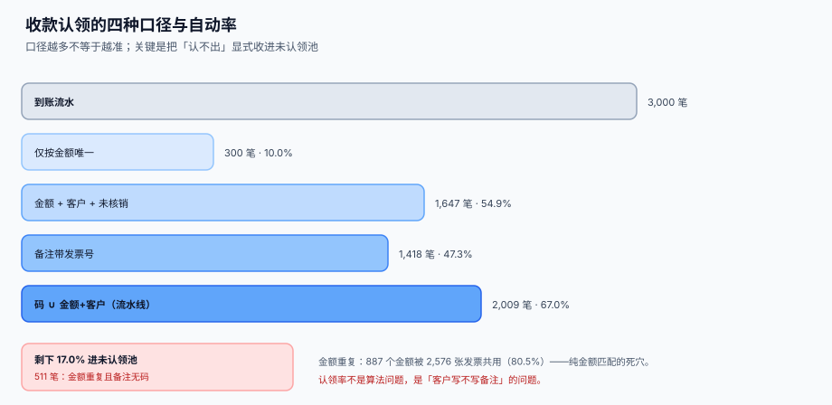

# 收款认领与未认领池

<p style="text-align:center;"></p>

钱到了，账没销——这是应收账款里最普遍的日常。客户打了 45,000，备注只有「货款」两个字；系统里有三张发票正好都能凑出这个数；应收会计看了一眼，把它挂在一边，准备「等客户问了再说」。三个月后这笔钱还在未认领池里，应收账款账龄表上那三张票还在逾期。

本页判据族 `TRA-A` ~ `TRA-H`，共 8 条，定义在最后一节。

## 一、到账与认领是两件事

| 概念 | 表 | 含义 | 数量关系 |
| --- | --- | --- | --- |
| 到账（receipt） | `tre_receipt` | 银行真收到一笔钱 | 一笔到账 = 一行 |
| 认领（allocation） | `tre_receipt_alloc` | 这笔钱销了哪张票 | 一笔到账可以对多张票 |
| 核销（settlement） | 应收子系统 | 发票状态变为已收款 | 一张票可以被多笔到账分次销 |

三种关系必须都能表达，缺一种就会有人用「改金额」绕过去：

```text
一票一款：receipt 45,000 → alloc INV001 45,000
合单收款：receipt 87,000 → alloc INV001 45,000 + alloc INV002 42,000
部分收款：receipt 12,000 → alloc INV003 12,000（票面 30,000，余 18,000）
```



## 二、四种匹配口径，本机读数

样本：3,000 笔到账、3,200 张发票，55% 一票一款、25% 合单、20% 部分收款；发票金额按「整数单价 × 小数量」生成（真实发票金额高度重复）。

| 口径 | 规则 | 自动认领 | 自动率 |
| --- | --- | --- | --- |
| A 仅按金额 | 该金额全库唯一才认 | 300 笔 | **10.0%** |
| B 金额 + 客户 + 未核销唯一 | 同客户同金额只剩一张未核销 | 1,647 笔 | **54.9%** |
| C 备注带发票号 | 摘要里的 `INV\d{6}` 能对上 | 1,418 笔 | **47.3%** |
| D 流水线（C 优先，B 兜底） | 先按码、码不在再按金额+客户 | 2,009 笔 | **67.0%** |
| — 进人工池 | 金额重复且备注无码 | 511 笔 | **17.0%** |

两个反直觉的读数：

1. **纯金额匹配只有 10.0%**。因为 **887 个金额被 2,576 张发票共用（80.5%）**——「整数单价 × 小数量」天然制造重号，一张 1,280 × 5 = 6,400 的票，全库可能有七八张。
2. **「备注码」单用只有 47.3%，比「金额+客户」还低**。不是因为码不准，而是**只有约六成客户真的写**。码一旦写了几乎一定对，覆盖率才是瓶颈。

::: danger 三个常见的「聪明做法」
1. **按金额最接近的那张票认**：45,000 的到账去认一张 44,980 的票，差 20 元挂「尾差」。一次两次是尾差，一百次就是**用一张票吸收所有差额**，账上永远平，实际永远错。
2. **先认最早到期的票**（FIFO）：客户明确付的是争议最小的那张，你按 FIFO 认成最早的逾期票，结果逾期表看起来变好了，真实的争议票永远显示「未收」。
3. **把认不出的钱记「其他应付款」**：这在总账上是平的，但资金侧会永远留下一笔「来源不明」的钱；正确做法是进**未认领池**，带账龄与责任人。
:::

## 三、匹配必须有序

匹配不是「找一个能对上的」，而是**按确定的优先级逐层落**，每一层落不下才进下一层：

```python
def apply(receipt, open_invoices):
    # 第 1 层：摘要里的发票号（最可信，客户自己说的）
    nos = re.findall(r"INV\d{6}", receipt.memo or "")
    hits = [i for i in open_invoices if i.no in nos]
    if hits and sum(i.open_amt for i in hits) == receipt.amt:
        return alloc(receipt, hits)          # 合单且金额正好

    # 第 2 层：客户 + 金额 + 未核销唯一
    cand = [i for i in open_invoices
            if i.cust == receipt.payer and i.open_amt == receipt.amt]
    if len(cand) == 1:
        return alloc(receipt, cand)

    # 第 3 层：客户 + 金额 ≤ 到账额（部分收款），且只有一张
    cand = [i for i in open_invoices
            if i.cust == receipt.payer and i.open_amt <= receipt.amt]
    if len(cand) == 1:
        return alloc(receipt, cand, amt=receipt.amt)

    # 落不下：进未认领池，带「为什么落不下」
    return to_pool(receipt, reason=pool_reason(receipt, open_invoices))
```

`pool_reason` 是这一页最重要的设计：**未认领池里的每一笔都要能回答「为什么没认上」**。否则三个月后没人知道该去找客户还是找系统。

| `pool_reason` | 含义 | 下一步动作 |
| --- | --- | --- |
| `AMBIGUOUS_AMOUNT` | 金额对应多张未核销票 | 让客户在摘要里补发票号 |
| `NO_OPEN_INVOICE` | 该客户没有任何未核销票 | 可能是预收、也可能是错付 |
| `OVER_PAYMENT` | 到账额大于全部未核销票之和 | 差额进预收或退款流程 |
| `NAME_MISMATCH` | 付款方名称与客户主数据对不上 | 先做身份归一化（见下） |

## 四、付款方名称要先归一化

「上海某某科技有限公司」「上海某某科技」「某某科技（上海）」在系统里可能是三个客户。归一化做不好，第 2 层匹配直接失效。

```sql
-- 归一化：去括号内容、去地域后缀、去标点、统一全角
CREATE FUNCTION norm_payer(s TEXT) RETURNS TEXT AS $$
  SELECT replace(replace(replace(
           regexp_replace(upper(s), '[（）()【】\[\]｛｝{}·,，.。\s]', '', 'g'),
         '有限责任公司',''), '有限公司',''), '股份','');
$$ LANGUAGE sql IMMUTABLE;
```

本机读数（3,000 笔到账，付款方名称带全角括号、省略后缀、去掉行业词三种变体）：

| 口径 | 能对上客户主数据 | 比例 |
| --- | --- | --- |
| 严格字符串相等 | 2,702 笔 | 90.1% |
| 归一化后相等 | 2,782 笔 | **92.7%** |
| 仍对不上 | 218 笔 | 7.3% |

归一化只多救了 **2.6 个百分点（80 笔）**——这提醒一件事：**名称归一化的收益比想象的小**，因为客户大多数时候就照抄了全名。真正要靠的是税号与结构化汇款信息，而不是把公司的名字反复洗。

::: warning 归一化只能「收窄」，不能「合并」
把「某某科技」和「某某科技（上海）」归一成同一个字符串，会把两个独立法人合成一个客户。正确做法是：归一化只用于**召回候选**，最终仍要人工确认或按税号匹配——税号是唯一可靠的实体标识。
:::

## 五、未认领池要有账龄与责任人

```sql
CREATE TABLE tre_unapplied_pool (
  pool_id     INTEGER PRIMARY KEY,
  receipt_id  INTEGER NOT NULL REFERENCES tre_receipt(receipt_id),
  reason      TEXT NOT NULL,
  owner       TEXT NOT NULL,              -- 责任人，不能为空
  created_on  TEXT NOT NULL,
  aged_days   INTEGER GENERATED ALWAYS AS
              (julianday('now') - julianday(created_on)) VIRTUAL,
  resolved_on TEXT
);
```

三条纪律：

1. **`owner` 不能为空**。没有责任人的池子等于垃圾桶。
2. **账龄分档与动作绑定**：0~7 天自动重试匹配；8~30 天通知客户补摘要；31~90 天升级到财务主管；90 天以上进「长期挂账」报表，按准则判断是否转入营业外收入。
3. **池子只出不进不对**——要能统计「本月新增 / 本月清掉 / 期末余额」，否则它会静默增长。

## 六、判据清单

| 编号 | 判据 | 怎么验 |
| --- | --- | --- |
| `TRA-A` | 一笔到账只落一行，银行流水号在账户内唯一 | `UNIQUE (acct_id, bank_ref)` |
| `TRA-B` | 认领合计不得超过到账金额 | 触发器 `ALLOC_OVER_RECEIPT` |
| `TRA-C` | 同一到账对同一发票只能认一次 | `UNIQUE (receipt_id, invoice_no)` |
| `TRA-D` | 匹配按固定优先级执行，顺序写在代码里而不是「谁先匹配到算谁」 | 函数内 1→2→3 层显式 `if`，无 `LIKE` 兜底 |
| `TRA-E` | 未认领池每笔都有 `reason` 与 `owner` | 两列 `NOT NULL` |
| `TRA-F` | 部分收款后发票仍保持「未核销」，不被置为已收 | 发票余额由 `Σ alloc` 反算，不另存状态 |
| `TRA-G` | 合单收款必须要求金额与所选发票合计相等 | 第 1 层 `sum(open_amt) == receipt.amt` |
| `TRA-H` | 池子的期末余额 = 期初 + 新增 − 清掉 | 月度对账查询恒等 |

## 验证方式

```shell
# 1) 认领不得超过到账：应报 ALLOC_OVER_RECEIPT
sqlite3 /tmp/tre.db "INSERT INTO tre_receipt_alloc(receipt_id,invoice_no,amt)
                     VALUES(1,'INV000001',999999);"
# 期望：ALLOC_OVER_RECEIPT（触发器拦截）

# 2) 同票同到账不能认两次
sqlite3 /tmp/tre.db "INSERT INTO tre_receipt_alloc(receipt_id,invoice_no,amt)
                     VALUES(1,'INV000001',1);"
# 期望：UNIQUE constraint failed: tre_receipt_alloc.receipt_id, tre_receipt_alloc.invoice_no

# 3) 认领合计 = 到账金额时状态应为 APPLIED
sqlite3 /tmp/tre.db "SELECT bank_ref, status, amt,
                       (SELECT COALESCE(SUM(amt),0) FROM tre_receipt_alloc a
                         WHERE a.receipt_id=r.receipt_id) AS allocated
                       FROM tre_receipt r;"
# 期望：allocated = amt 的行，status 都是 APPLIED

# 4) 未认领池不许有无主条目
sqlite3 /tmp/tre.db "SELECT count(*) FROM tre_unapplied_pool WHERE owner IS NULL OR reason IS NULL;"
# 期望：0
```

## 参考资料

- [账户、余额与价值日期](../AccountModel/index.md)：到账流水落在哪个账户、按哪个日期可用
- [13 周滚动预测与现金缺口](../Forecast/index.md)：认领率直接影响回款曲线
- [银行对账与对账单解析](../Statement/index.md)：到账流水的上游是对账单
- [幂等键与状态机](../../IdempotencyStateMachine/IdempotencyKey/index.md)：重投的到账通知怎么去重
- ISO 20022 `camt.054` 借贷通知（`RmtInf` 结构化汇款信息）：<https://www.iso20022.org/iso-20022-message-definitions>
