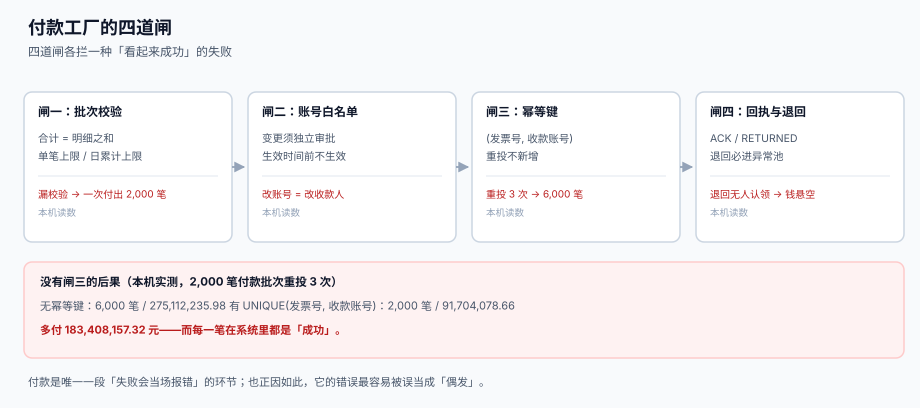

# 付款工厂与账号白名单

<p style="text-align:center;"></p>

付款是资金链里唯一「失败会当场报错」的一段——也正因如此，它的错误最容易被误当成「偶发」。一笔付款重复发送两次，银行两笔都成功，供应商两笔都收下，系统里两条都是「成功」；直到对账时发现余额少了 45,000，才回头找是哪一步出的问题。

本页判据族 `TRF-A` ~ `TRF-H`，共 8 条，定义在最后一节。

## 一、四道闸，各拦一种「看起来成功」的失败



| 闸 | 拦什么 | 靠什么 | 漏了会怎样 |
| --- | --- | --- | --- |
| 批次校验 | 合计对不上、单笔超限、超日累计 | 入库前算三遍 | 一次付出 2,000 笔而不是 20 笔 |
| 账号白名单 | 收款账号被改 | 变更走独立审批 + 生效时间 | 钱付给了「长得一样」的另一个账户 |
| 幂等键 | 批次重投、消息重放、人工重发 | `UNIQUE (invoice_no, ben_acct)` | 重投 3 次 → 6,000 笔 |
| 回执与退回 | 账号不存在、户名不符、被退汇 | `ACKED` / `RETURNED` 两态 + 异常池 | 钱退回来了没人认，悬在账上 |

## 二、批次与指令必须分两张表

```sql
CREATE TABLE tre_payment_batch (
  batch_no    TEXT PRIMARY KEY,
  acct_id     TEXT NOT NULL REFERENCES tre_account(acct_id),
  biz_date    TEXT NOT NULL,
  total_amt   NUMERIC NOT NULL,
  item_count  INTEGER NOT NULL,
  status      TEXT NOT NULL DEFAULT 'DRAFT'
              CHECK (status IN ('DRAFT','CHECKED','SENT','CLOSED'))
);

CREATE TABLE tre_payment_instr (
  instr_id   INTEGER PRIMARY KEY,
  batch_no   TEXT NOT NULL REFERENCES tre_payment_batch(batch_no),
  invoice_no TEXT NOT NULL,
  ben_acct   TEXT NOT NULL,
  amt        NUMERIC NOT NULL CHECK (amt > 0),
  status     TEXT NOT NULL DEFAULT 'CREATED'
             CHECK (status IN ('CREATED','SENT','ACKED','RETURNED')),
  UNIQUE (invoice_no, ben_acct)
);
```

为什么不能合成一张表：

1. **批次是「一次动作」，指令是「一笔债务」**。批次的合计与笔数一旦发出就不能改；指令的 `status` 会随着回执变化。
2. **幂等键属于指令**。同一个批次重投两次，应该被键拦下；换一个批次号再投，仍应被同一张发票的键拦下——键写在指令上才拦得住。
3. **退回是逐笔的**。一批 20 笔退回 1 笔，批次状态仍是 `CLOSED`，但那一笔要进异常池。

### 本机读数：没有幂等键的代价

2,000 笔付款批次，因网关超时被重投 3 次（真实场景里非常常见：超时不等于失败）：

| 配置 | 指令数 | 金额 |
| --- | --- | --- |
| 无幂等键 | **6,000** | **275,112,235.98** |
| `UNIQUE (invoice_no, ben_acct)` | 2,000 | 91,704,078.66 |
| 多付 | +4,000 | **+183,408,157.32** |

::: danger 用「批次号」当幂等键的三个漏洞
1. **人工重发会换批次号**。出纳没看到「已发送」，重新组一个批次再点一次——键完全不同，两批都过。
2. **同一张发票可能合法地出现在两个批次**（部分付款），批次号更拦不住，而 `(invoice_no, ben_acct)` 加金额上限才拦得住。
3. **重投的是消息不是批次**。网关重投时批次号可能被包在消息里也可能不在，键必须落在「业务事实」上（哪张票、付给谁），不能落在「一次动作」上。
:::

**正确写法**：键用 `(invoice_no, ben_acct)`，金额上限靠触发器校验，不靠键。

```sql
-- 部分付款场景：同一 (invoice_no, ben_acct) 允许多行，但累计不得超过发票金额
CREATE TRIGGER trg_pay_cap BEFORE INSERT ON tre_payment_instr
BEGIN
  SELECT CASE WHEN
    (SELECT COALESCE(SUM(amt),0) FROM tre_payment_instr
      WHERE invoice_no = NEW.invoice_no AND ben_acct = NEW.ben_acct) + NEW.amt
    > (SELECT open_amt FROM ap_invoice WHERE invoice_no = NEW.invoice_no)
  THEN RAISE(ABORT, 'PAY_OVER_INVOICE') END;
END;
```

## 三、账号白名单：改账号 ≠ 改电话

「供应商改收款账号」是资金诈骗的经典入口，因为它在系统里长得和「改联系电话」一模一样。本机读数：2,000 家供应商里 **31 家**变更了收款账户，其中 **7 家（22.6%）** 走的是「普通资料维护」入口，没有独立审批。

```sql
CREATE TABLE tre_beneficiary_whitelist (
  ben_id      INTEGER PRIMARY KEY,
  supplier_id TEXT NOT NULL,
  ben_acct    TEXT NOT NULL,
  ben_name    TEXT NOT NULL,
  effective_from TEXT NOT NULL,
  effective_to   TEXT,
  approved_by TEXT NOT NULL,
  approval_ref TEXT NOT NULL,          -- 审批单号，不是「审批人写了名字」
  UNIQUE (supplier_id, ben_acct, effective_from)
);
```

四条硬规则：

| 规则 | 判据 | 违反后果 |
| --- | --- | --- |
| 新账号有冷静期 | `effective_from >= approved_at + 24h` | 骗子当天改、当天付，来不及发现 |
| 户名校验 | `ben_name` 必须与银行返回的户名一致 | 户名不符的付款会被退回，但退汇要 3~7 天 |
| 旧账号失效不删除 | `effective_to` 置日期，行保留 | 删了就无法解释「上个月为什么付到这个账号」 |
| 付款时必查 | 付款指令的 `ben_acct` 必须在白名单内且 `effective_from <= biz_date` | 直接付款绕过白名单等于没有白名单 |

::: warning 冷静期要按「付款日」算，不是按「录入日」
`effective_from >= approved_at + 24h` 这条如果按录入日算，骗子在周五 17:00 提交、周六生效、周一付款，冷静期形同虚设。正确写法是把冷静期算到**下一个工作日**，并且在这段时间内向**原预留联系人**（不是发起变更的人）发一条确认。
:::

## 四、金额分级与双人复核

| 单笔金额 | 复核要求 | 依据 |
| --- | --- | --- |
| < 5 万 | 单人复核 | 成本高于风险 |
| 5 万 ~ 50 万 | 双人复核（发起人不能是复核人） | 覆盖绝大多数付款 |
| > 50 万 | 双人复核 + 资金总监审批 | 单笔影响当日头寸 |
| 新收款账号首笔 | 不论金额，双人复核 + 电话回呼 | 变更风险与金额无关 |

```sql
-- 复核记录独立成表：审批不是「指令上的一个布尔字段」
CREATE TABLE tre_payment_approval (
  instr_id   INTEGER NOT NULL REFERENCES tre_payment_instr(instr_id),
  approver   TEXT NOT NULL,
  approved_at TEXT NOT NULL,
  decision   TEXT NOT NULL CHECK (decision IN ('APPROVE','REJECT')),
  PRIMARY KEY (instr_id, approver)
);
```

「发起人不能是复核人」要在数据库层拦，不能只在前端拦：

```sql
CREATE TRIGGER trg_no_self_approve BEFORE INSERT ON tre_payment_approval
BEGIN
  SELECT CASE WHEN NEW.approver = (
    SELECT created_by FROM tre_payment_instr WHERE instr_id = NEW.instr_id)
  THEN RAISE(ABORT, 'SELF_APPROVAL') END;
END;
```

## 五、回执、退回与「悬空的钱」

付款发出去只是 `SENT`，真正结束要等 `ACKED`；被退回要进 `RETURNED` 并落异常池。

| 状态 | 含义 | 钱在哪 | 下一步 |
| --- | --- | --- | --- |
| `CREATED` | 指令已建，未发 | 还在账上 | 等复核 |
| `SENT` | 已提交银行，未回执 | **不确定** | 超时先查回执，不能重发 |
| `ACKED` | 银行确认受理 | 已出账 | 等对账单 |
| `RETURNED` | 户名不符 / 账号不存在 / 被退汇 | **退回到账上** | 进异常池，限期处理 |

`SENT` 是最危险的状态：钱可能已经出去了，也可能没有。**此时唯一正确的动作是查回执，不是重发**——重发就是第二节那个 3 倍金额的来源。

```sql
-- 超时未回执的指令：只查不重发
SELECT instr_id, batch_no, invoice_no, amt, status
  FROM tre_payment_instr
 WHERE status = 'SENT'
   AND julianday('now') - julianday(created_at) > 0.25;   -- 6 小时
```

## 六、排程：早付与晚付都是钱

| 选择 | 收益 | 成本 |
| --- | --- | --- |
| 到期日付（不早付） | 多占 20~30 天现金 | 供应商满意度 |
| 折扣期内付（2/10 net 30） | 省 2%，年化 **37.2%** | 提前 20 天出钱 |
| 集中批量付（每周一次） | 批次少、复核成本低 | 单日头寸峰值高 |

折扣的条件必须写进付款排程，而不是靠人记：

```sql
-- 折扣窗口：invoice_date + 10 天，折扣 2%
SELECT invoice_no, amt,
       ROUND(amt * 0.02, 2)                       AS discount,
       date(invoice_date, '+10 day')              AS discount_deadline,
       CASE WHEN date('now') <= date(invoice_date, '+10 day')
            THEN ROUND(amt * 0.98, 2) ELSE amt END AS pay_amt
  FROM ap_invoice
 WHERE status = 'OPEN';
```

## 七、判据清单

| 编号 | 判据 | 怎么验 |
| --- | --- | --- |
| `TRF-A` | 批次与指令分表，批次合计 = 指令之和 | `SUM(amt) = total_amt AND count(*) = item_count` |
| `TRF-B` | 幂等键落在业务事实（发票 + 收款账号）上 | `UNIQUE (invoice_no, ben_acct)` |
| `TRF-C` | 同票同账号累计付款不超过发票余额 | 触发器 `PAY_OVER_INVOICE` |
| `TRF-D` | 付款前必查白名单且校验生效日期 | 付款函数内 `EXISTS (… effective_from <= :biz_date)` |
| `TRF-E` | 新账号冷静期按工作日计，且通知原联系人 | 变更表有 `notified_to` 与 `effective_from` |
| `TRF-F` | 发起人不能是复核人 | 触发器 `SELF_APPROVAL` |
| `TRF-G` | `SENT` 超时只查回执、不重发 | 无「超时自动重发」代码路径 |
| `TRF-H` | 退回必进异常池且有处理期限 | `RETURNED` 的指令在 `tre_payment_exception` 有行 |

## 验证方式

```shell
# 1) 重投不新增：同一 (发票, 账号) 插两次，第二次应失败
sqlite3 /tmp/tre.db "INSERT INTO tre_payment_instr(batch_no,invoice_no,ben_acct,amt)
                     VALUES('B1','INV000002','6222-8888',45000);
                     INSERT INTO tre_payment_instr(batch_no,invoice_no,ben_acct,amt)
                     VALUES('B2','INV000002','6222-8888',45000);"
# 期望：UNIQUE constraint failed: tre_payment_instr.invoice_no, tre_payment_instr.ben_acct

# 2) 批次合计必须等于指令之和：应输出 0 行
sqlite3 /tmp/tre.db "SELECT b.batch_no FROM tre_payment_batch b
                      JOIN tre_payment_instr i USING(batch_no)
                     GROUP BY b.batch_no
                    HAVING ROUND(SUM(i.amt),2) <> ROUND(b.total_amt,2)
                        OR COUNT(*) <> b.item_count;"
# 期望：无输出（0 行）

# 3) 发起人不能自审：应报 SELF_APPROVAL
sqlite3 /tmp/tre.db "INSERT INTO tre_payment_approval VALUES(1,'alice','2026-11-30 10:00','APPROVE');"
# 期望：SELF_APPROVAL（当 created_by 也是 alice 时）

# 4) 已发出的指令不得再改金额：应报错或 0 行受影响
sqlite3 /tmp/tre.db "UPDATE tre_payment_instr SET amt = amt + 1 WHERE status IN ('SENT','ACKED');"
# 期望：0 行受影响（或由触发器 RAISE）
```

## 参考资料

- [收款认领与未认领池](../Inflow/index.md)：进来的钱怎么对上账
- [短期融资、额度与计息基准](../Funding/index.md)：额度不足时付款排程怎么改
- [银行对账与对账单解析](../Statement/index.md)：`ACKED` 之后的核对
- [供应商协同与价格主数据](../../SupplierCollaboration/SupplierPortal/index.md)：门户侧的账号变更入口
- [幂等键与状态机](../../IdempotencyStateMachine/IdempotencyKey/index.md)：幂等键的通用设计
