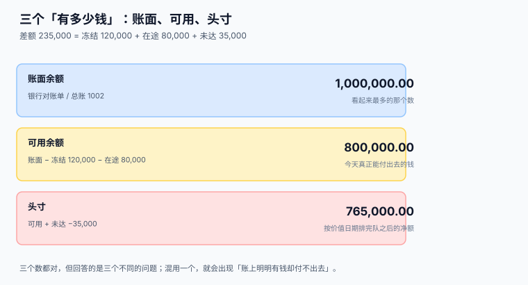
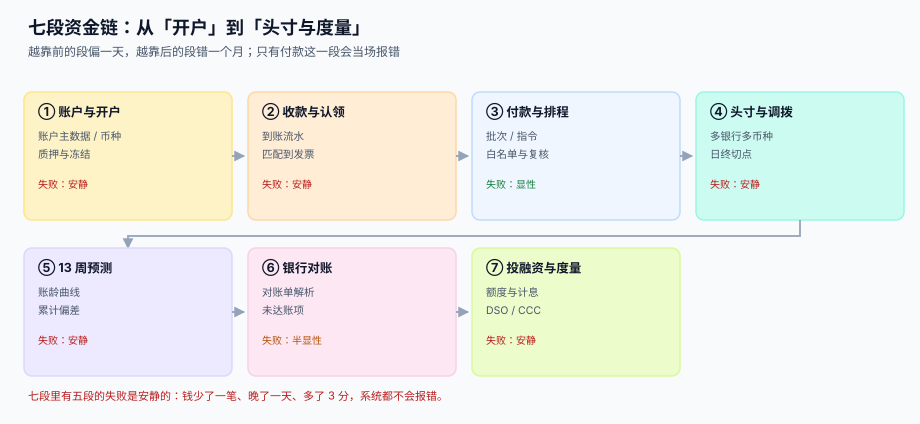

# 总览：七段资金链与三个「有多少钱」

<p style="text-align:center;"></p>

同一家公司，同一个上午，四个人报出四个余额：出纳看网银说「有一百万」，资金经理看系统说「能用八十万」，CFO 看集团头寸表说「七十六万五」，应付会计说「下周要付一百二十万」。四个人都没撒谎，四个数也都能对上账——但只有把这四个数的关系写清楚，才谈得上「管钱」。

::: tip 一句话理解
**资金管理的对象不是「余额」，而是「余额的时间」。** 账上有多少钱不重要，重要的是哪一天、在哪个账户上、能动多少。
:::

本页判据族 `TRO-A` ~ `TRO-H`，共 8 条，定义在最后一节。

## 一、三个「有多少钱」



| 口径 | 存在哪 | 回答什么 | 公式 | 典型失效 |
| --- | --- | --- | --- | --- |
| 账面余额 | 银行对账单 / 总账 1002 | 银行说你有多少 | 银行给的期末余额 | 把质押保证金当成自己的钱 |
| 可用余额 | `tre_balance_snapshot` | 今天能付出去多少 | 账面 − 冻结 − 在途 | 在途算成已到账 |
| 头寸 | `tre_position` | 按价值日期排完队之后的净额 | 可用 + 未达净额 | 未达账项方向搞反 |

本机读数（一个账户，2026-11-30）：

| 项目 | 金额 |
| --- | --- |
| 账面余额 | 1,000,000.00 |
| 减：质押 / 冻结 | −120,000.00 |
| 减：在途未清算（T+1） | −80,000.00 |
| **可用余额** | **800,000.00** |
| 加：未达账项净额 | −35,000.00 |
| **头寸** | **765,000.00** |

账面与头寸相差 **235,000.00（23.50%）**。这个差不是差错，是**四类「在账上但不在手上」的钱**：质押、冻结、在途、未达。

::: danger 把三个余额合成一个字段的三个后果
1. **只存账面余额**：付不出去的时候才发现 12 万是票据保证金，而保证金要等票据到期才解冻。这类事故在财务报表上表现为「货币资金充足但流动性断裂」。
2. **只存可用余额**：总账对不上。总账 1002 科目记的是账面余额，你给它一个「减去冻结」的数，月结时借贷不平，查三天查不出来。
3. **用头寸当付款上限**：头寸含未达账项，而未达里有一半是「银行已扣、企业还没记」的付款——那笔钱已经出去了，再按头寸付一次就是重复付款。
:::

**正确写法**：三个数分三列存，且**每次都从明细算出来**，不维护一个「当前余额」字段。

```sql
-- 一次算出三个口径，任何一列都不能用另一列推算
SELECT s.acct_id,
       s.book_amt                                   AS book,
       s.book_amt - s.frozen_amt - s.in_transit_amt AS available,
       s.book_amt - s.frozen_amt - s.in_transit_amt
         + COALESCE(u.unmatched_net, 0)             AS position
  FROM tre_balance_snapshot s
  LEFT JOIN (SELECT acct_id,
                    SUM(CASE direction WHEN 'CR' THEN amt ELSE -amt END) AS unmatched_net
               FROM tre_bank_line
              WHERE matched_instr_id IS NULL AND matched_receipt_id IS NULL
              GROUP BY acct_id) u ON u.acct_id = s.acct_id
 WHERE s.biz_date = :biz_date;
```

## 二、七段链：哪几段的失败是安静的



| 段 | 谁在做 | 交给下一段的东西 | 这一段独有的失败 | 谁来发现 |
| --- | --- | --- | --- | --- |
| ① 账户与开户 | 资金部 | 账户主数据、余额快照 | 账户性质记错（一般户当基本户） | 年检（**一年一次**） |
| ② 收款与认领 | 应收会计 | 到账流水、认领分配 | 认不上就放着，客户也不催 | 应收账龄异常（**没人看**） |
| ③ 付款与排程 | 资金部 | 付款批次、指令 | 重复付款、收款账号被改 | 银行回执（显性） |
| ④ 头寸与调拨 | 资金经理 | 日终头寸 | 日终切点不统一 | 月度对账（**跨月才发现**） |
| ⑤ 13 周预测 | 资金经理 | 未来 13 周现金流 | 用固定 DSO，把波动抹平 | 缺钱那天（**已经晚了**） |
| ⑥ 银行对账 | 出纳 | 余额调节表 | 只比总额，不逐笔 | 季末审计（**三个月后**） |
| ⑦ 投融资与度量 | 资金总监 | 授信台账、DSO/CCC | 计息基准写错、额度超占 | 利息单（**金额小到没人核**） |

七段里有**五段的失败是安静的**。安静的失败有一个共同特征：**它不产生异常，只产生偏差**——数字变小了、晚了一天、多了几分钱，没有任何一条规则被违反。

第 ⑤ 段最典型。本机实测：期初 300 万、每周固定支出 400 万，用「固定 DSO = 45 天」预测 13 周回款，模拟出来的**最低余额是 3,000,000.00，一次都不会为负**；而按实际回款，余额在 **12-30 转为 −1,025,534.30**。系统在整个过程中一次都没有报警。

## 三、四个必失接缝

七段之间有四个接缝。它们不是流程节点，而是**口径断点**——上一段的产物在这一段被重新解释，解释错了没人拦。

| 接缝 | 断在哪 | 本机读数 | 本册哪一页管 |
| --- | --- | --- | --- |
| 记账日 vs 价值日期 | 月末余额按哪个日期取数 | 最后 5 天 846 笔收款里 **178 笔（21.0%）** 可用日落到次月，月末高估 **3.40%** | [账户、余额与价值日期](../AccountModel/index.md) |
| 到账 vs 认领 | 一笔到账能不能自动归到发票 | 纯金额匹配只认 **10.0%**，加客户 **54.9%**，流水线合并 **67.0%**，剩 **17.0%** 进人工池 | [收款认领与未认领池](../Inflow/index.md) |
| 可用 vs 冻结 | 质押、保证金、司法冻结算不算可用 | 12 万保证金按活期计息 **119.67**，按理财应为 **1,256.55** | [头寸、多银行与资金归集](../Positioning/index.md) |
| 预测 vs 实际 | 周内波动要不要建模 | 单周 MAPE 固定 DSO **65.8%** vs 账龄曲线 **55.7%**；4 周窗口 **51.5%** vs **37.8%** | [13 周滚动预测与现金缺口](../Forecast/index.md) |

四个接缝里，前三个是**数据口径**问题，第四个是**方法**问题。它们共用一个特征：**错了也不会有人来投诉**——直到某天付不出钱。

## 四、本册的工程立场

三句话，后面每页都会回到它们：

1. **明细只追加，余额算出来。** 余额快照按「账户 × 日」唯一，重跑覆盖同一天，绝不新增一行；认领分配、付款指令、对账匹配都是追加表（见 [账户、余额与价值日期](../AccountModel/index.md)）。
2. **一切「什么时候能用」都落在 `value_date` 上。** 不存「预计到账日」这种含混字段，只存价值日期与在途金额，让可用余额成为一个可复算的减法（见 [头寸、多银行与资金归集](../Positioning/index.md)）。
3. **所有勾稽都写成 SQL，不写成流程。** 流程会被跳过，SQL 不会——月结前跑五条查询，任何一条不为 0 就不许关账（见 [实战：从到账到调节表的闭环](../Practice/index.md)）。

## 五、判据清单

| 编号 | 判据 | 怎么验 |
| --- | --- | --- |
| `TRO-A` | 七段各有产物表，且段与段之间不共用一张表 | 七张 `tre_*` 表都在，`tre_receipt` 不含「已认领金额」以外的会计字段 |
| `TRO-B` | 三个余额分列三处，任一口径都不由另一个推算 | `tre_balance_snapshot` 有四列原始数，视图中才算 `available` |
| `TRO-C` | 账户 × 日唯一，重跑覆盖而非新增 | `PRIMARY KEY (acct_id, biz_date)` |
| `TRO-D` | 一切时点判断以 `value_date` 为准，不以 `created_at` 为准 | 全表无 `created_at` 参与余额或头寸计算 |
| `TRO-E` | 四个接缝各有对应表与判据页 | 四张表存在，且对应页判据族非空 |
| `TRO-F` | 每个失败模式都能追到「哪个账户、哪一天、哪一笔」 | 任取一条异常，能定位到 `acct_id` + `biz_date` + 业务单号 |
| `TRO-G` | 本册不回答「怎么编现金流量表」，只回答「现金怎么流动」 | 正文不出现报表编制步骤，只出现时点与口径 |
| `TRO-H` | 「失败是否安静」的标注与实际代码一致 | 五段安静段均无异常抛出点，仅在月末勾稽处报错 |

## 验证方式

```shell
# 1) 三个余额必须分列：应输出 3（book / frozen / in_transit；未达在对账单侧）
sqlite3 /tmp/tre.db "SELECT name FROM pragma_table_info('tre_balance_snapshot')
                      WHERE name IN ('book_amt','frozen_amt','in_transit_amt');" | wc -l
# 期望：3（未达不在快照表里，它在对账单侧，避免同一事实存两处）

# 2) 账户 × 日唯一：重复插入应报错
sqlite3 /tmp/tre.db "INSERT INTO tre_balance_snapshot VALUES('A001','2026-11-30',1,0,0);"
# 期望：UNIQUE constraint failed: tre_balance_snapshot.acct_id, tre_balance_snapshot.biz_date

# 3) 头寸 = 可用 + 未达：应输出 0.0
sqlite3 /tmp/tre.db "WITH a AS (
  SELECT SUM(book_amt-frozen_amt-in_transit_amt) v FROM tre_balance_snapshot WHERE biz_date='2026-11-30'),
u AS (SELECT COALESCE(SUM(CASE direction WHEN 'CR' THEN amt ELSE -amt END),0) v
        FROM tre_bank_line WHERE matched_instr_id IS NULL AND matched_receipt_id IS NULL)
SELECT ROUND((SELECT v FROM a)+(SELECT v FROM u)
             -(SELECT SUM(book_amt-frozen_amt-in_transit_amt) FROM tre_balance_snapshot WHERE biz_date='2026-11-30')
             -(SELECT v FROM u), 2);"
# 期望：0.0（定义自洽，不是靠巧合）
```

## 与本专题的分工

资金册判**余额的时间**（什么时候有多少钱可用），合并册判**余额的归属**（这笔钱属于集团还是少数股东）。

| 你关心的问题 | 该读哪一册 | 为什么 |
| --- | --- | --- |
| 今天可用头寸是多少、下周会不会缺 | 本册 | 三个余额、13 周滚动预测 |
| 集团资金池的内部拆借要不要抵销 | [合并报表与内部抵销](../../Consolidation/Intercompany/index.md) | 内部利息收入 / 支出成对抵销 |
| 合并现金流量表怎么编 | 合并册 | 内部收付要抵销，否则经营现金流虚增 |
| 少数股东的分红算不算集团现金流出 | 合并册 | 属于筹资活动的分配，列示位置不同 |
| 境外子公司的现金按哪个汇率折 | 合并册 | 期末汇率折算，差额进 CTA |

::: danger 本页特有的一处坑：内部资金往来只抵余额不抵利息
资金池的拆借在资产负债表上是「其他应收 / 其他应付」，抵销比较直观；但利息收入与利息支出也必须成对抵销，否则合并利润表的「财务费用」净额会偏。

更隐蔽的是**计息天数不一致**：拆出方按 365 天、拆入方按 360 天计息，双方利息差一点点，抵销后仍留下一个余额。本册在 ACT/360 与 ACT/365 之间差 1.39%，这个差额在合并层必须显式处置（进 CTA 或调平并留痕），不能靠「差不多」。
:::

## 参考资料

- [账户、余额与价值日期](../AccountModel/index.md)：三个余额的字段设计与价值日期
- [13 周滚动预测与现金缺口](../Forecast/index.md)：为什么单周点值不可承诺
- [实战：从到账到调节表的闭环](../Practice/index.md)：五条自检查询
- [复式记账与分录](../../Ledger/DoubleEntry/index.md)：货币资金科目与两腿
- 财政部：《企业会计准则第 31 号——现金流量表》：<https://www.mof.gov.cn/>
