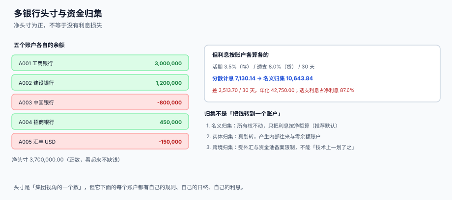

# 头寸、多银行与资金归集

<p style="text-align:center;"></p>

集团有 5 个账户，净头寸 3,700,000——看起来不缺钱。但其中两个账户是负的，一个透支 80 万，一个透支 15 万，按 8% 计息；另外三个账户放着 465 万，按 3.5% 收利息。同一天、同一笔钱，一边付 8% 一边收 3.5%，中间的 4.5 个百分点**没有任何人赚到，全部交给了银行**。

本页判据族 `TRC-A` ~ `TRC-H`，共 8 条，定义在最后一节。

## 一、头寸有三个层级

「头寸」这个词在不同场合指三个不同的东西，混用是资金报表最常见的争议来源：

| 层级 | 回答什么 | 取数范围 | 用途 |
| --- | --- | --- | --- |
| 账户头寸 | 这个账户今天能动多少 | 单账户 | 付款审批 |
| 法人头寸 | 这个法人今天能动多少 | 同一法人全部账户 | 授信与内部计价 |
| 集团头寸 | 整个集团今天净多少 | 全部法人、全部币种 | 投融资决策 |

三个层级的差额来自**内部往来**：子公司 A 的钱调到母公司，集团头寸不变，法人头寸一增一减。**报表上必须写明是哪一层**，否则「集团不缺钱」会被用来解释「子公司付不出钱」。

## 二、五个账户的利息账



| 账户 | 余额 | 利率 | 30 天利息 |
| --- | --- | --- | --- |
| A001 工商银行 | 3,000,000 | 3.5%（存） | +8,630.14 |
| A002 建设银行 | 1,200,000 | 3.5%（存） | +3,452.05 |
| A003 中国银行 | −800,000 | 8.0%（贷） | −5,260.27 |
| A004 招商银行 | 450,000 | 3.5%（存） | +1,294.52 |
| A005 汇丰 USD | −150,000 | 8.0%（贷） | −986.30 |
| **分散计息合计** | 净 3,700,000 | — | **7,130.14** |
| **名义归集** | 3,700,000 | 3.5% | **10,643.84** |

差 **3,513.70 / 30 天**，年化 **42,750.00**。透支利息占「分散计息」净额的 **87.6%**——也就是说，这 7,130 的净利息里，绝大部分是**为透支付的钱**，而不是为存款收的钱。

::: tip 一句话结论
**归集赚的不是利差，是「不用透支」这件事。** 把 465 万存款里的 95 万挪去补透支，透支利息立刻归零，存款利息只减少一点点。
:::

## 三、多币种头寸：折算时点决定数字

同一批外币余额，用月初汇率和月末汇率折算，头寸就不一样：

| 币种 | 金额 | 月初汇率 | 月末汇率 |
| --- | --- | --- | --- |
| USD | 1,200,000 | 7.1234 | 7.2300 |
| EUR | 450,000 | 7.7412 | 7.7860 |
| HKD | 8,000,000 | 0.9123 | 0.9158 |

| 口径 | 折算头寸 |
| --- | --- |
| 月初汇率 | 19,330,020.00 |
| 月末汇率 | 19,506,100.00 |
| 差 | **+176,080.00（+0.911%）** |

一天之内头寸「涨」了 17.6 万，但实际上**一分钱外汇都没动**。所以头寸报表必须固定一件事：**折算用哪个时点的汇率**。

三种常见口径，各有各的用途：

| 口径 | 汇率 | 用途 | 缺点 |
| --- | --- | --- | --- |
| 期末中间价 | 报表日央行中间价 | 对外报表、与会计一致 | 与「今天能换多少」无关 |
| 实时牌价 | 当前即期 | 当天结汇决策 | 一天内多次变动，不可比 |
| 预算汇率 | 年初锁定 | 年度预算与考核 | 与市场脱节 |

**本册立场**：头寸表用**期末中间价**（与会计口径一致），另设一列「按实时牌价的参考值」供交易使用。两个数并存，但**永远不在同一个汇总里相加**。

## 四、日终切点：一天到底在哪结束

| 账户币种 | 当地时刻 | UTC 时刻 | 集团日终（UTC 00:00）归属 |
| --- | --- | --- | --- |
| CNY | 11-30 23:40 | 11-30 15:40 | 11-30 |
| USD（纽约） | 11-30 23:40 | **12-01 12:40** | **12-01** |
| HKD | 12-01 00:10 | 11-30 16:10 | 11-30 |

同一笔 USD 付款，在「当地日终」口径下属于 11-30，在「集团日终」口径下属于 12-01。月末那天，这个差别就是**两个不同的月末头寸**。

::: danger 三种「差不多就行」的切点做法
1. **按服务器时间切**：服务器在哪个时区，日终就在哪，换一台机器报表就变。
2. **按账户所在国切**：每个账户一个日终，集团汇总时「今天」有 20 个不同含义，跨月时无法相加。
3. **按业务录入时间切**：录入是人工动作，可以补录昨天的单，昨天已经关账的头寸会被追溯篡改。
:::

**正确写法**：`biz_date` 由清算日历 + 固定时区规则算出，落库后不再变；所有汇总按 `biz_date` 分组。

```sql
CREATE TABLE tre_position (
  biz_date   TEXT NOT NULL,
  scope      TEXT NOT NULL CHECK (scope IN ('ACCOUNT','LEGAL','GROUP')),
  scope_id   TEXT NOT NULL,           -- acct_id / 法人代码 / 'GROUP'
  ccy        TEXT NOT NULL,
  book_amt   NUMERIC NOT NULL,
  available_amt NUMERIC NOT NULL,
  position_amt  NUMERIC NOT NULL,
  fx_basis   TEXT NOT NULL DEFAULT 'CLOSING',   -- CLOSING / SPOT / BUDGET
  PRIMARY KEY (biz_date, scope, scope_id, ccy, fx_basis)
);
```

`fx_basis` 进主键，是为了让「同一时点、两种汇率」的两个头寸**并存而不互相覆盖**——这也顺便解决了「报表口径改了但历史数据被覆盖」的问题。

## 五、归集的三种形态

| 形态 | 做法 | 所有权 | 典型场景 |
| --- | --- | --- | --- |
| 名义归集（notional pooling） | 不划转，银行按净额计息 | 不动 | 同一法人多账户、同一银行 |
| 实体归集（zero balance account） | 每日日终划转到主账户，子账户归零 | 划转，产生内部往来 | 多法人、同一银行集团 |
| 跨境归集 | 跨境划转或跨境名义归集 | 受外汇管理约束 | 需要备案与额度 |

三条边界必须写清楚：

1. **名义归集不改变法律上的所有权**，所以它不产生内部往来分录；实体归集会，必须同步记「其他应收/应付 — 内部」。
2. **跨境归集不能「技术上一划了之」**：涉及跨境资金池备案、外债/放款额度、汇率与税务，工程上表现为「有额度校验的划转」，而不是普通转账。
3. **归集有成本**：实体归集每天划转，每笔都是跨行转账，手续费与人工都要算；账户数少时未必划算。

```sql
CREATE TABLE tre_pool_rule (
  pool_id     TEXT PRIMARY KEY,
  pool_kind   TEXT NOT NULL CHECK (pool_kind IN ('NOTIONAL','ZBA','CROSS_BORDER')),
  master_acct TEXT NOT NULL REFERENCES tre_account(acct_id),
  member_acct TEXT NOT NULL REFERENCES tre_account(acct_id),
  keep_amt    NUMERIC NOT NULL DEFAULT 0,   -- 子账户留存额
  run_at      TEXT NOT NULL,                -- 'T22:30'
  ccy         TEXT NOT NULL,
  UNIQUE (pool_id, master_acct, member_acct)
);
```

`keep_amt` 不是可有可无的：子账户要留出次日零星付款，全额归零会导致每天早上第一笔付款透支。

## 六、判据清单

| 编号 | 判据 | 怎么验 |
| --- | --- | --- |
| `TRC-A` | 头寸分三层（账户 / 法人 / 集团），报表注明层级 | `tre_position.scope` 三值齐全 |
| `TRC-B` | 日终切点固定，`biz_date` 落库后不变 | 汇总查询只按 `biz_date` 分组，无 `datetime('now')` 参与 |
| `TRC-C` | 折算口径进主键，两种汇率可并存 | `PRIMARY KEY (…, fx_basis)` |
| `TRC-D` | 归集形态可区分，跨境单独一类 | `pool_kind` 三值，`CROSS_BORDER` 有额度校验 |
| `TRC-E` | 实体归集必须产生内部往来分录 | `tre_pool_run` 有 `journal_id` 非空约束 |
| `TRC-F` | 子账户留存额生效，不全额归零 | `keep_amt > 0` 的账户归集后余额 ≥ `keep_amt` |
| `TRC-G` | 透支账户的负余额是「正常」，不触发账务差错 | 余额校验允许 `book_amt < 0` 当且仅当存在 `overdraft_limit` |
| `TRC-H` | 归集收益可复算（分散 vs 归集利息差） | 月度报表能给出两个数及差额 |

## 验证方式

```shell
# 1) 头寸三层齐全：应输出 3
sqlite3 /tmp/tre.db "SELECT count(DISTINCT scope) FROM tre_position WHERE biz_date='2026-11-30';"
# 期望：3

# 2) 同一时点两种汇率并存：应输出 2
sqlite3 /tmp/tre.db "SELECT count(DISTINCT fx_basis) FROM tre_position
                      WHERE biz_date='2026-11-30' AND scope='GROUP';"
# 期望：2（CLOSING 与 SPOT 各一行，互不覆盖）

# 3) 子账户归集后不低于留存额：应输出 0 行
sqlite3 /tmp/tre.db "SELECT r.pool_id, r.member_acct
                       FROM tre_pool_run r JOIN tre_pool_rule u ON u.pool_id=r.pool_id
                      WHERE r.biz_date='2026-11-30'
                        AND r.balance_after < u.keep_amt;"
# 期望：无输出

# 4) 归集收益可复算：分散与归集两个利息数都能算出来
sqlite3 /tmp/tre.db "SELECT ROUND(SUM(CASE WHEN book_amt>0
                          THEN book_amt*0.035*30/365.0
                          ELSE book_amt*0.08*30/365.0 END),2) AS separate,
                            ROUND(SUM(book_amt)*0.035*30/365.0,2)    AS pooled
                       FROM tre_balance_snapshot WHERE biz_date='2026-11-30';"
# 期望：separate = 7130.14 / pooled = 10643.84（与页内读数一致）
```

## 参考资料

- [账户、余额与价值日期](../AccountModel/index.md)：可用余额与在途的定义
- [13 周滚动预测与现金缺口](../Forecast/index.md)：头寸的未来版本就是预测
- [短期融资、额度与计息基准](../Funding/index.md)：透支额度的成本口径
- [多币种与汇率折算](../../MultiCurrency/Conversion/index.md)：折算路径与重估
- 国家外汇管理局：跨境资金池业务相关规定：<https://www.safe.gov.cn/>
