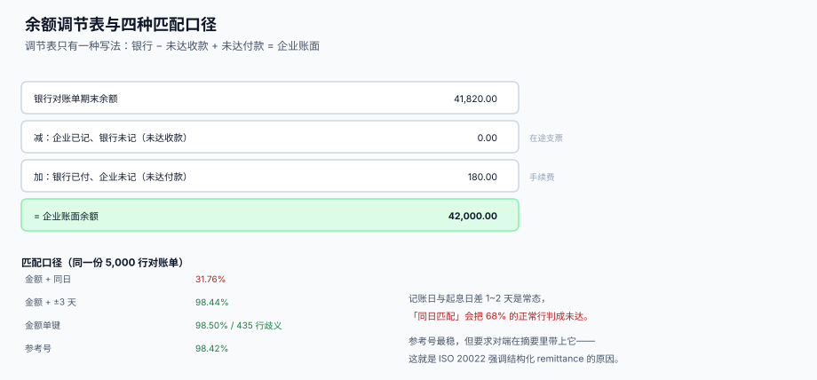

# 银行对账与对账单解析

<p style="text-align:center;"></p>

对账这件事有一种奇怪的错觉：只要总额对得上，就认为账是平的。本机实测把这个错觉打掉了——5,000 行对账单里有 79 行差异，总额却只差 **0.0006%**；如果把判据定成「总额差异 < 0.1%」，这 79 行会全部通过。

本页判据族 `TRB-A` ~ `TRB-H`，共 8 条，定义在最后一节。

## 一、对账单长什么样

三种载体，从旧到新：

| 载体 | 结构 | 现状（2026 年） |
| --- | --- | --- |
| MT940 | 冒号分隔的文本块（`:20:` 参考号、`:60F:` 期初、`:61:` 分录、`:86:` 附言） | 跨境已停用；部分银行境内仍提供 |
| CAMT.053 | ISO 20022 XML：`Acct` / `Bal` / `Ntry` / `RmtInf` | 跨境强制、境内逐步推广 |
| 银行自有 CSV / Excel | 每家一套列名 | 中小企业主流，最不可移植 |

**2025-11-22 是一个硬时点**：SWIFT 跨境支付与报告的 MT 与 ISO 20022 共存期在这一天结束，第 1、2、9 类 MT 报文不再投递。2026 年再做跨境收付，解析器必须直接吃 ISO 20022，不要再为「两种都支持」付维护成本。

```xml
<!-- CAMT.053 的最小可用片段：一个账户、两个余额、一笔分录 -->
<Document xmlns="urn:iso:std:iso:20022:tech:xsd:camt.053.001.08">
  <BkToCstmrStmt>
    <Stmt>
      <Acct><Id><Othr><Id>6222001</Id></Othr></Id></Acct>
      <Bal>
        <Tp><CdOrPrtry><Cd>OPBD</Cd></CdOrPrtry></Tp>
        <Amt Ccy="CNY">1000000.00</Amt>
        <CdtDbtInd>CRDT</CdtDbtInd>
        <Dt><Dt>2026-11-30</Dt></Dt>
      </Bal>
      <Ntry>
        <Amt Ccy="CNY">30000.00</Amt>
        <CdtDbtInd>CRDT</CdtDbtInd>
        <BookgDt><Dt>2026-11-28</Dt></BookgDt>
        <ValDt><Dt>2026-11-28</Dt></ValDt>
        <NtryDtls><TxDtls><RmtInf><Ustrd>货款 INV000001</Ustrd></RmtInf></TxDtls></NtryDtls>
      </Ntry>
    </Stmt>
  </BkToCstmrStmt>
</Document>
```

::: danger 解析 CAMT.053 的四个必错点
1. **`CdtDbtInd` 是方向，不是正负号**。金额永远为正，方向单独一个字段。直接 `float(amt)` 求和，会把所有付款当成收款，余额立刻翻倍偏差。
2. **`Bal` 有四种类型码**：`OPBD`（期初）、`CLBD`（期末）、`CLAV`（期末可用）、`ITBD`（中间）。只取 `CLBD` 会让「可用余额」等于「账面余额」，冻结全部消失。
3. **`BookgDt` 与 `ValDt` 是两个日期**。对账匹配要用 `BookgDt`（银行记账日），可用余额要用 `ValDt`（价值日）。
4. **一笔 `Ntry` 可以含多笔 `TxDtls`**。按 `Ntry` 建行会把合单收款的明细全部压成一行，之后永远无法逐票认领。
:::

## 二、四种匹配口径，本机读数

同一份 5,000 行对账单 vs 4,921 行内部流水：

| 口径 | 匹配行数 | 匹配率 | 剩余需人工 |
| --- | --- | --- | --- |
| A 金额 + 同日记账日 | 1,588 | **31.76%** | 3,412 行 |
| B 金额 + ±3 天容差 | 4,922 | **98.44%** | 78 行 |
| C 金额单键 | 4,925 | 98.50% | 其中 **435 行** 是一对多歧义 |
| D 参考号 | 4,921 | 98.42% | 79 行 |

两个关键读数：

1. **「同日匹配」只有 31.76%**。因为内部记账日常常比银行起息日早 1~2 天（单据先入系统、款项后到账）。把「同一天」当默认条件，会把 68% 的正常行判成未达账项，然后你就会去查一批根本不存在的差异。
2. **「金额单键」匹配率高但不可用**：435 行是一对多（同一金额对多条流水），系统「匹配上了」但配错了对象，比没匹配上更危险。

::: warning 匹配顺序：参考号 → 金额+容差 → 人工
不要用「金额单键」兜底。宁可把 435 行放进未达池让出纳看一眼，也不要让系统自动配错——**配错的差异会在下一个季度变成一笔查不出来的账**。
:::

## 三、未达账项有四类，各有各的账龄

| 类型 | 谁记了 | 谁没记 | 典型例子 | 处理 |
| --- | --- | --- | --- | --- |
| 企业已收、银行未收 | 企业 | 银行 | 收到支票尚未入账 | 等银行入账 |
| 企业已付、银行未付 | 企业 | 银行 | 开出支票对方未兑付 | 等兑付或作废 |
| 银行已收、企业未收 | 银行 | 企业 | 客户直汇、利息 | 补记收款 |
| 银行已付、企业未付 | 银行 | 企业 | 手续费、代扣、贷款扣息 | 补记费用 |

```sql
CREATE TABLE tre_recon_diff (
  diff_id    INTEGER PRIMARY KEY,
  acct_id    TEXT NOT NULL,
  biz_date   TEXT NOT NULL,
  side       TEXT NOT NULL CHECK (side IN ('BOOK_ONLY','BANK_ONLY')),
  direction  TEXT NOT NULL CHECK (direction IN ('CR','DR')),
  amt        NUMERIC NOT NULL,
  ref        TEXT,
  reason     TEXT,
  aged_days  INTEGER,
  cleared_on TEXT
);
```

`side` 只有两个值：**只在企业侧有**、**只在银行侧有**。四类未达账项就是这两个值 × 两个方向的组合——用两个字段表达四类，比四个枚举更不容易漏。

## 四、余额调节表只有一种写法



```text
银行对账单期末余额
  减：企业已记、银行未记（未达收款）
  加：银行已付、企业未记（未达付款）
= 企业账面余额
```

本机样例（实战页数据）：

| 项目 | 金额 |
| --- | --- |
| 银行对账单期末余额 | 41,820.00 |
| 减：未达收款（企业已记、银行未记） | 0.00 |
| 加：未达付款（银行已付、企业未记，手续费） | 180.00 |
| **= 企业账面余额** | **42,000.00** |

大样本读数：银行端合计 148,844,474.00，企业端合计 146,444,328.00，差 **2,400,146.00**；这 2,400,146.00 全部能归到 78 行未达账项上，调节后差 **0.00**。

::: danger 三种「调节不平就凑数」的做法
1. **反向调整做平**：差额记「待处理财产损溢」或「其他应收款」，账面平了，实质是把差异藏起来。
2. **改内部流水**：直接把差异行的金额改成银行金额。之后所有凭据、审批、原始单据全部对不上。
3. **只在年度调一次**：月度差异累积到年末一次性处理，金额大到没有人敢签。
:::

**正确做法**：差异只进 `tre_recon_diff`，**永不改原始分录**；补记分录是「新增一笔」，不是「修改一笔」。

## 五、对账跑批要可重跑

```sql
CREATE TABLE tre_recon_run (
  run_id     INTEGER PRIMARY KEY,
  acct_id    TEXT NOT NULL,
  period     TEXT NOT NULL,           -- '2026-11'
  matched    INTEGER NOT NULL,
  unmatched  INTEGER NOT NULL,
  bank_total NUMERIC NOT NULL,
  book_total NUMERIC NOT NULL,
  diff_amt   NUMERIC NOT NULL,
  run_at     TEXT NOT NULL DEFAULT (datetime('now')),
  UNIQUE (acct_id, period)            -- 同一账户同一期间只保留最后一次结果
);
```

`UNIQUE (acct_id, period)` 让重跑变成覆盖，而不是累积。如果每次跑批都 `INSERT` 一行，一个月跑 30 次就会留下 30 行「对账结果」，报表上会出现 30 个不同的差异数。

## 六、判据清单

| 编号 | 判据 | 怎么验 |
| --- | --- | --- |
| `TRB-A` | 分录金额永远为正，方向单独字段 | `CHECK (amt > 0)` + `direction IN ('CR','DR')` |
| `TRB-B` | 银行流水号在账户内唯一 | `UNIQUE (acct_id, bank_ref)` |
| `TRB-C` | 匹配按「参考号 → 金额+容差 → 人工」顺序执行 | 代码里三层显式顺序，无金额单键兜底 |
| `TRB-D` | 一对多歧义不自动匹配，进未达池 | 匹配时要求候选数 = 1 |
| `TRB-E` | 未达账项只分两侧两向，不新增枚举 | `side` / `direction` 各两值 |
| `TRB-F` | 余额调节表恒等：银行 − 未达CR + 未达DR = 账面 | 查询结果恒为 0 |
| `TRB-G` | 对账跑批同账户同期唯一，可重跑 | `UNIQUE (acct_id, period)` |
| `TRB-H` | 差异只新增、不改原始分录 | 无 `UPDATE` 到 `tre_receipt` / `tre_payment_instr` 的金额字段 |

## 验证方式

```shell
# 1) 分录金额必须为正：应报 CHECK 失败
sqlite3 /tmp/tre.db "INSERT INTO tre_bank_line(acct_id,bank_ref,value_date,direction,amt)
                     VALUES('A001','ST999','2026-11-30','CR',-100);"
# 期望：CHECK constraint failed: amt > 0

# 2) 调节表恒等：应输出 0.0
sqlite3 /tmp/tre.db "SELECT ROUND(
    (SELECT SUM(CASE direction WHEN 'CR' THEN amt ELSE -amt END) FROM tre_bank_line WHERE acct_id='A001')
  - (SELECT COALESCE(SUM(amt),0) FROM tre_bank_line WHERE acct_id='A001' AND direction='CR' AND matched_receipt_id IS NULL)
  + (SELECT COALESCE(SUM(amt),0) FROM tre_bank_line WHERE acct_id='A001' AND direction='DR' AND matched_instr_id IS NULL)
  - ((SELECT COALESCE(SUM(amt),0) FROM tre_receipt WHERE acct_id='A001')
   - (SELECT COALESCE(SUM(amt),0) FROM tre_payment_instr)), 2);"
# 期望：0.0

# 3) 同账户同期只留一次对账结果：跑两次后应只有 1 行
sqlite3 /tmp/tre.db "INSERT INTO tre_recon_run(acct_id,period,matched,unmatched,bank_total,book_total,diff_amt)
                     VALUES('A001','2026-11',4921,79,41820,42000,-180)
                     ON CONFLICT(acct_id,period) DO UPDATE SET matched=excluded.matched, run_at=datetime('now');
                     SELECT count(*) FROM tre_recon_run WHERE acct_id='A001' AND period='2026-11';"
# 期望：1

# 4) 歧义不自动匹配：金额重复的候选应全部留在未达池
sqlite3 /tmp/tre.db "SELECT count(*) FROM tre_bank_line b
                      WHERE b.matched_receipt_id IS NULL
                        AND (SELECT count(*) FROM tre_receipt r
                              WHERE r.acct_id=b.acct_id AND r.amt=b.amt) > 1;"
# 期望：> 0（这些必须人工处理，不是缺陷）
```

## 参考资料

- [收款认领与未认领池](../Inflow/index.md)：银行流水进入系统后的第一站
- [付款工厂与账号白名单](../Outflow/index.md)：`ACKED` / `RETURNED` 与对账单的关系
- [账户、余额与价值日期](../AccountModel/index.md)：`BookgDt` 与 `ValDt` 的区别
- ISO 20022 `camt.053` 账户报表（`Bal` 四种类型码）：<https://www.iso20022.org/iso-20022-message-definitions>
- Swift：MT 与 ISO 20022 共存期于 2025-11-22 结束：<https://www.swift.com/news-events/migrated-news/press-releases/global-financial-community-completes-switch-iso-20022-paving-way-new-levels-cross-border-payment-speed-and-innovation-around-world>
