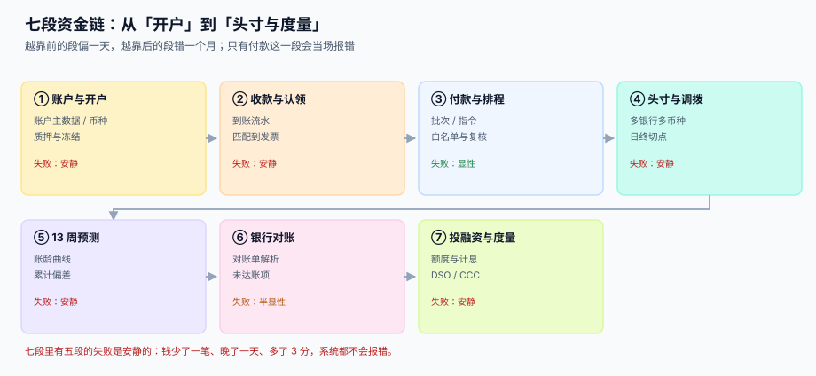
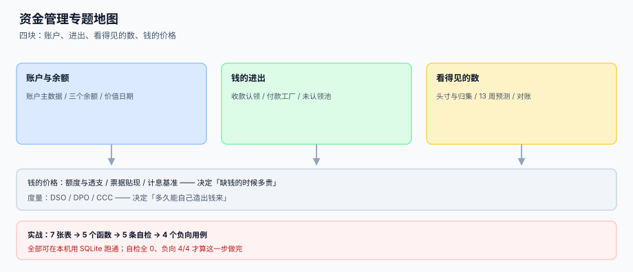

# 资金管理与现金流预测

<p style="text-align:center;"></p>

财务系统里最容易被误读的一句话是「**账上还有钱**」。同样一家公司，出纳看到的余额是 1,000,000，资金经理说可用只有 800,000，CFO 关心的头寸是 765,000，而三周后要付的工资是 1,200,000——四个数字都真实，但没有一个能单独回答「明天够不够付」。

::: tip 一句话理解
**资金管理不是记账，而是「在正确的时间、正确的账户上，有正确的钱」。** 记账回答「这笔钱是什么」，资金回答「这笔钱在哪、什么时候能用、明天够不够」。
:::

## 这个专题讲什么

一笔钱从「客户打过来」到「变成工资发出去」，要过七道工序。本专题按这七段组织，每段都标出产物与失败方式：

| 段 | 这一段在做什么 | 产物 | 失败是否安静 |
| --- | --- | --- | --- |
| ① 账户与开户 | 账户主数据、币种、质押与冻结 | `tre_account` + 日终快照 | **安静**（账户状态错，余额就一直错） |
| ② 收款与认领 | 到账流水归到具体发票 | `tre_receipt` + 分配表 | **安静**（认不上就进池子，没人催） |
| ③ 付款与排程 | 批次、指令、复核、白名单 | `tre_payment_instr` | 显性（失败的付款会被退回） |
| ④ 头寸与调拨 | 多银行多币种汇总、日终切点 | `tre_position` | **安静**（切点错一天，头寸差一天） |
| ⑤ 13 周预测 | 应收账龄 + 应付排程 → 未来现金 | `tre_forecast` | **安静**（预测错了不影响任何一笔账） |
| ⑥ 银行对账 | 对账单解析、匹配、未达账项 | 余额调节表 | 半显性（差异会累积到季末） |
| ⑦ 投融资与度量 | 额度、透支、票据、DSO/CCC | 授信台账 + 指标 | **安静**（成本高了也只是「利息多一点」） |



## 与其它专题的分工

库里写「钱」的册子已经有七八本，问的问题都不一样。先看这张表再决定读哪一册：

| 你关心的问题 | 该读哪一册 | 为什么不是本册 |
| --- | --- | --- |
| 「这笔收款怎么记账」 | [复式记账与分录](../Ledger/DoubleEntry/index.md) | 那册讲**借贷两腿怎么平**，本册讲**这笔钱什么时候真的能用** |
| 「银行流水和账面对不上」 | [对账与差异归集](../Ledger/Reconciliation/index.md) | 那册讲**差异怎么归类**，本册讲**调节表怎么写、未达怎么清** |
| 「这个月要付多少供应商」 | [采购到付款](../ProcureToPay/Overview/index.md) | 那册讲**三单匹配**，本册讲**付款排程与批次** |
| 「客户多久回款」 | [收入确认与递延收入](../RevenueRecognition/Overview/index.md) | 那册讲**义务何时消**，本册讲**钱何时到** |
| 「外币账户怎么折算」 | [多币种与汇率折算](../MultiCurrency/Conversion/index.md) | 那册讲**折算路径与重估**，本册只取「头寸折算用哪个时点」 |
| 「账单什么时候收、收不回怎么催」 | [订阅计费与周期账单](../SubscriptionBilling/Overview/index.md) | 那册到**账单**为止，本册到**到账**为止 |
| 「付款接口怎么保证不重复」 | [幂等键与状态机](../IdempotencyStateMachine/IdempotencyKey/index.md) | 那册讲**通用幂等设计**，本册讲**付款场景的键是哪几个字段** |
| 「供应商改收款账号怎么防」 | [供应商协同](../SupplierCollaboration/SupplierPortal/index.md) | 那册讲**门户可见范围**，本册讲**白名单与生效时间** |
| 「成本与预算怎么核」 | [容量与成本](../../Ops/CapacityCost/Overview/index.md) | 那册讲**单位成本**，本册讲**现金的时点** |

::: info 为什么不并入「复式记账」与「对账」
三册的判据没有一条可以复用：复式记账判「借贷相等」（横平），对账判「差异归类」（纵向可解释），本册判**「同一笔钱的三种余额互相对得上」**——账面 − 冻结 − 在途 = 可用，可用 + 未达 = 头寸。一个判横平，一个判归因，一个判时点，合并只会造出第二个 `BasicAdvanced`。
:::

## 本专题的章节



- [总览：七段资金链与三个「有多少钱」](Overview/index.md)
- [账户、余额与价值日期](AccountModel/index.md)
- [收款认领与未认领池](Inflow/index.md)
- [付款工厂与账号白名单](Outflow/index.md)
- [头寸、多银行与资金归集](Positioning/index.md)
- [13 周滚动预测与现金缺口](Forecast/index.md)
- [银行对账与对账单解析](Statement/index.md)
- [短期融资、额度与计息基准](Funding/index.md)
- [实战：从到账到调节表的闭环](Practice/index.md)
- [常见问题与分诊](FAQ/index.md)

## 版本与标准

资金管理**没有「代码大版本」概念**，因此本专题不建版本目录（如 `Spring5/`、`Spring6/` 那种）。三条理由：

1. **换代的是报文格式与监管要求，而判据未变**：不管用 MT940 还是 CAMT.053，「银行余额 − 未达收款 + 未达付款 = 企业账面」一字不差；报文换代只是换解析器，判据表里没有一行要改。
2. **并存的差异是银行与辖区，不是代际**：同一集团在五家银行的回单格式、起息规则、日终时点都不同，差异是同一张配置表的几行，不是两套内容线。
3. **真正需要版本目录的是「同一份代码两套写法」**，而本专题写的是账模型与数据契约。可参考按大版本组织的先例：[Spring5](../Java/Frame/Spring/Spring5/index.md)、[Vue2](../../Frontend/Frame/Vue/Vue2/index.md)。

涉及外部依据时，本专题引用**长期稳定的编号与已生效的时点**，而非某一年的版本号：

| 依据 | 编号 / 时点 | 本专题用它说明什么 |
| --- | --- | --- |
| ISO 20022 银行对账单报文 | `camt.053`（账户报表）、`camt.054`（借贷通知） | 对账单的结构化字段：`Acct`、`Bal`、`Ntry`、`RmtInf` |
| SWIFT 跨境报文迁移 | MT 第 1、2、9 类 **2025-11-22** 停止共存 | 2026 年再做跨境收付，解析器必须直接吃 ISO 20022 |
| 《商业汇票承兑、贴现与再贴现管理办法》 | **2023-01-01** 施行，最长付款期限由 1 年缩至 **6 个月** | 票据作为短期融资工具的期限上限与保证金占用 |
| 《企业会计准则第 31 号——现金流量表》 | 经营 / 投资 / 筹资三类活动 | 为什么「现金等价物」不等于「银行存款」 |
| 计息基准 | ACT/360、ACT/365、30/360 | 同一笔透支换一个分母就差 1.39% |

::: warning 报文迁移是有明确日期的，读的时候先看年份
上面第二行是本专题唯一带**硬时点**的事实：跨境支付的 MT 与 ISO 20022 共存期在 **2025-11-22** 结束。写解析器时不要「两种都支持、谁先到用谁」——那会让你在 2026 年还在维护一条已经没人发报文的代码路径。
:::

## 判据纪律

| 页 | 判据族 | 这一族管什么 | 条数 |
| --- | --- | --- | --- |
| 总览 | `TRO-A` ~ `TRO-H` | 七段产物齐全、三个余额分列、失败可归因 | 8 |
| 账户与价值日期 | `TRM-A` ~ `TRM-H` | 账户唯一、余额四字段、可用日可复算 | 8 |
| 收款认领 | `TRA-A` ~ `TRA-H` | 到账不重、认领不超、未认领有主 | 8 |
| 付款工厂 | `TRF-A` ~ `TRF-H` | 幂等键唯一、白名单生效、退回可追 | 8 |
| 头寸与归集 | `TRC-A` ~ `TRC-H` | 日终唯一、切点统一、归集可解释 | 8 |
| 滚动预测 | `TRL-A` ~ `TRL-H` | 版本只增不改、口径可复算、偏差可归因 | 8 |
| 银行对账 | `TRB-A` ~ `TRB-H` | 匹配有序、调节表恒等、未达有账龄 | 8 |
| 短期融资 | `TRD-A` ~ `TRD-H` | 额度不超、基准明确、成本可算 | 8 |
| 实战 | `TRS-A` ~ `TRS-H` | 建库一次成功、自检恒 0、负向必须失败 | 8 |
| 常见问题 | `TRQ-A` ~ `TRQ-H` | 分诊可落地、止血有序、术语一致 | 8 |

每条判据回答三件事：**看什么现象、判成什么、不满足时改哪里**。编号逐页唯一，可被 `utils/audit` 下的判据类巡检机械核对。

## 验证方式

```shell
# 1) 专题结构：应为 11（目录页 + 10 章），每个子目录都有 index.md
find docs/Backend/Treasury -name "index.md" | wc -l
# 期望：11

# 2) 每页判据族 8 条：应输出 10 行，每行前面都是 8
for f in docs/Backend/Treasury/*/index.md; do
  echo "$(grep -oE '`TR[A-Z]-[A-H]`' "$f" | sort -u | wc -l | tr -d ' ') $f"; done

# 3) 目录页的判据表按「区间」写，10 族 × 起止两端 = 20 个编号
grep -oE '`TR[A-Z]-[A-H]`' docs/Backend/Treasury/index.md | sort -u | wc -l
# 期望：20（不是 80——区间写法只出现首尾两个编号）

# 4) 全专题编号总数：10 章 × 8 条 = 80
grep -rhoE '`TR[A-Z]-[A-H]`' docs/Backend/Treasury/*/index.md | sort -u | wc -l
# 期望：80

# 5) 配图齐全：应为 10 张 SVG + 1 张 Logo
ls docs/Backend/Treasury/assets/*.svg | wc -l && ls docs/Backend/Treasury/assets/*.png
# 期望：10 与 tre-logo.png
```

## 参考资料

- [总览：七段资金链与三个「有多少钱」](Overview/index.md)
- [实战：从到账到调节表的闭环](Practice/index.md)
- ISO 20022 报文定义（`camt.053` / `camt.054`）：<https://www.iso20022.org/iso-20022-message-definitions>
- Swift：全球金融社群完成 ISO 20022 迁移（2025-11-22 共存期结束）：<https://www.swift.com/news-events/migrated-news/press-releases/global-financial-community-completes-switch-iso-20022-paving-way-new-levels-cross-border-payment-speed-and-innovation-around-world>
- 中国人民银行、原银保监会：《商业汇票承兑、贴现与再贴现管理办法》（2023-01-01 施行）：<https://www.gov.cn/zhengce/zhengceku/2022-11/19/content_5727831.htm>
- 财政部：《企业会计准则第 31 号——现金流量表》：<https://www.mof.gov.cn/>
