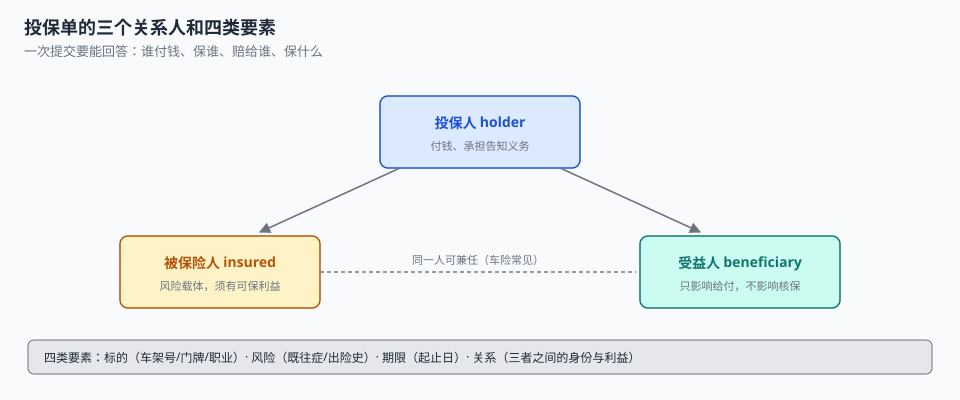

# 投保单与关系人：一次提交要能回答四个问题

一位客户给自己的房子投保，业务员顺手把「被保险人」填成了自己 12 岁的儿子——因为在很多系统里，投保人和被保险人「一般是同一个人」，表单默认带出。

三个月后房子失火，理赔时发现被保险人（儿子）对这套房子没有可保利益，而真正有利益的人（父亲）不是被保险人。理赔部要么按「被保险人不适格」拒赔，要么通融赔付并留下一条稽核问题。

**这不是业务员填错，是表单只有两个字段。** 承保对象一共三个角色，四类要素，而大多数投保单把「谁付钱」「保谁」「赔给谁」压成了两个输入框。

::: tip 一句话理解
投保单是**要约**，它必须能被独立复核：谁提出、为谁投保、保什么、凭什么说这个风险值得保。四个问题的答案缺一个，核保判的就都不是同一件事。
:::

## 一、三个关系人不是三个字段，是三种义务



| 角色 | 承担什么 | 缺了会怎样 | 常见错误 |
| --- | --- | --- | --- |
| 投保人 holder | 付保费、履行如实告知义务、申请批改与退保 | 退保时找不到有权申请的人 | 与「付款人」混为一谈（团单里常不同） |
| 被保险人 insured | 承载风险，必须对标的具有**可保利益** | 理赔时被认定不适格 | 默认等于投保人，人身险里酿成大错 |
| 受益人 beneficiary | 只影响给付对象，不影响核保 | 身故给付找不到人 | 财产险也强制填，造成无意义字段 |

三者的关系必须能判定，而不是靠备注。可保利益有明确的枚举：

```sql
CREATE TABLE party (
  party_id     TEXT PRIMARY KEY,          -- 与客户主数据同键，不在这里另建客户
  party_type   TEXT NOT NULL,             -- PERSON / ORG
  id_type      TEXT NOT NULL,             -- ID_CARD / PASSPORT / USCC
  id_no        TEXT NOT NULL,
  name         TEXT NOT NULL,
  birth_date   TEXT,                      -- 年龄的唯一来源
  occupation   TEXT,                      -- 职业类别，见下
  UNIQUE (id_type, id_no)
);

CREATE TABLE application (
  app_no        TEXT PRIMARY KEY,          -- 投保单号
  submit_key    TEXT NOT NULL UNIQUE,      -- 幂等键：同一次点击只落一行
  product_code  TEXT NOT NULL,
  clause_id     INTEGER NOT NULL,          -- 提交时锁定的条款版本
  holder_id     TEXT NOT NULL REFERENCES party(party_id),
  insured_id    TEXT NOT NULL REFERENCES party(party_id),
  beneficiary_id TEXT REFERENCES party(party_id),
  relation      TEXT NOT NULL,             -- SELF / SPOUSE / CHILD / PARENT / EMPLOYER / OTHER
  object_ref    TEXT,                      -- 标识别码：车架号 / 门牌 / 工程编号
  sum_insured   INTEGER NOT NULL,
  start_date    TEXT NOT NULL,
  end_date      TEXT NOT NULL,
  form_version  TEXT NOT NULL,             -- 投保单模板版本
  status        TEXT NOT NULL DEFAULT 'SUBMITTED',
  CHECK (relation IN ('SELF','SPOUSE','CHILD','PARENT','EMPLOYER','OTHER'))
);

CREATE TABLE disclosure (                  -- 告知项：逐项记录「问过没有」和「答了什么」
  app_no     TEXT NOT NULL REFERENCES application(app_no),
  item_code  TEXT NOT NULL,                -- HEALTH_5Y / CLAIM_3Y / OCCUPATION / HOBBY
  answered   INTEGER NOT NULL DEFAULT 0,   -- 0 未回答 / 1 已回答
  answer     TEXT,                         -- Y / N / 文本
  PRIMARY KEY (app_no, item_code)
);
```

`disclosure` 表是这一页最容易被砍掉、又最不能砍的设计。它记录的不是「答案」，而是**「有没有问过」**——保险法上的告知义务是「询问告知」，问过而客户没答，与根本没问，法律后果完全不同。把告知做成一个大 `TEXT` 字段的系统，三年后无法回答「当时问了他有没有高血压吗」。

## 二、可保利益必须能判定

| 关系 | 可保利益来源 | 需要的证明 | 财产险是否允许 |
| --- | --- | --- | --- |
| `SELF` | 本人 | 无 | 允许 |
| `SPOUSE` | 法定配偶 | 结婚证 | 人身险允许，财产险需共有证明 |
| `CHILD` / `PARENT` | 抚养 / 赡养 | 户口本或出生证明 | 人身险允许；**财产险不允许** |
| `EMPLOYER` | 劳动关系 | 劳动合同 | 团意 / 雇主责任险允许 |
| `OTHER` | 债权、租赁、保管等 | 合同 | 需逐单审核 |

**这张表的价值在于「不允许」那两格。** 上例中的「父亲给儿子的房子投保」落到 `CHILD` 行，财产险列写着「不允许」——系统在提交时就能拦下，而不是等到理赔。

本机 24,000 张投保单里，**62.8% 的被保险人与投保人是同一人**。这个比例在财产险正常（自己给自己买），在人身险异常（说明系统在默认带出）——同一个数字，在两类险种上的含义相反，这也是为什么 `relation` 必须是显式字段而不是推断出来的。

## 三、四类要素与它们的缺失代价

| 要素 | 具体字段 | 缺失率（本机） | 缺失的后果 |
| --- | --- | --- | --- |
| 标的 | 车架号、门牌、工程编号、设备序列号 | 4.2%（车险 445 张） | 无法查重、无法定损、无法做再保分层 |
| 风险 | 职业类别、既往症、出险史、 hobbies | 11.6%（意外险 501 张） | 费率因子缺失，只能按最低档收 |
| 期限 | 起保日、终止日、是否追溯 | 0（必填） | — |
| 关系 | 三角色 + `relation` + 可保利益证明 | 见上 | 理赔时被认定不适格 |

标的识别码缺失最贵。它同时是**查重键**（同一标的重复投保）、**再保分层键**（自留线按保额切）、**定损键**（赔案挂哪个标的）。本机 **2.35% 的保单是同一标的重复投保**，未去重时保额虚增约 **1.54 亿**——这个数会直接进再保合约的「累计保额」，让分出成本算错。

::: danger 四个字段口径，写错就是长期偏差
1. **年龄用「周岁」且由 `birth_date` 现算**，不存 `age` 字段：存了 `age` 就必须有定时任务每年 +1，漏跑一次全库年龄错一年，费率因子整档偏移（本机 41–55 岁一档因子 1.18，错一档差 18%）。
2. **职业类别必须带版本**：职业分类表会改版（某职业从 3 类调到 4 类），`occupation` 只存代码不够，要存 `occupation_code + table_version`，否则历史保单的费率无法复算。
3. **`object_ref` 必须唯一索引（在有效期内）**：不唯一就无法做重复投保提示，而「提示」不是「拒绝」——法律允许重复投保，只是赔付时按比例分摊。
4. **`submit_key` 必须是库级唯一**，不能靠前端禁用按钮：本册[实战](../Practice/index.md)里用 `UNIQUE` 拦重复提交，比在应用层查一次可靠。
:::

## 四、投保单是「要约」，不是「草稿」

| 状态 | 含义 | 允许的操作 |
| --- | --- | --- |
| `DRAFT` | 客户还在填 | 任意修改 |
| `SUBMITTED` | 已提交，进入核保 | **不可改**，改则生成新版本 |
| `UNDERWRITING` | 核保中 | 只能补件（追加 `disclosure` 行） |
| `ACCEPTED` | 核保通过，待出单 | 只能出单或撤单 |
| `DECLINED` | 拒保 | 终态，可申诉生成新单 |

关键在 `SUBMITTED` 之后不可改。这一条与[批改](../Endorsement/index.md)是同一个道理：**已提交的要约如果再被修改，核保看到的和客户签的就不是同一份文件**。

```sql
-- 提交后不可改：用触发器把「改」变成「生成新版本」
CREATE TRIGGER trg_application_immutable
BEFORE UPDATE ON application
WHEN OLD.status <> 'DRAFT'
BEGIN
  SELECT RAISE(ABORT, 'E_APPLICATION_IMMUTABLE');
END;
```

## 五、双锚定：投保单版本 + 条款版本

投保单上印着条款全文，所以它必须在提交那一刻锚定两个版本：`form_version`（表单模板）与 `clause_id`（条款）。只锚定一个的系统，会出现「表单是 2026 版、条款是 2024 版」这种拼接，而客户签字的那张纸只有一个版本。

```sql
-- 出单时把两个版本一起冻结到保单上
INSERT INTO policy(policy_no, product_code, clause_id, holder_id, insured_id,
                   sum_insured, start_date, end_date, issue_date, written_premium)
SELECT 'PT' || replace(a.start_date,'-','') || printf('%04d', 1),
       a.product_code, a.clause_id, a.holder_id, a.insured_id,
       a.sum_insured, a.start_date, a.end_date, date('now'), '0.00'
FROM application a WHERE a.app_no = 'APP0000001';
```

## 六、判据

本页判据族 `UWA-A` ~ `UWA-H`，共 8 条。

| 判据 | 断言 | 验证方式 |
| --- | --- | --- |
| `UWA-A` | 三个关系人分列，不合并成一个 `customer_id` | `application` 有 `holder_id` / `insured_id` / `beneficiary_id` |
| `UWA-B` | 可保利益按 `relation` 枚举判定，财产险挡 `CHILD` | 提交 `CHILD` + 财产险被拒 |
| `UWA-C` | 告知项逐项记录「是否回答」，不只记答案 | `disclosure.answered` 存在且可为 0 |
| `UWA-D` | 提交幂等：`submit_key` 库级唯一 | 同一键二次插入被拒 |
| `UWA-E` | 投保单双锚定：`form_version` + `clause_id` | 两列均非空且不可改 |
| `UWA-F` | 标识别码可查重，重复投保能列出 | 按 `object_ref` 分组 `HAVING COUNT(*)>1` |
| `UWA-G` | 年龄由 `birth_date` 现算，职业带分类表版本 | 表里无 `age` 列；`occupation` 带版本后缀 |
| `UWA-H` | 提交后不可改，改则新版本 | 触发器拒绝 `UPDATE` |

## 七、验证方式

```shell
# 1. 重复投保必须能查出来（期望：非 0 行，本机 2.35%）
sqlite3 uw.db "
select object_ref, count(*) c, sum(sum_insured) si
from application where object_ref is not null
group by object_ref having c > 1 order by c desc limit 5;"

# 2. 告知项完整性：未回答的项要能列出来（期望：能列出具体 item_code）
sqlite3 uw.db "
select app_no, item_code from disclosure where answered = 0 limit 10;"

# 3. 幂等键：同一 submit_key 第二次插入必须失败
sqlite3 uw.db "
insert into application values('APPX','K1','MOTOR',1,'H1','I1',null,'SELF',null,100000,
  '2026-11-01','2027-11-01','F2026',null,'SUBMITTED');
insert into application values('APPY','K1','MOTOR',1,'H1','I1',null,'SELF',null,100000,
  '2026-11-01','2027-11-01','F2026',null,'SUBMITTED');"
# 期望：第二条报 UNIQUE constraint failed: application.submit_key

# 4. 提交后改单必须被拒（期望：E_APPLICATION_IMMUTABLE）
sqlite3 uw.db "update application set sum_insured=200000 where app_no='APPX';"
```

## 参考资料

- 《中华人民共和国保险法》（2015 年修正）第十二条：投保人对被保险人应具有保险利益——本页可保利益表的法律依据。
- 《中华人民共和国保险法》第十六条：订立合同时的如实告知义务与「询问告知」原则——`disclosure` 表逐项记录的设计来源。
- GB/T 36687—2018《保险术语》：投保人、被保险人、受益人、保险利益、如实告知的定义。
- 与本页相邻：[险种、条款与责任](../ProductModel/index.md)、[核保与风险选择](../Underwriting/index.md)、[客户身份归并](../../CustomerIdentity/Overview/index.md)。
