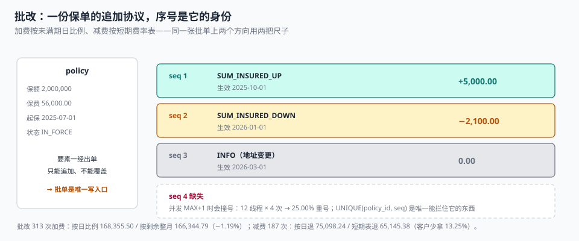

# 批改与加退费：同一张批单上，两个方向用两把尺子

客户在 7 月把一份年缴保单的保额从 20 万加到 30 万，批单上加收了 5,000 元保费。三个月后他又把保额降回 20 万，批单上退了 2,100 元。

客户算了一笔账：加了 10 万保额付 5,000，减了 10 万只退 2,100——「你们净赚 2,900」。他要求解释。

**这个差额是合规的，但它从来没人解释过。** 加费按「未满期日比例」收（剩余 9 个月，收 9/12），减费按「短期费率表」退（已生效 6 个月，表上留成 60%，只退 40%）。两把尺子都写在制度里，但没有任何一个字段记录「这张批单用的是哪把尺子」。

::: tip 一句话理解
批改是**保单要素的唯一写入口**：出单之后，一切变化都以「追加一份批单」的形式发生。批单的身份是**序号**，批单的价值是**口径**——加费用哪把尺子、减费用哪把尺子、追溯改到哪一天，三件事都必须落在字段上。
:::

## 一、八类批改，四类影响钱



| 批改类型 | 影响保额 | 影响保费 | 影响保障期 | 常见场景 |
| --- | --- | --- | --- | --- |
| `SUM_INSURED_UP` 加保 | ✅ | ✅ 加收 | — | 房价上涨、车辆加装 |
| `SUM_INSURED_DOWN` 减保 | ✅ | ✅ 退还 | — | 标的贬值、客户降本 |
| `INFO_CHANGE` 信息变更 | — | — | — | 地址、电话、车牌 |
| `CANCEL` 退保 | — | ✅ 退还 | ✅ 提前终止 | 卖房、退车 |
| `REINSTATE` 复效 | — | ✅ 补收 | — | 欠缴后复效 |
| `EXTEND` 延期 | — | ✅ 加收 | ✅ 延长 | 工程延期 |
| `COVERAGE_ADD` 加附加险 | ✅ | ✅ 加收 | — | 加家电险 |
| `BENEFICIARY` 受益人变更 | — | — | — | 人身险 |

八类里前两类和退保最容易算错，因为它们都涉及「按比例」。而「比例」的分母取决于**用哪把尺子**。

## 二、加费用日比例，减费用短期费率表

这是承保侧最反直觉的一条规则，但它有明确的商业逻辑：

| 方向 | 尺子 | 公式 | 逻辑 |
| --- | --- | --- | --- |
| 加费（增保额/延期） | 未满期日比例 | `Δ保费 × 剩余天数 / 365` | 只收「还没保的那段时间」 |
| 减费（降保额/退保） | 短期费率表 | `Δ保费 × (1 − 短期费率[已生效月])` | 保险公司已承担前期风险，前期费率更高 |

短期费率表前重后轻，所以前几个月退保会「吃亏」：

| 已生效月 | 短期费率表留成 | 按日比例留成 | 差（多收） |
| --- | --- | --- | --- |
| 1 | 10% | 8.22% | +1.78 个点 |
| 3 | 30% | 24.66% | +5.34 个点 |
| 6 | 60% | 49.32% | **+10.68 个点**（最大） |
| 9 | 80% | 73.97% | +6.03 个点 |
| 11 | 90% | 90.41% | **−0.41 个点**（反过来） |

最后一行是个漂亮的例外：**第 11 个月，短期费率表反而比按日比例少收 0.41 个点**。所以「短期费率表总是对客户不利」这句话是错的——它在最后一个月会反手让利。任何写「短期表 ≥ 日比例」的断言，都要把第 11 个月排除（本册[实战](../Practice/index.md)的 `C5` 就是这么写的）。

本机 500 次批改的实测：

| 方向 | 笔数 | 按日比例 | 另一把尺子 | 差 |
| --- | --- | --- | --- | --- |
| 加费 | 313 | 168,355.50 | 166,344.79（按剩余整月） | −2,010.71（−1.19%） |
| 减费 | 187 | 75,098.24 | 65,145.38（短期费率表） | 客户少拿 9,952.86（**13.25%**） |

加费方向两种算法只差 1.19%（因为剩余月数和剩余天数本来就接近），减费方向差 13.25%。**同一个「按比例」，在两个方向上误差量级差一个数量级**——这就是为什么口径必须落在字段上，而不是「反正都是按比例」。

## 三、批单序号：唯一、连续、不可跳

```sql
CREATE TABLE endorsement (
  endorsement_id INTEGER PRIMARY KEY,
  policy_id      INTEGER NOT NULL REFERENCES policy(policy_id),
  seq            INTEGER NOT NULL CHECK (seq >= 1),
  kind           TEXT NOT NULL,
  effective_date TEXT NOT NULL,          -- 批改生效日（可追溯）
  premium_delta  TEXT NOT NULL DEFAULT '0.00',
  calc_basis     TEXT NOT NULL,          -- PRORATA_DAY / SHORT_RATE / FLAT
  external_ref   TEXT,                   -- 上游单号，用于幂等
  reason         TEXT,
  created_at     TEXT NOT NULL DEFAULT (datetime('now')),
  UNIQUE (policy_id, seq),
  UNIQUE (policy_id, external_ref),
  CHECK (kind IN ('SUM_INSURED_UP','SUM_INSURED_DOWN','INFO_CHANGE','CANCEL',
                  'REINSTATE','EXTEND','COVERAGE_ADD','BENEFICIARY'))
);
```

`seq` 的三条纪律：

1. **唯一**：`UNIQUE(policy_id, seq)`。没有它，并发下 `MAX(seq)+1` 会撞号——本机 12 线程 × 4 次实测，48 行记录只有 **36 个不同的 seq，重号 12 次（25.00%）**。
2. **连续**：`seq` 不许跳号。跳号意味着「某一版批单消失了」，而批单是合同的一部分，消失一版就可能少了一条免责。
3. **不可复用**：批单被撤销不是删行，而是**追加一条反向批单**（`seq+1`，金额取反）。

```sql
-- 序号必须等于当前最大 +1，否则拒绝（把「跳号」变成硬错误）
CREATE TRIGGER trg_endorse_seq_contiguous
BEFORE INSERT ON endorsement
WHEN NEW.seq <> (SELECT COALESCE(MAX(seq), 0) + 1 FROM endorsement WHERE policy_id = NEW.policy_id)
BEGIN
  SELECT RAISE(ABORT, 'E_ENDORSE_SEQ_GAP');
END;
```

## 四、追溯批改：改的是历史，必须重算已赚

批改的 `effective_date` 可以早于今天（追溯批改）。这带来一个必须处理的问题：**已赚保费要按新的保额重算过去那段时间**。

| 场景 | 处理 | 不做会怎样 |
| --- | --- | --- |
| 追溯加保，生效日在上个月 | 补收保费 = Δ × 追溯日至终止日天数 / 365；已赚重算 | 少收一个月保费，且已赚偏低 |
| 追溯减保，生效日在上个月 | 退还保费按短期表；已赚重算 | 多收，客户投诉 |
| 追溯退保，生效日在两个月前 | 退保金按短期表；两个月的已赚要冲回 | 账面已赚虚高 |

「重算」不是把历史记录改掉，而是**追加一条重算记录**：

```sql
CREATE TABLE earned_adjust (
  adjust_id   INTEGER PRIMARY KEY,
  policy_id   INTEGER NOT NULL REFERENCES policy(policy_id),
  endorsement_id INTEGER NOT NULL REFERENCES endorsement(endorsement_id),
  period_from TEXT NOT NULL,
  period_to   TEXT NOT NULL,
  earned_delta TEXT NOT NULL,            -- 正数补记、负数冲回
  created_at  TEXT NOT NULL DEFAULT (datetime('now'))
);
```

这样「本月已赚 = 原始摊额 + 所有调整额」，任何一笔调整都能追到具体批单。

## 五、批改的四个禁区

::: danger 四类批改必须被硬拦，不能靠流程
1. **已终止的保单不接受批改**：`CANCELLED` / `EXPIRED` 之后再改，等于给一份已经结束的合同追加条款。触发器 `trg_endorse_after_termination` 直接 `RAISE(ABORT)`。
2. **理赔中的保单禁止减保或退保**：赔案已按原保额定损，减保会让「赔付额 > 保额」。正确做法是「理赔冻结」，批改接口先查赔案状态。
3. **批改不能 `UPDATE` 保单要素**：直接 `UPDATE policy SET sum_insured=...` 会绕过批单，让「这张保单为什么是 30 万」永远查不出来。
4. **批量批改必须整批成功或整批失败**：团单 500 人调保额，成功 300 人失败 200 人，是最难对账的状态。用 `batch_no` + 事务包住整批。
:::

```sql
-- 理赔冻结：批改前先看有没有在处理的赔案
SELECT COUNT(*) FROM claim_notice c
WHERE c.policy_id = :pid AND c.status IN ('OPEN','ASSESSING');
-- 期望：0，否则拒绝减保/退保类批改
```

## 六、判据

本页判据族 `UWE-A` ~ `UWE-H`，共 8 条。

| 判据 | 断言 | 验证方式 |
| --- | --- | --- |
| `UWE-A` | 批单序号唯一、连续、不可跳 | 跳号插入被 `E_ENDORSE_SEQ_GAP` 拒绝 |
| `UWE-B` | 批改是保单要素的唯一写入口 | 全库无 `UPDATE policy SET sum_insured` |
| `UWE-C` | 加/减费用哪把尺子落在 `calc_basis` | 该列非空且取值在三枚举内 |
| `UWE-D` | 追溯批改重算已赚并留痕 | `earned_adjust` 行数 = 追溯批改笔数 |
| `UWE-E` | 已终止与理赔冻结保单拒绝批改 | 负向用例被拒 |
| `UWE-F` | 批量批改按 `batch_no` 整批原子 | 批内成功数 = 批内应处理数 |
| `UWE-G` | 批改幂等：`external_ref` 唯一 | 同一上游单号二次提交被拒 |
| `UWE-H` | 批单不可改，撤销用反向批单 | 无 `UPDATE endorsement`，存在金额取反的后续批单 |

## 七、验证方式

```shell
# 1. 序号连续（期望：0 行缺口）
sqlite3 uw.db "
select count(*) from (
  select policy_id, max(seq) m, count(*) c from endorsement group by policy_id having m <> c);"

# 2. 跳号必须被拒（期望：E_ENDORSE_SEQ_GAP）
sqlite3 uw.db "
insert into endorsement(policy_id,seq,kind,effective_date,premium_delta,calc_basis)
values(8,5,'INFO_CHANGE','2026-02-01','0.00','FLAT');"

# 3. 已终止保单批改必须被拒（期望：E_POLICY_TERMINATED）
sqlite3 uw.db "
insert into endorsement(policy_id,seq,kind,effective_date,premium_delta,calc_basis)
values(4,2,'INFO_CHANGE','2025-01-01','0.00','FLAT');"

# 4. 加退费合计必须等于保单调整后保费（期望 0.00）
sqlite3 uw.db "
select round(sum(cast(premium_delta as real)),2) from endorsement where policy_id=8;"
# 期望：2900.00（+5,000.00 − 2,100.00），与调整后保费差额一致
```

## 参考资料

- 《中华人民共和国保险法》（2015 年修正）第二十条：投保人和保险人可以协商变更合同内容，变更应批注或附贴批单——批单作为合同组成部分的法律依据。
- 《中华人民共和国保险法》第四十七条：解除合同退还现金价值——退保类批改的金额口径。
- GB/T 36687—2018《保险术语》：批改、批单、加保、减保、退保、复效的标准定义。
- 与本页相邻：[出单与保单要素](../PolicyIssue/index.md)、[续保与退保](../RenewalCancel/index.md)、[理赔作业与赔付计算](../../ClaimsProcessing/Overview/index.md)。
