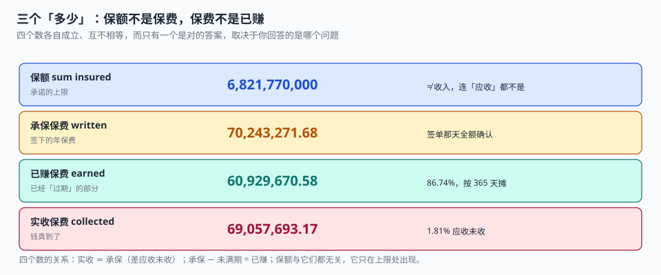

# 总览：七段链与三个「多少」

一位客户在 3 月买了一份家财险，保额 60 万，保费 720 元。8 月房子卖了，他来退保。柜员打开系统，看到「已生效 5 个月」，按下退保，系统算出应退 360 元——按日比例正好一半。

但当天下午另一个柜员给同样的保单退保，算出来是 288 元。两个人调的保单号一样、时间一样、金额差 72 元。

**差在「按哪把尺子」：** 一个走的是「剩余天数 / 365」，另一个走的是「短期费率表」——表上写着 5 个月留 50%（留成），所以退 50%；而按日比例留 41.1%，退 58.9%。两把尺子都写在制度里，只是没写「什么时候用哪把」。

::: tip 一句话理解
承保系统的核心不是「录入一张保单」，而是**把一份承诺的四个数（保额、承保保费、已赚保费、实收保费）和五个结局（标准、加费、除外、转人工、拒保）分别落到字段上**——任何一个混用，都会在退保、对账或理赔那天变成一次解释。
:::

## 一、为什么承保不是「表单 + 打印」

很多人第一版会做成这样：一张 `policy` 表，前端填表，点一下生成保单号，导个 PDF。这一版能上线，然后会在四个地方同时坏掉。

| 维度 | 表单式做法 | 承保系统 |
| --- | --- | --- |
| 对象 | 一张保单 = 一行记录 | 一份**承诺**：期限 × 保额 × 条件 |
| 时间 | 一个 `create_time` | 申请日 / 承保日 / 起保日 / 终止日，四个 |
| 钱 | 一个 `amount` | 保额 / 承保保费 / 已赚 / 实收，四个 |
| 变更 | 直接 `UPDATE` 字段 | 只能追加**批单**，保单要素冻结 |
| 结束 | 删掉或标记无效 | 退保（退钱）/ 期满（不退）/ 失效（欠缴）三条不同路径 |
| 分险 | 没有 | 再保分出，决定「这张单亏了谁承担」 |

六行里只有第一行是「存储」问题，其余五行都是**语义**问题。把承保做成表单的人，通常只看到了第一行。

## 二、七段链与它们的失败形态



| 段 | 关键判断 | 失败形态 | 谁先发现 |
| --- | --- | --- | --- |
| 要 | 标的风险要素到底采到没有 | 半显性：缺字段，核保时退回 | 核保员 |
| 核 | 卖不卖、以什么条件卖 | 半显性：结论错照样能出单 | 理赔时 |
| 保 | 定价与要素冻结对不对 | **安静**：要素错了保单照出 | 理赔 / 稽核 |
| 改 | 加退费算得对不对 | **安静**：多扣客户会来问，少扣没人问 | 客户投诉（单向） |
| 续 | NCD 与费率接得对不对 | 半显性：续不上掉客户 | 续保率 |
| 退 | 用哪把尺子、冷静期有没有算 | **安静**：口径错只影响一个数 | 财务对账 |
| 摊 | 分出比例与摊回对不对 | **安静**：只影响自留风险 | 再保账单对不上 |

「安静」的意思是：**没有任何一处会抛异常**。保单能出、发票能开、柜面能办，只有「这份承诺的边界在哪里」是错的。

### 为什么「安静」比「报错」更危险

报错会被处理，安静的偏差会被**解释掉**。本机 18,000 张保单上有一组特别典型的读数：

- 承保保费 **70,243,271.68**，实收 **69,057,693.17**，差 118.56 万
- 这 118.56 万在财务眼里是「应收未收」；在业务眼里是「分期还没到期」；在客户眼里是「我明明交了」
- 三个解释都对，因为**没有一张表记录「这笔钱该什么时候到」**

再看已赚：按日摊 60,929,670.58（86.74%），按整月摊 59,958,780.44，差 **97.09 万**。两条口径都能自圆其说，只有恒等式 `承保 − 未满期 = 已赚` 能判定谁对。

## 三、三个「多少」与它们之间的桥

| 口径 | 数据来源 | 什么时候成立 | 差在哪 |
| --- | --- | --- | --- |
| 保额 | `policy.sum_insured` | 出单时冻结 | 与保费无固定比例，不能互相推算 |
| 承保保费 | `policy.written_premium` | 出单时确认 | 批改后要按批单调整，不是改原值 |
| 已赚保费 | 按日摊到已过天数 | 每个结账日重算 | 用整月摊会差 1.59% |
| 实收保费 | `premium_txn` 到账合计 | 每笔到账后 | 应收未收 1.81% 是「时间差」不是「差错」 |

四者的关系可以写成三条恒等式，缺一不可：

```text
① 承保保费 − 未满期保费 = 已赚保费            （时间维度）
② 承保保费 + 批改加费 − 批改减费 = 调整后承保   （变更维度）
③ 实收保费 + 应收未收 = 调整后承保              （资金维度）
```

第 ① 条是结账的地基；第 ② 条是批改的地基（本册[批改](../Endorsement/index.md)整页都在守它）；第 ③ 条是对账的地基。

三条恒等式有三个用途：

1. **月末结账**：三条都平才允许关账，任何一条不平先查「是不是把批改并进了新单」。
2. **看板**：分母写清楚——「件均保费」用承保 ÷ 保单数，「已赚率」用已赚 ÷ 承保，「应收率」用应收 ÷ 承保。三个比率的分母不同，混用会得出「件均 3.9 万」这种既不保额也不保费的数。
3. **对账**：银行流水、保费流水、保单三者按「保单号 + 期次」对齐，对不上先分形状（漏 / 多 / 重 / 差）。

## 四、一张保单的最小字段集

下面这几组字段，少任何一组都会在某个环节算不出数：

```sql
CREATE TABLE policy (
  policy_id      INTEGER PRIMARY KEY,
  policy_no      TEXT NOT NULL UNIQUE,          -- 对外单号，一经生成不可改
  product_code   TEXT NOT NULL,                 -- 险种
  clause_id      INTEGER NOT NULL,              -- 条款版本（指向 clause 表，不存文本）
  holder_id      TEXT NOT NULL,                 -- 投保人（付钱、负告知义务）
  insured_id     TEXT NOT NULL,                 -- 被保险人（风险载体）
  sum_insured    INTEGER NOT NULL CHECK (sum_insured > 0),   -- 保额，整数元
  written_premium TEXT NOT NULL,                -- 承保保费，字符串存 Decimal
  start_date     TEXT NOT NULL,                 -- 起保日（半开区间左端）
  end_date       TEXT NOT NULL,                 -- 终止日（不含）
  issue_date     TEXT NOT NULL,                 -- 承保日（核保通过、出单）
  ncd_level      INTEGER NOT NULL DEFAULT 4,    -- 无赔款优待档位 0..6
  status         TEXT NOT NULL DEFAULT 'IN_FORCE',
  CHECK (end_date > start_date),
  CHECK (status IN ('IN_FORCE','LAPSED','CANCELLED','EXPIRED'))
);

-- 批单：保单要素的唯一写入口，序号从 1 开始、连续、不可跳
CREATE TABLE endorsement (
  endorsement_id INTEGER PRIMARY KEY,
  policy_id      INTEGER NOT NULL REFERENCES policy(policy_id),
  seq            INTEGER NOT NULL CHECK (seq >= 1),
  kind           TEXT NOT NULL,
  effective_date TEXT NOT NULL,
  premium_delta  TEXT NOT NULL DEFAULT '0.00',
  UNIQUE (policy_id, seq)
);
```

`issue_date` 与 `start_date` 分列，是最容易被省略、又最不该省略的一处。本机 **3.23%（581 张）** 的保单是追溯生效——起保日早于承保日，这在「续保衔接」「团单补录」里完全合法。合并成一个字段后，已赚保费按承保日算会比按起保日算多 **179,772.62（0.30%）**，而这 0.30% 会被当成「四舍五入」。

## 五、「安静」的四种形态

把七段链里所有安静失败归纳一遍，其实只有四种：

| 形态 | 表现 | 实测读数 | 对应页 |
| --- | --- | --- | --- |
| 少算 | 批改加费没并进承保保费 | 加费 313 次共 168,355.50 未入账 | [批改](../Endorsement/index.md) |
| 多算 | 退保按短期表多留成 | 1,500 张少退 357,798.40（12.05%） | [续保与退保](../RenewalCancel/index.md) |
| 用错尺子 | 已赚按整月摊 | 差 970,890.14（1.59%） | [出单](../PolicyIssue/index.md) |
| 分不出去 | 溢额自留线写错 | 分出保额占比 51.00%，保费只 22.29% | [再保](../Reinsurance/index.md) |

四种形态有一个共同点：**它们的偏差都不会超过「一个保单年度」这个量级，所以永远不会触发任何阈值告警**。一张保单多扣 72 元不会有人报警，但一年 1,500 张退保就是 35.8 万。

## 六、七段链的判据

本页判据族 `UWO-A` ~ `UWO-H`，共 8 条。八条都能被单独判定，任何一条不成立就不算这篇文档写完。

| 判据 | 断言 | 验证方式 |
| --- | --- | --- |
| `UWO-A` | 四个「多少」各有独立字段，不存在复用同一列的路径 | 全库检索 `policy` 表定义，`sum_insured` 与 `written_premium` 均存在且类型不同 |
| `UWO-B` | `issue_date` 与 `start_date` 分列，追溯生效可判定 | `SELECT COUNT(*) FROM policy WHERE issue_date > start_date` 能跑出非零 |
| `UWO-C` | 已赚保费按日摊，且由查询算出 | 同一批数据两种摊法差 1.59%，恒等式差 0.00 |
| `UWO-D` | 每段留证据：核保留规则命中、出单留快照、批改留序号 | 四张表行数与业务笔数相等 |
| `UWO-E` | 保额与保费之间没有任何推导公式 | 代码检索无 `sum_insured * rate` 之外的换算 |
| `UWO-F` | 条款版本用生效期索引，不存条款文本 | `clause` 表有 `(version, effective_from, effective_to)` |
| `UWO-G` | 七段的失败形态文档化，可对照排查 | 本页第二节表格七行齐全 |
| `UWO-H` | 三个比率的分母写死且互不相同 | 件均 = 承保 ÷ 单数；已赚率 = 已赚 ÷ 承保；应收率 = 应收 ÷ 承保 |

## 七、验证方式

```shell
# 1. 四个「多少」必须能各自求和（期望：四行，且第 4 行 = 第 2 行 − 未满期）
sqlite3 uw.db "
select 'sum_insured', sum(sum_insured) from policy
union all select 'written', round(sum(cast(written_premium as real)),2) from policy
union all select 'collected', round(sum(cast(amount as real)),2) from premium_txn where kind='COLLECT'
union all select 'upr', round(sum(cast(written_premium as real)) -
  (select sum(cast(amount as real)) from premium_txn where kind='COLLECT'),2) from policy;"
# 期望：collected + upr = written（本例全收，两行相等）

# 2. 恒等式：承保 − 未满期 = 已赚（期望 0.0）
sqlite3 uw.db "
with e as (
  select cast(written_premium as real) wp,
         cast(written_premium as real) * min(1.0, max(0.0,
           (julianday(min(end_date,'2026-10-31')) - julianday(start_date)) /
           (julianday(end_date) - julianday(start_date)))) earned
  from policy)
select round(sum(wp) - sum(wp - earned) - sum(earned), 2) from e;"
# 期望：0.0

# 3. 追溯生效必须能被数出来（期望：非 0）
sqlite3 uw.db "select count(*) from policy where issue_date > start_date;"
```

第 2 步的那条 CTE 是整个专题的地基：**`julianday(终止日) − julianday(起保日)` 做分母、已过天数做分子**，这样无论保单是 90 天、180 天还是 365 天，已赚比例都落在 `[0, 1]` 内。写成「月份差 ÷ 12」的版本会在短期险上直接把比例撑过 1。

## 参考资料

- 《中华人民共和国保险法》（2015 年修正）第十三条、第十四条：合同成立、生效与保险责任开始的时间点——本页四个日期的法律对应。
- 《中华人民共和国保险法》第四十七条：解除合同退还现金价值，退保口径的出处。
- GB/T 36687—2018《保险术语》：保费、保额、批改、退保、无赔款优待的标准定义。
- 与本页相邻：[险种、条款与责任](../ProductModel/index.md)、[出单与保单要素](../PolicyIssue/index.md)、[批改与加退费](../Endorsement/index.md)。
