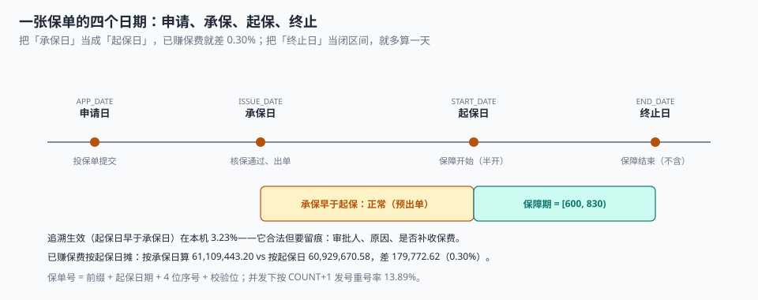

# 出单与保单要素：出单是一次冻结，不是一个 INSERT

一位客户的保单在 11 月 3 日承保，11 月 5 日起保。系统在 11 月 3 日就把保费算进了当月已赚，理由是「出单了就应该算收入」。

月末结账时，精算按保障期摊出另一个数，两边差 **179,772.62 元（0.30%）**。财务问「哪个对」，承保说「都按系统算的」。

**这就是「出单」被当成一次 INSERT 的代价。** 出单真正做的事是**冻结**：把投保单上那一刻的要素、条款版本、费率、核保结论，全部复制成一份不可变的记录。这份记录里，日期不是「创建时间」，而是四个含义不同的时间点。

::: tip 一句话理解
出单 = 把「要约」变成「承诺」的那一次转换，它有三个硬要求：**只能成功一次（幂等）、要素从此不可改（冻结）、四个日期各有含义（不能合并）**。
:::

## 一、四个日期，各有各的用途



| 日期 | 含义 | 谁在用 | 合并后的后果 |
| --- | --- | --- | --- |
| `apply_date` 申请日 | 投保单提交 | 核保时效、销售考核 | 「出单时长」无法计算 |
| `issue_date` 承保日 | 核保通过、保单生成 | 财务确认承保保费、再保账单 | 已赚保费起算点错 |
| `start_date` 起保日 | 保障开始（半开） | 理赔判定「在不在保期内」 | 追溯生效无法表达 |
| `end_date` 终止日 | 保障结束（**不含**） | 续保衔接、退保计算 | 多算或少算一天 |

四种日期两两之间的关系都是合法的：

| 关系 | 场景 | 本机占比 |
| --- | --- | --- |
| 承保日 < 起保日 | 预出单（提前几天出单，下月起保） | 多数 |
| 承保日 = 起保日 | 即时生效（线上投保最常见） | 多数 |
| 承保日 > 起保日 | **追溯生效**（补录、续保衔接、团单） | **3.23%（581 张）** |

追溯生效不是错误，它合法但必须留痕：谁批的、为什么、有没有补收保费。把它当成异常挡掉，会让「续保衔接」这类业务无法落地；把它当成正常且不留痕，稽核时就无法区分「业务需要」和「倒签单」。

## 二、已赚保费：分母是实际保障天数

```sql
-- 已赚保费：按日摊，截至某个结账日
SELECT p.policy_no,
       p.written_premium,
       MIN(1.0, MAX(0.0,
         (julianday(MIN(p.end_date, '2026-10-31')) - julianday(p.start_date))
         / (julianday(p.end_date) - julianday(p.start_date)))) AS earned_ratio,
       ROUND(CAST(p.written_premium AS REAL) *
         MIN(1.0, MAX(0.0,
           (julianday(MIN(p.end_date, '2026-10-31')) - julianday(p.start_date))
           / (julianday(p.end_date) - julianday(p.start_date)))), 2) AS earned
FROM policy p;
```

四个细节，缺一个就会在短期险上出错：

1. **`MIN(1.0, ...)`**：结账日晚于终止日时，比例不能超过 1。
2. **`MAX(0.0, ...)`**：结账日早于起保日时（预出单），比例不能为负。
3. **分母用 `end_date − start_date`**，不用 365：90 天短期险按 365 摊，比例会永远到不了 1。
4. **`MIN(end_date, 结账日)`**：已到期保单不该继续累积已赚。

本机 18,000 张保单上，三种摊法的差异：

| 摊法 | 已赚合计 | 与按日摊的差 |
| --- | --- | --- |
| 按日（正确） | 60,929,670.58 | 基准 |
| 按整月（`月数/12`） | 59,958,780.44 | −970,890.14（**−1.59%**） |
| 按承保日起算 | 61,109,443.20 | +179,772.62（+0.30%） |

**整月摊低估 1.59%，按承保日起算高估 0.30%。** 两个方向相反，所以在混合口径的系统里它们可能互相抵消，让总额看起来「差不多」——这正是这类错误能活很久的原因。

## 三、保单号：唯一、可读、带校验位

保单号是对外标识，三件事都要满足：

| 要求 | 做法 | 反例 |
| --- | --- | --- |
| 唯一 | 库级 `UNIQUE` + 序列/雪花 | `SELECT COUNT(*)+1`（并发重号 13.89%） |
| 可读 | 前缀 + 起保日期 + 序号 | 纯 UUID（客服念不出来） |
| 可校验 | 末位校验码（MOD 11-2 或 Luhn） | 无校验（录入错一位查不到单） |

本机并发实测：12 线程各发 6 张单，按 `COUNT(*)+1` 发号，72 张里只有 **62 个不同的号，重号 10 次（13.89%）**。改成数据库序列 + `UNIQUE` 后重号为 0。

```sql
-- 发号：用独立序列表 + 单号唯一约束，两步都要有
CREATE TABLE policy_no_seq (
  biz_date TEXT PRIMARY KEY,
  next_val INTEGER NOT NULL DEFAULT 1
);

BEGIN IMMEDIATE;
INSERT INTO policy_no_seq(biz_date, next_val) VALUES ('2026-11-05', 1)
  ON CONFLICT(biz_date) DO UPDATE SET next_val = next_val + 1;
SELECT 'PT' || replace('2026-11-05','-','') || printf('%04d', next_val - 1)
FROM policy_no_seq WHERE biz_date = '2026-11-05';
COMMIT;
```

校验位用 MOD 11-2（与身份证一致的口径）：本机 2,000 次单字符改错，检出 **2,000 次（100.00%）**——一位错必被检出，这对柜面手工录入是最便宜的一道门。

```python
def check_digit(s: str) -> str:
    w = [7, 9, 10, 5, 8, 4, 2, 1, 6, 3, 7, 9, 10, 5, 8, 4, 2]
    return "10X98765432"[sum(int(c) * w[i] for i, c in enumerate(s)) % 11]
```

## 四、出单幂等：一张投保单只能出一张保单

出单接口被重试、被双击、被消息重复投递，都是常态。防重的正确位置是**唯一约束**，不是「先查有没有出过单」：

```sql
ALTER TABLE policy ADD COLUMN app_no TEXT NOT NULL;
CREATE UNIQUE INDEX ux_policy_app ON policy(app_no);   -- 一张投保单一张保单
```

```sql
-- 重试安全：第二次插入直接被索引拦住，而不是产生第二张保单
INSERT INTO policy(policy_no, app_no, product_code, clause_id, holder_id, insured_id,
                   sum_insured, start_date, end_date, issue_date, written_premium)
VALUES ('PT202611050001','APP0000001','MOTOR',1,'H1','I1',230000,
        '2026-11-05','2027-11-05','2026-11-05','7029.10');
-- 再执行一次：UNIQUE constraint failed: policy.app_no
```

## 五、状态机：四态三边

| 状态 | 含义 | 可迁移到 | 触发 |
| --- | --- | --- | --- |
| `IN_FORCE` | 有效 | `LAPSED` / `CANCELLED` / `EXPIRED` | 欠缴 / 退保 / 期满 |
| `LAPSED` | 失效（欠缴） | `IN_FORCE`（复效） | 补缴 + 复效审核 |
| `CANCELLED` | 退保（终态） | — | 退保批单 |
| `EXPIRED` | 期满（终态） | — | 到期任务 |

三个要点：

1. **`EXPIRED` 是「期满」，不是「失效」**：期满不退钱、失效可能退钱、退保一定退钱，三者的账务处理完全不同。
2. **`LAPSED → IN_FORCE` 需要复效审核**：直接改状态等于跳过了「这段时间的风险由谁承担」这个判断。
3. **终态不可逆**：`CANCELLED` 之后再出批单，是[批改](../Endorsement/index.md)那一页要拦的事。

本机 18,000 张保单里，到 2026-10-31 仍在有效期的只有 **5,254 张（29.19%）**，其保额 **19.84 亿**。这个「有效保单占比」是承保侧最重要的分母之一：件均保费、赔付率、续保率都要按它算，用「累计保单数」当分母会把所有指标摊薄。

## 六、判据

本页判据族 `UWI-A` ~ `UWI-H`，共 8 条。

| 判据 | 断言 | 验证方式 |
| --- | --- | --- |
| `UWI-A` | 出单幂等：一张投保单只能出一张保单 | `UNIQUE(app_no)`，二次插入被拒 |
| `UWI-B` | 四个日期分列，追溯生效可判定 | `issue_date > start_date` 能查出非零 |
| `UWI-C` | 保单号唯一 + 可读 + 带校验位 | 并发发号重号 0；单字符错检出 100% |
| `UWI-D` | 保单要素冻结：单号与起保日不可改 | 触发器拒绝 `UPDATE OF policy_no, start_date` |
| `UWI-E` | 四态三边，迁移留痕 | 状态迁移表行数 = 状态变更次数 |
| `UWI-F` | 已赚按日摊，分母是实际保障天数 | 90 天短期险的已赚比例能到 1.0 |
| `UWI-G` | 起止半开，终止日不含 | `end_date` 当天的赔案判为「不在保期内」 |
| `UWI-H` | 出单在同一事务内触发保费流水与分出 | 保单数与首笔流水数相等 |

## 七、验证方式

```shell
# 1. 出单幂等（期望：第二条报 UNIQUE constraint failed）
sqlite3 uw.db "
insert into policy(policy_no,app_no,product_code,clause_id,holder_id,insured_id,sum_insured,
  start_date,end_date,issue_date,written_premium)
values('PT202611050001','APP1','MOTOR',1,'H1','I1',230000,'2026-11-05','2027-11-05','2026-11-05','7029.10');
insert into policy(policy_no,app_no,product_code,clause_id,holder_id,insured_id,sum_insured,
  start_date,end_date,issue_date,written_premium)
values('PT202611050002','APP1','MOTOR',1,'H1','I1',230000,'2026-11-05','2027-11-05','2026-11-05','7029.10');"

# 2. 已赚比例必须落在 [0,1]（期望：0 行越界）
sqlite3 uw.db "
select count(*) from policy where
  (julianday(min(end_date,'2026-10-31'))-julianday(start_date))
  / (julianday(end_date)-julianday(start_date)) not between 0.0 and 1.0;"

# 3. 90 天短期险到期后已赚必须正好 100%（期望 1.0）
sqlite3 uw.db "
select round((julianday(min(end_date,'2099-12-31'))-julianday(start_date))
  / (julianday(end_date)-julianday(start_date)),4)
from policy where julianday(end_date)-julianday(start_date)=90 limit 1;"

# 4. 单号校验位：改一位必须对不上（期望：True）
python3 -c "
w=[7,9,10,5,8,4,2,1,6,3,7,9,10,5,8,4,2]; m='10X98765432'
f=lambda s: m[sum(int(c)*w[i] for i,c in enumerate(s))%11]
print(f('202611050001') != f('202611050002'))"
```

## 参考资料

- 《中华人民共和国保险法》（2015 年修正）第十三条：保险合同成立后，保险人应及时向投保人签发保险单或其他保险凭证。
- 《中华人民共和国保险法》第十四条：保险合同成立后，投保人按约定交付保险费，保险人按约定时间开始承担保险责任——「承保日」与「起保日」分离的法律基础。
- GB/T 36687—2018《保险术语》：保险单、承保、起保日、保险期间的定义。
- 与本页相邻：[核保与风险选择](../Underwriting/index.md)、[批改与加退费](../Endorsement/index.md)、[再保分出与账单](../Reinsurance/index.md)。
