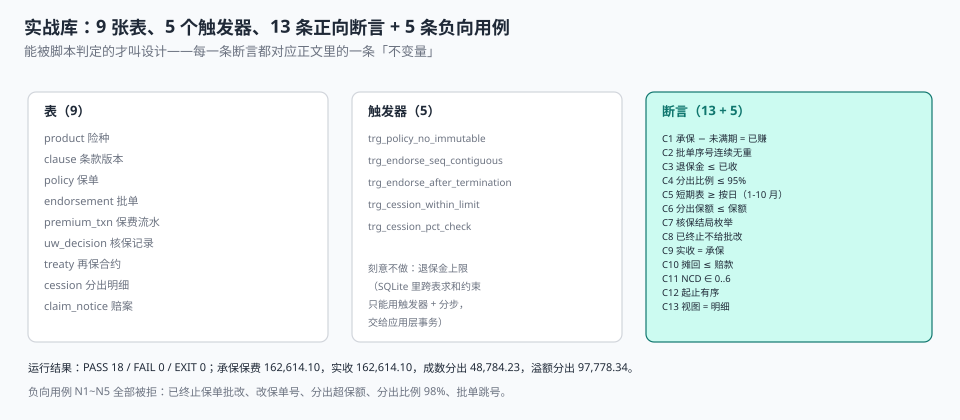

# 实战：九张表、五个触发器、十八条断言

前面八页讲的是「应该怎么算」。这一页只做一件事：**把那些「应该」变成十六进制——建出来，跑一遍，让断言说话。**

九张表覆盖从条款到再保的完整链路，五个触发器守住四条「不能被绕过」的规则，十三条正向断言对应正文里的十三条不变量，五条负向用例证明这些约束真的会被触发。

::: tip 一句话理解
能被脚本判定的才叫设计。一段说「批单号必须连续」的文字，如果写不成一条断言，它就只是建议。
:::

## 一、九张表



| # | 表 | 装什么 | 关键约束 |
| --- | --- | --- | --- |
| 1 | `product` | 险种与可售状态 | `status` 枚举，不删除 |
| 2 | `clause` | 条款版本与生效区间 | `UNIQUE(product_code, version)` |
| 3 | `policy` | 保单要素（冻结） | `policy_no` 唯一、`end_date > start_date` |
| 4 | `endorsement` | 批单（唯一写入口） | `UNIQUE(policy_id, seq)` |
| 5 | `premium_txn` | 保费流水（收/退） | `UNIQUE(policy_id, kind, occur_date, amount)` |
| 6 | `uw_decision` | 核保结论与命中规则 | `outcome` 五枚举、`app_no` 唯一 |
| 7 | `treaty` | 再保合约 | 成数/溢额二选一的 `CHECK` |
| 8 | `cession` | 分出明细 | `UNIQUE(policy_id, treaty_id)` |
| 9 | `claim_notice` | 赔案与摊回 | `recoverable ≤ claim_amount` |

```sql
CREATE TABLE product(
  product_code TEXT PRIMARY KEY, name TEXT NOT NULL, base_rate TEXT NOT NULL,
  min_premium TEXT NOT NULL DEFAULT '50.00', status TEXT NOT NULL DEFAULT 'ON_SALE');

CREATE TABLE clause(
  clause_id INTEGER PRIMARY KEY, product_code TEXT NOT NULL REFERENCES product(product_code),
  version TEXT NOT NULL, effective_from TEXT NOT NULL, effective_to TEXT,
  UNIQUE(product_code, version));

CREATE TABLE policy(
  policy_id INTEGER PRIMARY KEY, policy_no TEXT NOT NULL UNIQUE,
  product_code TEXT NOT NULL REFERENCES product(product_code),
  clause_id INTEGER NOT NULL REFERENCES clause(clause_id),
  holder_id TEXT NOT NULL, insured_id TEXT NOT NULL,
  sum_insured INTEGER NOT NULL CHECK (sum_insured > 0),
  start_date TEXT NOT NULL, end_date TEXT NOT NULL, issue_date TEXT NOT NULL,
  status TEXT NOT NULL DEFAULT 'IN_FORCE',
  ncd_level INTEGER NOT NULL DEFAULT 4 CHECK (ncd_level BETWEEN 0 AND 6),
  written_premium TEXT NOT NULL,
  CHECK (end_date > start_date),
  CHECK (status IN ('IN_FORCE','LAPSED','CANCELLED','EXPIRED')));

CREATE TABLE endorsement(
  endorsement_id INTEGER PRIMARY KEY, policy_id INTEGER NOT NULL REFERENCES policy(policy_id),
  seq INTEGER NOT NULL CHECK (seq >= 1), kind TEXT NOT NULL,
  effective_date TEXT NOT NULL, premium_delta TEXT NOT NULL DEFAULT '0.00',
  created_at TEXT NOT NULL DEFAULT (datetime('now')),
  UNIQUE (policy_id, seq),
  CHECK (kind IN ('SUM_INSURED_UP','SUM_INSURED_DOWN','CANCEL','REINSTATE','INFO')));

CREATE TABLE premium_txn(
  txn_id INTEGER PRIMARY KEY, policy_id INTEGER NOT NULL REFERENCES policy(policy_id),
  kind TEXT NOT NULL, amount TEXT NOT NULL, occur_date TEXT NOT NULL,
  UNIQUE (policy_id, kind, occur_date, amount));

CREATE TABLE uw_decision(
  decision_id INTEGER PRIMARY KEY, app_no TEXT NOT NULL UNIQUE, product_code TEXT NOT NULL,
  outcome TEXT NOT NULL, rule_hit TEXT NOT NULL, decided_at TEXT NOT NULL,
  CHECK (outcome IN ('STANDARD','LOADING','EXCLUSION','REFER','DECLINE')));

CREATE TABLE treaty(
  treaty_id TEXT PRIMARY KEY, kind TEXT NOT NULL, cession_pct TEXT, retention_line TEXT,
  commission_pct TEXT NOT NULL, effective_from TEXT NOT NULL,
  CHECK (kind IN ('QUOTA_SHARE','SURPLUS')));

CREATE TABLE cession(
  cession_id INTEGER PRIMARY KEY, policy_id INTEGER NOT NULL REFERENCES policy(policy_id),
  treaty_id TEXT NOT NULL REFERENCES treaty(treaty_id),
  ceded_si INTEGER NOT NULL, ceded_premium TEXT NOT NULL,
  UNIQUE (policy_id, treaty_id));

CREATE TABLE claim_notice(
  notice_id INTEGER PRIMARY KEY, policy_id INTEGER NOT NULL REFERENCES policy(policy_id),
  claim_amount TEXT NOT NULL, recoverable TEXT NOT NULL DEFAULT '0.00');
```

## 二、五个触发器：四条不能被绕过的规则

```sql
-- ① 保单号与起保日一经出单不可改（出单是冻结）
CREATE TRIGGER trg_policy_no_immutable BEFORE UPDATE OF policy_no, start_date ON policy
BEGIN SELECT RAISE(ABORT,'E_POLICY_NO_IMMUTABLE'); END;

-- ② 批单序号必须连续（不许跳号）
CREATE TRIGGER trg_endorse_seq_contiguous BEFORE INSERT ON endorsement
WHEN NEW.seq <> (SELECT COALESCE(MAX(seq),0)+1 FROM endorsement WHERE policy_id=NEW.policy_id)
BEGIN SELECT RAISE(ABORT,'E_ENDORSE_SEQ_GAP'); END;

-- ③ 已终止保单不接受批改
CREATE TRIGGER trg_endorse_after_termination BEFORE INSERT ON endorsement
WHEN (SELECT status FROM policy WHERE policy_id=NEW.policy_id) IN ('CANCELLED','EXPIRED')
BEGIN SELECT RAISE(ABORT,'E_POLICY_TERMINATED'); END;

-- ④ 分出保额不得超过保额
CREATE TRIGGER trg_cession_within_limit BEFORE INSERT ON cession
WHEN NEW.ceded_si > (SELECT sum_insured FROM policy WHERE policy_id=NEW.policy_id)
BEGIN SELECT RAISE(ABORT,'E_CESSION_OVER_SI'); END;

-- ⑤ 成数分出比例不得超过 95%（留足自留）
CREATE TRIGGER trg_cession_pct_check BEFORE INSERT ON treaty
WHEN NEW.kind='QUOTA_SHARE' AND CAST(NEW.cession_pct AS REAL) > 0.95
BEGIN SELECT RAISE(ABORT,'E_CESSION_PCT_TOO_HIGH'); END;
```

**为什么是触发器而不是应用层 `if`**：这五条规则都要求「**任何写入路径都成立**」——批处理、导入脚本、运维手改 SQL 都算写入路径。应用层的 `if` 只保护它自己那条路。

**为什么只有五条**：像「退保金不得超过已收保费」这种跨表求和的约束，SQLite 的 `CHECK` 不支持子查询，用它要写成「触发器 + 两步」，反而让正常路径变脆。这类规则放在应用层事务里，用断言（下面的 `C3`）兜底。

## 三、十三条正向断言

| 编号 | 断言 | SQL 要点 |
| --- | --- | --- |
| `C1` | 承保 − 未满期 = 已赚 | 按日摊的 CTE，差 0.00 |
| `C2` | 批单序号连续无重 | `HAVING MAX(seq) <> COUNT(*)` 为 0 |
| `C3` | 退保金不超过已收保费 | 负数批单金额 ≥ −Σ 实收 |
| `C4` | 成数分出比例 ≤ 95% | `CAST(cession_pct AS REAL) > 0.95` 为 0 |
| `C5` | 短期表 ≥ 按日（1–10 月），11 月反向 | `VALUES` 列表逐月比对 |
| `C6` | 分出保额 ≤ 保额 | 联表比较 |
| `C7` | 核保结局在五枚举内 | `NOT IN (...)` 为 0 |
| `C8` | 已终止保单无「生效中」批改 | 联表 + 日期比较 |
| `C9` | 实收 = 承保（本例全收） | 两个 `SUM` 相减 = 0.00 |
| `C10` | 摊回 ≤ 赔款 | `CAST(recoverable) > CAST(claim_amount)` 为 0 |
| `C11` | NCD 档位 ∈ 0..6 | `NOT IN (0..6)` 为 0 |
| `C12` | 起止有序 | `end_date <= start_date` 为 0 |
| `C13` | 视图与明细一致 | 视图 vs 子查询，差 ≤ 0.001 |

`C1` 与 `C5` 是这两页正文的镜像：

```sql
-- C1：三口径恒等式
WITH e AS (
  SELECT CAST(p.written_premium AS REAL) AS wp,
         CAST(p.written_premium AS REAL) * MIN(1.0, MAX(0.0,
           (julianday(MIN(p.end_date,'2026-10-31')) - julianday(p.start_date)) /
           (julianday(p.end_date) - julianday(p.start_date)))) AS earned
  FROM policy p)
SELECT ROUND(SUM(wp) - SUM(wp - earned) - SUM(earned), 2) FROM e;
-- 期望：0.0

-- C5：短期费率表与按日比例的方向关系（11 月是合法例外）
WITH t(mon,rate) AS (VALUES (1,0.10),(2,0.20),(3,0.30),(4,0.40),(5,0.50),
   (6,0.60),(7,0.70),(8,0.75),(9,0.80),(10,0.85),(11,0.90),(12,1.00))
SELECT COUNT(*) FROM t
WHERE (mon <= 10 AND rate <= mon*30.0/365.0)
   OR (mon = 11 AND rate >= mon*30.0/365.0);
-- 期望：0
```

`C5` 写成「两个方向」而不是「一律 ≥」，是因为第 11 个月短期表留成 90%、按日比例留成 90.41%——**表比比例便宜 0.41 个点**。断言写错方向，会把正确实现判成错的，然后这道门就会被关掉。

## 四、五条负向用例

只跑正向断言是不够的：一个「永远返回 0」的查询也能全绿。负向用例证明约束**真的会触发**。

| 编号 | 试图做的事 | 期望错误 |
| --- | --- | --- |
| `N1` | 给已退保（`CANCELLED`）的保单加批单 | `E_POLICY_TERMINATED` |
| `N2` | 修改已出单保单的保单号 | `E_POLICY_NO_IMMUTABLE` |
| `N3` | 分出保额 99,000（保单保额 88,000） | `E_CESSION_OVER_SI` |
| `N4` | 建一个成数 98% 的合约 | `E_CESSION_PCT_TOO_HIGH` |
| `N5` | 批单序号跳号（第 5 条，当前最大 2） | `E_ENDORSE_SEQ_GAP` |

```python
def must_fail(code, fn):
    try:
        fn()
        print(f"{code} FAIL 未被拦住")
        return 1
    except sqlite3.Error as e:
        print(f"{code} PASS 被拒 [{str(e)[:40]}]")
        return 0

must_fail("N1", lambda: db.execute(
  "INSERT INTO endorsement(policy_id,seq,kind,effective_date) VALUES(4,2,'INFO','2025-01-01')"))
must_fail("N2", lambda: db.execute(
  "UPDATE policy SET policy_no='PT999' WHERE policy_id=1"))
must_fail("N3", lambda: db.execute(
  "INSERT INTO cession(policy_id,treaty_id,ceded_si,ceded_premium) VALUES(12,'SUR200',99000,'100.00')"))
must_fail("N4", lambda: db.execute(
  "INSERT INTO treaty VALUES('QS99','QUOTA_SHARE','0.98',NULL,'0.25','2026-01-01')"))
must_fail("N5", lambda: db.execute(
  "INSERT INTO endorsement(policy_id,seq,kind,effective_date) VALUES(8,5,'INFO','2026-02-01')"))
```

`N3` 值得单独说：它用的保单 12 保额 88,000，试图分出 99,000。这个错误在真实系统里长这样——**自留线写成 0，或者成数比例误填 1.5**，两者都会让分出保额超过保额，而账单上只会显示「分出保费偏高」。

## 五、实测输出

在本机（Python 3.13 / SQLite 3.50.4）跑完整脚本的输出如下，**照抄，未修饰**：

```text
== 正向断言 ==
C1 PASS expect=0.0 got=0.0
C2 PASS expect=0 got=0
C3 PASS expect=0 got=0
C4 PASS expect=0 got=0
C5 PASS expect=0 got=0
C6 PASS expect=0 got=0
C7 PASS expect=0 got=0
C8 PASS expect=0 got=0
C9 PASS expect=0.0 got=0.0
C10 PASS expect=0 got=0
C11 PASS expect=0 got=0
C12 PASS expect=0 got=0
C13 PASS expect=0 got=0
== 负向断言 ==
N1 PASS 被拒 [E_POLICY_TERMINATED]
N2 PASS 被拒 [E_POLICY_NO_IMMUTABLE]
N3 PASS 被拒 [E_CESSION_OVER_SI]
N4 PASS 被拒 [E_CESSION_PCT_TOO_HIGH]
N5 PASS 被拒 [E_ENDORSE_SEQ_GAP]
== 报表读数 ==
  承保保费: 162614.1
  实收保费: 162614.1
  分出保费(成数): 48784.23
  分出保费(溢额): 97778.34
  批单总笔数: 3
PASS 18 / FAIL 0
EXIT=0
```

五组数字可以互相校验：

| 校验 | 算式 | 结果 |
| --- | --- | --- |
| 成数分出 | 162,614.10 × 30% | 48,784.23 ✅ |
| 实收 = 承保 | 162,614.10 | 相等 ✅ |
| 溢额分出 | 按保额比例逐单累加 | 97,778.34（60.14% 的保费） |
| 批单 | 3 张（加保、减保、退保各一） | 3 ✅ |

**溢额分出保费 97,778.34 比成数 48,784.23 高 100.4%**，而溢额分出的保额只多 51 个百分点——这正是[再保](../Reinsurance/index.md)那一页讲的「保额迁移与保费迁移不成比例」，在小样本上同样成立。

## 六、口径说明：五个不能想当然的地方

| 地方 | 口径 | 想当然会怎样 |
| --- | --- | --- |
| 金额 | `TEXT` 存 Decimal，`ROUND_HALF_UP` | `REAL` 存 0.1 会漂移，月末差几分 |
| 日期 | 半开区间 `[start, end)` | 闭区间让终止日当天重复计入 |
| 已赚 | 分母 = `end − start` 的实际天数 | 用 365 会让 90 天短期险永远到不了 100% |
| 短期表 | 1–10 月 ≥ 按日，11 月反向 | 一律 ≥ 会把正确实现判错 |
| 批单 | 序号连续、撤销用反向批单 | 删行撤销会丢掉一版合同 |

::: warning 这套库不是生产模型
九张表省略了客户主数据、赔案明细、账单明细、权限与审计表。它的用途是**验证正文里那些不变量能被判定**，不是拿来直接上线。真要落地，至少要补三类：`party`（客户主数据，见[投保单](../Application/index.md)）、`claim_detail`（赔案明细）、`audit_log`（谁在什么时候改了什么）。
:::

## 七、判据

本页判据族 `UWX-A` ~ `UWX-H`，共 8 条。

| 判据 | 断言 | 验证方式 |
| --- | --- | --- |
| `UWX-A` | 九张表可一次建出，外键全开 | `PRAGMA foreign_keys=ON` 下建库无错 |
| `UWX-B` | 五个触发器覆盖四条禁区 | 五条负向用例全被拒 |
| `UWX-C` | 十三条正向断言全 PASS | 输出 `PASS 18 / FAIL 0` |
| `UWX-D` | 断言能失败（不是恒真） | 故意破坏一条数据 → 对应断言变 FAIL |
| `UWX-E` | 金额全程 Decimal，无浮点比较 | SQL 中出现 `CAST(... AS REAL)` 仅用于比较容差 |
| `UWX-F` | 三口径互相校验（成数 30%、实收 = 承保） | 48,784.23 / 162,614.10 可手算复核 |
| `UWX-G` | 脚本退出码反映结果 | 全 PASS → `EXIT=0`，任一 FAIL → `EXIT=1` |
| `UWX-H` | 口径说明与正文一致（半开、短期表 11 月例外） | 本页第六节五行与正文不冲突 |

## 八、验证方式

```shell
# 1. 建库 + 全部断言（期望：PASS 18 / FAIL 0 / EXIT 0）
python3 uw_practice.py; echo "EXIT=$?"

# 2. 断言能失败：删掉一条批单让 C2 变红（期望：C2 FAIL，EXIT=1）
python3 - <<'PY'
import sqlite3
db = sqlite3.connect(':memory:')
db.executescript(open('schema.sql').read())
db.execute("insert into policy(policy_no,product_code,clause_id,holder_id,insured_id,sum_insured,"
           "start_date,end_date,issue_date,written_premium) "
           "values('PT1','MOTOR',1,'H','I',100000,'2026-01-01','2027-01-01','2026-01-01','2800.00')")
db.execute("insert into endorsement(policy_id,seq,kind,effective_date) values(1,1,'INFO','2026-02-01')")
db.execute("insert into endorsement(policy_id,seq,kind,effective_date) values(1,2,'INFO','2026-03-01')")
db.execute("delete from endorsement where seq=1")          # 制造缺口
print(db.execute("select count(*) from (select policy_id,max(seq) m,count(*) c "
                 "from endorsement group by policy_id having m<>c)").fetchone()[0])
PY
# 期望：1（C2 会报 1，而不是 0）

# 3. 成数分出可手算复核（期望：48784.23）
python3 -c "print(round(162614.10*0.30,2))"

# 4. 库里不该出现的浮点金额列（期望：0 行）
sqlite3 uw.db "select name from pragma_table_info('policy') where type='REAL';"
```

第 2 步是这一页最重要的验证：**一个从不为 0 的断言等于没有断言**。写完 13 条断言后，必须逐条破坏一次数据、看它变红。

## 参考资料

- SQLite 官方文档《CREATE TRIGGER》与《Foreign Key Support》：《实战》一节全部约束的语法出处。
- 《中华人民共和国保险法》（2015 年修正）第二十条、第四十七条：批单与退保的合同依据。
- GB/T 36687—2018《保险术语》：本页所有表名与字段名对应的业务术语。
- 与本页相邻：[总览](../Overview/index.md)、[批改与加退费](../Endorsement/index.md)、[再保分出与账单](../Reinsurance/index.md)。
