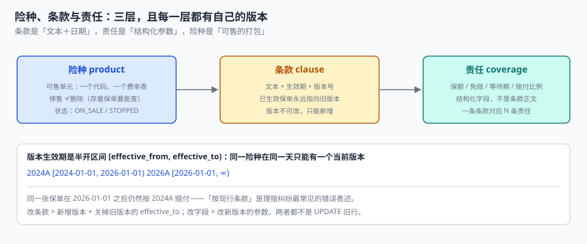

# 险种、条款与责任：三层，各有各的版本

2026 年 1 月 1 日，某险种的新版条款上线。系统里做了一次「条款升级」：把 `clause` 表里该险种的行 `UPDATE` 成 2026A。

三个月后，一位客户在 2025 年 11 月买的保单出险。理赔员打开条款，看到的是 2026A 的免赔额——比客户买的时候高了 500 元。客户拿出当时的投保单，上面印的是 2024A 的免赔额。

**这是一次典型的「用 UPDATE 改历史」。** 条款不是配置项，它是**合同的一部分**：已经成立的合同，条款就固定了。系统里改一个字，等于单方面修改了 5,602 张仍在有效期内的合同（本机跨版本保单占比 31.12%）。

::: tip 一句话理解
险种是**可售的打包**，条款是**带生效期的文本**，责任是**结构化参数**——三层必须分开，因为它们的变更方式完全不同：险种可以停售，条款只能新增版本，责任只能在新版本里改。
:::

## 一、为什么不能「一张表装下所有」

最常见的做法是一张 `product` 表，字段里塞 `clause_text`、`deductible`、`waiting_days`、`rate`。这一版能上线，然后会在三个地方同时坏掉。

| 变更 | 一张表的做法 | 三层模型的做法 |
| --- | --- | --- |
| 条款措辞调整 | `UPDATE product SET clause_text=...` | 新增 `clause` 行，旧行关掉 `effective_to` |
| 免赔额从 500 调到 800 | `UPDATE product SET deductible=800` | 新增版本，旧保单仍读 500 |
| 费率整体上调 5% | `UPDATE product SET rate=...` | 新增 `rate_table` 版本，与条款版本**解耦** |
| 某险种停售 | `DELETE FROM product` | `status='STOPPED'`，存量保单仍可查 |
| 监管要求留痕 | 没有留痕 | 版本表本身就是留痕 |

五行里只有第一行看起来「省事」，代价是**历史被覆盖**。而承保系统的第一属性就是「历史不可改」——你今天看到的任何一张保单，都要能在三年后按当时的条款解释。

## 二、三层模型与它们的边界



| 层 | 装什么 | 变更方式 | 生命周期 |
| --- | --- | --- | --- |
| 险种 `product` | 代码、名称、可售状态、所属条线 | 新增或停售（不删除） | 长期，可停售 |
| 条款 `clause` | 版本号、文本、生效区间 | **只新增**，旧版关 `effective_to` | 按版本，永久保留 |
| 责任 `coverage` | 保额、免赔、等待期、赔付比例、限额 | 随条款版本新增 | 跟条款版本走 |

三层的对应关系是：**一个险种有 N 个条款版本，一个条款版本有 M 条责任**。保险责任不是「条款里的一段话」，而是**能被计算的一行参数**——理赔时读的是 `coverage.deductible`，不是从 PDF 里正则匹配「免赔额」。

```sql
CREATE TABLE product (
  product_code TEXT PRIMARY KEY,
  name         TEXT NOT NULL,
  line         TEXT NOT NULL,                    -- MOTOR / PROPERTY / LIABILITY / HEALTH
  status       TEXT NOT NULL DEFAULT 'ON_SALE',  -- ON_SALE / STOPPED
  CHECK (status IN ('ON_SALE','STOPPED'))
);

CREATE TABLE clause (
  clause_id      INTEGER PRIMARY KEY,
  product_code   TEXT NOT NULL REFERENCES product(product_code),
  version        TEXT NOT NULL,                  -- 2024A / 2026A
  document_uri   TEXT NOT NULL,                  -- 条款全文的位置（对象存储键）
  effective_from TEXT NOT NULL,
  effective_to   TEXT,                           -- NULL 表示仍在生效
  UNIQUE (product_code, version),
  CHECK (effective_to IS NULL OR effective_to > effective_from)
);

CREATE TABLE coverage (
  coverage_id    INTEGER PRIMARY KEY,
  clause_id      INTEGER NOT NULL REFERENCES clause(clause_id),
  code           TEXT NOT NULL,                  -- BODILY / PROPERTY / MEDICAL / LIABILITY
  is_rider       INTEGER NOT NULL DEFAULT 0,     -- 0 主险责任 / 1 附加险责任
  sum_insured    INTEGER,                        -- NULL = 跟随保单保额
  deductible     INTEGER NOT NULL DEFAULT 0,     -- 绝对免赔额（元）
  waiting_days   INTEGER NOT NULL DEFAULT 0,     -- 等待期（天）
  payout_ratio   TEXT NOT NULL DEFAULT '1.0000', -- 赔付比例，Decimal 字符串
  per_claim_cap  INTEGER,                        -- 单次限额
  UNIQUE (clause_id, code, is_rider)
);
```

`payout_ratio` 用 `TEXT` 存而不是 `REAL`，是本册所有金额字段的统一口径：`0.8` 在二进制浮点里是 `0.80000000000000004`，乘上 12345.67 元之后，四舍五入的边界会漂移 1 分钱。用字符串存 `Decimal`，再在应用层做 `ROUND_HALF_UP`，才能保证「同样的输入永远同样的输出」。

## 三、版本生效期是半开区间

条款版本用 `[effective_from, effective_to)` 表示，同一险种在同一天只能有一个当前版本：

```text
2024A   [2024-01-01, 2026-01-01)
2026A   [2026-01-01, NULL)          -- 仍在生效
```

这条约定解决的是一个具体问题：**2026-01-01 当天起保的保单，用哪版条款？** 闭区间写法会让 2024A 和 2026A 同时命中这一天，两个答案都「有依据」。半开区间只有一个答案。

更关键的是**归版依据用哪一天**。本机 18,000 张保单里：

| 归版依据 | 2024A | 2026A | 问题 |
| --- | --- | --- | --- |
| 按**起保日**（正确） | 13,027（72.37%） | 4,973（27.63%） | 无 |
| 按**终止日** | 7,425 | 10,575 | 5,602 张跨版本保单被错挂到新版 |

**31.12% 的保单跨版本**（起保在旧版期内、终止在新版期内）。按终止日归版的系统，会让这 5,602 张合同在理赔时读到一份它们从未签署过的条款——而系统里没有任何一处会报错，因为「保单有条款」这个条件始终成立。

::: danger 四个必须写死的约定
1. **条款行只增不改**：`UPDATE clause SET document_uri=...` 是禁止操作。改文本 = 新增版本 + 关旧版的 `effective_to`。
2. **保单存 `clause_id`，不存条款文本**：存文本的版本在条款修订后无法回答「当时写的是什么」，而且一份 PDF 会被复制 18,000 次。
3. **责任参数挂在 `clause_id` 上，不挂在 `product_code` 上**：挂在险种上意味着改一次费率就改了所有历史保单的免赔额。
4. **停售用状态位，不用 `DELETE`**：删掉险种行，存量保单的外键就悬空了；而承保系统最不能接受的就是「查不到这张保单属于哪个险种」。
:::

## 四、费率表与条款解耦

条款版本和费率表**不是一一对应**的：同一条款可能有多档费率（地区、渠道、团单折扣），同一档费率也可能跨两个条款版本沿用。把它们绑在一起，会出现「只调费率也得新建条款版本」这种荒唐事。

| 组合 | 是否合法 | 例子 |
| --- | --- | --- |
| 一条款 × 一费率表 | 合法 | 简单险种 |
| 一条款 × 多费率表 | 合法 | 车险按地区分三档费率 |
| 多条款 × 一费率表 | 合法 | 条款只改了措辞，费率未变（沿用） |
| 无条款 × 有费率 | **不合法** | 定价没有合同依据 |

本机 5 个险种的实际结构可以说明这种「不对称」：

| 险种 | 保单数 | 保额占比 | 保费占比 | 件均保费 |
| --- | --- | --- | --- | --- |
| 机动车综合 | 8,097（44.98%） | 22.90% | **69.27%** | 6,009.34 |
| 家庭财产 | 2,576（14.31%） | 24.68% | 3.09% | 842.94 |
| 个人意外 | 3,340（18.56%） | 15.93% | 3.97% | 835.03 |
| 责任险 | 1,859（10.33%） | **29.86%** | 12.20% | 4,609.74 |
| 费用补偿医疗 | 2,128（11.82%） | 6.63% | 11.47% | 3,785.61 |

**保额占比和保费占比可以完全不相关**：责任险占 29.86% 的保额、只贡献 12.20% 的保费；车险占 22.90% 的保额、贡献 69.27% 的保费。任何用「保额 × 统一费率」估算保费的报表，在这一步就会偏出量级。

## 五、附加险是独立的责任行

附加险常被做成「在主险上加个标记」，然后在新条款里塞一段「本附加险条款适用于……」——这会让三件事失效：附加险的保额无法单独统计、附加险的免赔额无法单独设置、附加险的停售无法独立于主险。

正确做法是 `coverage.is_rider=1` 的独立行，并有自己的 `sum_insured` 与 `deductible`：

```sql
-- 主险责任：跟随保单保额
INSERT INTO coverage(clause_id, code, is_rider, sum_insured, deductible, payout_ratio)
VALUES (1, 'PROPERTY', 0, NULL, 500, '1.0000');

-- 附加险责任：独立保额 5 万、独立免赔 200
INSERT INTO coverage(clause_id, code, is_rider, sum_insured, deductible, payout_ratio)
VALUES (1, 'HOME_APPLIANCE', 1, 50000, 200, '0.9000');
```

这样「这张保单最多赔多少」可以一次算出：

```sql
SELECT p.policy_no,
       p.sum_insured + COALESCE(SUM(c.sum_insured), 0) AS total_limit
FROM policy p
JOIN clause cl ON cl.clause_id = p.clause_id
LEFT JOIN coverage c ON c.clause_id = cl.clause_id AND c.is_rider = 1
GROUP BY p.policy_id;
```

## 六、判据

本页判据族 `UWP-A` ~ `UWP-H`，共 8 条。

| 判据 | 断言 | 验证方式 |
| --- | --- | --- |
| `UWP-A` | 险种、条款、责任三层分表，责任不是文本字段 | 三张表存在，`clause` 无 `deductible` 列 |
| `UWP-B` | 条款版本半开生效区间，同险种同日唯一 | 任意日期 `SELECT` 只返回一行 |
| `UWP-C` | 保单存 `clause_id`，不存条款文本 | `policy` 表无 `clause_text` 列 |
| `UWP-D` | 条款只增不改，`effective_to` 可关不可回退 | 版本号集合单调递增 |
| `UWP-E` | 停售用 `status`，无 `DELETE` | `product` 行数不因停售减少 |
| `UWP-F` | 附加险是独立责任行，`is_rider=1` | 附加险保额可单独求和 |
| `UWP-G` | 免赔、等待期、赔付比例是数值字段 | `coverage` 三列类型为 INTEGER / TEXT(Decimal) |
| `UWP-H` | 归版依据是起保日，跨版本保单可数出来 | 跨版本 31.12%（5,602 单）能查出明细 |

## 七、验证方式

```shell
# 1. 同一天只能有一个当前版本（期望：每行 count=1）
sqlite3 uw.db "
select product_code, '2026-06-01' d, count(*) from clause
where effective_from <= '2026-06-01'
  and (effective_to is null or effective_to > '2026-06-01')
group by product_code;"

# 2. 跨版本保单必须能数出来（期望：非 0，本机 5,602）
sqlite3 uw.db "
select count(*) from policy p join clause c on c.clause_id=p.clause_id
where p.start_date < c.effective_to
  and p.end_date > c.effective_to;"

# 3. 停售不删：行数守恒（期望：两条 SQL 结果相同）
sqlite3 uw.db "select count(*) from product;"
sqlite3 uw.db "update product set status='STOPPED' where product_code='HLT';
               select count(*) from product;"
# 期望：两次输出相同

# 4. 归版依据：按起保日与按终止日的分布不同（期望：两组数字不相等）
sqlite3 uw.db "
select c.version, count(*) from policy p join clause c on c.clause_id=p.clause_id
group by c.version;"
```

第 2 步那条 SQL 是这一页的核心判据：**`start_date < effective_to < end_date` 就是一张跨版本保单**。这个条件能被写成 SQL，说明版本切换是「数据问题」；写不成 SQL，说明版本被写进了代码。

## 参考资料

- 《中华人民共和国保险法》（2015 年修正）第十七条：保险人应向投保人提供条款并明确说明免除责任条款——条款文本与版本留存的法定义务。
- 中国银行保险监督管理委员会《财产保险公司保险条款和保险费率管理办法》（2021 年修订）：条款与费率的报备、变更与停售管理。
- GB/T 36687—2018《保险术语》：险种、条款、保险责任、附加险、免赔额的标准定义。
- 与本页相邻：[投保单与关系人](../Application/index.md)、[费率因子与保费计算](../Rating/index.md)、[出单与保单要素](../PolicyIssue/index.md)。
