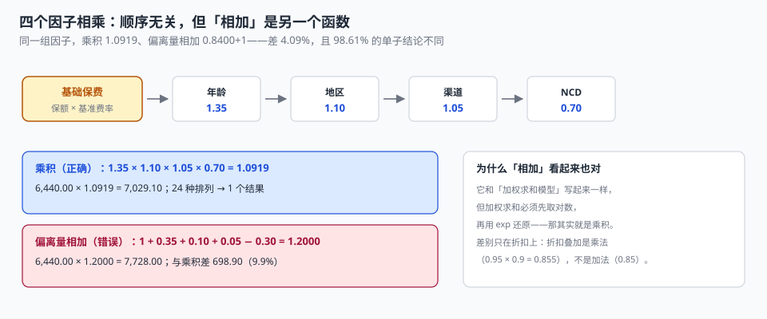

# 费率因子与保费计算：因子是相乘的，不是相加的

一张保单的基准保费是 6,440 元。四个因子：年龄 1.35、地区 1.10、渠道 1.05、NCD 0.70。

报价页算出来 **7,029.10**。同一个客户换了个渠道再算一次，得到 **7,728.00**。两套代码都在线上跑了半年，谁也没报错，因为两个数都是「算出来的」。

差在组合方式：一个把因子**相乘**（1.35 × 1.10 × 1.05 × 0.70 = 1.0919），另一个把**偏离量相加**（1 + 0.35 + 0.10 + 0.05 − 0.30 = 1.2000）。本机 8,000 张单子上，两种算法 **98.61% 的结论不同**，总额差 4.09%。

::: tip 一句话理解
定价是一个**纯函数**：`保费 = f(保额, 因子集合, 费率表版本)`。它必须顺序无关、可复算、只在一处取整——这三条不成立时，两个入口算出的两个数都不是 bug，而是两套制度。
:::

## 一、保费是怎么被算出来的



```text
步骤 1  基准保费 = 保额 × 基准费率（来自费率表版本）
步骤 2  风险保费 = 基准保费 × Π 因子（年龄、地区、渠道、NCD、职业…）
步骤 3  承保保费 = 风险保费 × 核保加费系数
步骤 4  承保保费 = max(承保保费, 最低保费)
步骤 5  取整（只在这里做一次）
```

五个步骤里，**第 2 步和第 5 步是事故高发区**。第 2 步错在组合方式，第 5 步错在取整位置。

## 二、为什么因子必须相乘

| 组合方式 | 表达式 | 例（1.35 / 1.10 / 1.05 / 0.70） | 语义 |
| --- | --- | --- | --- |
| 相乘（正确） | `Π fᵢ` | 1.0919 | 「每个因子把当前保费放大/缩小某个比例」 |
| 偏离量相加 | `1 + Σ(fᵢ − 1)` | 1.2000 | 「每个因子的影响是固定的加数」 |
| 加权求和 | `Σ wᵢfᵢ` | 取决于权重 | 只有在 `w` 归一且因子是对数时才等价于相乘 |

第二种写法在很多系统里存在，因为它写起来像「评分卡」：`score = 1 + 0.35 + 0.10 + 0.05 - 0.30`。但它的语义是错的——**折扣叠加不是加法**：

```text
两个 10% 折扣叠加：
  乘法：0.9 × 0.9 = 0.81     （实际打 19% 折，不是 20%）
  加法：1 − 0.1 − 0.1 = 0.80  （多打了 1 个点）
```

本机 8,000 张单子的对比：

| 指标 | 乘积 | 偏离量相加 | 差 |
| --- | --- | --- | --- |
| 保费合计 | 29,116,167.02 | 30,307,730.08 | −1,191,563.06（**−4.09%**） |
| 逐单结论不同的比例 | — | — | **98.61%（7,889 / 8,000）** |

4.09% 听起来不大，但它不是随机误差——**它是系统性的**：折扣越多，相加法越低估；加成越多，相加法越高估。这意味着它在产品结构变化时会突然放大，而任何按「历史平均偏差」做的调平都追不上。

## 三、顺序无关是纯函数的必要条件

```python
from decimal import Decimal as D, ROUND_HALF_UP

def premium(sum_insured: int, base_rate: D, factors: list[D], load: D = D("1")) -> D:
    """纯函数：同样输入永远同样输出，不读全局、不读时钟、不查库。"""
    p = D(sum_insured) * base_rate
    for f in factors:                     # 顺序无关：乘法可交换
        p *= f
    p *= load
    return max(p, D("50")).quantize(D("0.01"), rounding=ROUND_HALF_UP)
```

本机验证：四个因子 **24 种排列 → 1 个结果**（7,029.10）。如果换成「逐因子取整」，24 种排列会产生多个结果——这不是理论问题，它意味着**审计重算时永远对不上**。

| 取整位置 | 8,000 单合计 | 与末次取整的差 |
| --- | --- | --- |
| 逐因子取整 | 30,297,021.85 | +2.73 |
| 末次取整（正确） | 30,297,019.12 | 基准 |

**差 2.73 元，占 0.0000%。** 这个读数值得单独说一句：在本机规模上，取整位置几乎不影响总额，所以它**不是金额风险**；但它影响**可复算性**——逐因子取整的函数不是纯函数（结果依赖因子顺序），审计重算会出现「差几分钱但对不上」的情况，然后这张单就要人工核。

::: danger 四个定价事故
1. **`ROUND_HALF_UP` 与 Python 内置 `round()` 不是一回事**：`round(2.675, 2)` 得到 `2.67`（二进制浮点），而业务期望 `2.68`。金额一律用 `Decimal` + `ROUND_HALF_UP`。
2. **不要用 `REAL`/`FLOAT` 存因子**：`1.1` 存成浮点是 `1.1000000000000000888`，乘 100 万次后总额会漂移出几元。
3. **最低保费必须显式**：本机 8,000 单没有一单触及 50 元下限（件均 3,900），但在「短期险 + 小额标的」场景里它是常态；写死在代码里的最低保费，改一次要发版。
4. **加费系数不能混进因子集合**：核保加费（1.25）是**合同条件**，费率因子是**风险刻画**。混在一起后，`load_factor` 无法单独审计，也无法回答「这张单为什么贵 25%」。
:::

## 四、费率表要带版本，因为要能复算

```sql
CREATE TABLE rate_table (
  rate_id      INTEGER PRIMARY KEY,
  product_code TEXT NOT NULL,
  version      TEXT NOT NULL,             -- 2024A / 2026A
  region_code  TEXT,                      -- NULL = 全国统一
  base_rate    TEXT NOT NULL,             -- 对保额的基准费率，Decimal 字符串
  min_premium  TEXT NOT NULL DEFAULT '50.00',
  band_json    TEXT,                      -- 保额档位：[{lo,hi,factor}]
  effective_from TEXT NOT NULL,
  effective_to   TEXT,
  UNIQUE (product_code, version, region_code)
);

CREATE TABLE policy_price (               -- 计价快照：每张保单一行，可复算
  policy_id    INTEGER PRIMARY KEY REFERENCES policy(policy_id),
  rate_id      INTEGER NOT NULL REFERENCES rate_table(rate_id),
  sum_insured  INTEGER NOT NULL,
  factor_json  TEXT NOT NULL,             -- {"age":"1.35","region":"1.10",...}
  load_factor  TEXT NOT NULL DEFAULT '1.0000',
  risk_premium TEXT NOT NULL,             -- 取整前的风险保费
  written_premium TEXT NOT NULL           -- 取整后的承保保费
);
```

`factor_json` 与 `risk_premium` 这两列是「可解释性」的载体：三年后有人问「这张单 7,029.10 是怎么来的」，一条 SQL 就能重算，不需要找当时的代码版本。

```sql
-- 复算：把因子重新乘一遍，与落库值比对（期望 0 条不一致）
SELECT COUNT(*) FROM policy_price
WHERE ABS(
  CAST(sum_insured AS REAL) * (SELECT CAST(base_rate AS REAL) FROM rate_table r WHERE r.rate_id = rate_id)
  * (SELECT EXP(SUM(LN(CAST(value AS REAL)))) FROM json_each(factor_json))
  * CAST(load_factor AS REAL) - CAST(risk_premium AS REAL)) > 0.005;
```

## 五、保额档位：一个容易被忽略的非线性

很多费率表按保额分档打折（保额 100 万以上费率降 10%）。档位是**分段函数**，不是连续函数，所以「保额 99.9 万」和「保额 100 万」的保费可能出现**反向跳变**：

| 保额 | 费率 | 保费 | 说明 |
| --- | --- | --- | --- |
| 990,000 | 0.00280 | 2,772.00 | 未达档 |
| 1,000,000 | 0.00252 | 2,520.00 | 进档后**更便宜** |
| 1,010,000 | 0.00252 | 2,545.20 | 恢复单调 |

这类跳变在报价页上会被客户发现（「我少保 1 万反而贵 252 元」）。三种处理方式：

1. **接受并公示**：档位边界写进条款附件，属于合法的产品设计。
2. **改为连续插值**：`rate = base × (1 − 0.1 × min(1, si/1e6))`，代价是失去档位的简洁性。
3. **在边界处做「取优」**：客户可选按档内最低保费承保更高保额——本质是促销，不是定价。

选哪种是产品决策，但**必须写下来**：系统里没有记录「为什么 99.9 万比 100 万贵」的地方，就意味着每次客服都要重新解释一遍。

## 六、判据

本页判据族 `UWR-A` ~ `UWR-H`，共 8 条。

| 判据 | 断言 | 验证方式 |
| --- | --- | --- |
| `UWR-A` | 因子以乘积组合 | 24 种排列 → 1 个结果 |
| `UWR-B` | 保费是纯函数，无隐藏状态 | 同样输入调 100 次，输出一致 |
| `UWR-C` | 取整只在最后一步，用 `ROUND_HALF_UP` | 中间量保留 4 位以上 |
| `UWR-D` | 最低保费与保额档位显式配置，不写死在代码 | `rate_table.min_premium` / `band_json` |
| `UWR-E` | 费率表带版本，可按保单复算 | `policy_price.rate_id` 指向具体版本 |
| `UWR-F` | 加费系数与费率因子分开存 | `load_factor` 与 `factor_json` 两列 |
| `UWR-G` | 计价快照保留中间量（取整前保费） | `risk_premium` 存在 |
| `UWR-H` | 折扣叠加按乘法，且顺序无关 | 0.9 × 0.9 = 0.81，与顺序无关 |

## 七、验证方式

```shell
# 1. 顺序无关：同一组因子按不同顺序相乘，结果必须唯一（期望 1）
python3 - <<'PY'
import itertools
from decimal import Decimal as D, ROUND_HALF_UP
fs = [D("1.35"), D("1.10"), D("1.05"), D("0.70")]
out = set()
for p in itertools.permutations(fs):
    v = D(230000) * D("0.028")
    for f in p: v *= f
    out.add(v.quantize(D("0.01"), rounding=ROUND_HALF_UP))
print(len(out), out)
PY
# 期望：1 {Decimal('7029.10')}

# 2. 乘积与相加的差（期望：两者不相等，本机差 4.09%）
python3 - <<'PY'
from decimal import Decimal as D
mul = D("1.35")*D("1.10")*D("1.05")*D("0.70")
add = D(1)+(D("1.35")-1)+(D("1.10")-1)+(D("1.05")-1)+(D("0.70")-1)
print(round(mul,4), round(add,4))
PY
# 期望：1.0919 1.2000

# 3. 复算一致（在实战库上跑，期望 0）
sqlite3 uw.db "
select count(*) from policy_price where abs(
  cast(sum_insured as real) * (select cast(base_rate as real) from rate_table r where r.rate_id=rate_id)
  * (select exp(sum(ln(cast(value as real)))) from json_each(factor_json))
  * cast(load_factor as real) - cast(risk_premium as real)) > 0.005;"
```

第 1 步的那个脚本值得留在测试里：它是「纯函数」这一条判据的唯一客观验证方式。

## 参考资料

- GB/T 36687—2018《保险术语》：保险费、费率、基准费率、费率因子的定义。
- 中国银行保险监督管理委员会《财产保险公司保险条款和保险费率管理办法》（2021 年修订）：费率报备与浮动范围管理。
- ISO 80000-1:2009《量和单位 第 1 部分：总则》：数值修约与有效数字的通用约定（本册取整口径的参考）。
- 与本页相邻：[核保与风险选择](../Underwriting/index.md)、[出单与保单要素](../PolicyIssue/index.md)、[险种、条款与责任](../ProductModel/index.md)。
