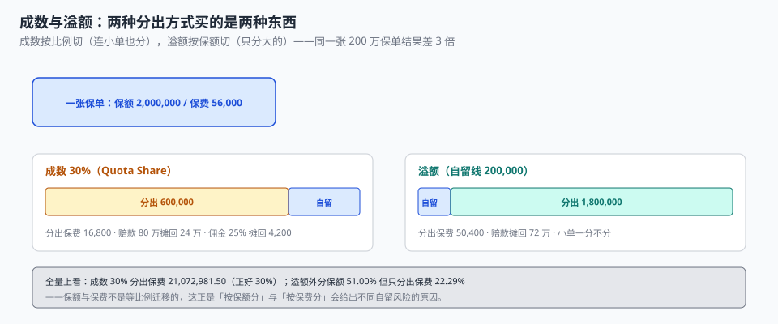

# 再保分出与账单：成数按比例切，溢额按保额切

承保部签了一张 200 万的保单，保费 56,000。同一个月，再保部收到两份不同的分出结果：一份说分出保费 16,800、分出保额 60 万；另一份说分出保费 50,400、分出保额 180 万。

两张单子都对——一张按**成数 30%** 分，一张按**溢额（自留线 20 万）** 分。但把它们并排放在一张账单上，就会得到「同一张保单分出两次、共 67,200 元」这种不可能的数。

::: tip 一句话理解
再保买的不是「保险」，是**自留风险的形状**：成数按比例切（连小单也分），溢额按保额切（只分大的）。两者保额迁移与保费迁移**不成比例**，所以每一笔分出都必须记清「按哪个合约、按什么口径」。
:::

## 一、两种分出方式，买的是两种东西



| 维度 | 成数（Quota Share） | 溢额（Surplus） |
| --- | --- | --- |
| 切什么 | 保费与保额**同比例** | 保额按「自留线」切，保费按保额比例分摊 |
| 小单 | 也分（哪怕 5 万保额） | **一分不分** |
| 分出保额 | 保额 × 比例 | 保额 − 自留线 |
| 分出保费 | 保费 × 比例 | 保费 × 分出保额 / 保额 |
| 适合 | 新业务、缺资本、要稳定 | 大额风险、只想去掉尾部 |
| 本机读数 | 分出保费 21,072,981.50（正好 30.00%） | 分出保额占比 **51.00%**，分出保费占比 **22.29%** |

最后一行是这一页的核心：**溢额分出 51% 的保额，却只分出 22.29% 的保费**。因为溢额只切超过自留线的那一段，而「超过的那一段」在大额保单里占保额比例高、在保费里占比低（大额保单的费率通常更低）。

同一张 200 万保单的对比：

| 口径 | 分出保额 | 分出保费 | 赔款 80 万时摊回 |
| --- | --- | --- | --- |
| 成数 30% | 600,000 | 16,800.00 | 240,000.00 |
| 溢额（自留 20 万） | 1,800,000 | 50,400.00 | 720,000.00 |
| 倍数 | 3.0× | 3.0× | 3.0× |

倍数正好 3 倍，是因为这张单的「分出保额占比」恰好等于 90%（180 万 / 200 万），而 90% / 30% = 3。换成一张 30 万的小保单，溢额一分不分，成数还要分 9 万——**这就是「小单被成数摊薄」的那笔成本**。

## 二、四笔钱，四个方向

再保账单上有四类金额，方向和口径都不同：

| 项目 | 方向 | 计算 | 易错点 |
| --- | --- | --- | --- |
| 分出保费 | 我方付出 | 保费 × 分出比例 | 与「分出保额比例」混用 |
| 分出佣金 | 我方收回 | 分出保费 × 佣金率 | 佣金率按合约版本取，不按当期 |
| 赔款摊回 | 我方收回 | 赔款 × 分出比例 | 同一赔案重复摊回 |
| 纯益手续费 | 视合约 | 按年度利润分成 | 期间错配（跨年结算） |

```sql
CREATE TABLE treaty (
  treaty_id      TEXT PRIMARY KEY,
  kind           TEXT NOT NULL,           -- QUOTA_SHARE / SURPLUS
  cession_pct    TEXT,                    -- 成数：0.30
  retention_line TEXT,                    -- 溢额：自留线（元）
  commission_pct TEXT NOT NULL,           -- 分出佣金率
  effective_from TEXT NOT NULL,
  effective_to   TEXT,
  CHECK (kind IN ('QUOTA_SHARE','SURPLUS')),
  CHECK ((kind='QUOTA_SHARE' AND cession_pct IS NOT NULL)
      OR (kind='SURPLUS' AND retention_line IS NOT NULL))
);

CREATE TABLE cession (
  cession_id   INTEGER PRIMARY KEY,
  policy_id    INTEGER NOT NULL REFERENCES policy(policy_id),
  treaty_id    TEXT NOT NULL REFERENCES treaty(treaty_id),
  ceded_si     INTEGER NOT NULL,
  ceded_premium TEXT NOT NULL,
  UNIQUE (policy_id, treaty_id),          -- 同一保单同一合约只分一次
  CHECK (ceded_si >= 0)
);

CREATE TABLE reinsurance_stmt (            -- 账单：按月、按合约聚合
  stmt_id     INTEGER PRIMARY KEY,
  treaty_id   TEXT NOT NULL REFERENCES treaty(treaty_id),
  period      TEXT NOT NULL,              -- 2026-10
  ceded_premium TEXT NOT NULL,
  commission    TEXT NOT NULL,
  recovered     TEXT NOT NULL DEFAULT '0.00',
  UNIQUE (treaty_id, period)
);
```

`UNIQUE (policy_id, treaty_id)` 是防「双重分出」的那道门。没有它，两个批处理跑一遍就会分出两次，而账单上多出来的钱**没有任何一处会报错**——它只会让自留保费偏低、赔付率偏高，然后被解释成「今年业务质量不好」。

`CHECK` 那一条同样重要：成数合约必须有 `cession_pct`，溢额合约必须有 `retention_line`。缺一个的合约在计算时只能靠代码里的 `if`，而这个 `if` 会在下一个合约类型出现时失效。

## 三、分出保额 + 自留保额 = 保单保额

这条恒等式看起来废话，但它是**唯一能自动发现「分出比例写错」的判据**：

```sql
-- 期望：0 行（每张保单的分出保额不超过保额，且成数合约正好等于比例）
SELECT COUNT(*) FROM cession c JOIN policy p ON p.policy_id = c.policy_id
WHERE c.ceded_si > p.sum_insured;

-- 成数合约的分出保额必须严格等于 保额 × 比例
SELECT COUNT(*) FROM cession c
JOIN treaty t ON t.treaty_id = c.treaty_id
JOIN policy p ON p.policy_id = c.policy_id
WHERE t.kind = 'QUOTA_SHARE'
  AND ABS(c.ceded_si - CAST(p.sum_insured AS REAL) * CAST(t.cession_pct AS REAL)) > 1;
```

第二条 SQL 的容差是 1 元（保额是整数，比例可能有小数）。容差设成 0 会把正常取整判成错误，设成 100 元就会漏掉「比例写成 0.31」这类错误。

## 四、自留线怎么定：一个被「累计保额」支配的数

自留线（retention）不是「我愿意承担多少」，而是「**我最多能同时承担多少**」。决定它的有两个数：

1. **单张保单的最大保额**：自留线必须显著低于它，否则大单全额自留。
2. **累计保额（aggregate）**：同一标的重保、同一地址多单、同一企业多险种，都会让「实际敞口」超过单张保额。

本机 18,000 张保单里，**2.35% 是同一标的重复投保，未去重时保额虚增约 1.54 亿**。这 1.54 亿如果不从累计保额里扣掉，再保合约的「累计自留」会被高估，进而导致**多买再保**（成本上升）或**少买**（风险敞口超限），两个方向的错误都不会在当期报表上显现。

| 指标 | 本机读数 | 用途 |
| --- | --- | --- |
| 超过自留线（20 万）的保单占比 | 67.34% | 决定溢额合约的必要性 |
| 这些保单的保费占比 | 64.66% | 决定溢额的性价比 |
| 溢额分出保额占比 | 51.00% | 累计自留敞口的分母 |
| 溢额分出保费占比 | 22.29% | 分出成本的分子 |

「67.34% 的保单超线」这件事说明：在本机的保额分布下，20 万自留线偏低（多数单都要分）。真实业务里自留线通常定在「单张保额的 60~80 分位」，这个数必须从自己的保额分布里算，不能照抄。

## 五、再保不改变原保单

这是最容易被工程实现破坏的一条：**客户与再保人之间没有合同关系**，再保分出、摊回、拒赔都不影响原保单的赔付义务。

| 场景 | 正确 | 错误 |
| --- | --- | --- |
| 再保人拒付某笔摊回 | 我方仍全额赔客户，账上记「摊回失败」 | 以「再保未确认」为由延迟赔款 |
| 再保合约未覆盖某险种 | 全额自留，正常承保 | 拒绝承保该险种 |
| 再保账单期间跨月 | 按分出日归属，不按赔款日 | 调整原保单的已赚保费 |

第三行是工程上最常出错的：**再保账单期间与保单账务期间不是同一个期间**。分出按「承保日/批改日」归属，摊回按「赔款日」归属，两者在月结时必然错位——错位部分要在账单里显式列为「在途」，而不是去调整原保单的已赚。

## 六、判据

本页判据族 `UWS-A` ~ `UWS-H`，共 8 条。

| 判据 | 断言 | 验证方式 |
| --- | --- | --- |
| `UWS-A` | 合约参数落在 `treaty`，不写在代码 | 成数/自留线/佣金率三列可查 |
| `UWS-B` | 成数与溢额两种口径分开计算 | 成数分出保费 = 保费 × 比例（容差 1 元） |
| `UWS-C` | 分出保额 + 自留保额 = 保单保额 | 越界分出被 `E_CESSION_OVER_SI` 拒绝 |
| `UWS-D` | 同一保单同一合约只分一次 | `UNIQUE(policy_id, treaty_id)` |
| `UWS-E` | 佣金按合约比例，且与分出保费同期间 | 账单佣金 = 分出保费 × 佣金率 |
| `UWS-F` | 赔款摊回与赔案一一对应，不重复 | 摊回合计 ≤ 赔款 × 分出比例 |
| `UWS-G` | 再保不改变原保单的赔付义务 | 摊回失败不影响赔案状态 |
| `UWS-H` | 账单期间与账务期间错位显式列为在途 | 账单有 `in_transit` 金额 |

## 七、验证方式

```shell
# 1. 分出保额不得超过保额（期望：0）
sqlite3 uw.db "
select count(*) from cession c join policy p on p.policy_id=c.policy_id
where c.ceded_si > p.sum_insured;"

# 2. 成数合约的分出保额必须等于比例（期望：0）
sqlite3 uw.db "
select count(*) from cession c
join treaty t on t.treaty_id=c.treaty_id
join policy p on p.policy_id=c.policy_id
where t.kind='QUOTA_SHARE'
  and abs(c.ceded_si - cast(p.sum_insured as real)*cast(t.cession_pct as real)) > 1;"

# 3. 两种口径的差异量级（期望：保额占比 ≈ 51%，保费占比 ≈ 22%）
sqlite3 uw.db "
select round(100.0*sum(c.ceded_si)/(select sum(sum_insured) from policy),2) as si_pct,
       round(100.0*sum(cast(c.ceded_premium as real))
             /(select sum(cast(written_premium as real)) from policy),2) as prem_pct
from cession c join treaty t on t.treaty_id=c.treaty_id where t.kind='SURPLUS';"

# 4. 同一保单同一合约不能分两次（期望：UNIQUE constraint failed）
sqlite3 uw.db "
insert into cession(policy_id,treaty_id,ceded_si,ceded_premium) values(8,'QS30',600000,'16800.00');"
```

第 3 步的两个数（51.00% / 22.29%）是这一页最有说服力的一组：**它们不相等，而且不该相等**。任何用「分出保额比例 × 保费」估分出成本的算法，都会低估 28.71 个百分点。

## 参考资料

- 《中华人民共和国保险法》（2015 年修正）第二十九条：再保险分出人不得以再保险接受人未履行再保险责任为由，拒绝履行或延迟履行其对被保险人的赔偿义务。
- 《保险法》第二十八条：再保险接受人不得向原保险的投保人要求支付保险费——再保与客户无直接合同关系。
- GB/T 36687—2018《保险术语》：再保险、分出、分入、成数再保险、溢额再保险、转分保的定义。
- 与本页相邻：[出单与保单要素](../PolicyIssue/index.md)、[续保与退保](../RenewalCancel/index.md)、[理赔作业与赔付计算](../../ClaimsProcessing/Overview/index.md)。
