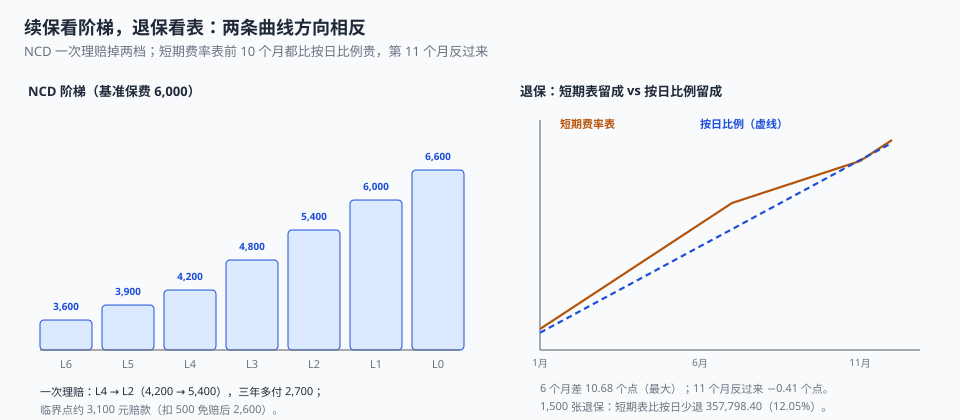

# 续保与退保：续保看阶梯，退保看表

一位车险客户连续四年没出险，NCD 打到 L5（0.65）。第五年他蹭了护栏，修车 1,200 元，走保险赔了 700（扣 500 免赔）。

第二年续保时，他的 NCD 从 L4 掉到 L2，保费从 4,200 涨到 5,400。他算了一下：赔了 700，三年多付 2,700。

**这不是保险公司在惩罚他，是 NCD 阶梯的数学。** 但客户看不懂——因为系统里没有任何一处告诉他「这次理赔的临界点在哪里」。

::: tip 一句话理解
续保和退保是同一件事的两面：**都在问「这段保障还剩多少价值」**。续保用阶梯（NCD、经验费率）回答「明年收多少」，退保用表（短期费率表）回答「现在退多少」。两条曲线方向相反，混用就出错。
:::

## 一、续保的三条路径，账完全不同



| 路径 | 触发 | 系统动作 | 账务 | 常见错误 |
| --- | --- | --- | --- | --- |
| 正常续保 | 到期前 30 天 | 生成新一期保单，挂 `predecessor_no` | 新单承保保费 | 复用旧保单号（历史被覆盖） |
| 脱保后新保 | 过期超过宽限期 | 按新单处理，重新核保 | 新单承保保费 | 不标记「脱保过」，NCD 处理错 |
| 复效 | 失效（欠缴）后补缴 | 原保单恢复 `IN_FORCE` | 补收保费 + 可能加收 | 直接改状态，跳过复效审核 |

三条路径里，「脱保后新保」最容易被做成「正常续保」——因为对系统来说都是「生成一张保单」。**区别在于要不要重新核保，以及 NCD 要不要清零。**

```sql
CREATE TABLE renewal_link (
  predecessor_no TEXT NOT NULL REFERENCES policy(policy_no),
  successor_no   TEXT NOT NULL UNIQUE REFERENCES policy(policy_no),
  path           TEXT NOT NULL,          -- RENEW / NEW_AFTER_LAPSE / REINSTATE
  gap_days       INTEGER NOT NULL DEFAULT 0,  -- 脱保天数
  ncd_before     INTEGER NOT NULL,
  ncd_after      INTEGER NOT NULL,
  PRIMARY KEY (predecessor_no, successor_no),
  CHECK (path IN ('RENEW','NEW_AFTER_LAPSE','REINSTATE'))
);
```

`successor_no` 上的 `UNIQUE` 是续保幂等的关键：**一份保单只能被续一次**。没有它，两个渠道同时续保会产生两张保单，客户收到两张、付两次钱——这在年缴车险里每年都会发生几次。

## 二、NCD 阶梯：理赔决策的临界点

无赔款优待（No Claim Discount）是阶梯函数，一次理赔掉两档：

| 档位 | 系数 | 基准 6,000 时的保费 |
| --- | --- | --- |
| L6 | 0.60 | 3,600 |
| L5 | 0.65 | 3,900 |
| L4 | 0.70 | 4,200 |
| L3 | 0.80 | 4,800 |
| L2 | 0.90 | 5,400 |
| L1 | 1.00 | 6,000 |
| L0 | 1.10 | 6,600 |

客户当前 L4（4,200），一次理赔后掉到 L2（5,400），**次年多付 1,200**；如果后续不再出险，第三年 L3（4,800）、第四年回到 L4（4,200），**三年累计多付 2,700**。

于是「该不该报」有一个明确的临界点：

| 损失金额（扣 500 免赔后） | 三年多付保费 | 净得失 | 该不该报 |
| --- | --- | --- | --- |
| 700 | 2,700 | **−2,000** | 不该报 |
| 1,700 | 2,700 | **−1,000** | 不该报 |
| 2,500 | 2,700 | **−200** | 临界附近 |
| 4,500 | 2,700 | **+1,800** | 该报 |

本机口径下临界点约 **3,100 元损失额**（扣免赔后 2,600）。这个数应该出现在理赔入口页上，而不是只在精算的报表里——**客户在报案那一刻做的决定，决定了明年他会不会退保**。

::: danger NCD 的三个实现错误
1. **把 NCD 变动挂在理赔上**：理赔审核完就改档，会让「拒赔的案子」也降档。NCD 只能在**续保时**按「上一保期是否有赔付」计算。
2. **档位跳变写成连续函数**：`0.70 - 0.20 × 理赔次数` 会产生 0.50、0.30 这类不存在的档位。阶梯必须是查表。
3. **续保时忘记清零脱保单的档位**：脱保超过宽限期按新单处理，NCD 应回到 L1（1.00）而不是沿用 L4——否则「故意脱保一年再续」就成了套利路径。
:::

## 三、脱保宽限：续保率与逆选择的交换

宽限期（grace period）允许客户在到期后若干天内补缴而不断保。它对续保率的影响非常直接，本机 6,000 张保单的读数：

| 宽限天数 | 续保率 | 脱保单数 | 脱保期出险率 |
| --- | --- | --- | --- |
| 0 天 | 79.22% | 1,247 | 7.78% |
| 10 天 | 81.17% | 1,130 | 9.38% |
| 30 天 | **87.80%** | 732 | **10.66%** |

宽限从 0 天放到 30 天，续保率涨 8.58 个点，但脱保期出险率从 7.78% 涨到 10.66%——**留下来的人里，有更多是「已经出险才想起来续」的**。这就是逆选择：宽限期越长，进来的风险越差。

所以宽限期不是「越长越友好」，它要和控制手段配套：

| 手段 | 作用 | 代价 |
| --- | --- | --- |
| 宽限 30 天 | 续保率 +8.58 个点 | 逆选择 +2.88 个点出险率 |
| 宽限期内出险需补缴全额保费 | 抑制「出事才续」 | 客诉上升 |
| 宽限期出险按「脱保期不保」处理 | 最严格，也最容易被投诉 | 需在条款里明确 |

本册不给结论，只给一条纪律：**宽限期是一个配置项，必须留痕**（谁改的、改成多少、生效日），否则明年无法解释「为什么这个月的赔付率跳了」。

## 四、退保：三种口径，三种金额

| 类型 | 时间窗 | 计算 | 本机读数 |
| --- | --- | --- | --- |
| 冷静期退保 | 签收保单起 15 日内 | **全额退**（可扣工本费） | 160 张若误按短期表扣 10%，多收 61,398.95 |
| 正常退保 | 超过冷静期 | 短期费率表：`保费 × (1 − 留成率)` | 1,500 张少退 357,798.40（12.05%） |
| 现金价值退保 | 长期险 | 保单现金价值表 | 本册不展开（属长期险精算） |

冷静期那 61,398.95 元是最容易被忽略的一笔：它不产生客诉（客户不知道自己有权全额退），也不产生差错告警（金额算得「对」），只会在监管检查时变成一个问题。

短期费率表与按日比例的系统性差异：

| 指标 | 短期费率表 | 按日比例 | 差 |
| --- | --- | --- | --- |
| 1,500 张退保合计退款 | 2,611,514.83 | 2,969,313.23 | **−357,798.40（−12.05%）** |
| 按日比例更有利客户的单数 | — | 1,362 / 1,500 | **90.80%** |
| 单笔最大差额 | — | 1,660.68 | 保费 13,321.88、已生效 7 个月 |

**90.80% 的退保单，客户按日比例能多拿钱。** 这不是说短期费率表不合理（它对应「前期风险更高」这个事实），而是说：**同一个客户在不同时间退保，拿到的钱差异巨大，而系统必须能解释这个差异**。

```sql
-- 退保金：按短期费率表查表，且不得超过已收保费
SELECT p.policy_no,
       ROUND(CAST(p.written_premium AS REAL) *
             (1 - CASE :months_in_force
                    WHEN 1 THEN 0.10 WHEN 2 THEN 0.20 WHEN 3 THEN 0.30
                    WHEN 4 THEN 0.40 WHEN 5 THEN 0.50 WHEN 6 THEN 0.60
                    WHEN 7 THEN 0.70 WHEN 8 THEN 0.75 WHEN 9 THEN 0.80
                    WHEN 10 THEN 0.85 WHEN 11 THEN 0.90 ELSE 1.00 END), 2) AS surrender_value,
       (SELECT SUM(CAST(amount AS REAL)) FROM premium_txn t
        WHERE t.policy_id = p.policy_id AND t.kind = 'COLLECT') AS collected
FROM policy p WHERE p.policy_no = :policy_no;
```

## 五、退保之后：已赚要冲回

退保不是「把这行标记为 `CANCELLED`」就完了。它的账务影响有三步：

1. **退保金出账**：`premium_txn` 加一条负数流水（不是改原流水）。
2. **未满期保费归零**：退保日之后不再有未满期。
3. **已赚保费重算**：退保日之前的已赚不变，之后的已赚为 0，差额冲回。

```sql
-- 退保后重算：已赚 = 承保保费 × (退保日 − 起保日) / (终止日 − 起保日)
SELECT p.policy_no,
       ROUND(CAST(p.written_premium AS REAL) *
         (julianday(e.effective_date) - julianday(p.start_date))
         / (julianday(p.end_date) - julianday(p.start_date)), 2) AS earned_at_cancel
FROM policy p
JOIN endorsement e ON e.policy_id = p.policy_id AND e.kind = 'CANCEL'
WHERE p.policy_no = :policy_no;
```

这一步漏掉的典型症状是：**退保当月的已赚保费偏高**，而且偏高得不多（一张保单一年只影响几千元），所以没人查。

## 六、判据

本页判据族 `UWN-A` ~ `UWN-H`，共 8 条。

| 判据 | 断言 | 验证方式 |
| --- | --- | --- |
| `UWN-A` | 续保路径显式（续保 / 脱保新保 / 复效） | `renewal_link.path` 三枚举 |
| `UWN-B` | 一份保单只能被续一次 | `successor_no` 唯一，二次续保被拒 |
| `UWN-C` | NCD 只在续保时按上期赔付计算 | 档位变动行数与续保笔数相等 |
| `UWN-D` | NCD 是查表阶梯，不是连续函数 | 档位取值 ⊆ {0..6} |
| `UWN-E` | 脱保宽限是配置且留痕 | 有 `grace_days` 与变更记录 |
| `UWN-F` | 冷静期退保全额，起算日明确 | 15 日内退保金 = 已收保费 |
| `UWN-G` | 退保金 ≤ 已收保费 | 负向用例被拒 |
| `UWN-H` | 退保后已赚按退保日重算并冲回 | 重算值 ≤ 原摊额 |

## 七、验证方式

```shell
# 1. 同一保单不能被续两次（期望：第二条报 UNIQUE constraint failed）
sqlite3 uw.db "
insert into renewal_link values('PT202401010001','PT202501010001','RENEW',0,4,5);
insert into renewal_link values('PT202401010001','PT202501010002','RENEW',0,4,5);"

# 2. NCD 档位只能是 0..6（期望：0 行越界）
sqlite3 uw.db "select count(*) from policy where ncd_level not in (0,1,2,3,4,5,6);"

# 3. 退保金不得超过已收保费（期望：0 行）
sqlite3 uw.db "
select count(*) from endorsement e
where e.kind='CANCEL' and cast(e.premium_delta as real) < -1 *
  (select sum(cast(amount as real)) from premium_txn t where t.policy_id=e.policy_id);"

# 4. 短期费率表在 1..10 月都比按日比例高（期望：0 行不满足）
sqlite3 uw.db "
with t(mon,rate) as (values (1,0.10),(2,0.20),(3,0.30),(4,0.40),(5,0.50),
  (6,0.60),(7,0.70),(8,0.75),(9,0.80),(10,0.85),(11,0.90),(12,1.00))
select count(*) from t where mon <= 10 and rate <= mon*30.0/365.0;"
```

第 4 步故意只查到 10 月：第 11 个月短期表（90%）低于按日比例（90.41%），这是合法例外，写进断言会把正确实现判成错的。

## 参考资料

- 《中华人民共和国保险法》（2015 年修正）第四十七条：投保人解除合同的，保险人应自收到解除通知之日起三十日内退还保险单的现金价值。
- 《人身保险新型产品信息披露管理办法》（2009 年）：犹豫期（冷静期）起算与全额退保的要求。
- GB/T 36687—2018《保险术语》：续保、退保、无赔款优待、未满期保费、短期费率的标准定义。
- 与本页相邻：[批改与加退费](../Endorsement/index.md)、[出单与保单要素](../PolicyIssue/index.md)、[再保分出与账单](../Reinsurance/index.md)。
