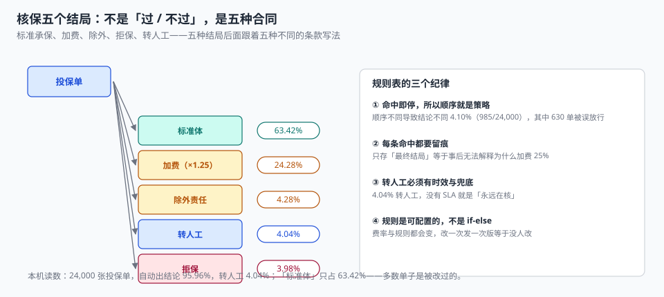

# 核保与风险选择：五个结局，不是「过 / 不过」

一位 61 岁的客户投保费用补偿医疗险。系统跑完规则，结论是「加费 25%」。客户接受了，保单出单。

半年后同一客户理赔，理赔员发现按条款该险种对 60 岁以上本应拒保。回去查核保日志，只有一行：`outcome=LOADING`，`rule=age_loading`。**没有记录它曾经命中过拒保规则**——因为规则是「命中即停」的，拒保规则排在加费规则后面，永远轮不到它。

这个错误在数据上完全看不出来：保单一应俱全、保费也收了、客户也没投诉。它只在理赔那天变成一次争议。

::: tip 一句话理解
核保不是一道判断题，是**五种合同形态的选择**：标准承保、加费、除外、转人工、拒保。系统要记录的不是「结论」，而是「为什么是这个结论，以及为什么不是另外四个」。
:::

## 一、五个结局各自意味着什么



| 结局 | 合同形态 | 后续动作 | 本机占比 |
| --- | --- | --- | --- |
| `STANDARD` | 按标准费率承保 | 直接出单 | 63.42% |
| `LOADING` | 加费承保（保费 × 加成系数） | 出单时写 `load_factor` | 24.28% |
| `EXCLUSION` | 承保但除外某项责任 | 出单时在 `coverage` 上打除外标记 | 4.28% |
| `REFER` | 转人工核保 | 派单、SLA、可能要求体检/补充材料 | 4.04% |
| `DECLINE` | 拒保 | 出拒保通知书 + 理由码，可申诉 | 3.98% |

**「标准体」只占 63.42%**——超过三分之一的单子是被改过的。这个数字很重要：它意味着「核保 = 走过场」的系统会把 36.58% 的风险错配，而错配的方向通常是**收费不足**（因为最省事的做法是全都按标准体出单）。

五个结局里，只有 `REFER` 是「还没结论」，其余四个都是终态。把 `REFER` 当成「待定」存进 `status` 字段的系统，会在三个月后攒下几千条「永远在核」的申请。

## 二、规则表：命中即停，所以顺序就是策略

核保规则的执行模型几乎都是「按优先级顺序逐条判定，命中即停」。这个模型简单、快、可解释，但它有一个必须被显式管理的副作用：**规则顺序决定了业务策略**。

本机 24,000 张投保单上，同一套规则、两种排序，结论不同的有 **985 单（4.10%）**，其中 **630 单是被「误放行」的**——本该拒保，却因为加费规则排在了前面而被加费承保。

| 排序 | 第一条命中的规则 | 后果 |
| --- | --- | --- |
| A：拒保 → 转人工 → 加费 → 除外 | 高风险单先被拦住 | 保守，可能过度拒保 |
| B：加费 → 除外 → 拒保 → 转人工 | 高风险单被「加费」消化 | 激进，4.10% 结论不同，630 单误放行 |

两种排序都能在系统里跑通，也都能被解释。**关键不是选哪个，而是把它写下来、版本化、可审计**。

```sql
CREATE TABLE uw_rule (
  rule_id      TEXT PRIMARY KEY,
  rule_version TEXT NOT NULL,             -- 规则表版本，改规则 = 新版本
  priority     INTEGER NOT NULL,          -- 越小越先判，全局唯一
  condition    TEXT NOT NULL,             -- 结构化条件（JSON），不是字符串拼 SQL
  outcome      TEXT NOT NULL,
  reason_code  TEXT NOT NULL,             -- 拒保/加费的理由码
  load_factor  TEXT,                      -- 仅 LOADING 用，如 '1.25'
  effective_from TEXT NOT NULL,
  effective_to   TEXT,
  UNIQUE (rule_version, priority),
  CHECK (outcome IN ('STANDARD','LOADING','EXCLUSION','REFER','DECLINE'))
);

CREATE TABLE uw_decision (
  decision_id  INTEGER PRIMARY KEY,
  app_no       TEXT NOT NULL UNIQUE,
  rule_version TEXT NOT NULL,
  rule_id      TEXT NOT NULL REFERENCES uw_rule(rule_id),
  outcome      TEXT NOT NULL,
  load_factor  TEXT,
  input_snapshot TEXT NOT NULL,           -- 判定时的关键输入，JSON
  decided_at   TEXT NOT NULL,
  decided_by   TEXT NOT NULL              -- ENGINE / 工号
);
```

三个字段值得单独说：

- `rule_version`：规则表会改，改了之后历史决策必须还能解释。只存 `rule_id` 不够，因为同一个 `rule_id` 的条件可能变过。
- `input_snapshot`：判定时客户填了什么。没有它，事后无法回答「为什么这单被判加费」——因为投保单可能已经被批改过。
- `decided_by`：`ENGINE` 还是某个工号。转人工之后的结论必须能追到人，这是稽核的硬要求。

## 三、留痕：只存结论等于没留痕

「命中即停」的模型有一个天然缺陷：**它只记录第一条命中的规则**。上例中那单 61 岁的医疗险，只留下了 `age_loading`，拒保规则从未被评估。

两种解法，各有代价：

| 方案 | 做法 | 代价 | 适用 |
| --- | --- | --- | --- |
| 短路 + 全量试算 | 按顺序命中即停，但同时跑一遍「全量评估」写进快照 | 多一次计算，日志变大 | 推荐：核保量不大，可解释性优先 |
| 改为全量评估 + 冲突裁决 | 所有命中规则都记录，最后按优先级裁决 | 规则之间要定义冲突矩阵 | 规则数量大、需要精细审计 |

```sql
-- 快照里同时记录「命中的第一条」与「全部命中的规则」
INSERT INTO uw_decision(app_no, rule_version, rule_id, outcome, load_factor,
                        input_snapshot, decided_at, decided_by)
VALUES ('APP0000001', 'R2026A', 'R_AGE_61', 'LOADING', '1.25',
        '{"age":61,"product":"HLT","hist_claims":0,"si":200000,"all_hits":["R_AGE_61","R_HLT_AGE_GT60"]}',
        '2026-11-05T09:12:00', 'ENGINE');
```

`all_hits` 里那第二条 `R_HLT_AGE_GT60` 就是拒保规则的命中。有了它，稽核能在不重跑引擎的情况下发现「顺序错了」。

## 四、转人工：没有 SLA 的转人工等于无限期搁置

`REFER` 占 4.04%，按 24,000 单算约 970 单。这 970 单如果平均 3 天出结论，客户等 3 天；如果没人管，客户等到放弃。

| 指标 | 建议口径 | 为什么 |
| --- | --- | --- |
| 派单时限 | 提交后 ≤ 30 分钟落到具体核保员 | 「池子里的单」没有人负责 |
| 首次响应 | ≤ 4 工作小时 | 客户感知的是「有没有人联系我」 |
| 结案时限 | 常规 ≤ 1 工作日，需体检 ≤ 5 工作日 | 与销售承诺的「最快当天出单」对齐 |
| 超时兜底 | 超时自动升级到主管，并记录 `escalated_at` | 兜底不是「自动通过」——自动通过等于取消核保 |

最后一行是重点：**超时兜底不能是「自动承保」**。很多系统为了让「出单时效」好看，会把超时的转人工单自动置为 `STANDARD`，这在数据上表现为「核保时效达标」，实质是把风险选择权交给了时钟。

## 五、加费与除外必须落到合同上

`LOADING` 的加费系数、`EXCLUSION` 的除外项，如果只写在核保意见里（一个 `TEXT` 字段），出单时就会被漏掉——因为出单流程读的是 `policy` 表，不是核保意见。

```sql
-- 加费：系数进保单，可复算
ALTER TABLE policy ADD COLUMN load_factor TEXT NOT NULL DEFAULT '1.0000';

-- 除外：在责任行上标记，而不是在保单上写一段话
ALTER TABLE coverage ADD COLUMN excluded INTEGER NOT NULL DEFAULT 0;
```

这样「这张保单为什么贵 25%」「这次理赔为什么被除外」都能用一条 SQL 回答：

```sql
SELECT p.policy_no, p.load_factor, c.code, c.excluded
FROM policy p JOIN clause cl ON cl.clause_id = p.clause_id
JOIN coverage c ON c.clause_id = cl.clause_id
WHERE p.policy_no = 'PT202611050001';
```

## 六、判据

本页判据族 `UWU-A` ~ `UWU-H`，共 8 条。

| 判据 | 断言 | 验证方式 |
| --- | --- | --- |
| `UWU-A` | 五结局枚举，无第六种取值 | `CHECK (outcome IN (...))`，越界插入被拒 |
| `UWU-B` | 每次判定记录规则版本 + 规则号 + 输入快照 | 三列非空，且历史单可回放 |
| `UWU-C` | 规则顺序可配置且版本化 | `uw_rule` 有 `rule_version` 与 `priority` |
| `UWU-D` | 规则表顺序变化对结论的影响可量化 | 两种排序跑批，差异 4.10%（985 单） |
| `UWU-E` | 转人工有 SLA 与超时升级，且不做自动通过 | 存在 `escalated_at`，无「超时自动 STANDARD」路径 |
| `UWU-F` | 加费系数落到保单字段，可复算 | `policy.load_factor` 存在且与核保一致 |
| `UWU-G` | 除外责任落到 `coverage.excluded`，不是备注 | 除外项能按责任代码查询 |
| `UWU-H` | 拒保给理由码，可申诉 | `reason_code` 非空，且存在申诉入口 |

## 七、验证方式

```shell
# 1. 五结局分布（期望：五行，合计 = 投保单数）
sqlite3 uw.db "select outcome, count(*) from uw_decision group by outcome;"

# 2. 只留结论不留快照的单子（期望：0）
sqlite3 uw.db "select count(*) from uw_decision where input_snapshot is null or rule_version is null;"

# 3. 加费单的系数必须与规则表一致（期望：0）
sqlite3 uw.db "
select count(*) from uw_decision d join uw_rule r on r.rule_id = d.rule_id
where d.outcome = 'LOADING'
  and (d.load_factor is null or d.load_factor <> r.load_factor);"

# 4. 越界结局必须被拒（期望：CHECK constraint failed）
sqlite3 uw.db "insert into uw_decision(app_no,rule_version,rule_id,outcome,input_snapshot,decided_at,decided_by)
  values('APPZ','R2026A','R_X','PENDING','{}','2026-11-05','ENGINE');"
```

第 2 步的值是这一页的门槛：**快照为空 = 这个决策永远无法被解释**。它比「结局对不对」更值得先查，因为结局对不对需要重算，而快照空了就只能靠猜。

## 参考资料

- 《中华人民共和国保险法》（2015 年修正）第十六条：保险人有权就保险标的或被保险人的有关情况提出询问，投保人应如实告知。
- 《中华人民共和国保险法》第十七条：免责条款的提示与明确说明义务——除外责任必须落到合同文本，不能只在核保意见里。
- GB/T 36687—2018《保险术语》：核保、承保、拒保、加费承保、除外责任的定义。
- 与本页相邻：[投保单与关系人](../Application/index.md)、[费率因子与保费计算](../Rating/index.md)、[实时风控决策](../../RiskDecision/Overview/index.md)。
