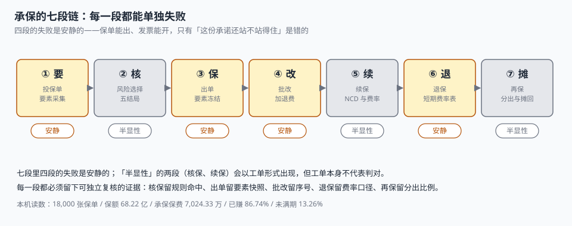
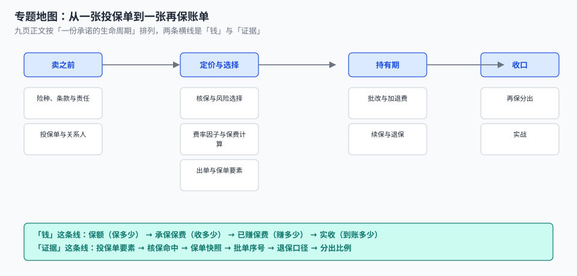

# 承保与保单管理工程

<p style="text-align:center;"></p>

一张车险保单签下来的那天，业务员在群里发了个「恭喜」。四个月后客户退保，柜面按短期费率表扣了 30%，客户问「我只用了三分之一时间，为什么扣三成」。柜面翻出条款附件第 12 页的表格，指给他看——表格上确实写着 3 个月 30%。

同一天，财务在对账时发现「承保保费」比「实收保费」多了 118 万，于是去问承保部；承保部说没有少收，是分期还没到账；财务又问「那已赚多少」，承保部给了一个数，和精算给的数差 97 万。

**这四件事里没有一件是 bug。** 每一件都是「同一个词在两处指的不是同一件事」：退保的「扣多少」有两把尺子（短期费率表 / 按日比例），保费的「多少」有四个数（保额 / 承保 / 已赚 / 实收），而每一把尺子、每一个数都有自己的定义域，只是没有人把它们写在同一张纸上。

::: tip 一句话理解
承保卖的不是「一张保单」，是**一段期限内、以某个保额为上限、在若干条件成立时兑付的承诺**——所以它先是一门合同管理（要素不能事后改），再是一门风险选择（卖不卖给谁），最后才是一门算钱。
:::

## 一、这个专题讲什么

从「客户点开报价页」到「再保账单摊回」，一张保单要走七段：

| 段 | 这一段在做什么 | 产物 | 失败是否安静 |
| --- | --- | --- | --- |
| ① 要 | 收下投保单，把标的风险要素落成字段 | `application` | 半显性（缺字段时核保才发现） |
| ② 核 | 规则判定卖不卖、以什么条件卖 | `uw_decision` | 半显性（结论错也能出单） |
| ③ 保 | 定价、出单、冻结要素 | `policy` + `clause_id` | **安静**（要素错了照样能出单） |
| ④ 改 | 批改：加保额、减保额、改地址、退保 | `endorsement` | **安静**（加退费算错不报错） |
| ⑤ 续 | 续保：NCD、经验费率、脱保宽限 | `policy`（新一期） | 半显性（续不上会掉客户） |
| ⑥ 退 | 退保：短期费率表、冷静期、现金价值 | `endorsement(CANCEL)` | **安静**（多扣了客户会来问，少扣了没人问） |
| ⑦ 摊 | 再保分出、佣金摊回、赔款摊回 | `cession` + `reinsurance_stmt` | **安静**（分出比例错了只影响自留风险） |



七段里**四段的失败是安静的**。它们的共同形态是：保单能出、发票能开、柜面能办，只有「这份承诺的边界在哪里」是错的。

本机实测最能说明问题的一组读数：24,000 张投保单筛出 18,000 张保单，保额合计 **68.22 亿**，承保保费 **7,024.33 万**。但同一批保单的四个「多少」是四个不同的数：

| 视角 | 读数 | 它回答的问题 |
| --- | --- | --- |
| 保额 `sum_insured` | 6,821,770,000 | 最多赔多少（**不是收入**） |
| 承保保费 `written` | 70,243,271.68 | 这一年签下了多少 |
| 已赚保费 `earned` | 60,929,670.58（86.74%） | 已经「过期」、真正属于本期的部分 |
| 实收保费 `collected` | 69,057,693.17 | 钱真到账了多少（1.81% 应收未收） |

把这四个数混着用，是这一册里所有「对不上」的总根源。

## 二、三个「多少」

| 口径 | 定义 | 谁在关心 | 常见错法 |
| --- | --- | --- | --- |
| 保额 | 合同约定的赔付上限 | 客户、核保、再保 | 当成「保费」或「风险敞口」报给管理层 |
| 承保保费 | 出单时确认的年保费（含加费、不含批改） | 业务、财务 | 把批改的加退费并进当月新单 |
| 已赚保费 | 承保保费按保障期间摊到「已过天数」的部分 | 精算、财务 | 用「出单日」起算，或用整月摊（差 1.59%） |
| 实收保费 | 银行到账金额合计 | 财务、资金 | 把「应收」当「已收」做现金流预测 |

四个数之间只有一条恒等式必须成立：

```text
承保保费 − 未满期保费 = 已赚保费
```

本机 18,000 张保单上这条恒等式差 **0.00**。它成立的代价是：**未满期保费必须是算出来的，不能是「估」出来的**。用整月摊（每张保单按 `月数/12` 计）会把已赚保费做成 59,958,780.44，比按日摊少 **970,890.14（1.59%）**——这个数不大，但它会在月末结账时变成一个没人认领的差异，然后被「调平」。

::: danger 三件事必须写进数据模型，不能留给「报表时再算」
1. **保额与保费必须分列两个字段**：合成一个 `amount` 之后，「保额 68 亿」和「保费 7,024 万」会出现在同一张表里求平均，得到「件均 3.9 万」这种既不保额也不保费的数。
2. **已赚保费不能存成字段再定时刷**：它同时被「批改」「退保」「续保」三个写入点影响，任何一处漏刷就是永久偏差。要么用视图按日现算，要么用带日期区间的 `earned_schedule` 明细表。
3. **承保日（`issue_date`）与起保日（`start_date`）必须是两个字段**：本机 3.23% 的保单是追溯生效（起保日早于承保日），合并成一个字段就无法表达「先出单、后生效」和「先生效、后补单」这两种合法情形。
:::

## 三、专题地图



按「一份承诺的生命周期」读：

| 阶段 | 页面 | 一句话 |
| --- | --- | --- |
| 卖之前 | [险种、条款与责任](ProductModel/index.md) | 条款是文本加日期，责任是结构化参数，两者不能混 |
| 卖之前 | [投保单与关系人](Application/index.md) | 一次提交要能回答：谁付钱、保谁、赔给谁 |
| 卖的时候 | [核保与风险选择](Underwriting/index.md) | 五个结局，不是一个「过 / 不过」 |
| 卖的时候 | [费率因子与保费计算](Rating/index.md) | 因子是相乘的，不是相加的 |
| 卖的时候 | [出单与保单要素](PolicyIssue/index.md) | 出单是一次冻结，不是一个 INSERT |
| 卖掉之后 | [批改与加退费](Endorsement/index.md) | 加费和减费在同一张批单上用两把尺子 |
| 到期 | [续保与退保](RenewalCancel/index.md) | 续保看阶梯，退保看表，两条曲线方向相反 |
| 收口 | [再保分出与账单](Reinsurance/index.md) | 成数按比例切，溢额按保额切，买的是两种东西 |
| 落地 | [实战：九张表、五个触发器、十八条断言](Practice/index.md) | 能被脚本判定的，才叫设计 |

## 四、和相邻专题的分工

本册只讲「一份承诺怎么被卖出去、改对、算清、分出去」。相邻主题已经讲透的部分，这里不重复：

| 相邻专题 | 它讲什么 | 本专题不重复讲 |
| --- | --- | --- |
| [理赔作业与赔付计算](../ClaimsProcessing/Overview/index.md) | 报案、定损、核定、赔付、IBNR | 本册只假设「保单参数可用」，赔案只到「摊回」为止 |
| [实时风控决策](../RiskDecision/Overview/index.md) | 反欺诈、评分卡、规则引擎的通用形态 | 核保的**五个结局**与条款联动 |
| [收入确认](../RevenueRecognition/Overview/index.md) | 履约义务、时段确认、合同余额 | 保费的三种口径与短期费率表 |
| [合同与条款版本](../ContractEvolution/index.md) | 接口契约、版本治理 | 条款版本（2024A / 2026A）是**数据**，不是 API |
| [客户身份归并](../CustomerIdentity/Overview/index.md) | 一人多号、实体解析、金记录 | 投保人与被保险人是不是同一个人 |
| [审批流引擎](../WorkflowEngine/ApprovalFlow/index.md) | 节点、回退、加签、超时 | 核保转人工的**时效与兜底** |
| [账务与对账](../Ledger/Reconciliation/index.md) | 借贷横平、未达账项 | 保费三口径之间的桥 |
| [消息触达](../NotificationDelivery/Delivery/index.md) | 通道、重试、送达回执 | 续保提醒的**时点**（提前多少天） |
| [多币种折算](../MultiCurrency/Overview/index.md) | 汇率快照、重估、CTA | 跨境保单只讲「按哪天的汇率折保费」 |

## 五、版本组织：为什么不建版本目录

承保侧最容易被问「要不要按监管口径分一代」。本册**不建 `UnderwritingPolicy/V2024` 这类目录**，三条理由：

1. **换代的是费率表与条款文本，判据一字没变。** 2020 车险综改、2023 报行合一，变的都是**数据**——基准费率、因子取值、手续费上限；「保额与保费分列、已赚按日摊、批改只能追加」这三条在任何一版监管口径下都成立。
2. **并存差异是条款版本，不是代际。** 同一险种在同一年会同时存在 2024A 与 2026A 两个条款版本，这是**同一份代码的两份数据**，用 `clause(product_code, version, effective_from, effective_to)` 一张表就能装下。建两个文档目录反而会让「按哪个版本赔」这件事在两个目录里各说一遍。
3. **真正需要版本目录的是「同一份代码两套写法」。** 本库已有先例：[Spring5](../Java/Frame/Spring/Spring5/index.md) 与 [Spring6](../Java/Frame/Spring/Spring6/index.md)（注入与 AOT 语义不兼容）、[Vue2](../../Frontend/Frame/Vue/Vue2/index.md) 与 [Vue3](../../Frontend/Frame/Vue/Vue3/index.md)（响应式与组合式 API 不兼容）——旧版必须原样保留并标注「维护中 / 已停止维护」。承保侧不是这种情形。

::: info 旧条款版本的处置口径
遇到只对存量保单生效的旧条款（如 2020 版车险条款），**不新建章节**，在[险种、条款与责任](ProductModel/index.md)的版本表里加一行，标注「仅存量保单适用，新单不再使用」，并写清 `effective_to`。这条口径与 Spring5 / Vue2 的处理一致：旧内容保留、标注状态、不覆盖。
:::

## 六、建议阅读顺序

1. 先读[总览](Overview/index.md)——把「四个多少」和「七段链」立起来。
2. 再读[险种、条款与责任](ProductModel/index.md)与[投保单与关系人](Application/index.md)——这两页决定后面所有字段的含义。
3. 然后是三段「卖」的：[核保](Underwriting/index.md)、[定价](Rating/index.md)、[出单](PolicyIssue/index.md)。
4. 接着是持有期：[批改](Endorsement/index.md)、[续保与退保](RenewalCancel/index.md)。
5. 最后读[再保](Reinsurance/index.md)，按[实战](Practice/index.md)把九张表建出来，跑一遍十八条断言。

## 七、本册的读数从哪来

所有数字来自一台 16 GB 笔记本上的 SQLite 3.50.4 / Python 3.13，种子 `20261105`，规模是 24,000 张投保单、18,000 张保单、2024-01 至 2026-10 的三年区间，**不是生产数据，也不是压测结论**。写进正文的每个数都可以重跑：

| 读数 | 值 | 出现在 |
| --- | --- | --- |
| 承保保费 / 已赚 / 实收 | 7,024.33 万 / 86.74% / 6,905.77 万 | 本页、[总览](Overview/index.md) |
| 已赚按整月摊的偏差 | −1.59%（970,890.14） | [总览](Overview/index.md)、[出单](PolicyIssue/index.md) |
| 核保五结局 | 63.42 / 24.28 / 4.28 / 3.98 / 4.04% | [核保](Underwriting/index.md) |
| 规则顺序敏感度 | 4.10%（985 单，误放行 630） | [核保](Underwriting/index.md) |
| 因子乘积 vs 相加 | −4.09%（98.61% 结论不同） | [定价](Rating/index.md) |
| 退保短期表少退 | 12.05%（357,798.40） | [续保与退保](RenewalCancel/index.md) |
| 批单号并发重号 | 25.00%（12/48） | [批改](Endorsement/index.md) |
| 溢额分出保额 / 保费占比 | 51.00% / 22.29% | [再保](Reinsurance/index.md) |
| 断言通过 | 18 / 18，退出码 0 | [实战](Practice/index.md) |

::: warning 这些数字不能直接当费率或准备金依据
单机 SQLite 上的四舍五入与真实承保系统的精算口径不是一回事。本文用它们判断**方向和量级**（例如「乘积与相加会给出不同结论」「短期费率表并不总对客户不利」），不用它们承诺任何监管报备口径。凡涉及金额的结论，文中都注明了「按本机读数」。
:::

## 参考资料

- 《中华人民共和国保险法》（2015 年修正）第十三条、第十六条：保险合同成立与生效、投保人如实告知义务——本册「投保单要素」与「核保留痕」的法律基础。
- 《中华人民共和国保险法》第四十七条：投保人解除合同的，保险人应按合同约定退还保险单的现金价值——退保口径的法律出处。
- GB/T 36687—2018《保险术语》：保额、保费、批改、退保等术语的标准定义，本册术语以此为准。
- 中国银行保险监督管理委员会《财产保险公司保险条款和保险费率管理办法》（2021 年修订）：条款与费率的报备、版本管理与停售要求。
- 与本册相邻：[理赔作业与赔付计算](../ClaimsProcessing/Overview/index.md)、[收入确认](../RevenueRecognition/Overview/index.md)、[账务与清结算](../Ledger/Overview/index.md)。
