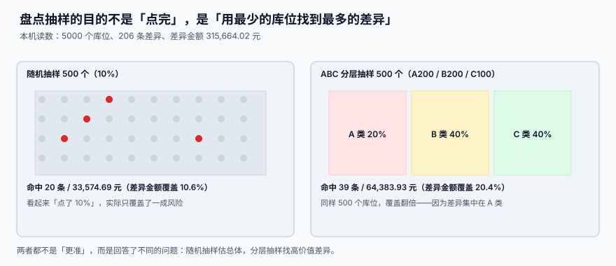

# 循环盘点与差异处理

<p style="text-align:center;"></p>

盘点不是「一年数一次货」，而是**用最少的点数动作，找到最多的不确定性**。全仓停业数三天，得到的是一张当天的准确快照；循环盘点每天数 30 个库位，得到的是**持续的账实一致**。

::: tip 一句话理解
**盘点的产出不是「数出来的数字」，而是「差异的归因」。** 数完不改原因、直接调平账面，等于把错误埋进地里。
:::

本页判据族 `WHC-A` ~ `WHC-H`，共 8 条，定义在最后一节。

## 一、四种盘点方式，选一种主用

| 方式 | 做法 | 频率 | 适用 |
| --- | --- | --- | --- |
| **循环盘点**（cycle count） | 每天按计划盘一部分库位 | 每日 | 绝大多数仓的主方式 |
| **全面盘点**（physical inventory） | 停业全盘 | 年 / 半年 | 审计要求、股权变更 |
| **抽盘**（sample count） | 随机或分层抽一部分 | 周 / 月 | 验证循环盘点的有效性 |
| **动碰盘点**（opportunistic） | 拣货时手边有货就顺带点 | 持续 | 零成本补充，覆盖率低 |

循环盘点之所以是主方式，因为它把「一次性停业的成本」摊成了「每天几十分钟」：

```text
全面盘点：停业 3 天 × 日均发货 8,000 单 = 24,000 单延迟
循环盘点：每天 30 个库位 × 约 40 分钟 = 不停业
```

## 二、抽什么：随机 vs 分层，差 2 倍

本机读数（5,000 个库位、206 条差异、差异金额 315,664.02 元；差异集中在 A 类前 20%）：

| 抽样方式 | 盘 500 个库位（10%） | 命中差异条数 | 覆盖差异金额 | 覆盖率 |
| --- | --- | --- | --- | --- |
| **随机抽样** | 全库随机取 500 | 20 | 33,574.69 元 | **10.6%** |
| **ABC 分层**（A 200 / B 200 / C 100） | 按类别配额 | 39 | 64,383.93 元 | **20.4%** |



同样点 500 个库位，分层抽样找到的差异金额是随机的 **近 2 倍**。原因不是「分层更准」，而是它回答了不同的问题：

| 抽样目标 | 用哪种 | 为什么 |
| --- | --- | --- |
| 估「全库准确率」 | **随机** | 无偏，能外推 |
| 找「最贵的差异」 | **分层（按金额 / 周转）** | 把点数预算花在高价值区 |
| 验证「上次整改有没有效」 | **定向**（上次出差异的库位） | 只看曾经出问题的地方 |

::: warning 分层抽样不能外推
分层抽样是**有偏**的：A 类被过度抽样，算出来的「准确率」会系统性低于全库真实值。要报「全库准确率」，必须用随机抽样；要报「高风险区准确率」，才用分层。**两个数不能混着用**，这是盘点报告最常见的口径错误。
:::

## 三、冻结：盘哪个冻哪个，不要整区冻

| 冻结方式 | 产能影响 | 盘点准确性 | 建议 |
| --- | --- | --- | --- |
| 整区冻结 | 大（该区当天不能拣） | 高 | 仅全面盘点用 |
| **按库位冻结** | 小（只影响被盘库位） | 高 | 循环盘点标准做法 |
| 不冻结（边拣边盘） | 无 | **低**（盘的过程中货被拿走） | 不可用于差异判定 |

```sql
-- 盘点冻结与解冻：用库位状态 + 任务绑定，避免「盘完忘了解冻」
UPDATE bin SET status='LOCKED' WHERE id IN (SELECT bin_id FROM count_task WHERE batch_no=:batch);

-- 解冻必须校验：该库位的盘点任务已全部有结论
UPDATE bin SET status='OCCUPIED'
 WHERE status='LOCKED'
   AND id IN (SELECT bin_id FROM count_task WHERE batch_no=:batch)
   AND NOT EXISTS (SELECT 1 FROM count_task
                    WHERE batch_no=:batch AND bin_id=bin.id AND counted_at IS NULL);
```

::: danger 冻结的三个坑
1. **冻结不写流水。** 库位被锁 3 天没人解冻，拣货员绕开它，最后变成「死库位」。冻结/解冻都要进状态流水。
2. **盘点期间允许拣货但不记录。** 盘出来的差异里混进了「盘的过程中被拣走的」，差异就无法归因。
3. **解冻条件只看「有没有盘」。** 应该看「有没有结论」——盘了但差异还没处理，解冻就会把待处理的差异放回可售池。
:::

## 四、盲盘：不给账面数，才数得准

| 方式 | 盘点单上显示 | 准确度 | 代价 |
| --- | --- | --- | --- |
| 明盘 | 账面数量 | 低（会「凑数」） | 无 |
| **盲盘** | 不显示账面数 | 高 | 需要系统支持，差异要事后比对 |
| 半盲 | 显示区间（如「约 100」） | 中 | 折中方案 |

盲盘是**唯一能测出真实准确率**的方式。明盘数出来的「98% 准确率」，很大一部分是「照着账面数」的结果。第一次上盲盘，准确率通常会掉 5~10 个百分点——那不是变差了，是**之前的数据本来就这样**。

## 五、差异处理：先归因，再调整

```text
盘点差异 ──> 分级 ──> 复盘（阈值以上）──> 归因 ──> 审批 ──> 调整过账
                     └── 阈值以下 ──────> 记录 + 累计观察
```

| 差异幅度 | 处置 | 谁批 |
| --- | --- | --- |
| 0（相符） | 只记录 | — |
| 差异 ≤ 0.5% 且 ≤ 3 件 | 记录 + 累计（连续 3 次超限升级） | 组长 |
| 0.5% ~ 5% | **必须复盘**，确认非计数错误 | 主管 |
| > 5% 或金额 > 阈值 | 复盘 + 查监控 + 归因报告 | 仓库经理 |

四种原因码，必须选一个：

| 原因码 | 含义 | 账务处理 |
| --- | --- | --- |
| `COUNT_ERROR` | 数错了 | 复盘后按实调 |
| `MISPLACED` | 货在别处 | 移库，不动总量 |
| `UNRECORDED` | 作业没记账 | 补流水，追作业人 |
| `LOSS` | 真丢了 | 盘亏审批 + 报损 |

```sql
CREATE TABLE stock_adjust (
  id           INTEGER PRIMARY KEY,
  count_id     INTEGER NOT NULL REFERENCES count_task(id),
  bin_id       INTEGER NOT NULL,
  sku          TEXT NOT NULL,
  batch_no     TEXT,
  book_qty     INTEGER NOT NULL,
  counted_qty  INTEGER NOT NULL,
  delta        INTEGER GENERATED ALWAYS AS (counted_qty - book_qty) STORED,
  reason_code  TEXT NOT NULL CHECK (reason_code IN
               ('COUNT_ERROR','MISPLACED','UNRECORDED','LOSS')),
  approved_by  TEXT,
  approved_at  TEXT,
  UNIQUE (count_id, bin_id, sku, batch_no)
);
```

::: danger 调整过账的四条铁律
1. **没有 `reason_code` 不许过账。** 一个 `CHECK NOT NULL` 就能拦住「调平了事」。
2. **必须同时写 `stock_txn`。** 只改余量不写流水，关系 1（余量 = Σ流水）立刻破裂，下一次盘点会再报一次同样的差异。
3. **必须留审批人。** 差异调整是**改账**，改账必须有签字。
4. **不许覆盖历史。** 调整错了只能反向再调一次，不能 `UPDATE` 原记录。
:::

## 六、判据清单

| 编号 | 判据 | 怎么验 |
| --- | --- | --- |
| `WHC-A` | 循环盘点为主，且有每日计划表 | `count_plan` 有按日分配的库位清单 |
| `WHC-B` | 抽样方式明确标注（随机 / 分层 / 定向） | 盘点批次上有 `sample_method` 列 |
| `WHC-C` | 分层抽样不外推全库准确率 | 报告里两种口径分列，不混算 |
| `WHC-D` | 冻结按库位，且冻结/解冻有流水 | 状态流水表能查到每条冻结记录 |
| `WHC-E` | 盘点期间该库位不发生拣货 | 拣货明细与盘点批次时间窗无交集 |
| `WHC-F` | 盲盘：盘点单不显示账面数 | 接口返回体中无 `book_qty` 字段 |
| `WHC-G` | 差异超阈值自动要求复盘 | 构造 2% 差异，状态不能直接进「已调整」 |
| `WHC-H` | 调整必须带原因码 + 审批人，并写流水 | 缺任一字段的插入被拒 |

## 验证方式

```shell
# 1) 调整是否都带原因与审批：应输出 0
sqlite3 /tmp/wh.db "SELECT count(*) FROM stock_adjust
  WHERE reason_code IS NULL OR approved_by IS NULL;"
# 期望：0

# 2) 调整是否都写了流水：应输出 0
sqlite3 /tmp/wh.db "SELECT count(*) FROM stock_adjust a
  WHERE NOT EXISTS (SELECT 1 FROM stock_txn t
                     WHERE t.bin_id=a.bin_id AND t.sku=a.sku
                       AND t.reason='COUNT_ADJUST' AND date(t.created_at)=date(a.approved_at));"
# 期望：0

# 3) 冻结库位是否被拣货：应输出 0 行
sqlite3 /tmp/wh.db "SELECT p.id FROM pick_task p JOIN bin b ON b.id=p.bin_id
  WHERE b.status='LOCKED' AND p.status='DONE';"
# 期望：0 行

# 4) 盘点覆盖率（按库位）：应与计划一致
sqlite3 /tmp/wh.db "SELECT round(100.0*count(DISTINCT bin_id)/(SELECT count(*) FROM bin),2)
  FROM count_task WHERE batch_no='2026-11-01';"
# 期望：与当日计划覆盖率一致（如 3.0）
```


## 与「资产台账与折旧摊销工程」的分工（第 229 天补充）

| 你关心的问题 | 该读哪一册 | 分界 |
| --- | --- | --- |
| 「仓库里的货少了 3 件怎么查」 | 本页 | 盘**数量**：抽样口径、库位冻结、调整四铁律 |
| 「那台机器还在不在、在哪一层」 | [资产盘点与账实核对](../../FixedAsset/Inventory/index.md) | 盘**存在性**：四态分类、盲盘、二次复核 |
| 「盘亏之后怎么入账」 | [处置与清理](../../FixedAsset/Disposal/index.md) | 那册区分盘亏与报废两条路 |

::: danger 一页一坑：把「没扫到」直接判成盘亏
存货盘点的差异是**数量**差，扫码漏扫通常只影响几条明细，业务上还能用出库流水反推。资产盘点没有流水可推——一台机器没扫到，可能是丢了，也可能只是标签被油污盖住。

本机读数：1,000 张卡、2.8% 漏扫率，直接判亏会虚减 **1,915,200 元**。所以资产盘点必须分四态，只对「账有实无」做二次复核，复核确认才出调整单——这条纪律比存货盘点严格得多，因为资产没有「流水」这个第二证据源。
:::

## 与「成本核算」的分工

盘点差异在这里是**数量差异**（少 3 件），在成本核算里会变成一个**金额差异**（少 3 件 × 单价），两者必须成对出现，否则账上会留下「数量调平了、金额没动」的幽灵余额。

| 差异类型 | 本页怎么处置 | 成本核算怎么处置 |
| --- | --- | --- |
| 盘亏（数量少） | 生成盘亏单、走审批 | 按当前计价单价冲减存货与成本 |
| 盘盈（数量多） | 生成盘盈单 | 按**同批次或最近入库单价**入账，不能按 0 入账 |
| 单位错（数量对、批次错） | 调拨 | 批次间金额转移，总额不变 |

::: warning 「按 0 入账」是最常见的一处
盘盈按 0 成本入账会让本期出库成本偏低、毛利率虚高，而且**下个月查不出来**（因为数量是对的）。判据：盘盈单的 `unit_cost` 必须非 0，且能追到「同批次 / 最近入库」两条来源之一。
:::

## 参考资料

- [库存快照与批次](../StockSnapshot/index.md)：差异调整之后三条闭合关系怎么恢复
- [库位模型与容量](../LocationModel/index.md)：`LOCKED` 状态的正确用法
- [作业度量与产能](../Metrics/index.md)：库存准确率的分母
- [批量数据交换](../../BulkDataExchange/RowValidation/index.md)：盘点结果批量导入时的行级回执
- [账实对账](../../Ledger/Reconciliation/index.md)：盘点差异在账务侧的归口
