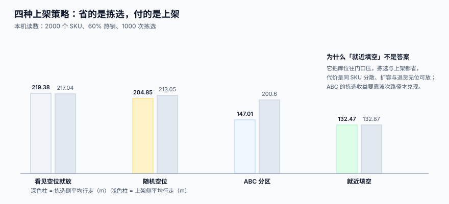

# 收货与上架策略

<p style="text-align:center;"></p>

收货是整条链上**唯一一次「相信外部」**的环节：车上下来多少、是好是坏，全凭这一次清点。而这一次清点几乎总是「按单收」而不是「按实收」——司机催、月台紧、单据上写着 200 箱，谁也不会真开箱数到 200。

::: tip 一句话理解
**收货的产物不是「入库了」，而是「差异被记录了」。** 没有差异记录的收货，等于把供应商的错误原封不动搬进自己的账。
:::

本页判据族 `WHP-A` ~ `WHP-H`，共 8 条，定义在最后一节。

## 一、到货预约：先把「什么时候来」变成数据

月台是稀缺资源，而到车时间几乎不受你控制。能控制的只有**分配方式**。

本机读数（3 个参数：4 个月台、20 车、4 小时卸货窗口、卸货时长对数正态分布中位 40 分钟）：

| 到车方式 | 平均等待 | 最长等待 |
| --- | --- | --- |
| 随机到达（谁先到谁卸） | **9.1 分钟** | 33.3 分钟 |
| 均分预约（每 12 分钟一车） | **2.0 分钟** | 11.7 分钟 |

同样的车、同样的月台，只把「什么时候来」变成一张时间表，平均等待降 **78%**。若加到 5 个月台，随机 2.8 分钟 vs 预约 0.1 分钟——**月台越紧张，预约收益越大**；而车的数量提到 24 台（利用率逼近 1），预约只能把 18.5 分钟降到 9.8 分钟：**排队是容量问题，预约只是把排队摊平，不能消除它**。

```sql
CREATE TABLE appointment (
  id           INTEGER PRIMARY KEY,
  dock_id      TEXT NOT NULL,
  supplier_id  TEXT NOT NULL,
  asn_no       TEXT,                       -- 供应商预先发的到货通知
  window_start TEXT NOT NULL,              -- ISO 8601 带时区
  window_end   TEXT NOT NULL,
  status       TEXT NOT NULL DEFAULT 'BOOKED'
               CHECK (status IN ('BOOKED','ARRIVED','UNLOADING','DONE','NO_SHOW')),
  CHECK (window_end > window_start)
);
-- 同一月台的时间窗不能重叠（半开区间 [start, end)）
CREATE UNIQUE INDEX ux_dock_window ON appointment(dock_id, window_start);
```

::: danger 时间窗的两个坑
1. **闭区间判断。** 用 `start <= t AND t <= end` 会让「上一车的结束时刻」与「下一车的开始时刻」被判成重叠，导致永远约不上连着的两个时段。正确写法是**半开区间** `t >= start AND t < end`。
2. **只存本地时间。** 跨时区供应商预约（尤其海外仓）会算错 8 小时。存 **带偏移的 ISO 8601**，或者统一存 UTC + 单独存 `timezone`。
:::

## 二、收货差异：四种，四种处理

| 差异类型 | 表现 | 处理方式 | 能不能先上架 |
| --- | --- | --- | --- |
| **少收**（short） | 实收 < 应收 | 记 `short_qty`，通知采购，按实收过账 | 能（按实收上架） |
| **多收**（over） | 实收 > 应收 | 记 `over_qty`，**不得直接入可售** | 不能，先入待检 |
| **坏损**（damage） | 数量对但货坏了 | 记 `damage_qty` + 照片 + 原因码 | 不能，进 `QUARANTINE` |
| **错货**（wrong item） | 条码与单据不符 | 整箱挂起，**不得拆包混入** | 不能 |

```sql
CREATE TABLE receipt_line (
  id            INTEGER PRIMARY KEY,
  receipt_id    INTEGER NOT NULL REFERENCES receipt(id),
  sku           TEXT NOT NULL,
  expected_qty  INTEGER NOT NULL,
  received_qty  INTEGER NOT NULL,
  damage_qty    INTEGER NOT NULL DEFAULT 0,
  short_qty     INTEGER GENERATED ALWAYS AS (expected_qty - received_qty) STORED,
  diff_reason   TEXT,          -- SHORT / OVER / DAMAGE / WRONG_ITEM
  batch_no      TEXT,
  expire_date   TEXT,
  UNIQUE (receipt_id, sku, batch_no)
);
```

`short_qty` 用**生成列**而不是应用层算：这样任何写入口径都一致，也不会出现「有的地方算、有的地方忘算」。

::: warning 少收不等于短装
`short_qty > 0` 有两种完全不同的原因：**供应商少发**（要索赔）与**运输丢件**（要报险）。如果不区分，索赔与报险就都做不了。**原因码必须在收货当场录入**，事后补录的成功率极低。
:::

## 三、质检分流：三个池子，不能混

```text
收货 ──> 待检池（QUARANTINE）──质检通过──> 可售池（available）
             │                        └──质检不通过──> 残次池（scrap）
             └──超时未检（72h）──> 升级告警（不是自动放行）
```

| 池子 | 计不计入可售 | 占不占库位 | 能不能拣 |
| --- | --- | --- | --- |
| 待检 | **不计** | 占 | **不能** |
| 可售 | 计 | 占 | 能 |
| 残次 | 不计 | 占（残次区） | 不能 |

::: danger 待检品进了可售池
这是仓储侧最贵的一类错，而且**不留痕迹**：货已经到了货架上，系统显示「有货」，销售就卖出去了。等质检发现不合格，订单已经发出。唯一的拦法是**库位分区 + 状态字段双保险**：待检品只能放在 `QI-` 前缀的库位，而可售拣货的查询里 `bin NOT LIKE 'QI-%'` 是硬条件。
:::

## 四、上架策略：四种，看清代价再选

| 策略 | 规则 | 适合 | 代价 |
| --- | --- | --- | --- |
| **随机空位** | 任意空位 | 品类极多、周转均匀 | 同 SKU 分散，拣货靠找 |
| **就近填空** | 离发货口最近的空位 | 单区、面积小、SKU 少 | 库位往门口堆，扩容无位 |
| **ABC 分区** | 热销靠近发货口 | SKU 多、周转差异大 | 上架要多走（200.60 m vs 132.87 m） |
| **整箱归位**（consolidate） | 优先放到同 SKU 已有库位 | 整箱进出、SKU 集中 | 库位很快放满，需要「溢出位」 |



**四种都在用**，因为一个仓里通常有多种货：A 类快消走 ABC 分区、B 类走就近填空、C 类长尾走随机、整箱大货走整箱归位。策略要挂在**分区**上，而不是全局一个开关：

```sql
CREATE TABLE zone_strategy (
  zone_id  TEXT PRIMARY KEY,
  strategy TEXT NOT NULL CHECK (strategy IN ('RANDOM','NEAREST','ABC','CONSOLIDATE')),
  priority INTEGER NOT NULL DEFAULT 100
);
```

## 五、上架任务的幂等：一个箱码只能上一次架

上架任务经常被重复下发（手持终端重连、组长重派）。如果任务没有唯一键，同一箱货会被上架两次：

```sql
CREATE TABLE putaway_task (
  id          INTEGER PRIMARY KEY,
  receipt_id  INTEGER NOT NULL,
  sku         TEXT NOT NULL,
  batch_no    TEXT,
  qty         INTEGER NOT NULL CHECK (qty > 0),
  from_bin    TEXT NOT NULL,        -- 通常为月台暂存位
  to_bin      TEXT,
  carton_sscc TEXT NOT NULL,        -- 箱级唯一标识（GS1 AI(00)，18 位）
  status      TEXT NOT NULL DEFAULT 'OPEN'
              CHECK (status IN ('OPEN','DONE','CANCELLED')),
  UNIQUE (receipt_id, carton_sscc)  -- 同一个箱码在同一收货单里只能有一条任务
);
```

::: tip 为什么用箱码而不是「收货行 + 序号」
序号是人造的，重发时容易重排；箱码是**物理上贴在箱子上的**，重发一次仍然是同一个号，天然幂等。GS1 的 SSCC 是 18 位（扩展位 + 公司前缀 + 序列参考 + 校验位），把它当箱码用，还能顺带对上物流标签。
:::

## 六、越库（cross-dock）：不收上架，直接出库

到货即分拨，跳过上架。三条硬约束：

1. **必须有明确的出库去向**（已分配的订单 / 已定波次），否则货会堆在月台变成「无主库存」。
2. **必须仍然记收货**（数量、批次、质检结论），只是不记上架。跳过收货直接出库，等于这批货从未进入你的账。
3. **必须有时限**（如 4 小时内必须离场），超时自动转普通上架，否则越库区会变成第二个仓库。

| 场景 | 越库收益 | 风险 |
| --- | --- | --- |
| 门店补货（整箱、已分配） | 省一次上架 + 一次下架，工时省 40% 以上 | 分拨错了要全链路返工 |
| 电商大促前置 | 提前压货到仓，当天直发 | 需要准确的预测与库容预留 |
| 退货再发 | 省搬运 | 质检没做会让残次品二次流出 |

## 七、判据清单

| 编号 | 判据 | 怎么验 |
| --- | --- | --- |
| `WHP-A` | 月台时间窗用半开区间判重叠，且能连排两车 | 构造 10:00-11:00 与 11:00-12:00 两车，都被接受 |
| `WHP-B` | 收货差异四类都落库，且有原因码 | 四类各造一条，`diff_reason` 均非空 |
| `WHP-C` | `short_qty` 为生成列或唯一计算入口 | 手改 `received_qty`，`short_qty` 自动随之变化 |
| `WHP-D` | 待检品不能进可售池，且库位分区可验证 | 查 `QI-` 库位上的货，可售查询返回 0 |
| `WHP-E` | 上架任务以箱码唯一，重发幂等 | 同一箱码下发两次，`putaway_task` 只有一行 |
| `WHP-F` | 上架策略挂在分区上，可逐区不同 | 改某分区策略，其他分区的任务不受影响 |
| `WHP-G` | 越库仍有收货记录，只是无上架 | 越库单在 `receipt` 有行、在 `putaway_task` 无行 |
| `WHP-H` | 越库超时会自动转普通上架 | 把时间推过阈值，任务状态变为 `OPEN` 且带 `to_bin` |

## 验证方式

```shell
# 1) 时间窗连排：两条都应插入成功
sqlite3 /tmp/wh.db "INSERT INTO appointment(dock_id,supplier_id,window_start,window_end)
  VALUES('D1','S1','2026-11-01T10:00:00+08:00','2026-11-01T11:00:00+08:00'),
        ('D1','S2','2026-11-01T11:00:00+08:00','2026-11-01T12:00:00+08:00');
  SELECT count(*) FROM appointment;"
# 期望：2

# 2) 箱码幂等：第二次插入应报 UNIQUE 冲突
sqlite3 /tmp/wh.db "INSERT INTO putaway_task(receipt_id,sku,qty,from_bin,carton_sscc)
  VALUES(1,'SKU1',10,'DOCK','000123456789012345');
  INSERT INTO putaway_task(receipt_id,sku,qty,from_bin,carton_sscc)
  VALUES(1,'SKU1',10,'DOCK','000123456789012345');"
# 期望：第二条报 UNIQUE constraint failed

# 3) 待检品是否漏进可售：应输出 0
sqlite3 /tmp/wh.db "SELECT count(*) FROM stock_qty q JOIN bin b ON b.id=q.bin_id
  WHERE b.code LIKE 'QI-%' AND q.available_qty > 0;"
# 期望：0
```

## 与本专题的分工

| 你关心的问题 | 该读哪一册 | 为什么不是本册 |
| --- | --- | --- |
| 「成品完工后怎么入库」 | [完工入库、批次与追溯](../../Manufacturing/Completion/index.md) | 那册讲**成品批与批次链**，本册讲**收货位与上架策略** |
| 「领料把库存扣在哪」 | [备料、领退料与倒冲](../../Manufacturing/MaterialIssue/index.md) | 那册讲**料为什么被消耗**，本册讲**料放在哪** |
| 「批次能不能反向查到货位」 | [库存快照与批次](../StockSnapshot/index.md) | 本册只负责「收货那一刻」的批次与库位 |

::: danger 一页一坑：上架成功不等于追溯成立
本册的验收判据是「货在位、账在库」。但**批次链（成品批 ← 原料批）是生产侧写的**：入库那一刻没写 `mf_lot_link`，货位再准也召回不了。本机读数：12 个原料批对应 240 个成品批（4,800 件），有完整批次链时一次召回只停 **8.3%**；只记工单则要停整张工单，**放大 12 倍**。
:::


## 参考资料

- [库位模型与容量](../LocationModel/index.md)：上架的目标位置从哪来
- [库存快照与批次](../StockSnapshot/index.md)：收货后怎么写账
- [收货质检与暂估](../../ProcureToPay/GoodsReceipt/index.md)：同一批货在采购侧的账务处理
- [VMI 与寄售](../../SupplierCollaboration/VmiConsignment/index.md)：货权不属于自己时的收货差异怎么记
- GS1 物流标签（SSCC 作为箱码，AI `(00)`）：<https://www.gs1.org/standards/gs1-logistic-label-guideline/current-standard>
