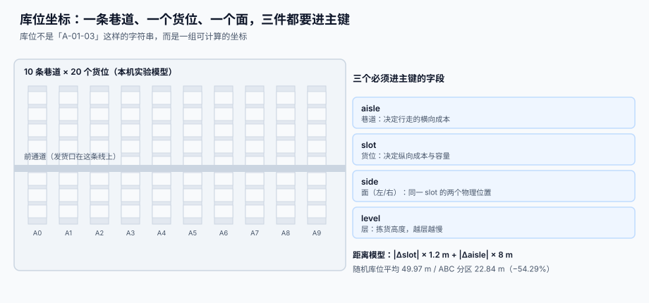
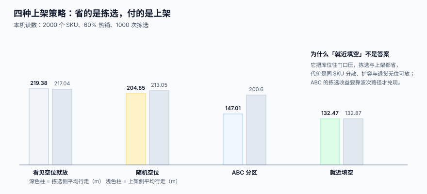

# 库位模型与容量

<p style="text-align:center;"></p>

「A-01-03」这种字符串在系统里长得像编号，实际上它必须能被**计算**：算距离、算容量、算这个货位能不能放下这批货。一旦它只是个字符串，路径优化、容量校验、混放管控就全部退化成人肉经验。

::: tip 一句话理解
**库位不是名字，是坐标。** 名字给人看，坐标给算法用；两者必须能互相还原，且**排序结果一致**。
:::

本页判据族 `WHL-A` ~ `WHL-H`，共 8 条，定义在最后一节。

## 一、四元组：巷道、货位、面、层

| 字段 | 含义 | 为什么必须独立成列 | 典型取值 |
| --- | --- | --- | --- |
| `aisle` | 巷道 | 决定横向移动成本（跨巷道要绕路） | `1` ~ `10` |
| `slot` | 货位（沿巷道的纵向位置） | 决定纵向移动成本 | `1` ~ `20` |
| `side` | 面（左 / 右） | 同一 `slot` 有两个物理位置，混了就会「走过路过没看见」 | `L` / `R` |
| `level` | 层 | 决定拣货高度与人工成本（第 1~2 层最快） | `1` ~ `5` |

```sql
CREATE TABLE bin (
  id          INTEGER PRIMARY KEY,
  wh_id       TEXT NOT NULL,
  zone_id     TEXT NOT NULL,                -- 分区：常温 / 冷藏 / 危化 / 退货
  aisle       INTEGER NOT NULL,
  slot        INTEGER NOT NULL,
  side        TEXT    NOT NULL CHECK (side IN ('L','R')),
  level       INTEGER NOT NULL,
  code        TEXT    NOT NULL,             -- 人读编码，见第二节
  max_volume  INTEGER NOT NULL,             -- cm³
  max_weight  INTEGER NOT NULL,             -- g
  max_qty     INTEGER NOT NULL,             -- 件数上限（小件专用）
  status      TEXT NOT NULL DEFAULT 'FREE'
              CHECK (status IN ('FREE','OCCUPIED','LOCKED','QUARANTINE','DISABLED')),
  UNIQUE (wh_id, aisle, slot, side, level),
  UNIQUE (wh_id, code)
);
CREATE INDEX idx_bin_route ON bin(wh_id, aisle, slot, level);
```



`UNIQUE (wh_id, aisle, slot, side, level)` 是**物理唯一约束**：同一个物理位置不能建两条库位记录。这条约束能拦住一类常见事故——两次「建库位」导入，一条写 `A-01-03-L`、一条写 `A-1-3-L`，从此同一个货位有两个 ID，库存被劈成两半。

## 二、编码必须可排序，而且排序结果要与坐标一致

人读编码的常见写法是 `A1-3-L2`（巷道 1、货位 3、左面、第 2 层）。问题出在**排序**：

```text
"A1-3"  <  "A10-3"  <  "A2-3"        ← 字符串排序，A10 跑到 A2 前面
(1,3)   <  (2,3)    <  (10,3)        ← 坐标排序，这才是真实的行走顺序
```

本机读数（400 个拣货点、10 条巷道）：按**未补零**的编码排序走 **707.2 m**，按坐标或**补零编码**排序走 **595.2 m**，差 **18.8%**。差异只有一个来源：`A10` 被排到了 `A2` 前面，路径多走一趟回头路。

::: danger 编码三条硬规则
1. **每段定长、左补零。** `A01-03-L2` 而不是 `A1-3-L2`：只要有一段变长，字符串排序就会与坐标排序分叉。
2. **编码里不要放会变的东西。** 把「温度区」「周转类型」塞进编码（如 `A01C-03`），分区一改，编码全废，历史数据全对不上。
3. **编码与坐标双向可还原，且要有断言。** 入库时校验 `parse(code) == (aisle, slot, side, level)`，不一致就拒绝——这条断言能抓住 90% 的人工录入错误。
:::

```sql
-- 补零编码的生成与还原（SQLite 表达式索引可用）
SELECT printf('A%02d-%02d-%s%d', aisle, slot, side, level) AS code FROM bin LIMIT 5;
```

## 三、容量：三个上限，取最小

| 上限 | 单位 | 谁来决定 | 违反的后果 |
| --- | --- | --- | --- |
| 体积 | cm³ | 货位净空（扣掉横梁与立柱） | 放不进去，硬塞会压坏下层 |
| 承重 | g | 货架层载（横梁式通常按层算） | 长期超载变形，安全风险 |
| 件数 | 件 | 小件区的物理隔断 | 满出来掉到通道，变成「找不到的货」 |

三者**不是取一个**，而是**三个都要过**，实际可用量是三者分别算出的件数的最小值：

```sql
-- 这个 SKU 还能往这个库位放多少件（取三个上限的最小值）
WITH cap AS (
  SELECT b.id,
         CAST(b.max_volume / NULLIF(s.unit_volume, 0) AS INTEGER) AS by_volume,
         CAST(b.max_weight / NULLIF(s.unit_weight, 0) AS INTEGER) AS by_weight,
         b.max_qty                                               AS by_qty
  FROM bin b JOIN sku s ON s.sku = :sku
  WHERE b.id = :bin_id
)
SELECT min(by_volume, by_weight, by_qty) AS free_capacity FROM cap;
```

::: warning 「体积」用的是包装体积，不是商品体积
写成商品净体积，会系统性高估容量 30%~60%（包装、内衬、空隙都不算）。同理，**重量要用含包材的毛重**，否则按净重算出来的层载永远「没超」，直到货架变形。
:::

## 四、混放规则：四种必须拦住，四种可以放开

| 规则 | 是否允许同一库位混放 | 拦住它的收益 |
| --- | --- | --- |
| 同 SKU 不同批次 | **允许**（但必须能区分，见[库存快照](../StockSnapshot/index.md)） | 提高库位利用率 |
| 不同 SKU 同温区 | 允许（小件区常见） | 提高拣选密度 |
| 不同温区 | **禁止** | 冷链断链，整批报废 |
| 危化与非危化 | **禁止** | 合规与安全，不可协商 |
| 食品与日化 | **禁止** | 串味与污染投诉 |
| 正品与退货 / 残次 | **禁止** | 退货品混入可售，是最贵的错 |
| 同一 SKU 同一批次 | 允许 | — |
| 超期与在效期 | **禁止** | 过期品混放，拣货按 FEFO 也会拿错 |

规则不能写在 SOP 里，要写在**数据里**：

```sql
CREATE TABLE bin_mix_rule (
  zone_a TEXT NOT NULL,       -- 允许混放的分区对（对称存储两行）
  zone_b TEXT NOT NULL,
  allow  INTEGER NOT NULL CHECK (allow IN (0,1)),
  PRIMARY KEY (zone_a, zone_b)
);

-- 入库前的守卫：目标库位已有货时，检查分区对是否允许
SELECT count(*) FROM stock_qty q
  JOIN bin b1 ON b1.id = q.bin_id
 WHERE q.bin_id = :bin_id AND q.qty > 0
   AND NOT EXISTS (SELECT 1 FROM bin_mix_rule r
                    WHERE r.allow = 1
                      AND ((r.zone_a = b1.zone_id AND r.zone_b = :zone_in)
                        OR (r.zone_a = :zone_in AND r.zone_b = b1.zone_id)));
-- 期望：0（为 0 才允许放）
```

## 五、库位状态机：五个状态，三条迁移要审批

| 状态 | 含义 | 谁能进 | 谁能出 |
| --- | --- | --- | --- |
| `FREE` | 空，可分配 | 系统自动 | 分配即出 |
| `OCCUPIED` | 有货 | 上架完成 | 清空即出 |
| `LOCKED` | 被作业占用（盘点中 / 波次锁定） | 系统 / 组长 | 作业结束 |
| `QUARANTINE` | 待检、待处理 | 质检 | 质检结论 |
| `DISABLED` | 停用（货架维修、消防通道） | **审批** | **审批** |

```text
FREE ──分配──> OCCUPIED ──清空──> FREE
  │                 │
  └──锁定──> LOCKED ┘
                    └──质检──> QUARANTINE ──结论──> OCCUPIED / FREE
FREE/OCCUPIED ──审批──> DISABLED ──审批──> FREE
```

::: danger 状态机的三个坑
1. **`LOCKED` 与 `QUARANTINE` 混用。** 盘点锁定是「暂时不许动」，待检是「不许卖」。混成一个状态，盘点一结束就会把待检品放回可售池。
2. **`DISABLED` 没有强校验。** 停用后必须校验「该库位余量为 0」，否则货会被「永远锁在一个不能再用的位置」。
3. **状态变更不写流水。** 库位状态是**作业证据**（谁在什么时候锁的、为什么），必须只追加记录，不能只留当前值。
:::

## 六、分区与分配策略

| 策略 | 依据 | 本机读数（1000 次拣选平均行走） | 代价 |
| --- | --- | --- | --- |
| 随机空位 | 随便挑一个空位 | **204.85 m** | 同 SKU 分散，找货难 |
| 就近填空 | 离发货口最近的空位 | **132.47 m** | 库位往门口堆，扩容与退货无位 |
| ABC 分区 | 热销区靠近发货口 | **147.01 m** | 上架成本上升（**200.60 m** vs 132.87 m） |
| 看见空位就放 | 现场习惯 | **219.38 m** | 最差，且不可解释 |



另一个更直观的读数：5000 行拣货、随机库位平均行走 **49.97 m**，ABC 分区 **22.84 m**，**−54.29%**。

::: warning ABC 不是「把热销挪到门口」这么简单
ABC 的收益来自**两个前提**：① 波次会把同一分区的行合并（否则每个分区都要跑一趟）；② 分类会随季节变（不改分类，半年后 A 类里全是死货）。缺任一前提，ABC 的收益都会被上架成本吃掉。
:::

## 七、判据清单

| 编号 | 判据 | 怎么验 |
| --- | --- | --- |
| `WHL-A` | 库位有 `(aisle, slot, side, level)` 四列独立存储，且有唯一约束 | `pragma table_info(bin)` 能看到四列；重复插入被拒 |
| `WHL-B` | 人读编码可排序，且与坐标排序结果一致 | 取 100 个库位按 `code` 与按坐标排序，两序列相等 |
| `WHL-C` | 编码与坐标可双向还原，入库时有断言 | 构造一条错码，入库被拒且报出具体字段 |
| `WHL-D` | 容量三上限（体积 / 承重 / 件数）都参与校验 | 三次构造超限，分别被拒且错误码不同 |
| `WHL-E` | 混放规则落库，而非只写在 SOP | 构造「危化 + 食品」同库位，写入被拒 |
| `WHL-F` | 库位状态五态且迁移有审批记录 | 状态流水表里 `DISABLED` 的进出各有一条审批人 |
| `WHL-G` | 分区（ABC）是数据不是硬编码 | 改分类后无需改代码，拣货顺序随之变化 |
| `WHL-H` | 停用库位前校验余量为 0 | 有货库位直接置 `DISABLED` 被拒 |

## 验证方式

```shell
# 1) 编码与坐标一致：应输出 0
sqlite3 /tmp/wh.db "SELECT count(*) FROM bin
  WHERE code <> printf('A%02d-%02d-%s%d', aisle, slot, side, level);"
# 期望：0

# 2) 四列唯一约束是否存在：应输出 1（唯一索引）
sqlite3 /tmp/wh.db "SELECT count(*) FROM pragma_index_list('bin') WHERE \"unique\"=1;"
# 期望：≥1

# 3) 混放守卫：应输出 0 行（没有违规混放）
sqlite3 /tmp/wh.db "SELECT b.id, b.zone_id, count(DISTINCT s.zone_id)
  FROM bin b JOIN stock_qty q ON q.bin_id=b.id JOIN sku s ON s.sku=q.sku
  WHERE q.qty>0 GROUP BY b.id HAVING count(DISTINCT s.zone_id) > 1;"
# 期望：0 行

# 4) 停用库位必须为空：应输出 0
sqlite3 /tmp/wh.db "SELECT count(*) FROM bin b JOIN stock_qty q ON q.bin_id=b.id
  WHERE b.status='DISABLED' AND q.qty>0;"
# 期望：0
```

## 参考资料

- [总览：七段库内作业链](../Overview/index.md)：库位在整条链里的位置
- [收货与上架策略](../InboundPutaway/index.md)：库位是怎么被「选」出来的
- [波次与拣选路径](../WavePicking/index.md)：坐标怎么变成路径
- [循环盘点与差异处理](../CycleCount/index.md)：库位状态 `LOCKED` 的真实用法
- 全国标准信息公共服务平台（GB/T 2934 联运通用平托盘，托盘尺寸决定货位容量口径）：<https://std.samr.gov.cn/>
- ISO 6780（通用平托盘主要尺寸，与 GB/T 2934 等效采用关系）：<https://www.iso.org/standard/43363.html>
