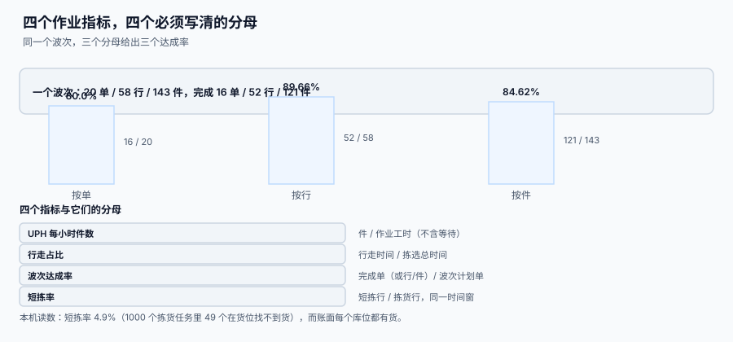

# 作业度量与产能

<p style="text-align:center;"></p>

仓库的日报最容易被「看起来很好的数」骗：拣货单完成率 98%、人均 120 行/小时、库存准确率 99.2%。这三个数可以同时全绿，而客户仍然在投诉少发——因为**它们的分子分母不是同一件事**。

::: tip 一句话理解
**仓储指标的问题几乎从不出在「算错」，而是出在「分母是谁」。** 同一个波次，按单 / 按行 / 按件算达成率，能差出 10 个百分点。
:::

本页判据族 `WHM-A` ~ `WHM-H`，共 8 条，定义在最后一节。

## 一、四个核心指标与它们的真实分母

| 指标 | 分子 | 分母 | 常见错误分母 |
| --- | --- | --- | --- |
| **UPH**（每小时行数） | 已拣行数 | **纯作业工时**（扣除等待、会议、找货） | 出勤工时（把等待也算进去，数值偏低且不可比） |
| **行走占比** | 行走时间 | 拣选总时间 | 订单处理总时长（把打单、复核也算进去） |
| **波次达成率** | 完成单数 | 波次计划单数 | 当日总单数（分母换了，指标就废了） |
| **短拣率** | 短拣行数 | 拣货行数（**同一时间窗**） | 订单数（分子是行、分母是单，量纲不一致） |

## 二、波次达成率：一个波次，三个答案

本机读数（一个波次：20 单 / 58 行 / 143 件，完成 16 单 / 52 行 / 121 件）：

| 口径 | 算式 | 结果 |
| --- | --- | --- |
| 按单 | 16 / 20 | **80.00%** |
| 按行 | 52 / 58 | **89.66%** |
| 按件 | 121 / 143 | **84.62%** |



三个数都「对」，差 **9.66 个百分点**。原因很简单：没完成的那几单是**行数少的大单**，所以按行算就显得完成得好。

::: danger 三个口径混用的后果
1. **考核用按行、汇报用按单。** 同一个月，绩效表上是 89.66%，客户侧看到的是 80%——两个部门各说各话，且都没撒谎。
2. **分母跟着日子变。** 今天按「计划单」算，明天按「当日总单」算，趋势图立刻出现假拐点。
3. **只报一个数。** 只报 80% 会让现场觉得「已经不错」，只报 89.66% 会让计划部门以为产能富余。
:::

**正确做法：三个数一起报，并明确主口径。** 主口径建议按单（客户感知的是「我的单发了没」），按行与按件作为产能分析的辅助。

```sql
-- 波次达成率三口径（同一波次，一次查完）
SELECT w.wave_no,
       round(100.0*sum(CASE WHEN p.picked_qty >= p.qty THEN 1 ELSE 0 END)
             / count(DISTINCT p.order_no), 2) AS by_order_pct,
       round(100.0*sum(CASE WHEN p.picked_qty >= p.qty THEN 1 ELSE 0 END)
             / count(*), 2)                     AS by_line_pct
  FROM wave w JOIN pick_task p ON p.wave_id = w.id
 GROUP BY w.id;
```

## 三、行走占比：56.7% 的时间在走路

用[波次与拣选路径](../WavePicking/index.md)的读数换算（行走 1.4 m/s、每行 30 s 拣货）：

| 方式 | 每单行走 | 每单行走时间 | 每单拣货时间 | 行走占比 | UPH（行/小时） |
| --- | --- | --- | --- | --- | --- |
| 单单拣货 | 158.06 m | 112.9 s | 86.3 s | **56.7%** | **52.0** |
| 波次 20 单 | 17.23 m | 12.3 s | 86.3 s | **12.5%** | **105.0** |

波次把行走占比从 56.7% 压到 12.5%，UPH 翻倍。这也解释了为什么「加人」不是产能的第一解法：**加人只增加分子，不改变行走占比**，而改善路径同时改变两者。

::: warning 行走占比不能无限压
压到 10% 以下就说明「拣货点非常密集」，这通常意味着：① 库位极度集中（ABC 副作用，扩容无位）；② 波次极大（订单等待变长）；③ 拣货员在同一个巷道里反复走（说明排序没做对）。**指标到极端值时要怀疑采集口径，而不是庆祝。**
:::

## 四、库存准确率：两个口径，差一个量级

| 口径 | 算式 | 本机读数 | 含义 |
| --- | --- | --- | --- |
| **按库位** | 相符库位数 / 盘点库位数 | 4,794 / 5,000 → **95.88%** | 有多少库位是对的 |
| **按金额** | 相符金额 / 盘点金额 | 差异合计 **315,664.02 元** | 钱上有多少是对的 |
| **按件** | 相符件数 / 总件数 | — | 大件商品会主导这个数 |

差异 206 条来自 5,000 个库位（4.12%），但金额集中在 A 类：**按库位是 95.88%，按金额可能只剩八成多**。两个数可以一个绿一个红——**报准确率必须带口径**，否则改善方向会指错（去点 C 类长尾，还是去管 A 类高价值区）。

## 五、短拣率 4.9%：这个数为什么重要

短拣率是**唯一一个同时反映「账准不准」和「作业实不实」的指标**：

```text
短拣 49 / 1,000 个任务 = 4.9%
  ├─ 其中 MISPLACED（放错位置）  → 库位管理问题
  ├─ 其中 UNRECORDED（没记账）   → 流程问题
  ├─ 其中 DAMAGED（坏了没报损）  → 报损流程问题
  └─ 其中 THEFT（真丢）          → 安防问题
```

只看总数没用，必须看**原因分布**：4.9% 里如果 70% 是 `MISPLACED`，那解决方案是「上架校验库位」，不是「加强盘点」。

## 六、从指标到人力：一张能算的账

```text
日订单 8,000 单 × 2.875 行/单 = 23,000 行
波次拣货 UPH(行) = 105
所需工时 = 23,000 / 105 = 219.0 小时
按每人每天有效 7 小时 → 31.3 人 → 排 32 人
```

若换成单单拣货（UPH 52）：23,000 / 52 = 442.3 小时 → **63.2 人**。同一批订单，路径策略决定了**两倍的人**。

::: tip 这张账的三个前提
① UPH 用的是「纯作业工时」，不含等待；② 2.875 行/单是实测均值，不是计划值；③ 波次规模受截单时间限制，不能为了 UPH 无限放大。缺任一前提，算出来的人数都会偏乐观。
:::

## 七、判据清单

| 编号 | 判据 | 怎么验 |
| --- | --- | --- |
| `WHM-A` | 每个指标都写明分子与分母，且量纲一致 | 指标字典里逐条标注，无「行/单」混算 |
| `WHM-B` | 波次达成率三口径同时可查 | 同一波次能取出 80.00 / 89.66 / 84.62 |
| `WHM-C` | UPH 用纯作业工时作分母 | 工时分表有 `work_seconds` 与 `idle_seconds` 两列 |
| `WHM-D` | 行走占比的分母是拣选总时间 | 能从任务记录反算出距离与秒数 |
| `WHM-E` | 短拣率带原因分布 | 按 `short_reason` 分组查询有结果 |
| `WHM-F` | 库存准确率带口径（库位 / 金额 / 件） | 报表上有明确的「口径」列 |
| `WHM-G` | 分层抽样的准确率不外推全库 | 报告分「全库（随机）」与「高风险区（分层）」两栏 |
| `WHM-H` | 人力测算可从指标反推，公式可复算 | 给定单量与 UPH，能算出人数并对上排班 |

## 验证方式

```shell
# 1) 三口径同时可取：应输出一行三列
sqlite3 /tmp/wh.db "SELECT
  round(100.0*sum(CASE WHEN picked_qty>=qty THEN 1 ELSE 0 END)/count(DISTINCT order_no),2),
  round(100.0*sum(CASE WHEN picked_qty>=qty THEN 1 ELSE 0 END)/count(*),2)
  FROM pick_task WHERE wave_id=1;"
# 期望：80.0 与 89.66（与正文读数一致）

# 2) 短拣原因分布：各原因之和应等于短拣行数
sqlite3 /tmp/wh.db "SELECT short_reason, count(*) FROM pick_task
  WHERE short_qty>0 GROUP BY short_reason;"
# 期望：分组之和 = 短拣行数，无 NULL 分组

# 3) 工时口径：纯作业工时不应大于出勤工时
sqlite3 /tmp/wh.db "SELECT count(*) FROM picker_shift WHERE work_seconds > shift_seconds;"
# 期望：0
```

## 参考资料

- [波次与拣选路径](../WavePicking/index.md)：行走距离从哪来
- [循环盘点与差异处理](../CycleCount/index.md)：库存准确率的口径
- [复核、打包与交接](../Packing/index.md)：短拣之后的下游成本
- [总览：七段库内作业链](../Overview/index.md)：七段的「完成」定义
- [容量与成本](../../../Ops/CapacityCost/Overview/index.md)：仓储成本怎么并入容量模型
