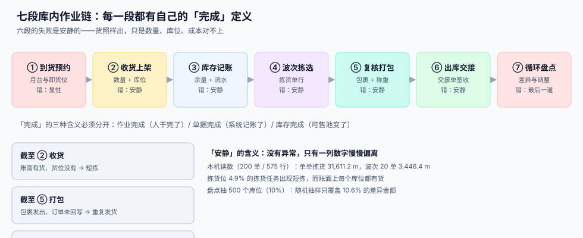

# 总览：七段库内作业链

<p style="text-align:center;"></p>

一个订单在系统里是 `qty = 2`，在仓库里是两个**具体的东西**：第 3 排第 12 个货位左面第 2 层的那两件。从「数字」到「东西」之间的这段路，就是仓储作业。这条路上每一步都改变物理世界，而系统只在少数几步看得见它。

::: tip 一句话理解
**仓储作业系统的本质，是把「物理动作」翻译成「可对账的记录」。** 动作一旦发生就没法撤销，所以记录必须跟着动作走，而不是事后补。
:::

本页判据族 `WHO-A` ~ `WHO-H`，共 8 条，定义在最后一节。

## 一、七段链与每段的「完成」

| 段 | 这一段在做什么 | 产物（表 / 单据） | 完成判据 | 失败是否安静 |
| --- | --- | --- | --- | --- |
| ① 到货预约 | 决定哪台车、几点、在哪个门卸 | `appointment` | 月台被占用且不重叠 | **显性**（冲突即拒） |
| ② 收货上架 | 点数、质检、决定放哪个库位 | `receipt` + `putaway_task` | 数量归零、库位已落 | 安静（差异可过账） |
| ③ 库存记账 | 写库位余量与流水 | `stock_qty` + `stock_txn` | 余量 = 期初 + Σ流水 | 安静（丢更新不留痕） |
| ④ 波次拣选 | 合并订单、排路径、取货 | `wave` + `pick_task` | 每个拣货行 `picked_qty` 已定 | 安静（短拣只是数字小） |
| ⑤ 复核打包 | 扫码核对、装箱、称重、贴标 | `package` + `package_item` | 包裹重量与行数都对上 | 安静（小件漏装称不出） |
| ⑥ 出库交接 | 按单点交、装车、签收 | `handover` + `handover_line` | 交接单数量 = 包裹数 | 安静（少交靠人记） |
| ⑦ 循环盘点 | 抽样、点数、处理差异 | `count_task` + `stock_adjust` | 差异有归因、有审批 | **最后一道** |



七段里**六段的失败是安静的**。这跟订单、支付那类链路完全相反：那些链路会抛异常（库存不足、支付失败、状态非法），而仓储链路的失败只表现为「这个月客诉多了点」「这个库位老是短拣」——通常被解释成「仓库管理不行」，而不是「系统少了一道闸门」。

## 二、「完成」有三种含义，必须分开

这是本专题最重要的一条口径。同一个「上架完成」，在三个地方指三件事：

| 口径 | 含义 | 谁在用 | 说错的后果 |
| --- | --- | --- | --- |
| **作业完成** | 人干完了（货放上货架了） | 现场、组长 | 只统计工时，不能写库存 |
| **单据完成** | 系统记账了（`putaway_task` 已关闭） | WMS、ERP | 可以算绩效，不能算可售 |
| **库存完成** | 可售池变了（`available` 增加） | 销售、渠道 | 这才是「能卖」 |

三者之间有**时间差**，而时间差就是事故窗口：

```text
收货上架：作业 09:12 → 单据 09:40（组批过账）→ 可售 09:41
           ↑ 这 28 分钟里，货在位、账上没有、卖不出去
```

反过来更危险：

```text
拣选下架：作业 14:05（货拿走了）→ 单据 14:06（过账）
           ↑ 如果先过账后拿货，这 1 分钟里两个拣货员会拿到同一件
```

::: danger 三个必失接缝
1. **「上架完成」被当成「可售增加」。** 上架任务关闭只说明货在货架上，如果这批货还在待检区（`PENDING`），它不该进可售池。两个口径混用，会出现「卖了没检的货」或「检了但卖不出」。
2. **「账面有货」被当成「货位有货」。** 系统只看 `stock_qty`，不看你走到货位时那里有没有货。本机读数：1,000 个拣货任务里 **49 个（4.9%）** 在货位找不到足量货，而账面每个库位都有货。这就是**短拣**，它的根因几乎总在「收货差异没处理」或「移动没记账」。
3. **「包裹发出」被当成「订单完成」。** 包裹离开仓库只是物理事实，订单状态要等承运商回传或签收才该推进。中间这段如果提前扣减，退货就没有货可回。
:::

## 三、三个「有货」必须同时可查

```sql
-- 三种「有货」，答案可以完全不同，而且都不算错
SELECT
  (SELECT sum(qty) FROM stock_qty  WHERE sku = :sku)                       AS 库位余量,
  (SELECT sum(qty) FROM stock_qty  WHERE sku = :sku AND bin NOT LIKE 'QI-%') AS 可售余量,
  (SELECT on_hand  FROM inventory_balance WHERE sku = :sku)                AS 台账余量;
```

三个数不一样是**正常的**：

| 数 | 口径 | 与另外两个不同时的原因 |
| --- | --- | --- |
| 库位余量 | 物理上分散在各货位的件数 | 待检区、退货暂存区也算物理库位 |
| 可售余量 | 能承诺给客户的部分 | 剔除待检、锁定、残次 |
| 台账余量 | 财务 / ERP 的存货数量 | 可能还没过账，也可能已按批次拆开 |

**能报警的不是「三个数不相等」，而是「三个数之差没有归属」**。差额必须能落到一个具体原因（待检、在途、盘盈盘亏待审），否则就是账实不符。

## 四、为什么「差一点」在这里特别贵

零售场景里「差 1 件」听起来无所谓，仓储场景里它会放大：

1. **它会挑最贵的订单发作。** 短拣发生在「最后一个」上——因为前面的人已经按账面取走了。于是被短拣的总是**最后履约的那一单**，通常也是最急的一单。
2. **它会同时污染三个指标。** 短拣既算履约失败，又算库存不准，还摊薄了人均产能，而这三个指标由三个部门看。
3. **它会自我强化。** 短拣之后如果只改订单不改库位，下一次拣货还会去同一个位置，误差累积。
4. **它的成本在交接之后跳变。** 仓内发现 = 返工 5 分钟；客户发现 = 补发 + 运费 + 客诉；平台判责 = 罚款。同一条错误，三档成本。

本机读数（[实战](../Practice/index.md)可复跑）：200 个订单 575 行，单单拣货走 **31,611.2 m**，波次 20 单一波只要 **3,446.4 m**（**−89.1%**）。也就是说，**同样的拣货量，路径策略决定了 89% 的行走**——而行走不产生任何价值。

## 五、四个必须先定下来的口径

| 口径 | 要定什么 | 定错的后果 |
| --- | --- | --- |
| **库存粒度** | 到 SKU，还是到 SKU + 库位 + 批次 | 定成 SKU 级就永远不知道货在哪，拣货只能靠人找 |
| **波次边界** | 按承运商截单时间切，还是按订单优先级切 | 切错会让「早上到的单赶不上早班车」 |
| **短拣策略** | 缺量发（partial）还是整单挂起（hold） | 缺量发会产生「多次到货」，客服成本翻倍 |
| **盘点冻结** | 盘哪个库位冻哪个，还是整区冻 | 整区冻会让当日产能掉 20% 以上，且员工会绕开盘点 |

这四条要在**第一次上 WMS 之前**写进设计文档。事后改的代价不是改代码，是**改现场习惯**——而现场习惯比代码难改十倍。

## 六、判据清单

| 编号 | 判据 | 怎么验 |
| --- | --- | --- |
| `WHO-A` | 七段各有自己的产物表，缺段能被发现 | 按表清单对齐七段，缺段数为 0 |
| `WHO-B` | 「作业完成 / 单据完成 / 库存完成」三个时间点分别落库 | 抽 10 个上架任务，三个时间戳都能查到且非递减 |
| `WHO-C` | 每个库存数量都能答出「哪个库位、哪个批次、什么状态」 | 任取 10 条 `stock_qty`，三列均非空 |
| `WHO-D` | 可售余量与物理余量分列存放，不共用一个字段 | 全库搜 `available`，只出现在视图或服务层 |
| `WHO-E` | 短拣有独立记录，不与「正常拣货」混在一列 | 存在 `short_qty > 0` 的行，且能关联到原因码 |
| `WHO-F` | 三个「有货」之差可归因，无一笔落「其他」 | 差额表按原因分组，未归类金额为 0 |
| `WHO-G` | 包裹与订单是多对多关系，不是一对一 | 存在一单多包与一包多单的数据，且都能查 |
| `WHO-H` | 同一批拣货重跑一次，库位余量不变 | 幂等断言：重放拣货事件后 `sum(qty)` 不变 |

## 验证方式

```shell
# 1) 七段产物表是否齐全：应输出 7 行
sqlite3 /tmp/wh.db "SELECT name FROM sqlite_master
  WHERE type='table' AND name IN
  ('appointment','receipt','stock_qty','pick_task','package','handover','count_task');"
# 期望：7 行，一段一行

# 2) 三个「有货」之差是否可归因：应输出 0
sqlite3 /tmp/wh.db "SELECT count(*) FROM stock_qty q
  JOIN inventory_balance b ON b.sku=q.sku
  WHERE abs(q.qty - b.on_hand) > 0
    AND q.hold_reason IS NULL AND q.bin NOT LIKE 'QI-%';"
# 期望：0

# 3) 短拣是否有原因码：应输出 0
sqlite3 /tmp/wh.db "SELECT count(*) FROM pick_task WHERE short_qty > 0 AND short_reason IS NULL;"
# 期望：0
```


## 与「设备维护与可靠性」专题的分工（第 233 天补充）

本册管**空间与动作**：料在哪个货位、谁去拣、走多少路、复核几次。那一册管**水平与后果**：这个件该备几个、缺了会停多久、服务水平定在多少。同一个备件库，一个问「怎么取」，一个问「备多少」。

| 你关心的问题 | 该读哪一册 | 为什么不是另一册 |
| --- | --- | --- |
| 这个备件放在哪个货位、怎么最快拣到 | 本册（[库位模型](../LocationModel/index.md)） | 那一册不关心货位，只关心数量 |
| 关键备件该备几个 | [设备维护与可靠性](../../EquipmentMaintenance/SpareParts/index.md) | 本册的补货规则按周转率，不按停机损失 |
| 盘点差异怎么处理 | 本册（[循环盘点](../CycleCount/index.md)） | 那一册的判据是「关键件是否可得」，不是「账实是否一致」 |
| 备件到货后怎么上架 | 本册（[收货与上架](../InboundPutaway/index.md)） | 那一册只用到货期这一个数 |

::: danger 一个代价很高的默认值：备件最低库存 = 0
把维修备件当普通物料管理时，系统默认「最低库存 0、按需采购」——这对螺丝螺母没问题，对一个 300 元的密封圈是灾难：它一缺就停线 8 小时。

**判据不是金额，是后果**：金额 C 类但关键性 A 的备件必须单独一张表管理，安全库存按停机损失倒推（`SS = z·σ_d·√L`），而不是按周转率。这类件在标准 ABC 分类里恰好被埋在最底层，是最容易被漏掉的一群。
:::

## 与本专题的分工（门店零售与 POS，第 243 天补充）

本页讲库内作业：库位坐标、波次拣选、复核打包、循环盘点。门店后仓看起来是「小一号的仓库」，但它**没有库位编码、没有波次、也没有拣货路径**——用同一套模型套上去，只会得到一堆填不满的字段。

| 维度 | 本页（仓储作业） | [门店零售与 POS](../../RetailPOS/Overview/index.md) |
| --- | --- | --- |
| 空间模型 | 库区 / 库位 / 巷道 | 前场货架 + 后仓，无坐标 |
| 作业单位 | 波次 / 拣货单 | 单张小票 / 补货单 |
| 库存层级 | 余量 + 流水 + 快照 | 本地余量 + 中心余量（两份，允许不一致） |
| 盘点 | 循环盘点按 ABC | 日盘 / 周盘，差异直接调本地 |
| 对账对象 | 与台账对 | 与钱箱、渠道、中心库存三方对 |

一处该页特有的坑：**给门店后仓建库位**。库位模型的价值在于「路径可优化」，而门店后仓通常只有十几平米、几十个 SKU，拣货路径的最优解就是「转身拿」。建了库位反而要求店员维护「这箱水在 A-03-02」，维护成本远高于收益，最后一定烂在系统里。正确做法是门店只用「前场/后仓」两级，把优化留给配送与补货环节。

## 与「质量管理工程」专题的分工（第 248 天补充）

本页与 [质量管理工程](../../QualityManagement/index.md) 的分工写在下面这张表里，两册**不重复定义**同一件事：

| 维度 | 本页 | 另一侧 |
| --- | --- | --- |
| 本页管什么 | 库位、波次、拣选、盘点、出入库 | 货物在哪 |
| 质量工程管什么 | 批次谱系：这批料进了哪些成品 | 货物从哪来 |
| 批次号 | 本页用作库存维度 | [追溯](../../QualityManagement/Traceability/index.md) 用作图的节点 |
| 关键动作 | 上料扫码 | 不扫码就断链 |

::: warning 只在本页成立的一个坑
批次号只当库存维度用。WMS 里批次号能做出入库、能盘库、能先进先出，但只要**上料时不与工单绑定**，召回时仍然只能整批处理——本机 2.9% 的缺环全部来自「补料手工输入」这一处。
:::

## 参考资料

- [库位模型与容量](../LocationModel/index.md)：第 ③ 段的地基，坐标与容量
- [库存快照与批次](../StockSnapshot/index.md)：三种「有货」的数据结构
- [波次与拣选路径](../WavePicking/index.md)：第 ④ 段，89% 的行走差异从哪来
- [作业度量与产能](../Metrics/index.md)：四个指标与四个分母
- [库存与预占](../../Ecommerce/Inventory/index.md)：对外的「可售」口径
- 履约交付与承运商集成（页面待补）：交接之后的路
