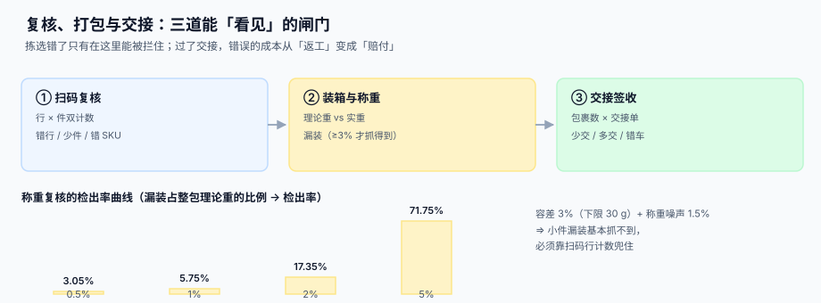

# 复核、打包与交接

<p style="text-align:center;"></p>

拣货错在仓库里只是「返工」，出仓库就是「赔付」。这三道闸门——复核、称重、交接——是仓内**最后三次能拦住错误的机会**，而它们的检出能力完全不同：扫码能抓错行，称重只能抓缺一大件，交接只能抓整箱少给。

::: tip 一句话理解
**复核管「对不对」，打包管「装得下」，交接管「给全了」。** 三件事三种数据，不能用一个「已发货」状态糊过去。
:::

本页判据族 `WHK-A` ~ `WHK-H`，共 8 条，定义在最后一节。

## 一、复核：行计数与件计数必须分开

| 计数口径 | 抓什么 | 抓不到什么 |
| --- | --- | --- |
| **行计数**（扫了几个 SKU） | 漏行、多行、错 SKU | 同一行少装 1 件 |
| **件计数**（扫了几件） | 漏件、多件 | 数量对但装错批次 |
| **称重** | 缺大件、多装 | 小件漏装、错批次（同重量） |
| **批次核对** | 装错批次 / 效期 | 数量错 |

四种都要，因为它们**互相补盲**：行计数看不到「同一行装少」，称重看不到「同重量错货」。

```sql
CREATE TABLE package (
  id            INTEGER PRIMARY KEY,
  package_no    TEXT NOT NULL UNIQUE,
  sscc          TEXT NOT NULL UNIQUE,        -- 18 位，GS1 AI(00)
  order_no      TEXT NOT NULL,
  carton_type   TEXT NOT NULL,
  plan_weight   INTEGER NOT NULL,            -- g，理论毛重
  actual_weight INTEGER,                     -- g，称重值
  measured_at   TEXT,
  status        TEXT NOT NULL DEFAULT 'OPEN'
                CHECK (status IN ('OPEN','SEALED','HANDED_OVER','RETURNED'))
);

CREATE TABLE package_item (
  package_id INTEGER NOT NULL REFERENCES package(id),
  sku        TEXT NOT NULL,
  batch_no   TEXT,
  qty        INTEGER NOT NULL CHECK (qty > 0),
  scanned    INTEGER NOT NULL DEFAULT 0,
  PRIMARY KEY (package_id, sku, batch_no),
  CHECK (scanned <= qty)
);
```

`CHECK (scanned <= qty)` 是一道很便宜的闸门：它拦住「多扫了一件还封箱」这种最常见的复核错误。

## 二、称重：容差决定了它能抓住什么

称重的检出能力由**容差**与**噪声**共同决定。本机读数（容差取整包理论重的 3%、下限 30 g；称重噪声 1.5%）：

| 漏装占整包重量 | 检出率 |
| --- | --- |
| 0.5% | **3.05%** |
| 1% | **5.75%** |
| 2% | **17.35%** |
| 5% | **71.75%** |



含义很直接：**称重只对「缺一大件」有效**。一个 2,000 g 的包裹漏装 20 g 的配件（1%），检出率不到 6%——基本等于没装这道闸。所以：

::: danger 称重的三个错误用法
1. **把称重当唯一复核手段。** 上面那张表就是答案：小件漏装它抓不到，必须有扫码行计数兜底。
2. **容差按固定克数给。** 500 g 的包裹和 5 kg 的包裹用同一个 30 g 容差，前者必然天天误报，后者必然天天漏报。容差要**按比例 + 下限**。
3. **不记录称重时间与设备。** 争议发生时，你需要证明「这个重量是这台秤在几点称的」，否则数据不可采信。
:::

```sql
-- 称重判定：超出容差的包必须挂起，不许自动封箱
SELECT p.package_no, p.plan_weight, p.actual_weight,
       abs(p.actual_weight - p.plan_weight) AS diff,
       max(30, CAST(p.plan_weight * 0.03 AS INTEGER)) AS tol
  FROM package p
 WHERE p.actual_weight IS NOT NULL
   AND abs(p.actual_weight - p.plan_weight) > max(30, CAST(p.plan_weight * 0.03 AS INTEGER));
-- 期望：这些包 status 仍是 OPEN，且带挂起原因
```

## 三、装箱：先排序，再装箱，箱数少 16.5%

| 算法 | 做法 | 本机读数（300 件、箱容 0.035 m³） |
| --- | --- | --- |
| **Next-Fit**（按顺序塞当前箱） | 装不下就换新箱 | **103 箱**，体积利用率 **82.74%** |
| **First-Fit Decreasing**（大的先装） | 排序后每件找第一个装得下的箱 | **86 箱**，利用率 **99.09%** |

同样是「按体积装箱」，只把**顺序**从「拣货顺序」换成「体积降序」，箱数少 **16.5%**，体积利用率从 82.74% 提到 99.09%。

::: warning 装箱优化必须服从物理约束
体积算得再漂亮，也可能：① 超重（单箱 20 kg 上限）；② 易碎品被压在下面；③ 液体与粉末同箱；④ 箱型不存在（只有 5 种箱型可选）。所以真实实现是**先按约束分组，再按体积装箱，最后校验重量**，顺序不能反。
:::

## 四、包裹与订单：多对多，不是一对一

| 关系 | 例子 | 数据结构要求 |
| --- | --- | --- |
| 一单多包 | 一个订单 3 箱，分 2 次发 | `package.order_no` 一对多 |
| 一包多单 | 同一客户两单合并成一箱 | 需要 `package_order` 关联表 |
| 一包多箱（托盘） | 4 个箱子码成一个托盘 | 需要 `sscc` 层级（托盘 SSCC + 箱 SSCC） |

GS1 的物流标签用 **SSCC（18 位，AI `(00)`）**标识「物流单元」，这个号在整个供应链里唯一，且**不重复使用**（同一 SSCC 至少在一年内不得重新分配给别的物流单元）。把它作为包裹的唯一业务键，比自增号更耐用：

```text
SSCC = 扩展位(1) + GS1 公司前缀 + 序列参考 + 校验位 = 18 位
AI(00) 不进 SSCC 本身，但要编进 GS1-128 条码
```

::: danger 包裹号的三个坑
1. **用自增 ID 当包裹号。** 换库、分库、重建表之后号会重排，历史面单对不上。
2. **不存箱码与包裹号的映射。** 客户报「这箱少了」，你只有一个箱码，查不到是哪一单——这是最常见的售后卡点。
3. **托盘不带 SSCC。** 整托交接时只能按「几托」点，无法按托内箱数核对，少一箱无人知晓。
:::

## 五、交接：三份数据要对上

```text
交接单（承运商签收）  =  包裹数（package 表 SEALED）
                      =  装车扫描数（扫描枪记录）
                      =  面单数（打印成功的面单）
```

四者中任意两个不等，就是交接差异，必须当场记录：

| 差异 | 常见原因 | 归责 | 处置 |
| --- | --- | --- | --- |
| 装车少 1 箱 | 漏装 / 装错车 | 仓库 | 找回或补发 |
| 面单少 1 张 | 打印机卡纸 | 仓库 | 重打 + 重扫 |
| 承运商少签 1 箱 | 司机漏点 | 承运商 | 凭装车扫描记录追 |
| 交接单多 1 箱 | 上一车遗留 | 双方 | 现场核对后修正 |

装车顺序也有讲究：**后卸的先装**（LIFO）。否则司机在每个站点都要把前面的货搬开，一车 20 个站点会多搬 20 次。

```sql
CREATE TABLE handover (
  id            INTEGER PRIMARY KEY,
  handover_no   TEXT NOT NULL UNIQUE,
  carrier_id    TEXT NOT NULL,
  vehicle_no    TEXT NOT NULL,
  seal_no       TEXT,                        -- 铅封号
  package_count INTEGER NOT NULL,
  signed_count  INTEGER,                     -- 承运商签收数
  signed_at     TEXT,
  signed_by     TEXT,
  diff_count    INTEGER GENERATED ALWAYS AS (coalesce(signed_count,0) - package_count) STORED
);
```

`diff_count` 用生成列，**交接差异不再是一个「事后想起来填」的字段**：签收数一填，差异立刻可查。

## 六、判据清单

| 编号 | 判据 | 怎么验 |
| --- | --- | --- |
| `WHK-A` | 复核同时有行计数与件计数两列 | `package_item` 有 `qty` 与 `scanned`，且约束 `scanned <= qty` |
| `WHK-B` | 称重容差按比例 + 下限，且超差挂起 | 构造超差包，`status` 仍为 `OPEN` |
| `WHK-C` | 称重记录带时间与设备标识 | `measured_at` 与设备列非空 |
| `WHK-D` | 包裹有 18 位 SSCC 且唯一 | 插入重复 SSCC 被拒 |
| `WHK-E` | 支持一单多包与一包多单 | 两种关系各能查出，且查询不返回重复 |
| `WHK-F` | 交接单数量 = 包裹数 = 面单数，三者可对账 | 跑三方计数，差异为 0 或有记录 |
| `WHK-G` | 交接差异为生成列，不可手工篡改 | 直接 `UPDATE diff_count` 被拒 |
| `WHK-H` | 装车按「后卸先装」排序且可验证 | 交接单上的装车顺序与配送顺序相反 |

## 验证方式

```shell
# 1) 三方数量对账：应输出 0
sqlite3 /tmp/wh.db "SELECT
  (SELECT count(*) FROM package WHERE status='SEALED')
- (SELECT count(*) FROM handover_line)
- (SELECT 0);"
# 期望：0（包裹数 = 交接明细行数）

# 2) SSCC 唯一：第二次插入应报错
sqlite3 /tmp/wh.db "INSERT INTO package(package_no,sscc,order_no,carton_type,plan_weight)
  VALUES('P1','000123456789012345','O1','C1',1200);
  INSERT INTO package(package_no,sscc,order_no,carton_type,plan_weight)
  VALUES('P2','000123456789012345','O2','C1',1200);"
# 期望：第二条报 UNIQUE constraint failed

# 3) 超差包是否被挂起：应输出 0（没有「已封箱但超差」的包）
sqlite3 /tmp/wh.db "SELECT count(*) FROM package
  WHERE status='SEALED' AND actual_weight IS NOT NULL
    AND abs(actual_weight-plan_weight) > max(30, plan_weight*0.03);"
# 期望：0

# 4) 交接差异：应能列出每一单的差异数
sqlite3 /tmp/wh.db "SELECT handover_no, package_count, signed_count, diff_count
  FROM handover WHERE diff_count <> 0;"
# 期望：只列出真有差异的交接单
```

## 参考资料

- [波次与拣选路径](../WavePicking/index.md)：这三道闸门的前一段
- [总览：七段库内作业链](../Overview/index.md)：交接之后归谁管
- [承运商账单核对](../../ShippingCarrier/InvoiceAudit/index.md)：重量与体积重怎么影响运费
- [面单渲染](../../ShippingCarrier/LabelRender/index.md)：包裹与面单的一一对应
- GS1 物流标签指南（SSCC 结构与 AI `(00)`）：<https://www.gs1.org/standards/gs1-logistic-label-guideline/current-standard>
- ISO/IEC 15417（Code 128 符号规范）：<https://www.iso.org/standard/38230.html>
