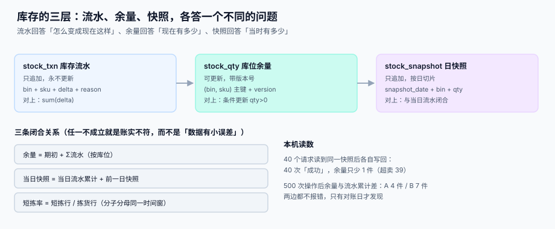

# 库存快照与批次

<p style="text-align:center;"></p>

「这个库位有多少件」看起来是一个数字，实际上它至少有三个来源：**流水累计**、**余量表**、**日快照**。三者本该一致，但它们的失败方式完全不同——流水会丢，余量会被覆盖，快照会被遗忘。

::: tip 一句话理解
**库存不是「一个字段」，是「一条可以重放的账」。** 余量表是为了快，流水是为了对，快照是为了查——三样都要有，缺一样就有一类问题永远查不清。
:::

本页判据族 `WHS-A` ~ `WHS-H`，共 8 条，定义在最后一节。

## 一、三层结构：各答一个不同的问题

| 层 | 表 | 回答什么 | 写模式 | 谁能改 |
| --- | --- | --- | --- | --- |
| 流水 | `stock_txn` | 「怎么变成现在这样」 | 只追加 | **任何人都不许改** |
| 余量 | `stock_qty` | 「现在有多少」 | 就地更新 + 版本号 | 只能通过受控入口 |
| 快照 | `stock_snapshot` | 「当时有多少」 | 按日追加 | 只读 |



三条闭合关系，任一不成立就是**账实不符**，而不是「数据有点小误差」：

```sql
-- 关系 1：余量 = 期初 + Σ流水（按库位与批次）
SELECT q.bin_id, q.sku, q.batch_no,
       q.qty AS qty_now,
       (SELECT coalesce(sum(delta),0) FROM stock_txn t
         WHERE t.bin_id=q.bin_id AND t.sku=q.sku AND t.batch_no=q.batch_no) AS qty_txn
  FROM stock_qty q
 WHERE q.qty <> (SELECT coalesce(sum(delta),0) FROM stock_txn t
                  WHERE t.bin_id=q.bin_id AND t.sku=q.sku AND t.batch_no=q.batch_no);
-- 期望：0 行
```

```sql
-- 关系 2：当日快照 = 前一日快照 + 当日流水
SELECT s.bin_id, s.sku, s.qty AS snap_today
  FROM stock_snapshot s
  JOIN stock_snapshot p
    ON p.bin_id=s.bin_id AND p.sku=s.sku
   AND p.snapshot_date = date(s.snapshot_date, '-1 day')
 WHERE s.qty <> p.qty + (SELECT coalesce(sum(delta),0) FROM stock_txn t
                          WHERE t.bin_id=s.bin_id AND t.sku=s.sku
                            AND date(t.created_at) = s.snapshot_date);
-- 期望：0 行
```

## 二、并发扣减：先查后改会超卖 39 件

仓储里最经典的并发缺陷发生在**拣货扣减**。写法 A（先查后改）：

```sql
-- 写法 A：两步，中间没有任何保护
SELECT qty FROM stock_qty WHERE bin_id=:bin AND sku=:sku;   -- 读：50
UPDATE stock_qty SET qty = :new_qty WHERE bin_id=:bin AND sku=:sku;  -- 写：49
```

同一瞬间 40 个拣货请求都读到 50，各自写回 49。结果：**40 次「成功」的扣减，余量只少了 1 件**，超卖 **39 件**。

写法 B（条件更新，一条语句完成判断与写入）：

```sql
-- 写法 B：条件更新，rowcount=0 即失败
UPDATE stock_qty
   SET qty = qty - :n, version = version + 1
 WHERE bin_id=:bin AND sku=:sku AND qty >= :n;
-- rowcount = 0 ⇒ 库存不足或已被别人扣走，重试或短拣
```

本机读数（SQLite，50 件初始库存、200 次扣减请求）：

| 写法 | 成功扣减 | 最终余量 | 是否超卖 |
| --- | --- | --- | --- |
| 先查后改（无守卫） | **40**（全部「成功」） | **49** | **超卖 39** |
| 条件更新 | 50 | **0** | 否 |

::: danger 三个必看细节
1. **`qty > 0` 不够，要 `qty >= :n`。** 拣 3 件时，`qty > 0` 在只剩 1 件时仍然成立，会扣成 **−2**。
2. **`rowcount = 0` 必须当成正常分支处理。** 它不是异常，是「货不够了」，要走短拣流程，不能直接抛 500 让前端重试——重试会再触发一次，除非有幂等键。
3. **扣减与流水必须在同一事务里。** 只扣余量不写流水，余量与流水就会分叉（见《余量与流水漂移》一节），而且**永远无法自动对平**。
:::

## 三、余量与流水漂移：500 次操作后差 4~7 件

流水丢失的原因很朴素：事务回滚、异步写失败、批量补数脚本漏写、`INSERT` 被吞。

本机读数（500 次操作、6% 的流水写入被丢弃）：

| SKU | 余量表 | 流水累计 | 差 |
| --- | --- | --- | --- |
| A | 27 | −69（相对 100） | **4 件** |
| B | 57 | −36（相对 100） | **7 件** |

**两边都不报错**。这种偏差只有在对账日（或客户投诉）才会暴露，而那时已经过去三周。

对策不是「要求大家都写流水」，而是：

1. **写流水与改余量在同一个事务**（同一个连接、同一个 `BEGIN`）。
2. **每日对账任务**跑上面的关系 1，把差异落到一张 `stock_discrepancy` 表，按库位归口。
3. **差异超过阈值（如 3 件或 0.5%）自动冻结该库位的拣货**，先查再放开。

## 四、批次与效期：FEFO 不是「建议」，是规则

同一 SKU 不同批次的货，物理上可以混放，**逻辑上必须能分开**。

| 字段 | 作用 | 缺失的后果 |
| --- | --- | --- |
| `batch_no` | 批次号（供应商批号或内部批号） | 过期无法定位，只能整区报废 |
| `expire_date` | 到期日（不是生产日） | FEFO 无从计算 |
| `received_at` | 收货时间 | FIFO 无从计算 |
| `lot_status` | 正常 / 待检 / 冻结 | 冻结批次仍会被拣出 |

```sql
CREATE TABLE stock_qty (
  bin_id     INTEGER NOT NULL,
  sku        TEXT    NOT NULL,
  batch_no   TEXT    NOT NULL,
  qty        INTEGER NOT NULL CHECK (qty >= 0),
  available  INTEGER NOT NULL CHECK (available >= 0 AND available <= qty),
  version    INTEGER NOT NULL DEFAULT 0,
  PRIMARY KEY (bin_id, sku, batch_no),
  CHECK (qty >= available)
);
CREATE INDEX idx_fefo ON stock_qty(sku, batch_no);
CREATE INDEX idx_stock_expire ON stock_lot(sku, expire_date);
```

`CHECK (qty >= available)` 是一条很便宜但很有效的约束：它保证「可售不超过实际」，把一类「预占写多了」的缺陷拦在数据库层。

::: danger FEFO 与 FIFO 的差别有多大
本机读数（500 个批次、40 个商品、需求把库存抽干）：按 **FEFO**（先到期先出）剩余近效期 **8,997 件**；按 **FIFO**（先进先出）剩余 **10,719 件**，**多 19.1%**。

差异来源很单纯：后进的批次效期可能更早（供应商清库存、生产日期倒挂）。FIFO 只看进货顺序，必然把早效期的货留在架上。**只要品类有效期，FEFO 就不是可选项。**
:::

拣货取批的顺序要写进查询，而不是靠人记：

```sql
-- 按 FEFO 取批：先到期先出，同效期按收货时间
SELECT q.bin_id, q.batch_no, q.qty, q.available, l.expire_date
  FROM stock_qty q JOIN stock_lot l ON l.sku=q.sku AND l.batch_no=q.batch_no
 WHERE q.sku=:sku AND q.available > 0 AND l.lot_status='NORMAL'
 ORDER BY l.expire_date ASC, q.bin_id ASC
 LIMIT 5;
```

## 五、快照：为什么不能只靠流水

流水能重放，但重放 3 个月的流水来回答「昨天这个库位有多少」太慢；而且**流水会被归档**（冷热分离）。所以要有日快照。

| 方案 | 空间 | 查询速度 | 适用 |
| --- | --- | --- | --- |
| 只存流水，实时累计 | 小 | 随天数线性变慢 | 小仓、SKU 少 |
| 只存快照 | 大（每天全量） | 快 | 报表为主 |
| **流水 + 日快照** | 中 | 快（近 1 天查流水，历史查快照） | 绝大多数生产仓 |

快照的三条纪律：

1. **快照必须由流水推导**，不能由「当前余量」直接复制——否则余量错了，快照跟着错，两套错数据互相印证。
2. **快照时间点固定**（如每日 00:00 UTC+8），且要记录**切片时刻**，因为快照生成可能跑 10 分钟。
3. **快照只追加，不更新**。发现问题只能补一条「更正快照」，不能改历史。

## 六、判据清单

| 编号 | 判据 | 怎么验 |
| --- | --- | --- |
| `WHS-A` | 三层齐全：流水、余量、快照各有表且职责不混 | 三张表都存在，`stock_txn` 无 `UPDATE` 入口 |
| `WHS-B` | 关系 1（余量 = Σ流水）可查且为 0 行 | 跑闭合查询，返回 0 行 |
| `WHS-C` | 关系 2（快照递推）可查且为 0 行 | 跑递推查询，返回 0 行 |
| `WHS-D` | 扣减用条件更新，`rowcount=0` 走短拣 | 并发 50 次扣 1 件，最终余量恰好为 0 |
| `WHS-E` | 扣减与流水同事务 | 人为让流水插入失败，余量回滚不变 |
| `WHS-F` | `qty >= available` 由数据库约束 | 直接更新 `available > qty` 被拒 |
| `WHS-G` | 取批顺序按 FEFO（或明确声明 FIFO）且写进查询 | `EXPLAIN` 能看到按 `expire_date` 排序 |
| `WHS-H` | 冻结批次不会被拣出 | 把批次置 `FROZEN`，拣货查询返回 0 行 |

## 验证方式

```shell
# 1) 闭合关系 1：应输出 0
sqlite3 /tmp/wh.db "SELECT count(*) FROM stock_qty q
  WHERE q.qty <> (SELECT coalesce(sum(delta),0) FROM stock_txn t
                   WHERE t.bin_id=q.bin_id AND t.sku=q.sku AND t.batch_no=q.batch_no);"
# 期望：0

# 2) 并发扣减的守卫：连跑 200 次，最后余量必须为 0 而不是负数
sqlite3 /tmp/wh.db "SELECT sum(qty) FROM stock_qty WHERE sku='SKU1';"
# 期望：0（且任何时刻不出现负数）

# 3) 可售不超过实际：应输出 0
sqlite3 /tmp/wh.db "SELECT count(*) FROM stock_qty WHERE available > qty;"
# 期望：0

# 4) 冻结批次是否会被拣出：应输出 0 行
sqlite3 /tmp/wh.db "SELECT q.bin_id FROM stock_qty q JOIN stock_lot l
  ON l.sku=q.sku AND l.batch_no=q.batch_no
  WHERE l.lot_status='FROZEN' AND q.available>0;"
# 期望：0 行
```

## 参考资料

- [库位模型与容量](../LocationModel/index.md)：`(bin_id, sku, batch_no)` 的地基
- [总览：七段库内作业链](../Overview/index.md)：三个「有货」口径
- [波次与拣选路径](../WavePicking/index.md)：FEFO 怎么影响拣货顺序
- [循环盘点与差异处理](../CycleCount/index.md)：余量与流水分叉之后怎么修
- [库存与预占](../../Ecommerce/Inventory/index.md)：对外的可售口径与预占
- [幂等键设计](../../IdempotencyStateMachine/IdempotencyKey/index.md)：重试与重复扣减的通用解法
