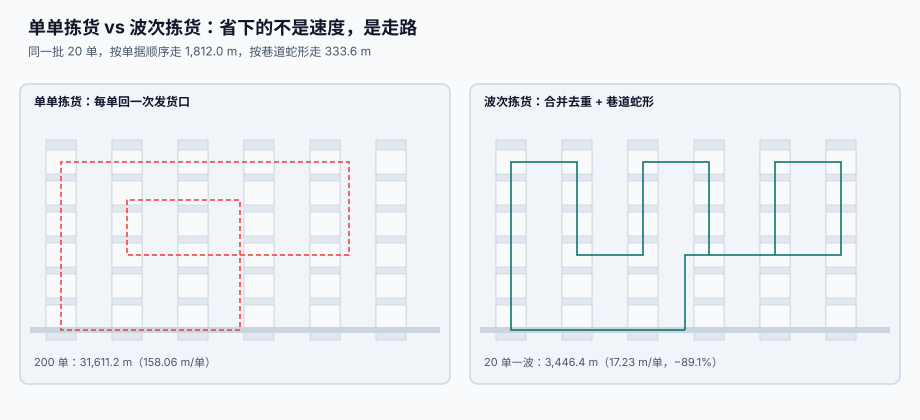

# 波次与拣选路径

<p style="text-align:center;"></p>

拣货员一天走 15 公里，其中真正「把货从架上拿下来」的时间不到 20%。剩下的都是走——去、回、绕、再走一遍刚才走过的地方。波次与路径不改变拣货量，它改变的是**这些走路里有多少是白走的**。

::: tip 一句话理解
**波次是把「很多小订单」拼成「一趟大路线」，路径是决定这一趟怎么走。** 前者省的是「回发货口」的次数，后者省的是「在巷道里折返」的次数。
:::

本页判据族 `WHW-A` ~ `WHW-H`，共 8 条，定义在最后一节。

## 一、单单拣货 vs 波次拣货：89% 的行走是可以省掉的

本机读数（200 个订单、575 行、10 条巷道 × 20 货位、拣货位随机分布）：

| 方式 | 总行走 | 每单行走 | 相对单单拣货 |
| --- | --- | --- | --- |
| 单单拣货（每单回发货口） | **31,611.2 m** | 158.06 m | — |
| 波次 10 单 | 6,194.4 m | 30.97 m | **−80.4%** |
| 波次 20 单 | 3,446.4 m | 17.23 m | **−89.1%** |
| 波次 50 单 | 1,471.2 m | 7.36 m | **−95.35%** |



省掉的不是速度，是**往返**：单单拣货每单要从发货口出发再回来一次，波次把 n 单的「往返」压成 1 次，且合并了重复库位。

::: warning 波次不是越大越好
波次越大，每单行走越低，但**订单等待**越长（要等凑够 50 单才开工），而且一次拣错的影响面越大（50 单一起错）。真实取值取决于两件事：**截单时间**（承运商几点来车）与**拣货位数量**（一个波次能不能同时容纳多个拣货员）。本机读数里 10 → 20 单省 8.7 个百分点，20 → 50 单只再省 6.25 个百分点，**边际收益递减很快**。
:::

## 二、同一批订单，路径顺序差 5.4 倍

波次解决「来回」，路径解决「折返」。同一批 20 单（58 个拣货点）：

| 走法 | 行走距离 | 说明 |
| --- | --- | --- |
| 按单据行顺序（拣货单上怎么写就怎么走） | **1,812.0 m** | 最常见的实现，也是最贵的 |
| 按巷道蛇形（S 形：一条巷道走到头，下一条反向） | **333.6 m** | 相差 **5.4 倍** |

```text
按单据顺序： A3 → B9 → A1 → C4 → A8 → B2 ...        （来回横跳）
蛇形排序：   A1 → A3 → A8 → B2 → B9 → C4 ...        （一路向前）
```

三种路径策略的取舍：

| 策略 | 做法 | 优点 | 缺点 |
| --- | --- | --- | --- |
| **S 形（蛇形）** | 巷道内单向走到底，下一条反向 | 实现最简单，人工也容易理解 | 拣货点稀疏时白走 |
| **最大间隙** | 跳过「没有拣货点」的最长一段 | 稀疏拣货时明显更短 | 需要算间隙，现场不好人工执行 |
| **最优（TSP 近似）** | 最近邻 + 2-opt | 距离最短 | 顺序看着「乱」，人工容易走错 |

::: danger 路径实现的三条纪律
1. **排序发生在生成拣货单时，不是拣货员现场判断。** 让拣货员自己决定顺序，等于每次重新发明一次路径，且无法度量。
2. **排序键必须是坐标，不是字符串。** 用 `bin.code` 排序会踩「`A10` 排在 `A2` 前面」的坑（见[库位模型](../LocationModel/index.md)）。
3. **同一波次内一个库位只能被分配给一个拣货员。** 否则两人走同一条巷道抢同一件货，第二个人必然短拣。
:::

```sql
-- 波次拣货明细：按巷道蛇形排序（奇数巷道正向、偶数巷道反向）
SELECT p.wave_id, p.order_no, p.sku, p.qty, b.aisle, b.slot, b.side, b.level
  FROM pick_task p JOIN bin b ON b.id = p.bin_id
 WHERE p.wave_id = :wave
 ORDER BY b.aisle ASC,
          CASE WHEN b.aisle % 2 = 1 THEN b.slot ELSE -b.slot END ASC,
          b.level ASC;
```

## 三、波次怎么切：四个约束，缺一个就出错

| 约束 | 为什么必须切 | 违反的后果 |
| --- | --- | --- |
| **承运商截单时间** | 早班车 11:00 走，晚班 18:00 走 | 早上到的单被排进晚班，次日达变隔日达 |
| **温区** | 常温 / 冷藏 / 冷冻不能同一车拣 | 冷链断链，整批退货 |
| **拣货方式** | 整箱（托盘）与拆零不能混在一个波次 | 拣货员要换车，效率断崖 |
| **单波次容量** | 一个波次的拣货点数不能超过单据长度 | 拣货单打 3 页，漏拣率飙升 |

```sql
CREATE TABLE wave (
  id            INTEGER PRIMARY KEY,
  wave_no       TEXT NOT NULL UNIQUE,
  zone_id       TEXT NOT NULL,
  carrier_id    TEXT NOT NULL,
  cutoff_at     TEXT NOT NULL,          -- 截单时刻（带时区）
  pick_type     TEXT NOT NULL CHECK (pick_type IN ('PIECE','CASE','PALLET')),
  plan_orders   INTEGER NOT NULL,
  plan_lines    INTEGER NOT NULL,
  status        TEXT NOT NULL DEFAULT 'PLANNED'
                CHECK (status IN ('PLANNED','RELEASED','PICKING','DONE','CANCELLED'))
);
-- 同一分区 + 承运商 + 截单时刻，只能有一个「同类型」未完成波次
CREATE UNIQUE INDEX ux_wave_slot ON wave(zone_id, carrier_id, cutoff_at, pick_type)
  WHERE status IN ('PLANNED','RELEASED','PICKING');
```

::: tip 「部分索引」把唯一性限定在活跃波次
已完成 / 已取消的波次不应该占位：第二天同一时刻还要再开一个波次。SQLite 与 PostgreSQL 都支持带 `WHERE` 的部分唯一索引，MySQL 需要用生成列模拟。这条索引能拦住「重复开工同一波次」这类事故——它会让同一批订单被拣两次。
:::

## 四、短拣：4.9% 的任务在货位上找不到货

短拣（short pick）是拣货员到库位发现货不够。本机读数：1,000 个拣货任务里 **49 个（4.9%）** 短拣，而**账面每个库位都有货**。

短拣的四个真实原因，必须分开记：

| 原因码 | 表现 | 正确处置 |
| --- | --- | --- |
| `MISPLACED` | 货在别的库位（放错了 / 被挪动没记账） | 找货 + 补一笔移库流水 |
| `UNRECORDED_ISSUE` | 之前有人拿走了但没扣账 | 追溯上一笔出库，补扣 |
| `DAMAGED` | 货坏了扔掉但没报损 | 补报损，进残次池 |
| `THEFT` | 真的少了 | 盘亏流程 + 审批 |

```sql
CREATE TABLE pick_task (
  id           INTEGER PRIMARY KEY,
  wave_id      INTEGER NOT NULL REFERENCES wave(id),
  order_no     TEXT NOT NULL,
  sku          TEXT NOT NULL,
  batch_no     TEXT,
  bin_id       INTEGER NOT NULL,
  qty          INTEGER NOT NULL CHECK (qty > 0),
  picked_qty   INTEGER NOT NULL DEFAULT 0,
  short_qty    INTEGER GENERATED ALWAYS AS (qty - picked_qty) STORED,
  short_reason TEXT CHECK (short_reason IN
               ('MISPLACED','UNRECORDED_ISSUE','DAMAGED','THEFT')),
  picker_id    TEXT,
  UNIQUE (wave_id, order_no, sku, bin_id, batch_no)
);
```

::: danger 短拣的三个错误处置
1. **直接把 `picked_qty` 改成 `qty`。** 账面上一切正常，物理上缺的货永远不会被发现——这是「把差异藏起来」而不是解决它。
2. **短拣不写原因码。** 下个月的改善动作就没有输入，只能开会讨论「为什么老短拣」。
3. **短拣后立刻改订单数量而不通知客户。** 客户以为发全了，收货时才发现少，客诉成本比先沟通高一档。
:::

## 五、拣货位分配：一个库位不能同时给两个人

波次释放时要把拣货点分给拣货员。三种分法：

| 分法 | 规则 | 适合 | 风险 |
| --- | --- | --- | --- |
| **按巷道切分** | 一人几条巷道 | 巷道式布局、拣货点密集 | 巷道内热点不均时有人闲着 |
| **按订单切分** | 一人几单 | 订单行少、拆零为主 | 同一库位被两人同时拣 |
| **按区域切分** | 一人一个分区 | 多温区、多楼层 | 分区大小不均 |

```sql
-- 释放波次：把拣货点按巷道分配给拣货员（一个库位只给一个人）
CREATE TABLE pick_assignment (
  wave_id    INTEGER NOT NULL,
  bin_id     INTEGER NOT NULL,
  picker_id  TEXT    NOT NULL,
  PRIMARY KEY (wave_id, bin_id)          -- 唯一约束保证不重复分配
);
```

`PRIMARY KEY (wave_id, bin_id)` 比任何应用层检查都可靠：第二次分配会被数据库直接拒掉。

## 六、判据清单

| 编号 | 判据 | 怎么验 |
| --- | --- | --- |
| `WHW-A` | 波次按「分区 + 承运商 + 截单 + 拣货方式」四约束切分 | 构造跨温区订单，被拆成两个波次 |
| `WHW-B` | 同一活跃波次唯一（部分唯一索引） | 重复开工被拒 |
| `WHW-C` | 拣货明细按坐标排序，而非按录入顺序 | 用 `EXPLAIN` 与结果首行确认按 `aisle, slot` 递增 |
| `WHW-D` | 一个库位在同一波次只分配给一个拣货员 | 重复分配被主键拒绝 |
| `WHW-E` | 短拣有 `short_qty` 与 `short_reason` 两列 | 存在短拣行且原因码非空 |
| `WHW-F` | 短拣不改写 `qty`，只写 `picked_qty` | `qty` 与拣货前的计划值一致 |
| `WHW-G` | 波次有 `plan_orders` / `plan_lines` 与实数可对比 | 两者之差有记录且有归口 |
| `WHW-H` | 取批顺序与 FEFO 一致（有效期品类） | 同一 SKU 多批次时先取近效期 |

## 验证方式

```shell
# 1) 波次内拣货顺序：应从最小巷道开始，且同巷道内 slot 单调
sqlite3 /tmp/wh.db "SELECT b.aisle, b.slot FROM pick_task p JOIN bin b ON b.id=p.bin_id
  WHERE p.wave_id=1 ORDER BY b.aisle,
  CASE WHEN b.aisle%2=1 THEN b.slot ELSE -b.slot END LIMIT 8;"
# 期望：aisle 递增；同 aisle 内 slot 单调（奇增偶减）

# 2) 库位重复分配：应报错
sqlite3 /tmp/wh.db "INSERT INTO pick_assignment VALUES(1,10,'P1'); INSERT INTO pick_assignment VALUES(1,10,'P2');"
# 期望：第二条报 UNIQUE constraint failed

# 3) 短拣是否都带原因：应输出 0
sqlite3 /tmp/wh.db "SELECT count(*) FROM pick_task WHERE short_qty>0 AND short_reason IS NULL;"
# 期望：0

# 4) 短拣率（同一时间窗）：应与看板一致
sqlite3 /tmp/wh.db "SELECT round(100.0*sum(CASE WHEN short_qty>0 THEN 1 ELSE 0 END)/count(*),2)
  FROM pick_task WHERE date(created_at)='2026-11-01';"
# 期望：约 4.9（本机模型）
```

## 参考资料

- [库位模型与容量](../LocationModel/index.md)：排序键从哪来
- [库存快照与批次](../StockSnapshot/index.md)：FEFO 的批次口径
- [复核、打包与交接](../Packing/index.md)：拣完之后的三道闸门
- [作业度量与产能](../Metrics/index.md)：短拣率的分母怎么写
- [履约交付与承运商集成](../../ShippingCarrier/Overview/index.md)：截单时间从哪来
