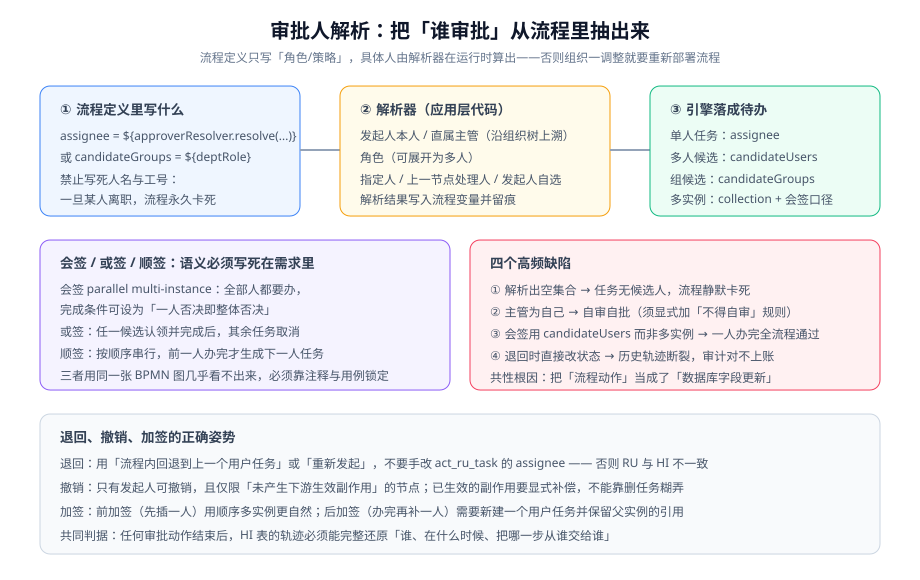

# 审批流设计

审批流是工作流引擎最主流的落地场景，也是需求最容易被写含糊的场景——"需要主管审批"这五个字，在实现层面至少要回答五个问题：**谁是主管、几个人、能不能改、能不能退、多久没办怎么办**。本页把这五个问题拆开逐个定死。



## 审批人解析：四种策略与一条兜底

流程定义里**只写策略，不写具体人**。原因很简单：组织架构调整一次就要重新部署一次流程，是不可接受的维护成本。

| 策略 | 表达 | 解析来源 | 坑 |
| --- | --- | --- | --- |
| 发起人本人 | `assignee = ${initiator}` | 流程变量 | 常用于"确认"节点；但要显式禁止"自审自批" |
| 直属主管 | `${approverResolver.directorOf(initiator)}` | 组织树向上找一级 | 多级组织、兼职、代理任职都会让"上溯一级"有歧义，**必须把口径写死在需求里** |
| 角色/岗位 | `candidateGroups = "finance-approver"` | 角色表 | 角色下无人 → 任务无人可办（不会报错） |
| 指定人 / 上一节点处理人 | `${assigneeOfPrevTask}` | 运行时解析 | 上一节点是多实例会签时有多个处理人，取谁？ |

```java [src/main/java/com/example/flow/ApproverResolver.java]
@Component("approverResolver")
public class ApproverResolver {

    /** 所有解析方法都必须返回「非空且去重后非空」的结果，否则任务会静默卡死 */
    public String directorOf(String initiator) {
        return resolveOrFallback(orgTree.directorOf(initiator), FALLBACK_ROLE);
    }

    public List<String> reviewersOf(int riskLevel) {
        List<String> users = riskLevel >= 3
                ? roleService.usersOf("senior-reviewer")
                : roleService.usersOf("content-reviewer");
        // 关键：解析结果为空时降级到兜底角色，并在留痕里标注"已降级"
        if (users.isEmpty()) {
            auditService.markDegraded(riskLevel, "senior-reviewer");
            return roleService.usersOf(FALLBACK_ROLE);
        }
        return users.stream().filter(Objects::nonNull).distinct().toList();
    }

    private String resolveOrFallback(String user, String fallbackRole) {
        if (user != null && !user.isBlank()) {
            return user;
        }
        List<String> fallback = roleService.usersOf(fallbackRole);
        if (fallback.isEmpty()) {
            // 宁可显式失败，也不要创建一个没人能办的任务
            throw new IllegalStateException("审批人解析失败：组织树无主管且兜底角色为空，请先配置兜底审批人");
        }
        return fallback.get(0);
    }
}
```

::: danger 「解析出空候选人」是最贵的静默故障
引擎创建任务时会**忠实执行**你的表达式：`candidateUsers` 解析成空集合，任务照样创建成功，只是**没有任何人能在待办里看到它**。它不会报错、不会进死信，只会安静地躺到有人发现流程不对为止。

两条强制纪律：
1. **每个审批人解析方法都要有兜底分支**，兜底角色为空时**显式抛异常**（让流程启动失败，而不是创建僵尸任务）。
2. **上线前必须跑一次"空组织"用例**：把解析结果 mock 成空，断言接口返回明确错误而不是 200。
:::

## 会签 / 或签 / 顺签：语义必须写死在需求里

这三个词在口语里经常混用，但它们的实现与业务含义完全不同：

| 名称 | BPMN 实现 | 业务含义 | 完成条件 |
| --- | --- | --- | --- |
| **或签** | `candidateUsers` / `candidateGroups` | 一组人里**任意一人**处理即可 | 一人完成 → 任务结束 |
| **会签** | `multiInstance`（并行） | **所有人**都要处理 | 全部实例完成，或 `completionCondition` 提前结束 |
| **顺签** | `multiInstance`（`isSequential="true"`） | 按**固定顺序**依次处理 | 最后一个实例完成 |

```xml [processes/article-review.bpmn20.xml]
<!-- 或签：初审组任意一人处理 -->
<userTask id="firstReview" name="初审" flowable:candidateGroups="content-reviewer" />

<!-- 会签：所有复审人都要处理；两人否决即整体否决（提前结束） -->
<userTask id="seniorReview" name="复审会签" flowable:assignee="${assignee}">
  <multiInstanceLoopCharacteristics isSequential="false"
        flowable:collection="${reviewers}" flowable:elementVariable="assignee">
    <completionCondition><![CDATA[${nrOfCompletedInstances >= 2 or rejectedCount >= 1}]]></completionCondition>
  </multiInstanceLoopCharacteristics>
</userTask>

<!-- 顺签：三级审核依次进行，前一人办完才生成下一人任务 -->
<userTask id="serialReview" name="逐级审核" flowable:assignee="${assignee}">
  <multiInstanceLoopCharacteristics isSequential="true"
        flowable:collection="${approvers}" flowable:elementVariable="assignee" />
</userTask>
```

| 变量 | 含义 | 什么时候能读到 |
| --- | --- | --- |
| `nrOfInstances` | 实例总数 | 进入多实例后即可 |
| `nrOfActiveInstances` | 未完成实例数 | 过程中 |
| `nrOfCompletedInstances` | 已完成实例数 | 过程中 |
| `loopCounter` | 当前序号（顺签从 0 开始） | 每次实例执行时 |

::: warning 「会签一票否决」必须自己实现
引擎不会帮你判断"否决"，它只认"完成"。想实现一票否决，要么用 `completionCondition` 提前结束多实例（如上例），要么让每个实例完成后由监听器检查否决票数、达到阈值时把流程推向否决分支。**只写"多人审批"而不写清完成条件，验收时一定会被问住。**
:::

## 退回、撤销、加签、转办

审批流里所有"非前进"的动作，都会在历史轨迹上留痕——这既是合规要求，也是排障的第一手资料。

| 动作 | 语义 | 正确实现 | 错误实现及其后果 |
| --- | --- | --- | --- |
| **退回** | 把处理权交还给上一个节点（或发起人） | 流程内回退到上一个用户任务；或终止当前实例、由业务层新建一个实例 | 直接 update `ACT_RU_TASK.ASSIGNEE_` → RU 与 HI 不一致，审计对不上 |
| **撤销** | 发起人在下游生效前收回 | 只有发起人有权限；显式终止实例并标记业务状态；**已生效的下游副作用必须补偿** | 删任务了事 → 下游已发通知/已写数据回不去 |
| **加签** | 在现有节点上再插一个人 | 前加签：顺序多实例（先插的人排前）；后加签：新建用户任务并保留父任务引用 | 用 `candidateUsers` 追加 → 变成"或签"，加签的人可能永远不会办 |
| **转办** | 把任务交给别人办（自己不再处理） | `taskService.setAssignee(taskId, other)` 并记录转办留痕 | 清空 assignee 再设置 → 丢失"谁转给谁"的审计线索 |
| **委派** | 交给别人处理，完成后回到自己 | `taskService.delegateTask()` + `resolveTask()` | 用转办模拟委派 → 办完回不到原办理人 |

::: tip 「退回」到底退到哪：三种都要在需求里问清楚
退回**上一节点**（最常见）、退回**发起人**（打回重写）、退回**指定节点**（跳过多步）。三种的权限、留痕、次数限制都不同——尤其是"退回次数限制"（比如超过 3 次直接终止），**不写清楚就一定会被业务方在验收时提出来**。
:::

## 超时与催办

| 需求 | 建模 | 参数要点 |
| --- | --- | --- |
| 超时催办（任务继续等待） | 用户任务 + **非中断**边界定时事件 | `cancelActivity="false"`；定时器用「持续时间」还是「循环」取决于是否重复催办 |
| 超时自动升级 | 用户任务 + 中断边界定时事件 → 升级任务 | 升级目标人也必须走解析器，也要有兜底 |
| 超时自动通过（慎用） | 中断边界定时 + 服务任务 | 合规风险高，必须写入需求确认单 |
| 工作日计算 | 定时器表达式改为基于业务日历计算 | BPMN 定时器只认绝对时间/时长，**工作日语义要自己算出来再传进去** |

```xml [processes/article-review.bpmn20.xml]
<!-- 非中断边界定时：48 小时后催办一次，任务仍在原办理人手上 -->
<boundaryEvent id="remindTimer" attachedToRef="seniorReview" cancelActivity="false">
  <timerEventDefinition>
    <timeDuration>PT48H</timeDuration>
  </timerEventDefinition>
</boundaryEvent>
<sequenceFlow sourceRef="remindTimer" targetRef="notifyTask" />
```

::: danger 工作日与自然日：一个属性引发的线上事故
`PT48H` 是**自然时长**，跨周末会在周一早上集中爆发"超时升级"。如果业务口径是"两个工作日"，必须在启动定时器前用工时日历算出目标时间点，写进流程变量，再用 `<timeDate>${deadline}</timeDate>` 触发。

**验证方法**：把系统时间调到周五 18:00 启动实例，检查 `ACT_RU_TIMER_JOB.DUEDATE_` 是否落在下周二同一时刻（而不是周日 18:00）。
:::

## 审批留痕：存业务库，不读引擎历史表

| 数据 | 权威源 | 理由 |
| --- | --- | --- |
| 审批动作流水（谁、何时、同意/退回、意见） | **业务库**（如 `review_records`） | 业务查询、报表、导出都要用；引擎历史表结构不稳定、跨版本会变 |
| 流程当前节点与耗时 | 引擎库（`ACT_HI_*`） | 这是"流程的形状"，引擎是最佳来源 |
| 流程实例 id 与业务主键的映射 | 业务库（`business_key` 列） | 业务侧要能反向查到自己的实例 |

::: warning 不要用引擎历史表当业务表
引擎历史表是引擎的内部实现：字段名带下划线、跨大版本可能调整、查询需要走引擎 API。把它当作"业务审计表"来用，等于把业务可查性绑死在引擎升级上。**做法：业务动作自己写一张留痕表，引擎历史只用于排障与流程耗时统计。**
:::

## 需求模板：一张表锁定语义

给业务方评审时，用这张表把每个审批节点问清楚，**空白项就是未定义的需求**：

| 节点 | 审批人策略 | 多人语义 | 可否退回 | 退回到 | 超时动作 | 超时时长 | 意见必填 |
| --- | --- | --- | --- | --- | --- | --- | --- |
| 初审 | 内容审核角色 | 或签 | 可 | 发起人 | 催办 | 24 小时 | 退回必填 |
| 复审 | 高级审核角色（按风险等级） | 会签（一票否决） | 可 | 初审 | 升级至主编 | 48 工作小时 | 退回必填 |
| 发布确认 | 发起人本人 | 单人 | 否 | — | 自动通过 | 72 小时 | 否 |

## 验证方式

```shell
# ① 或签：两个候选人分别认领同一任务，只有一个成功
curl -s -X POST "http://localhost:8080/api/v1/tasks/${TASK_ID}/claim" -H "X-User: u1"
curl -s -X POST "http://localhost:8080/api/v1/tasks/${TASK_ID}/claim" -H "X-User: u2"
# 期望：第一次 200；第二次 409（任务已被认领）

# ② 会签：三个人各办一次，完成任务总数等于 3
curl -s "http://localhost:8080/api/v1/instances/${INSTANCE_ID}/tasks?taskDefKey=seniorReview"
# 期望：returns 3 条（nrOfInstances=3）；办完 3 条后实例才往前走

# ③ 退回：带意见的退回被接受，不带意见的退回被拒绝
curl -s -X POST "http://localhost:8080/api/v1/tasks/${TASK_ID}/complete" \
  -H 'Content-Type: application/json' -d '{"decision":"reject"}'
# 期望：400，提示 "comment is required when rejecting"

# ④ 空组织兜底：把解析器 mock 成空，断言流程无法启动而不是创建僵尸任务
curl -s -X POST "http://localhost:8080/api/v1/submissions" -H 'X-Test-EmptyOrg: true'
# 期望：500/422 + 明确错误信息，且 ACT_RU_TASK 中不产生新记录
```

```sql
-- ⑤ 留痕完整性：任意一个已办任务，都能在业务留痕表里找到对应记录
SELECT t.ID_, t.NAME_, t.ASSIGNEE_, h.actor, h.action, h.comment, h.at
FROM ACT_HI_TASKINST t
JOIN review_records h ON h.instance_id = t.PROC_INST_ID_ AND h.task_id = t.ID_
WHERE t.PROC_INST_ID_ = '流程实例ID';
-- 期望：已完成的用户任务全部有对应留痕；返回行数 = 已办任务数
```

## 与「变更管理」专题的分工（第 170 天补充）

本页讲**审批流引擎怎么搭**（节点模型、会签/或签、加签与回退、超时升级）；[变更管理与发布工程](../../../Ops/ChangeManagement/ApprovalTrail/index.md) 讲**批完之后留下什么才能被校验**。

| 问题 | 本页 | 变更管理专题 |
| --- | --- | --- |
| 一条审批怎么流转 | 节点、参与者、条件分支 | —— |
| 审批对象是什么 | 一条业务单据（`businessKey`） | 变更单 + 它绑定的四个产物指纹 |
| 怎么证明没被改过 | 流程实例历史表 | 哈希链 `verify_chain()`（`OK` / `TAMPERED_FIELDS` / `BROKEN_LINK`） |

**一条本页特有的坑：「同意」不等于「批的是那个产物」。** 审批流引擎记录的是「张三在 14:02 点了同意」，但**没记录他同意的是哪个镜像 digest**。如果审批与构建之间隔了一次重新打包，审批依然有效、产物已经换了——留痕看起来完整，实际上批的是另一个东西。所以 `businessKey` 里必须带不可变摘要，而不是版本号或标签。

## 与「组织与任职」专题的分工（第 238 天补充）

本页判**流程怎么走、节点怎么算、或签会签怎么判**，组织与任职册判**「上级」这个角色在某一天是谁**。两者的接缝是「审批人解析」。

| 你关心的问题 | 该读哪一册 | 为什么不是本页 |
| --- | --- | --- |
| 这个单子要过几个节点、能不能跳过 | 本页 | 判**流程模型** |
| 或签、会签、加签怎么算通过 | 本页 | 判**节点判定** |
| 「部门负责人」这个节点在 3 月 1 日是谁 | [汇报线：实线、虚线与环](../../OrgPeople/ReportingLine/index.md) | 那册判**带时间的汇报线** |
| 组织调整后历史单据的审批人会不会变 | [任职与生效日期：双时态怎么写](../../OrgPeople/Employment/index.md) | 那册判**当时的归属** |

::: danger 本页特有的一处坑：审批人按「当前上级」解析，历史单据的签字人会变
流程引擎通常把节点写成「发起人的部门负责人」，运行时按当前汇报线解析。这在单据审批当天没问题，但三个月后组织调整，**同一张已完成的单据打开来，显示的审批人变成了新上级**——审计看到的那一刻，整条审批链就不可信了。

正确做法是节点解析后**落审批人快照**（`approval_step.assignee_id` + `resolved_at`），同时记录当时的汇报线版本。本机 6,785 条汇报关系里有 238 人（3.0%）落在环上，这类数据一旦参与实时解析，还会让流程卡在「找不到上级」。
:::

## 与「费用报销与差旅费控」专题的分工（第 241 天补充）

| 你关心的问题 | 该读哪一册 | 边界 |
| --- | --- | --- |
| 「审批链怎么画、怎么回滚」 | 本册 | 提供**引擎**：节点、会签、或签、回退 |
| 「这张单该几级、谁批」 | [审批路由](../../ExpenseReimbursement/Approval/index.md) | 判**级数矩阵与阈值** |
| 「审批人离职了单子挂住」 | [审批路由](../../ExpenseReimbursement/Approval/index.md) | 判**断链检测与上跳** |
| 「自己批自己算不算数」 | [审批路由](../../ExpenseReimbursement/Approval/index.md) | 判**自审检测** |

一页一坑：**引擎的「回退」与业务的「退回」不是同一个动作**。引擎回退是把流程指针退到上一个节点，业务退回是把单据状态改成「待补正」并让员工改内容；只做前者，员工看不到「要改什么」；只做后者，流程实例还停在原节点，重提时会创建第二个实例。本库的写法是「状态机管业务、引擎管节点」，两者用一个 `claim_status_log` 对齐。

## 与「临床试验数据管理」专题的分工（第 244 天补充）

本页讲审批引擎的通用能力（多级、会签、加签、驳回），临床专题讲的是「质疑（query）为什么不能当工单/审批流管」。这个边界很容易被工程实现抹平：

| 本页讲什么 | 临床专题讲什么 | 边界 |
| --- | --- | --- |
| 节点、条件、会签、超时升级 | 质疑的四种状态与「无回答不可关闭」 | 本页不判关闭条件 |
| 审批意见与附件 | 质疑的回答必须落到具体数据点 | 本页不判数据绑定 |
| 批量审批与流程编排 | 为什么质疑**不允许**批量关闭 | 本页不判批量边界 |
| SLA 与超时自动流转 | 质疑超时只能升级，不能自动关闭 | 本页不判自动动作 |

**一个必须写进引擎配置的约束**：审批流的「超时自动通过」在质疑场景里是**违规**的。质疑的语义是「数据管理员要求中心澄清」，超时自动关闭等于系统替中心回答了问题。引擎可以提供这个能力，但临床场景必须在配置层禁用它，并在数据库层用 `CHECK` 兜底——因为总有人会写脚本批量改状态。

→ 临床侧的完整链路见[双人录入与质疑：像工单但不能当工单管](../../ClinicalTrial/DataEntry/index.md)。

## 与「承保与保单管理」专题的分工（第 247 天补充）

核保的「转人工」看起来是一次审批，但它与通用审批流有三个不同的地方，边界如下：

| 问题 | 读哪一册 | 本页不重复讲 |
| --- | --- | --- |
| 转人工的五种结局与规则顺序 | [核保与风险选择](../../UnderwritingPolicy/Underwriting/index.md) | 命中即停与留痕 |
| 转人工的 SLA、超时升级 | [核保与风险选择](../../UnderwritingPolicy/Underwriting/index.md) | 超时兜底不能是「自动通过」 |
| 节点、回退、加签、会签 | 本页 | 引擎只负责流转 |
| 批改是否需要审批 | [批改与加退费](../../UnderwritingPolicy/Endorsement/index.md) | 追溯批改要审批留痕 |

::: danger 本页特有的一个坑：核保的「退回」不是审批的「退回」
审批流里的「退回」是把单据退给上一个节点重填；核保里的「转人工」不是退回，而是**流程内的一个正常结局**——它不产生「退回次数 +1」，也不应该计入审批效率的分母。把两者当成同一个动作，会让「核保时效」这个指标永远算不对：4.04% 的转人工单会被统计成「被打回的申请」。
:::

## 与「学籍、选课与排课工程」专题的分工（第 250 天补充）

学籍异动是审批流的一个标准用户，但它揭示了一个审批流**不该独自承担**的职责：

| 问题 | 本页（审批引擎） | 学籍专题 |
| --- | --- | --- |
| 谁批、批几级、怎么退回 | **判**：节点、会签、加签 | 只调用，不建模 |
| 批完改成什么状态 | 不判，只发出「已通过」事件 | **判**：九条边白名单 + 终态无出边 |
| 数据能不能被绕过流程改 | 不判 | **判**：库内约束（部分唯一索引 + 不重叠触发器） |

**一个只在本页成立的坑**：把审批流当成状态的唯一写入者。本机 210 名休学生里有 **12 人（5.71%）** 在休学区间内仍有成绩记录——成绩录入页根本不走审批流，它直接写 `grade` 表。只要「状态」可以被不经过流程的路径影响，审批就只能保证「流程内的单据合法」，保证不了「库里的状态合法」。结论是把白名单与区间约束下沉到库里，流程引擎只负责产生事件。

→ 教务侧的完整链路见[学籍、选课与排课工程](../../AcademicAffairs/index.md)。

## 与「配置、定价与报价工程」专题的分工（第 251 天补充）

| 关注点 | 本册（审批流引擎） | CPQ 专题 |
| --- | --- | --- |
| 引擎职责 | 节点、会签、加签、超时 | 阈值矩阵「谁能批到多少」 |
| 权限来源 | 角色与流程定义 | `max_pct` 落在**矩阵数据**里 |
| 留痕 | 每个节点的处理结果 | 批准绑定「版本 + 金额 + 折扣」 |
| 四眼 | 通过会签节点实现 | 校验 `COUNT(DISTINCT approver)` |

引擎保证「流程走完」，矩阵保证「走完的流程是合规的」。两者缺一：只有引擎，会出现「三级都批了但都无权批 30%」；只有矩阵，会出现「权限对但没人批」。

::: warning 权限不要存成外键引用
审批记录若只存 `role_id`，审批人半年后被降权，**历史审批会追溯性地变成「越权」**。CPQ 侧的口径是把「批准时的 `max_pct`」抄进审批行：`disc_approval.max_pct` 是快照，不是引用。同理，`approved_amt` 也要落，否则金额改了也无法判定批准失效。
:::

## 与「招投标与电子采购交易工程」专题的分工（第 252 天补充）

| 关注点 | 本册（审批流引擎） | 招投标专题 |
| --- | --- | --- |
| 决策方式 | 会签 / 或签 / 加签，串行推进 | 专家**独立**打分后汇总 |
| 可见性 | 节点之间可见上一位意见 | 汇总前互相不可见 |
| 判定对象 | 单据通过与驳回 | 排序与得分，无「通过」动作 |
| 留痕 | 每人一条处理记录 | 每人一张评分表 + 偏离度 |

本册的会签是「看得见彼此再表态」，评标恰好相反：**先各自落分，汇总时才第一次合并**。把评标建模成会签节点，等于把「独立评审」这条法定要求从流程里抹掉了。

::: warning 评标不要复用会签节点
会签节点会把前一位的处理意见渲染给下一位看。实测 2,606 个客观分格中**有 9.13%（238 格）两名专家打分不一致**——客观分本该唯一，不一致本身就说明存在互相影响或复核缺失。若流程还允许看分，这个比例只会往上走。正确做法是两条独立记录先入库（`score(expert_id, bid_id, item, value)`，唯一键 `(expert_id, bid_id, item)`），汇总视图 `v_score_summary` 才做去极值/平均；引擎只负责「收集齐没齐」，不参与算分。
:::

## 与「招聘与人才获取工程」专题的分工（第 253 天补充）

招聘册里有两处审批：需求审批（要不要招、招几个）与 Offer 审批（给多少钱）。这两处的「该谁审」全部由本册解析，招聘册只负责「审完了算不算数」。分工的关键在于：**流程的 `completed` 与业务的「生效」是两个事件，中间隔着一次业务校验**。

| 问题 | 本册（审批流） | 招聘与人才获取册 |
| --- | --- | --- |
| 该谁审 | **判**：四种解析策略 + 兜底 | 只写策略表达式，不写具体人 |
| 几个人审、会不会签 | **判**：单实例 / 多实例会签 / 或签 | 只声明 `approvalMode` |
| 多久没办怎么办 | **判**：超时提醒、升级、自动通过（默认禁止） | 记录中位 3 天 / P90 8 天 / 31.93% 超 5 天 |
| 审完之后生效了吗 | 不判（流程只管状态流转） | **判**：`offer.status` 迁移 + 四条不变量 |
| 能不能撤回 | 不判（引擎只给 `cancel` 能力） | **判**：九状态里哪几步不可逆 |

本机读数值得在这里重申一次：Offer 审批**中位 3 天、P90 8 天、31.93% 超过 5 天**。这个分布几乎完全由本册的「超时策略」决定——如果引擎只做提醒不做升级，审批就会堆在主管的待办里；而如果为了压缩时长开「超时自动通过」，那 27 份薪资带宽越线的审批里就会有一批是在无人看的情况下过的。

::: danger 一个只在本页成立的坑
**把流程 `completed` 当成业务生效。** 审批引擎的职责边界到「所有节点办完」为止，它不知道业务的唯一性约束。招聘册里有一条部分唯一索引 `uq_offer_active`：同一个人同时只能有一份有效 Offer。本机实测有 **6 份（2.52%）** 触发过这条约束——流程走完了，但写入被数据库挡回来了。

如果监听的是流程完成事件并直接改业务状态，这 6 份会变成「审批通过、状态却是旧的」的悬挂记录：审批人认为批了，HR 看到的是没批，候选人那边 Offer 也没发出去，三方各持一个说法。正确顺序是**流程完成 → 业务校验（唯一性、带宽、有效期）→ 业务状态迁移**，校验失败要回写到流程（挂起并通知发起人），而不是让流程自己宣布成功。

同理，`hc` 三水位的占用也必须在业务侧完成扣减，引擎里的「需求审批通过」不占编制。
:::

延伸阅读：[Offer：九状态与四次不可逆](../../Recruiting/Offer/index.md)、[需求与编制三水位](../../Recruiting/Requisition/index.md)。

## 参考资料

- Flowable 用户任务与多实例文档：https://www.flowable.com/open-source/docs/bpmn/ch07b-BPMN-Constructs
- Camunda 8 人机任务模式（任务分配与解除参考）：https://docs.camunda.io/docs/components/modeler/bpmn/user-tasks/
- Workflow Patterns（多实例与同步模式归纳）：https://www.workflowpatterns.com/patterns/control/
