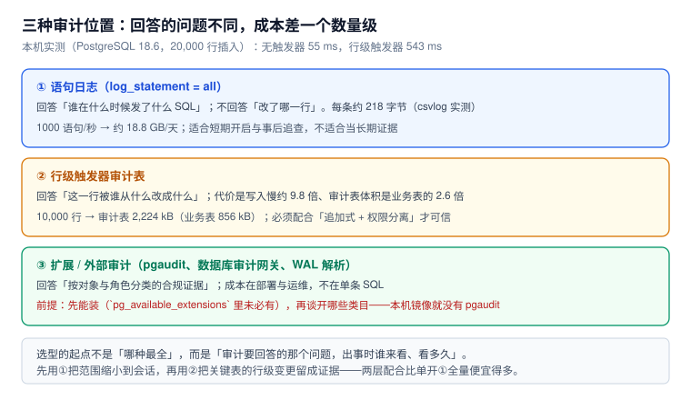

# 审计：三种位置与各自的成本

「有没有审计」这个问题没法直接回答，因为它取决于你要审计的是**语句**、**行**，还是**合规类目**。三者的位置、成本、能回答的问题都不同，混在一起谈就会得出「开了日志就等于有审计」这种结论——而事故复盘时，这句话会被现实打回来。



本页判据族 `AUD-A` ~ `AUD-H`，共 8 条。定义表在第七节。

## 一、三种位置，回答三个不同的问题

| 位置 | 配置 | 能回答 | 不能回答 | 本机成本 |
| --- | --- | --- | --- | --- |
| 语句日志 | `log_statement` / `log_min_duration_statement` | 谁、什么时候、发了什么 SQL | 改了哪一行、改成了什么 | **约 218 字节/条**（csvlog） |
| 行级审计表 | 触发器 + 审计表 | 哪一行、从什么改成什么、谁改的 | 没被触发覆盖的表 | 写入**慢 9.8 倍**、体积 **2.6 倍** |
| 扩展 / 外部审计 | `pgaudit`、审计网关、WAL 解析 | 按对象与角色的合规类目 | 业务语义 | 部署与运维成本为主 |

::: warning 先确认装得上
本机 `postgres:18` 镜像执行 `select * from pg_available_extensions where name like '%audit%'` 返回**空**——`pgaudit` 不在官方镜像里，要另装。所以「开个扩展就有审计」这句话，第一步就可能不成立。
:::

## 二、语句日志：先算容量，再决定开几档

`log_statement` 有四档：`none` / `ddl` / `mod` / `all`。大多数人需要的是 `ddl`（结构变更留痕）或 `mod`（写操作留痕），而不是 `all`。

本机实测（csvlog，300 条语句前后文件大小差）：

```text
delta=65492 ; per statement bytes: 218
```

也就是说，**每条语句约 218 字节**（含时间戳、会话 id、事务 id、应用名等固定字段）。容量算例：

```text
1000 语句/秒 × 218 字节 × 86400 秒 ≈ 18.8 GB/天
```

一个中等业务库（200 QPS 写操作）开 `all`，一天也接近 **3.8 GB**。这还没算索引与备份——日志文件本身不参与 WAL，但会占磁盘、进备份、拖慢归档。

::: tip 更省的组合
1. `log_statement = 'ddl'`：结构变更必须留痕，量极小；
2. `log_min_duration_statement = 2000`：只记慢语句，用于性能而不是审计；
3. 需要短期追查时，**临时**把某个角色的 `log_statement` 打开：

```sql
alter role app_rw set log_statement = 'all';   -- 只影响这个角色
-- 排查结束
alter role app_rw reset log_statement;
```

按角色设置比全局打开精确得多，代价是「忘记关」——所以要写进排查清单。
:::

## 三、行级审计表：能回答「改了哪一行」，但要付两次钱

### 最小可用结构

```sql
create table public.audit_row(
  id        bigserial primary key,
  tbl       text        not null,
  op        char(1)     not null,          -- I / U / D
  row_pk    text,                          -- 业务主键，字符串化
  actor     text,                          -- session_user（连接身份）
  db_role   text,                          -- current_user（执行身份）
  txid      bigint,
  before    jsonb,
  after     jsonb,
  at        timestamptz not null default clock_timestamp()
);

create index audit_row_tbl_at_idx on audit_row (tbl, at desc);
create index audit_row_actor_idx on audit_row (actor, at desc);
```

触发器：

```sql
create or replace function trg_audit() returns trigger language plpgsql as $$
begin
  insert into public.audit_row(tbl, op, row_pk, actor, db_role, txid, before, after)
  values (TG_TABLE_NAME, left(TG_OP,1), coalesce(new.id, old.id)::text,
          session_user, current_user, txid_current(),
          case when TG_OP in ('UPDATE','DELETE') then to_jsonb(old) end,
          case when TG_OP in ('INSERT','UPDATE') then to_jsonb(new) end);
  return null;   -- AFTER 触发器忽略返回值
end $$;

create trigger t_audit after insert or update or delete on biz
  for each row execute function trg_audit();
```

两个字段的选择值得单独说：

- **`actor` 用 `session_user`，`db_role` 用 `current_user`**：前者是「谁连进来的」，后者是「此刻以谁的身份执行」。连接池里用了 `SET ROLE` 时两者会不同，只记一个就会在追责时说不清。
- **`at` 用 `clock_timestamp()`，不用 `now()`**：`now()` 返回的是**事务开始时间**，同一事务里的一万行会共享同一个时间戳，追溯顺序就丢了。

### 成本：本机实测

同一张表插入 20,000 行，交替开关触发器（每轮先预热，避免冷热差异）：

| 轮次 | 无触发器 | 有触发器 | 倍数 |
| --- | --- | --- | --- |
| 第 1 轮 | 93.29 ms | 918.73 ms | 9.85× |
| 第 2 轮 | 55.38 ms | 543.05 ms | 9.81× |

按第 2 轮算：业务写入 **2.77 µs/行**，加审计后 **27.15 µs/行**，**每行多约 24 µs**。

体积（10,000 行）：

| 表 | 体积 |
| --- | --- |
| 业务表 `biz` | 856 kB |
| 审计表 `audit_row` | **2,224 kB**（2.6 倍） |

::: danger 三个必须知道的语义坑
1. **审计写在业务事务里，会跟着业务一起回滚**：业务失败 → 审计也消失。如果你要「尝试过就留痕」，得用 `dblink` / 独立连接写审计，或者在应用层补一条「尝试日志」。这是设计取舍，不是 bug，但必须写清楚。
2. **行级触发器对 `TRUNCATE` 不生效**：`TRUNCATE` 只触发语句级触发器（`FOR EACH STATEMENT`）。所以「有行级审计」不代表「表被清空会被记录」。
3. **`AFTER` 触发器里 `return null` 是正常的**，`BEFORE` 触发器返回 `null` 会**跳过这一行的操作**——把两者搞混，会得到「审计写了但业务没改」的诡异现象。
:::

## 四、防篡改：三道锁，缺一不可

审计表最常见的失败不是「没记」，而是「记了但能被改」。

```sql
-- ① 权限分离：应用角色只能读，不能写
revoke all on public.audit_row from public;
grant select on public.audit_row to auditor;
-- 应用角色连 SELECT 都不给（审计只给审计员看）

-- ② 追加式：连所有者也不能改
create or replace function trg_no_update() returns trigger language plpgsql as $$
begin
  raise exception 'audit_row is append-only';
end $$;
create trigger t_no_update before update or delete on public.audit_row
  for each row execute function trg_no_update();

-- ③ 归档：按月分区，老分区 detach 后只读
```

实测效果：

```sql
set role app_rw;
update audit_row set actor = 'nobody' where id = 1;
-- ERROR:  permission denied for table audit_row
delete from audit_row where id = 1;
-- ERROR:  permission denied for table audit_row
```

注意：这两条报的是**权限拒绝**，触发器的 `raise exception` 根本没轮到执行——权限是第一道，触发器是兜底（对表所有者、对超级用户之外的角色）。两者都要有，顺序不能颠倒。

::: tip 更强的做法：把审计写到库外
库内审计的天花板是「拿到超级用户就能改」。真要满足合规，需要把审计流到**库外**的不可变存储（对象存储 + 对象锁、日志服务），并定期做「库内 ⇄ 库外」条数对账。库内表的价值是「低延迟可查」，不是「不可篡改」。
:::

## 五、留存与容量：先算，再分区

审计表的增长速度等于业务写入量 × 审计保留策略。一个算例：

```text
业务写入 200 行/秒
审计 228 字节/行（本机实测：2,224 kB / 10,000 行）
→ 200 × 228 = 45.6 KB/秒 ≈ 3.9 GB/天 ≈ 118 GB/月
```

如果只保留 90 天，就是 **350 GB 左右**。这个量级必须分区，否则删除历史数据会变成一场 `VACUUM` 灾难：

```sql
create table audit_row (
  like audit_row_template including all
) partition by range (at);

create table audit_row_2026_10 partition of audit_row
  for values from ('2026-10-01') to ('2026-11-01');
```

保留策略用 `DETACH PARTITION`（秒级）而不是 `DELETE`（小时级 + 大量死元组）：

```sql
alter table audit_row detach partition audit_row_2025_07;
-- 确认归档完成后
drop table audit_row_2025_07;
```

## 六、给「谁改的」一个可信答案

审计要能回答四个问题，缺一个都会在复盘时卡住：

| 问题 | 字段 | 常见错误 |
| --- | --- | --- |
| 谁？ | `session_user` + `application_name` | 只记 `current_user`，池化后全是同一个角色 |
| 什么时候？ | `clock_timestamp()` | 用 `now()`，同事务时间戳相同 |
| 哪一行？ | 业务主键（字符串化） | 只记表名，无法定位 |
| 改成了什么？ | `before` / `after` 的 `jsonb` | 只记「更新了」不记值，等于没记 |

再加一条「哪台机器」——`inet_client_addr()`（若走 TCP）：

```sql
select inet_client_addr(), inet_client_port();   -- 本机 socket 连接时为 null
```

## 七、本页判据

| 编号 | 判据 | 看什么现象 | 不满足时改哪里 |
| --- | --- | --- | --- |
| `AUD-A` | 明确「审计要回答哪个问题」 | 有一句话说明审计目标（语句级 / 行级 / 合规） | 先定目标再选位置 |
| `AUD-B` | 语句日志有容量算式 | 有「QPS × 218 B × 86400」的估算 | 补算式；或改用按角色开启 |
| `AUD-C` | 关键表有行级审计 | `audit_row` 有对应 `tbl` 的记录 | 加触发器（先算 9.8 倍成本） |
| `AUD-D` | 审计记录同时含 `session_user` 与 `current_user` | 两列都有值且可不同 | 补字段；否则无法归因到人 |
| `AUD-E` | 时间戳用 `clock_timestamp()` | 同事务多行时间不同 | 改默认值 |
| `AUD-F` | 审计表权限分离 + 追加式 | `app_rw` 对审计表无写权限；有 `trg_no_update` | `REVOKE` + 加触发器 |
| `AUD-G` | 审计表按时间分区且有保留策略 | `pg_partition_tree` 可见月分区 | 建分区；用 `DETACH` 归档 |
| `AUD-H` | 审计回滚语义已明确 | 文档写明「业务失败时审计是否保留」 | 明确取舍；必要时走独立连接 |


## 与「隐私工程与合规落地」的分工（第 192 天补充）

| 问题 | 本页回答 | [隐私工程与合规落地](../../../Others/PrivacyEngineering/Deletion/index.md) 回答 |
| --- | --- | --- |
| 目标 | 谁、何时、改了哪一行、改成什么 | 这些痕迹**本身也是个人信息**，怎么处置 |
| 成本 | 语句日志 218 字节/条、行级审计 9.8 倍写入 | 审计表进不进删除传播清单 |
| 保留 | 按时间分区 + `DETACH` 归档 | 与「删除请求」冲突时怎么取舍 |

**本页特有的一个坑**：行级审计的 `before` / `after` 存的是 `jsonb` 全字段副本。用户要求删除后，主库那行没了，但审计表里还留着删除前的完整明文（含手机号、地址）——这等于删除只做了一半。可选的三种处置：① 审计表进删除清单，`before/after` 里的个人信息字段替换为哈希；② 审计表按更短周期保留（如 90 天）；③ 只存变更字段名与哈希值，不存原值。选哪一种要在设计时定，事后无法补救。

## 参考资料

- PostgreSQL 18 Documentation：*Error Reporting and Logging*（`log_statement`、`log_min_duration_statement`、`log_destination` / csvlog）
- PostgreSQL 18 Documentation：*CREATE TRIGGER*（`FOR EACH ROW` 与 `FOR EACH STATEMENT`、`TRUNCATE` 触发器）
- PostgreSQL 18 Documentation：*Date/Time Functions*（`now()` 与 `clock_timestamp()` 的区别）、*Partitioning*（`DETACH PARTITION`）
- pgaudit 官方仓库：审计类目与 `pgaudit.log_catalog`
- 本仓库：[四层结构与五个必失点](../Overview/index.md)、[异常访问检测](../Detection/index.md)、[安全加固与审计检测](../../Ops/SecurityHardening/AuditDetection/index.md)
