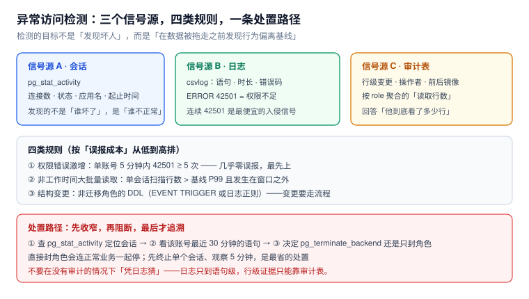

# 异常访问检测与处置

权限体系防的是「不该给的权限」，检测防的是「给了但用歪了」——两者不是替代关系：一个账号完全有权读一张表，也可以在凌晨三点把它全部导出。这种事只有靠**行为基线**才能发现。



本页判据族 `DET-A` ~ `DET-H`，共 8 条。定义表在第六节。

## 一、三个信号源，各自能看见什么

| 信号源 | 查询 / 来源 | 能看到 | 看不到 |
| --- | --- | --- | --- |
| 会话 | `pg_stat_activity` | 谁连着、在跑什么、连了多久 | 历史（只有当下快照） |
| 日志 | csvlog / `log_statement` | 语句、时长、错误码 | 行级影响 |
| 审计表 | `audit_row` | 行级变更、操作者、前后镜像 | 只读查询（除非也记） |

三者互补的关键在于「**会话是实时的，日志是历史的，审计是粒度的**」。只用一个都会缺一块。

```sql
-- 会话快照（建议每 15 秒采一次，落成时序数据）
select usename, application_name, state,
       now() - backend_start   as conn_age,
       now() - state_change    as state_age,
       now() - xact_start      as xact_age,
       wait_event_type, left(query, 80) as q
from pg_stat_activity
where backend_type = 'client backend' and pid <> pg_backend_pid()
order by xact_age desc nulls last;
```

三个 `age` 列各有含义，别混：

- `conn_age` 大而 `state_age` 小 → 正常的池化长连接；
- `state_age` 很大且 `state = idle in transaction` → **最危险**：握着事务不干活，锁着行、占着连接；
- `xact_age` 很大 → 长事务，`VACUUM` 被它拖住。

## 二、四类规则，按「误报成本」排序上线

### ① 权限错误激增（几乎零误报，先上）

PostgreSQL 的权限错误码是 `42501`（`insufficient_privilege`）。一个正常账号不该反复撞权限墙：

```text
规则：同一 usename 在 5 分钟内出现 ≥ 5 次 42501
含义：要么权限配错（应用故障），要么有人在试探（攻击）
```

日志里筛：

```shell
# csvlog 中 error code 列是 42501
grep ',42501,' /var/lib/postgresql/18/docker/log/*.csv | tail -20
```

这条规则的价值在于**误报极低**：正常业务不会连续撞权限。

### ② 非工作时间的大批量读取

单纯的「行数多」不是异常（报表每天都跑）。异常是「**行数多 + 时间不对 + 账号不对**」三者同时成立。

本机实测审计聚合的开销（20,000 行审计记录）：

```sql
select actor, tbl, count(*) from public.audit_row group by 1,2;
-- Time: 10.265 ms

select count(*) from public.audit_row where at > now() - interval '90 days';
-- Time: 5.409 ms
```

20,000 行十几毫秒，意味着**这条规则可以每分钟跑一次**，不需要额外的流式管道。

### ③ 结构变更

非迁移角色的 DDL 应当被视为异常。用事件触发器（见 [权限生命周期](../Lifecycle/index.md)）或日志正则都能抓：

```text
规则：tag ∈ {CREATE TABLE, ALTER TABLE, DROP TABLE, GRANT, REVOKE} 且 actor ≠ migrator
```

### ④ 会话行为异常

| 现象 | 阈值（起点，按自己环境校准） | 含义 |
| --- | --- | --- |
| `idle in transaction` 超过 5 分钟 | `state_age > 5 min and state = 'idle in transaction'` | 泄漏的连接 + 持锁 |
| 单账号连接数超过池上限 | `count(*) > maxPoolSize × 实例数` | 有非池来源（脚本 / 手工） |
| 同一账号多个 `application_name` | `count(distinct application_name) > 1` | 共享账号 |

## 三、处置：先收窄，再阻断，最后追溯

发现异常时的动作顺序很重要——**顺序错了会把排查窗口一起关掉**。

```sql
-- ① 先看这个会话在干什么（不要急着杀）
select pid, usename, state, now() - xact_start as xact_age, query
from pg_stat_activity where usename = 'app_rw';

-- ② 只终止可疑的那一个会话
select pg_terminate_backend(12345);

-- ③ 需要拦住整个账号时，先封角色再杀会话
alter role app_rw nologin;
select pg_terminate_backend(pid) from pg_stat_activity where usename = 'app_rw';
```

::: danger 直接封角色会连正常业务一起停
`ALTER ROLE ... NOLOGIN` 只拦新连接，已有会话还能继续跑；再配 `pg_terminate_backend` 才是完整阻断。但这两步都会让业务中断——所以顺序是「先终止单个会话观察 5 分钟」，只有在确认是账号级问题时才封角色。

另外一个坑：**封角色不会断开已经借出的连接池连接**，池里那些连接还在以该角色身份工作，直到被 `maxLifetime` 换掉。
:::

## 四、误报治理：基线、白名单、采样

检测规则上线后，真正的工作量在**压误报**。三条纪律：

1. **基线从自己的数据来**：不要抄「单次查询超过 10 万行就告警」这种阈值。先跑两周，取 P99 作为起点。
2. **白名单要带到期时间**：`('app_report', 'orders', '2027-01-31')` 这种形式，到期自动失效，避免白名单变成永久豁免。
3. **采样而不是全量**：会话快照每 15 秒一次已经足够定位；每秒一次只会在出问题时把监控库自己拖垮。

一个可执行的基线查询（按小时统计审计写入量，找出「正常波动范围」）：

```sql
select date_trunc('hour', at) as h, actor, count(*) as rows_touched
from public.audit_row
where at > now() - interval '14 days'
group by 1,2
order by 1 desc, 3 desc;
```

把结果按 actor 求 P50 / P99，就是②类规则的阈值来源。

## 五、一个完整的检测闭环

```text
信号采集（15s 会话快照 / 日志持续 / 审计持续）
   ↓
规则判定（42501 激增 / 行数偏离 / 非迁移角色 DDL / 会话异常）
   ↓
告警（带上 pg_stat_activity 的 pid 与 query，别只发一句「异常」）
   ↓
处置（终止单会话 → 观察 → 封角色 → 追溯审计）
   ↓
复盘产出（把这次的阈值调进基线，把误报加进白名单）
```

::: tip 告警里必须带的三样东西
`pid`、`query`（截断到 200 字符）、`application_name`。没有这三样，值班的人第一步就得自己去查——而那一步往往要花掉最宝贵的五分钟。
:::

## 六、本页判据

| 编号 | 判据 | 看什么现象 | 不满足时改哪里 |
| --- | --- | --- | --- |
| `DET-A` | 三个信号源至少接了两个 | 会话快照 + 日志或审计 | 补数据源；单靠日志无法定位行 |
| `DET-B` | 42501 规则已上线 | 告警规则里有错误码过滤 | 加规则；这是性价比最高的一条 |
| `DET-C` | 行数异常有基线而非拍脑袋 | 阈值来自 14 天 P99 | 先采集再定阈值 |
| `DET-D` | 非迁移角色 DDL 有告警 | 事件触发器或日志规则 | 补规则；DDL 必须走流程 |
| `DET-E` | 告警携带 pid / query / 应用名 | 通知模板里有三项 | 改模板；否则值班要重新查一遍 |
| `DET-F` | 处置顺序写成 runbook | 有「先单会话、后封角色」的步骤 | 补 runbook；顺序错会扩大中断 |
| `DET-G` | 白名单带到期时间 | 白名单表有 `expires_at` | 改造；永久豁免等于没有规则 |
| `DET-H` | 聚合查询在秒级内可跑 | 2 万行审计聚合 < 20 ms | 补 `(tbl, at)` / `(actor, at)` 索引 |

## 参考资料

- PostgreSQL 18 Documentation：*Monitoring Database Activity*（`pg_stat_activity` 各列、`state_change`、`wait_event_type`）
- PostgreSQL 18 Documentation：*Error Codes*（`42501 insufficient_privilege`）
- PostgreSQL 18 Documentation：*Event Triggers*（DDL 变更捕获）
- PostgreSQL 18 Documentation：*Log File Maintenance*（csvlog 字段顺序）
- 本仓库：[审计](../AuditTrail/index.md)、[权限生命周期](../Lifecycle/index.md)、[安全加固与审计检测](../../Ops/SecurityHardening/AuditDetection/index.md)
