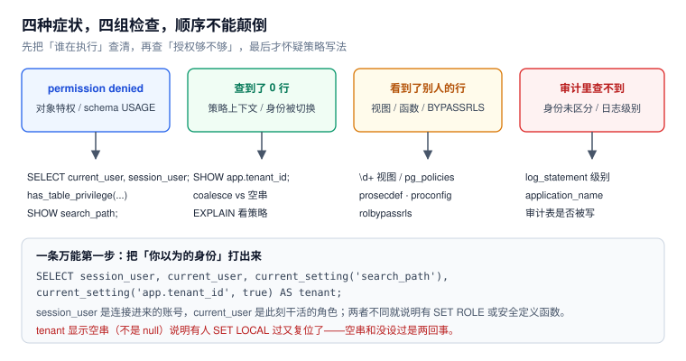

# 常见问题与分诊

权限问题的排查有一个特点：**报错信息往往指向错误的方向**。`permission denied for schema public` 可能是数据库级权限；`COPY FROM not supported with row-level security` 看起来像权限不够，实际是策略表不支持批量导入。本页把这些“指向错误方向的报错”按症状归类，给一条固定的排查顺序。



本页判据族 `ACQ-A` ~ `ACQ-H`，共 8 条。定义表在第五节。

## 一、先跑这一条

任何权限问题，第一步都是确认「你以为的身份」和「实际的身份」是不是同一个：

```sql
select session_user,
       current_user,
       current_setting('search_path')                  as search_path,
       coalesce(current_setting('app.tenant_id', true), '(null)') as tenant_ctx;
```

四个字段各自能解释一类问题：

| 字段 | 异常表现 | 说明 |
| --- | --- | --- |
| `session_user` | 与预期不符 | 连错账号 / 连接串读错了环境变量 |
| `current_user` | 与 `session_user` 不同 | 有 `SET ROLE` 或正在安全定义函数里 |
| `search_path` | 含非预期 schema | 被 `SET` 过且没复位（`RESET ROLE` 不清它） |
| `tenant_ctx` | 空串 | 上下文被复位过；空串 ≠ `null` |

## 二、十类症状的分诊表

| 症状 | 最可能的原因 | 验证 | 修复 |
| --- | --- | --- | --- |
| `permission denied for table X`，但 `\dp` 显示有权限 | 特权授给了组角色，而当前角色 `NOINHERIT` | `select pg_has_role(current_user,'r_x','USAGE')` | `SET ROLE r_x`，或改 `INHERIT` |
| `permission denied for schema public` | PG15+ 不再默认给 `PUBLIC` 建表权 | `select has_schema_privilege('dev1','public','CREATE')` | `GRANT CREATE ON SCHEMA public TO ...` |
| 建 schema 报 `permission denied for database` | 缺的是**数据库级** `CREATE` | `select has_database_privilege(current_user,'postgres','CREATE')` | `GRANT CREATE ON DATABASE ...` |
| 查表返回 0 行，不报错 | 上下文没设 / 空串 / 策略不匹配 | `select current_setting('app.tenant_id', true)` | 修上下文注入；确认 `nullif` |
| 直查 1 行，走视图 2 行 | 视图默认以所有者执行 | `\d+ v_x` 看 `security_invoker` | `FORCE RLS` 或重建视图 |
| `COPY FROM not supported with row-level security` | RLS 表不支持 `COPY FROM` | 报错原文即结论 | 改 `INSERT ... SELECT` 或走装载角色 |
| 应用能清空整张表 | 有 `TRUNCATE` 权限 | `has_table_privilege(...,'TRUNCATE')` | `REVOKE TRUNCATE` |
| 新表「谁都能读」 | 默认权限没覆盖建表角色 | `select * from pg_default_acl` | `ALTER DEFAULT PRIVILEGES ... FOR ROLE` |
| 审计里看不出是谁改的 | 只记了 `current_user`，池化后同角色 | `select distinct actor, db_role from audit_row` | 补 `session_user` + `application_name` |
| 审计里查不到某次改动 | 触发器没挂 / 事务回滚 / `TRUNCATE` 不触发行触发器 | `select tgname from pg_trigger where tgrelid='x'::regclass` | 补触发器；明确回滚语义 |

## 三、十二个高频问题

**Q1：`ENABLE` 和 `FORCE` 到底差在哪？**
`ENABLE` 让策略对「非所有者」生效；`FORCE` 让策略对「所有者」也生效。超级用户与 `BYPASSRLS` 角色不受任何一方约束。

**Q2：为什么 `has_table_privilege` 说 true，实际却查不了？**
两个常见原因：① 缺 schema 的 `USAGE`；② 表上有 RLS 而上下文不对。`has_table_privilege` 只回答「对象特权」，不回答「schema 门槛」与「行可见性」。

**Q3：`SET ROLE` 之后为什么还是没权限？**
目标角色是 `NOINHERIT` 时，`SET ROLE` 只换 `current_user`，不带入它被授予的组角色特权。要再 `SET ROLE` 到那个组角色。

**Q4：`REVOKE` 之后为什么还能查？**
已经有会话在执行中（计划已缓存）时可能还在用旧权限；另外检查是否有**直接授权**未收（`relacl` 里 grantee 是登录角色）。收权后重跑一次即可确认。

**Q5：`current_setting('app.x', true)` 返回空串还是 `null`？**
从没设置过是 `null`；设置过又被回滚/复位是**空串**。所以判断要写 `nullif(...,'')`。

**Q6：把上下文注入放在 autocommit 里为什么无效？**
`set_config(..., true)` 的作用域是当前事务，autocommit 下该语句自成事务，结束后即失效，且**不报错**。

**Q7：`RLS` 会不会拖慢查询？**
取决于谓词形态。与列直接比较的谓词能下推到索引（本机 50 万行 8.35 ms）；子查询型谓词在不带租户条件时会退化成全表扫描（同数据 1,323 ms，73 倍）。

**Q8：`COPY` 导入为什么被拒？**
RLS 表不支持 `COPY FROM`，这是设计限制。改 `INSERT ... SELECT`，或先灌临时表再过策略。

**Q9：审计表会不会跟着业务回滚？**
会。审计写在业务事务里，业务失败则审计一并回滚。要「尝试即留痕」必须走独立连接。

**Q10：为什么行级审计没记到 `TRUNCATE`？**
`TRUNCATE` 只触发**语句级**触发器（`FOR EACH STATEMENT`），行级触发器不会触发。而且 `TRUNCATE` 本身也不受 RLS 约束。

**Q11：`SECURITY DEFINER` 函数为什么危险？**
它把执行身份换成函数所有者。若不固定 `search_path`，函数体内未限定名的对象会按调用者的 `search_path` 解析，可被同名对象劫持；此外函数默认对 `PUBLIC` 可执行。

**Q12：多租户到底该用 RLS 还是应用层过滤？**
两者都要。应用层过滤决定「正常路径」，RLS 决定「应用层写错时还能不能兜住」。只做前者，一次漏写 `where tenant_id` 就是全量泄漏。

## 四、五条「听起来对」的错误建议

::: danger 别照做
1. **「先给 `SUPERUSER` 跑通，上线前再收」**——「上线前」通常不会到来。给 `BYPASSRLS` 都比给超级用户安全。
2. **「把 `max_connections` 和权限一起调大就好了」**——连接数不是权限问题；权限报错调连接数是误诊。
3. **「给应用账号 `TRUNCATE` 方便清测试数据」**——`TRUNCATE` 不受 RLS 约束，一句就能清空全部租户（本机实测）。
4. **「审计表放在业务库里，应用自己写」**——应用能写就能删，证据不可信。审计要么独立 schema + 独立角色，要么写库外。
5. **「视图能简化权限，多建几个视图就行」**——默认视图以所有者执行，会把 RLS 一起绕过。建视图必须配 `security_invoker`。
:::

## 五、上线自查 14 项

| # | 检查项 | 命令 / 判据 | 期望 |
| --- | --- | --- | --- |
| 1 | 应用账号无超级用户 | `select rolsuper from pg_roles where rolname='app_rw'` | `f` |
| 2 | 应用账号无 `BYPASSRLS` | `select rolbypassrls ...` | `f` |
| 3 | 应用账号无 `CREATEROLE` / `CREATEDB` | `select rolcreaterole, rolcreatedb ...` | 均 `f` |
| 4 | 业务表 `ENABLE` + `FORCE` 都开 | `relrowsecurity` / `relforcerowsecurity` | 均 `t` |
| 5 | 策略含 `WITH CHECK` | `pg_policies.with_check` 非空 | 非空 |
| 6 | 上下文用 `nullif` | 策略表达式 | 含 `nullif` |
| 7 | 应用账号无 `TRUNCATE` | `has_table_privilege` | `f` |
| 8 | 视图全部 `security_invoker` | `pg_views` | 无默认行为视图 |
| 9 | 安全定义函数固定 `search_path` | `pg_proc.proconfig` | 非空 |
| 10 | 安全定义函数不对 `PUBLIC` 开放 | `proacl` | 无 `=X/` |
| 11 | 审计表权限分离 | `has_table_privilege('app_rw','audit_row','INSERT')` | `f` |
| 12 | 审计表追加式 | `pg_trigger` 里有 `t_no_update` | 存在 |
| 13 | 默认权限覆盖所有建表角色 | `pg_default_acl` | 每个 `FOR ROLE` 一行 |
| 14 | 有基线快照与比对 | `acl_baseline` 表存在 | 存在 |

14 项里任何一项不满足，都不建议上线——它们不是「优化项」，而是「已经漏了」的证据。

## 六、本页判据

| 编号 | 判据 | 看什么现象 | 不满足时改哪里 |
| --- | --- | --- | --- |
| `ACQ-A` | 分诊先查身份四件事 | 排查记录里有 `session_user` / `current_user` / `search_path` / 上下文 | 补第一步；否则后面全是猜 |
| `ACQ-B` | 报错按「对象类型」而非语义定位 | 能区分 schema / database / table 三级 | 按报错里的对象类型查 |
| `ACQ-C` | 「0 行」被当作独立结论处理 | 有「0 行且无异常」的断言 | 改断言；不要只看异常 |
| `ACQ-D` | 拒绝类用例进入验收 | 验收脚本有「必须失败」的步骤 | 见 [实战](../Practice/index.md) S7–S10 |
| `ACQ-E` | 不使用「先超级用户后收权」的临时方案 | 无 `SUPERUSER` 授予记录 | 改 `BYPASSRLS` 或专用角色 |
| `ACQ-F` | 审计与业务权限分离 | 应用角色对审计表无写权限 | `REVOKE` |
| `ACQ-G` | 上线自查清单可执行 | 14 项每条都有命令 | 补命令；不要写「已确认」 |
| `ACQ-H` | 错误建议有书面黑名单 | 团队 wiki 有这五条 | 补文档；口头约定会失效 |

## 参考资料

- PostgreSQL 18 Documentation：*Error Codes*（`42501`、`42P01`、`3F000`）、*Privileges*、*Row Security Policies*
- PostgreSQL 18 Documentation：*COPY*、*CREATE VIEW*、*Writing SECURITY DEFINER Functions Safely*
- PostgreSQL 18 Documentation：*Monitoring*（`pg_stat_activity`）
- 本仓库：[四层结构与五个必失点](../Overview/index.md)、[行级安全](../RowLevelSecurity/index.md)、[实战](../Practice/index.md)
