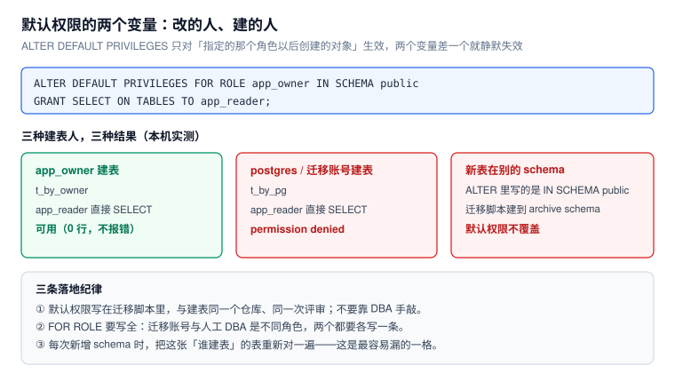

# 最小权限：从 GRANT 到默认权限

最小权限被说烂了，但落到库层，它其实是三个很具体的问题：**能不能进这个 schema、能不能碰这一列、以后新建的表算谁的**。前两个靠 `GRANT` 表达，第三个靠 `ALTER DEFAULT PRIVILEGES`——而第三个恰恰是最容易静默失效的。



本页判据族 `LPA-A` ~ `LPA-H`，共 8 条。定义表在第七节。

## 一、schema 的 `USAGE` 与 `CREATE`

对象特权之外，还有一道更早的门：**schema 上的 `USAGE`**。没有它，表上有 `SELECT` 也查不到。

```sql
grant usage on schema public to app_rw;   -- 能"看见"并访问其中的对象
grant create on schema public to app_owner; -- 能在其中建对象
```

::: danger PostgreSQL 15 起，`public` 不再默认给 `PUBLIC` 建表权
本机实测（18.6）：

```sql
set role dev1;
create table public.evil_t(i int);
-- ERROR:  permission denied for schema public
```

老教程里「新角色默认能在 public 建表」已经不成立。**这是好事**：过去任何能连库的账号都能在 `public` 建表、建函数，进而用同名对象做劫持（见 [越权路径](../PrivilegeEscalation/index.md)）。但升级到 15+ 之后，依赖旧行为的迁移脚本会突然失败。

顺带一个常被忽略的权限：**建 schema 需要数据库级 `CREATE`**。本机用普通角色试 `create schema evil`，报的是 `permission denied for database postgres`——报错里连 "schema" 都没提，很容易误判成 schema 权限问题。
:::

## 二、列级授权：能读一行，不等于能读全部列

```sql
create table emp(id int, name text, salary numeric, dept text);
grant select (id, name, dept) on emp to dev1;
```

以 `dev1` 身份执行：

| 语句 | 结果 |
| --- | --- |
| `select * from emp` | `ERROR: permission denied for table emp` |
| `select id, name from emp` | 正常返回 2 行 |
| `select id from emp where salary > 150` | `ERROR: permission denied for table emp` |

第三行是本页最值钱的一条：**`WHERE` 里用到没授权的列，同样被拒**。这不是限制，而是保护——否则可以用二分法把 `salary` 的每一行逼出来：

```sql
-- 如果能这样查，就等于能读出薪资
select id from emp where salary > 150;
```

所以列级权限不是「脱敏的替代品」，它只是把「读不到」变成「查不了」。真正的脱敏要靠视图或函数（见下）。

::: warning 列级授权与 `SELECT *` 不兼容
ORM 里一句 `select *` 就会整表失败。上列级权限之前，先把查询列显式化，否则上线当天全部接口 500。
:::

## 三、默认权限：三个变量，差一个就静默失效

`GRANT` 只作用于**已存在**的对象。新表要靠默认权限：

```sql
alter default privileges for role app_owner in schema public
  grant select on tables to app_reader;
```

本机实测三种情况：

| 谁建的表 | `app_reader` 能否 `SELECT` | 原因 |
| --- | --- | --- |
| `app_owner`（`ALTER` 里指定的角色） | **可以**（0 行，不报错） | 默认权限命中 |
| `postgres` / 迁移账号 | **`permission denied`** | `FOR ROLE` 不是它，规则不适用 |
| 建到别的 schema | 不适用 | `IN SCHEMA public` 限定了范围 |

这正是「新表一上线就谁都能读 / 谁都读不了」的根源：**默认权限跟着「建表者的角色」走，而建表者往往不是你以为的那个**。

三条落地纪律：

1. **默认权限写进迁移脚本**，和建表同一个仓库、同一次评审——不要靠 DBA 手敲，手敲的那份不在版本里。
2. **`FOR ROLE` 要写全**：迁移账号、人工 DBA、CI 里的建表角色，各写一条。
3. **新增 schema 时重跑一次对账**：`select * from pg_default_acl` 只有几行，肉眼可读。

## 四、迁移账号与运行账号必须分开

| 账号 | 权限 | 用途 | 不该有的权限 |
| --- | --- | --- | --- |
| `migrator` | 建表 / 改表 / 建索引 / 建函数 + 默认权限 | 只在发布窗口用 | 不用于在线查询 |
| `app_rw` | `SELECT` / `INSERT` / `UPDATE` / `DELETE` | 在线业务 | `TRUNCATE`、`CREATE`、`ALTER` |
| `app_ro` | `SELECT` | 报表、排查 | 任何 DML |
| `auditor` | 审计表 `SELECT` | 合规核查 | 业务表读取 |

判断「运行账号有没有多余的 DDL 权限」，一条查询就够：

```sql
select c.relname, p.priv
from pg_class c
cross join (values ('TRUNCATE'),('DELETE'),('TRIGGER'),('REFERENCES')) p(priv)
where c.relkind = 'r' and c.relnamespace = 'public'::regnamespace
  and has_table_privilege('app_rw', c.oid, p.priv)
order by 1,2;
```

输出应当为空。不为空就先收回，再谈其它优化。

## 五、几个「一个授权等于半个超级用户」的东西

这些权限很少人主动授，但经常被顺手打包进「方便账号」：

| 权限 / 角色 | 能做什么 | 本机实测报错 |
| --- | --- | --- |
| `pg_read_file()` | 读服务器上任意文件（含 `pg_hba.conf`） | `ERROR: permission denied for function pg_read_file` |
| `COPY ... FROM/TO PROGRAM` | 在服务器上执行命令（RCE 等价） | `Only roles with privileges of the "pg_execute_server_program" role may COPY to or from an external program.` |
| `pg_read_server_files` | 读服务器任意路径的文件 | 与上同族，慎授 |
| `CREATEROLE` | 建角色、改角色（PG16 起不再能借此成为超级用户，但能提权到已有角色） | 不给运行账号 |
| `pg_read_all_data` / `pg_write_all_data` | **全库**所有表的读写 | 只在只读副本 / 分析库用 |
| `MAINTAIN`（PG17+） | `VACUUM` / `ANALYZE` / `REINDEX` 等 | 给运维，不给业务 |

`COPY ... TO PROGRAM` 那条报错原文很值得记住：它把「需要哪个角色」直接写在 DETAIL 里。排查时照这句话去查，比翻文档快。

## 六、只读账号怎么写才安全

「只读」经常被写成 `GRANT SELECT ON ALL TABLES IN SCHEMA public TO app_ro`，然后漏掉两件事：

```sql
-- ① 以后新建的表
alter default privileges in schema public grant select on tables to app_ro;

-- ② 序列（自增列需要 USAGE 才能读 currval/lastval，但不需要 UPDATE）
grant usage on all sequences in schema public to app_ro;
```

再加两条边界：

- **只读账号不要给 `pg_read_all_data`**：那是跨 schema 全库，一旦以后建了 `audit` schema，它也能读审计。
- **只读账号走独立连接池**：与业务池共用时，一个慢报表能把在线池拖空（见 [连接池](../../ConnectionPool/index.md)）。

## 七、本页判据

| 编号 | 判据 | 看什么现象 | 不满足时改哪里 |
| --- | --- | --- | --- |
| `LPA-A` | schema 级 `USAGE` 与 `CREATE` 分开授予 | `has_schema_privilege` 两项分别可查 | 运行账号只给 `USAGE` |
| `LPA-B` | 运行账号无 `TRUNCATE` / DDL 权限 | 第四节那条查询输出为空 | `REVOKE`；DDL 交给 `migrator` |
| `LPA-C` | 敏感列用列级授权或视图 | `select *` 在敏感表上被拒是**预期行为** | 查询显式列名，或改建视图 |
| `LPA-D` | 默认权限覆盖所有建表角色 | `pg_default_acl` 里有 `FOR ROLE` 各条 | 补 `ALTER DEFAULT PRIVILEGES` |
| `LPA-E` | 默认权限在版本控制里 | 迁移脚本中能找到 `ALTER DEFAULT PRIVILEGES` | 从手工执行改为迁移脚本 |
| `LPA-F` | 高危函数 / 角色未被授予运行账号 | `pg_read_file`、`pg_execute_server_program` 均不可用 | `REVOKE`；排查历史授权 |
| `LPA-G` | 只读账号不含全库级角色 | 无 `pg_read_all_data` | 改为按 schema 授予 |
| `LPA-H` | 运行账号与迁移账号分离且各有一份清单 | 两份角色清单可对照 | 拆账号；共享账号无法定责 |

## 参考资料

- PostgreSQL 18 Documentation：*GRANT*（列级授权、schema 权限）、*ALTER DEFAULT PRIVILEGES*、*Predefined Roles*（`pg_read_all_data`、`pg_execute_server_program`、`pg_maintain`）
- PostgreSQL 15 Release Notes：`public` schema 的 `CREATE` 权限变更
- PostgreSQL 17 Release Notes：`MAINTAIN` 权限
- PostgreSQL 18 Documentation：*COPY*（`PROGRAM` 与所需角色）、*Secure Coding Guidelines*（不要给运行账号文件访问）
- 本仓库：[角色与继承](../RoleModel/index.md)、[越权路径](../PrivilegeEscalation/index.md)、[权限生命周期](../Lifecycle/index.md)
