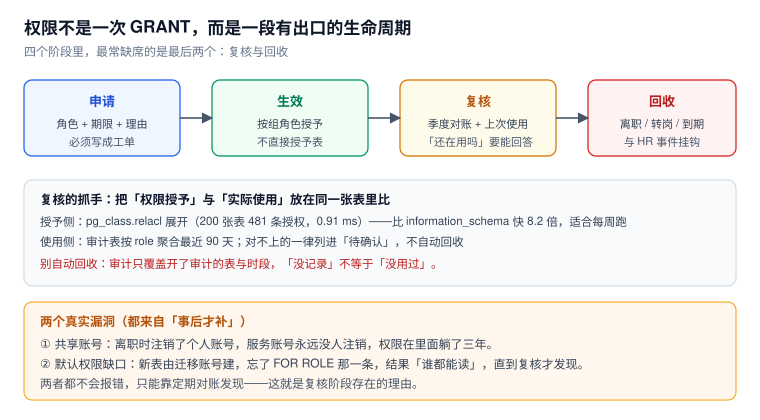

# 权限生命周期：申请、复核与回收

权限事故很少发生在「授予的那一刻」，而发生在**没有人负责收回**的那几年里。一个能用的权限体系，必须把「申请 → 生效 → 复核 → 回收」做成闭环，并且每一段都留下可查的证据。



本页判据族 `LIF-A` ~ `LIF-H`，共 8 条。定义表在第六节。

## 一、申请：把「为什么要」写下来

一条最小可用的申请记录必须包含四项，缺任何一项，半年后就没人能判断该不该收：

| 字段 | 例子 | 缺了会怎样 |
| --- | --- | --- |
| 角色 | `r_order_read` | 只能猜「他当时要干什么」 |
| 期限 | `2027-03-31` | 永久授权，无人回收 |
| 理由 | 「排查 10 月对账差异」 | 无法判断是否仍然成立 |
| 审批人 | 数据 owner | 出事时找不到责任人 |

期限可以直接落到库层，不必只靠流程：

```sql
-- 登录角色到期自动失效（到期后无法登录）
create role u_vendor_a login password '...' valid until '2027-03-31';

-- 已有角色补期限
alter role u_vendor_a valid until '2027-03-31';

select rolname, rolvaliduntil from pg_roles where rolvaliduntil is not null;
```

::: warning `rolvaliduntil` 只管「能不能登录」，不管「已有会话」
到期后新连接被拒，但**已建立的会话不会被踢掉**。要立刻生效，还得配合 `pg_terminate_backend` 或连接池侧的强制断开。
:::

## 二、生效：用组角色，不用直接授权

「直接 `GRANT SELECT ON orders TO u_zhangsan`」这种写法短期最省事，长期最贵：

- 回收时要逐表 `REVOKE`，漏一张就漏一个洞；
- 无法回答「他现在到底能看哪些表」，只能靠遍历 `relacl`；
- 转岗时没有「换一组角色」这个动作，只有「一堆零散回收」。

正确形态见 [角色与继承](../RoleModel/index.md)：对象特权只授给 `r_*` 组角色，人只挂组角色。

## 三、复核：把「授予」与「使用」放在一张表里比

复核的核心不是「问一遍还在用吗」，而是**用数据回答**。两侧的数据来源不同：

### 授予侧：从 `relacl` 展开

本机在 200 张表、2 个角色的环境里对比三种写法：

| 写法 | 条数 | 耗时 |
| --- | --- | --- |
| `information_schema.role_table_grants` | 481 | **7.415 ms** |
| `aclexplode(pg_class.relacl)` | 481 | **0.907 ms**（快 8.2 倍） |
| 逐表 `has_table_privilege`（200 × 2 × 3） | 478 | 1.773 ms |

选择 `aclexplode` 的理由是**它读的是原始 ACL**，不经过 `information_schema` 的视图展开；缺点是要自己处理 `grantee = 0`（即 `PUBLIC`）这一项。

```sql
-- 授予侧基线（每周跑一次，存成快照）
select c.relname                              as tbl,
       coalesce(nullif(a.grantee, 0)::regrole::text, 'PUBLIC') as grantee,
       a.privilege_type                       as priv,
       a.is_grantable
from pg_class c
cross join lateral aclexplode(c.relacl) a
where c.relkind = 'r'
  and c.relnamespace = 'public'::regnamespace
order by 1, 2, 3;
```

::: danger 对账脚本自己的 bug 会伪装成「权限漂移」
第一次跑对账时，我用 `CASE` 把 `privilege_type` 映射成固定几类，漏了 `TRUNCATE`，于是「两个来源各有 1 条只在自己这边」——看起来像权限漂移，实际是脚本的类型映射不全。

加上 `TRUNCATE` 后，480 条完全一致。**教训：对账脚本的权限词表必须与 `aclexplode` 的输出对齐**，否则每周都会报一条假差异，几周后所有人都不看这份报告了。
:::

### 使用侧：从审计聚合

```sql
-- 最近 90 天，每个角色碰过哪些表（前提：审计表按 tbl + actor 建了索引）
select actor, tbl, count(*) as ops, max(at) as last_seen
from public.audit_row
where at > now() - interval '90 days'
group by 1, 2
order by 1, 4 desc;
```

### 两侧比对

```sql
with granted as (
  select coalesce(nullif(a.grantee,0)::regrole::text,'PUBLIC') as grantee,
         c.relname as tbl
  from pg_class c cross join lateral aclexplode(c.relacl) a
  where c.relkind='r' and c.relnamespace='public'::regnamespace
),
used as (
  select actor as grantee, tbl from public.audit_row
  where at > now() - interval '90 days' group by 1,2
)
select g.grantee, g.tbl, '授予但 90 天未使用' as finding
from granted g left join used u using (grantee, tbl)
where u.tbl is null
order by 1,2;
```

::: warning 「没记录」不等于「没用过」
审计只覆盖**开了审计的表**与**开了日志的时段**。所以在把结果当成「可回收」之前，先回答：这张表在审计里吗？这 90 天日志完整吗？

正确做法是把结果标成「待确认」，由数据 owner 逐条确认后再收——**自动回收是这类脚本最容易造成生产事故的地方**。
:::

## 四、回收：三个触发点，一个兜底

| 触发点 | 来源 | 动作 |
| --- | --- | --- |
| 离职 | HR 系统事件 | 禁用登录角色 + 收回全部组角色 + 终止会话 |
| 转岗 | 组织变更 | 换组角色（先加后减，避免中间态没权限） |
| 到期 | `rolvaliduntil` | 到期自动拒登；补一次「到期前 7 天提醒」 |
| 兜底 | 季度复核 | 处理「授予但未使用」与「孤儿角色」 |

孤儿角色的判定：

```sql
-- 有 LOGIN 但从未在审计里出现过的角色（需要审计覆盖足够长的时间）
select r.rolname, r.rolvaliduntil
from pg_roles r
where r.rolcanlogin
  and r.rolname !~ '^pg_'
  and not exists (select 1 from public.audit_row a where a.actor = r.rolname);
```

再补一条「共享账号」的检查——同一个账号被多个 `application_name` 使用，就是共享：

```sql
select usename, count(distinct application_name) as apps, array_agg(distinct application_name) as names
from pg_stat_activity
where backend_type = 'client backend'
group by 1
having count(distinct application_name) > 1;
```

## 五、权限漂移的三个来源

权限不会「自己变」，但它会从三个缝里长出来：

1. **手工 `GRANT`**：值班时为了救火临时给的，事后没人收。对策：所有 `GRANT` 必须进迁移脚本，库层用事件触发器记录 DDL 类变更（见下）。
2. **默认权限**：新建表时按「建表者」自动授权，建表者一变，规则就落空（见 [最小权限](../LeastPrivilege/index.md)）。
3. **`PUBLIC` 的隐式授权**：函数默认对 `PUBLIC` 可执行、`public` schema 在 PG15 之前默认可建表——这些不写在任何 `GRANT` 语句里，却真实存在。

用一个事件触发器把「谁在什么时候改了权限」记下来（DDL 类事件）：

```sql
create table public.ddl_log(at timestamptz default clock_timestamp(),
                            actor text, tag text, obj text);
create or replace function trg_ddl() returns event_trigger language plpgsql as $$
begin
  insert into public.ddl_log(actor, tag, obj)
  values (session_user, tg_tag, coalesce(current_query(), ''));
end $$;
create event trigger et_ddl on ddl_command_end
  when tag in ('GRANT','REVOKE','CREATE ROLE','ALTER ROLE','CREATE TABLE','ALTER TABLE')
  execute function trg_ddl();
```

它不能阻止漂移，但能让漂移**有据可查**——这已经比大多数团队强。

## 六、本页判据

| 编号 | 判据 | 看什么现象 | 不满足时改哪里 |
| --- | --- | --- | --- |
| `LIF-A` | 每条授权有角色、期限、理由、审批人 | 工单或表里四项齐全 | 补流程；不要口头授权 |
| `LIF-B` | 临时角色有 `rolvaliduntil` | `pg_roles.rolvaliduntil` 非空 | `ALTER ROLE ... VALID UNTIL` |
| `LIF-C` | 对象特权只授组角色 | `relacl` 里 grantee 只有 `r_*` | 收回直接授权 |
| `LIF-D` | 有每周可跑的授予侧快照 | `aclexplode` 查询能在 1 秒内出结果 | 建快照表 + 定时任务 |
| `LIF-E` | 复核同时看「授予」与「使用」 | 比对查询有输出，且标注「待确认」 | 补使用侧数据源 |
| `LIF-F` | 回收与 HR 事件挂钩 | 离职流程里有库侧动作 | 补自动化；至少要有清单 |
| `LIF-G` | 无共享登录角色 | 第五节查询输出为空 | 拆账号 |
| `LIF-H` | 权限变更可追溯 | 有 DDL 事件触发器或迁移记录 | 补审计；否则漂移无法归因 |

## 参考资料

- PostgreSQL 18 Documentation：*CREATE ROLE*（`VALID UNTIL`）、*Event Triggers*（`ddl_command_end`、`tg_tag`）
- PostgreSQL 18 Documentation：*Privileges*（`aclexplode`、`has_*_privilege` 系列函数）、*System Catalogs*（`pg_class.relacl`、`pg_default_acl`）
- PostgreSQL 18 Documentation：*Monitoring*（`pg_stat_activity`、`pg_terminate_backend`）
- 本仓库：[角色与继承](../RoleModel/index.md)、[最小权限](../LeastPrivilege/index.md)、[审计](../AuditTrail/index.md)、[异常访问检测](../Detection/index.md)
