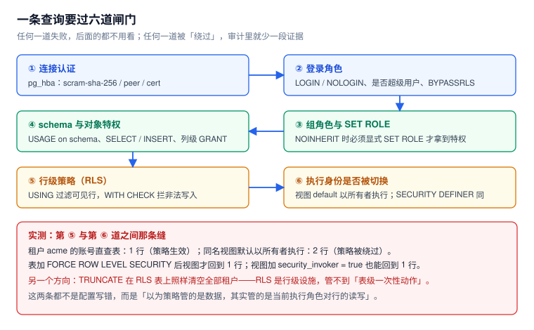

# 四层结构与五个必失点

权限系统的麻烦不在「配不出来」，而在**配出来了、看起来在工作、却在某个入口漏掉**。本页先把四层结构摊开，再用五个本机实测说明「漏」都发生在哪些缝里。



本页判据族 `ACL-A` ~ `ACL-H`，共 8 条。定义表在第七节。

## 一、四层，各判一件事

| 层 | 判什么 | 谁负责配置 | 失效时的表象 | 怎么查 |
| --- | --- | --- | --- | --- |
| ① 连接身份 | 这个 TCP 连接能不能建、用哪种认证 | `pg_hba.conf` + 角色密码 / 证书 | 所有请求都是同一个账号，审计分不清人和批处理 | `select usename, application_name, client_addr from pg_stat_activity` |
| ② 角色与继承 | 这个身份**此刻**拥有哪些角色 | `CREATE ROLE` / `GRANT role` | 「明明授予了却不生效」 | `select current_user, session_user; select * from pg_auth_members` |
| ③ 对象特权 | 能不能对这张表 / 这一列做这个动作 | `GRANT` / `ALTER DEFAULT PRIVILEGES` | `permission denied`，或反过来「谁都能读」 | `has_table_privilege()`、`aclexplode(relacl)` |
| ④ 行级策略 | 在这张表里能看见哪些行、能写进哪些行 | `CREATE POLICY` + `ENABLE` / `FORCE` | 查到 0 行（不是报错），或看到别人的行 | `pg_policies`、`EXPLAIN` 里的 `Filter` |
| ⑤ 审计 | 上面四层发生过什么，有没有证据 | 日志参数 / 审计触发器 / 扩展 | 出事时「查不到是谁改的」 | `pg_current_logfile()`、审计表 |

前四层是**拦截**，第五层是**证明**。一个只有拦截没有证明的系统，在事故复盘时会退化成「靠猜」。

::: tip 四层不是串行开关
它们是「与」的关系：任何一层被绕过，其它三层都不会报错。所以判据不能只问「配了吗」，要问「**从哪个入口进来时它会失效**」。
:::

## 二、五个必失点（全部本机跑过）

### ① 直查 1 行，走视图 2 行

建一张带租户列的表，开策略，只 `ENABLE` 不 `FORCE`，然后建一个视图：

```sql
-- 表所有者：owner_app（非超级用户）；查询者：app_rw
alter table docs2 enable row level security;
create policy p2 on docs2 using (tenant_id = current_setting('app.tenant_id', true));

create view v_docs2 as select * from docs2;   -- 由 owner_app 创建
grant select on v_docs2 to app_rw;
```

以 `app_rw` 身份、上下文设为 `acme`：

| 查询方式 | 返回行数 | 为什么 |
| --- | --- | --- |
| `select count(*) from docs2` | **1** | 策略生效 |
| `select count(*) from v_docs2` | **2** | 视图以**所有者**身份执行，所有者默认绕过策略 |
| 加 `FORCE ROW LEVEL SECURITY` 后再查视图 | **1** | 所有者也被策略约束 |
| 视图加 `WITH (security_invoker = true)` | **1** | 执行身份回到调用者 |

这是本专题最重要的一条：**RLS 判的是 `current_user`，而视图与 `SECURITY DEFINER` 函数都会换掉 `current_user`**。只 `ENABLE` 不 `FORCE`，等于只防了「非所有者」这一半。

### ② 一句 `TRUNCATE` 清空所有租户

同一个 `app_rw`，在策略配好的表上：

```sql
grant truncate on docs2 to app_rw;   -- 灾难的起点
truncate docs2;                       -- TRUNCATE TABLE
select count(*) from docs2;           -- 0
```

`TRUNCATE` **不受行级策略约束**——它是表级动作，没有「行」可供过滤。实测结果：策略下 1 行的表，被清成 0 行，另一个租户的行一起消失。

结论不是「策略写错了」，而是**「不要给应用账号 `TRUNCATE`」**。这条只能靠「不授予」，没有库层开关能补救。

### ③ `COPY FROM` 在 RLS 表上直接拒绝

同一张表上尝试批量导入：

```sql
copy docs2 from stdin with csv;
-- ERROR:  COPY FROM not supported with row-level security
-- HINT:   Use INSERT statements instead.
```

不是「部分行被拒」，是**整条语句不支持**。这解释了一个常见现象：日常查询都正常，一到批量导入就报这个错，而开发以为是权限不够。

三种可行替代：

1. 改成 `INSERT ... SELECT`（走策略校验）；
2. 用 `COPY` 灌到**临时表**（无策略），再用 `INSERT ... SELECT` 过一遍策略；
3. 由**独立的数据装载角色**（带 `BYPASSRLS`）执行，并把这个角色的一切操作单独审计。

### ④ `NOINHERIT` 下 `SET ROLE` 也拿不到组特权

```sql
create role r_reader noinherit;
create role r_analyst noinherit;
grant select on t_doc to r_reader;
grant r_reader to r_analyst;

select has_table_privilege('r_analyst','t_doc','SELECT');  -- f
set role r_analyst;
select count(*) from t_doc;                                 -- ERROR: permission denied
set role r_reader;                                          -- 必须再切一层
select count(*) from t_doc;                                 -- 2
```

对照 `INHERIT` 的版本：`has_table_privilege = t`，`SET ROLE r_analyst2` 后直接查出 2 行。

两个 API 问的是两件事：

```sql
select pg_has_role('r_analyst','r_reader','MEMBER');  -- true  是不是成员
select pg_has_role('r_analyst','r_reader','USAGE');   -- false 能不能立刻用
```

写检查脚本时用错一个，就会得出「权限已授予」的错误结论。详见 [角色与继承](../RoleModel/index.md)。

### ⑤ 审计只到语句级，回答不了「改了哪一行」

`log_statement = all` 的日志长这样（csvlog，实测约 **218 字节/条**）：

```text
2026-10-22 15:17:49 UTC,"postgres","postgres",1508,"[local]",6ada291d.5e4,3,"idle",...,"statement: update biz set payload=payload where id < 50;",...
```

它能回答「谁在什么时候发了什么语句」，**不能**回答「哪 49 行被改成了什么」。要回答后者，必须落到行级审计表（见 [审计](../AuditTrail/index.md)），代价是写入慢约 **9.8 倍**（20,000 行：55 ms → 543 ms）。

## 三、判定链：六个问题，按顺序问

排查任何「权限不对」的问题，按这个顺序问，比乱试快得多：

1. **`session_user` 是谁？** 连接进来的账号。审计里应该记这个。
2. **`current_user` 是谁？** 此刻干活的角色。两者不同 → 有 `SET ROLE` 或安全定义函数。
3. **`search_path` 是什么？** 决定未限定名的对象解析到哪个 schema——劫持就发生在这里。
4. **schema 有 `USAGE` 吗，表有对应特权吗？** 用 `has_*_privilege()` 问，不靠肉眼读 `\dp`。
5. **有策略吗，是 `ENABLE` 还是 `FORCE`？** `pg_policies` 看 `permissive` / `cmd`，`pg_class.relrowsecurity` / `relforcerowsecurity` 看开关。
6. **上下文取到了吗？** `current_setting('app.tenant_id', true)` 返回 `null` 还是空串，直接决定策略是真过滤还是全放行。

::: danger 第 6 步的两个陷阱
1. **空串不是 `null`**：`SET LOCAL app.tenant_id = 'acme'` 在事务结束后，`current_setting(..., true)` 返回的是**空串**而不是 `null`。所以 `current_setting(...) is null` 判不出「已经复位」，要写 `nullif(current_setting('app.tenant_id', true), '')`。
2. **`in_transaction` 之外 `set_config(..., true)` 会被静默丢弃**：本机实测，autocommit 下 `select set_config('app.probe','v1',true)` 之后的下一条语句读到的是空值——不是报错，是悄悄没生效。
:::

## 四、这条权限该谁管：一张归属表

| 现象 | 归属层 | 先改哪里 |
| --- | --- | --- |
| 应用能删表 / 能 `TRUNCATE` | ③ 对象特权 | 收回 `TRUNCATE` / `DELETE` / `CREATE`，DDL 归迁移账号 |
| 应用能读别的租户 | ④ 行策略 | 查 `FORCE`、视图 `security_invoker`、函数 `SECURITY DEFINER` |
| 应用能改审计表 | ⑤ 审计 | 撤销写权限 + 加追加式触发器 + 换独立角色 |
| 某角色「授予了但用不了」 | ② 角色继承 | `rolinherit` 与 `SET ROLE` |
| 新表默认「谁都能读」 | ③ 默认权限 | `ALTER DEFAULT PRIVILEGES ... FOR ROLE <建表者>` |
| 日志里分不清人和批处理 | ① 连接身份 | 一人一账号 / 每个服务一个账号，并设 `application_name` |

## 五、五步起步（半天能做完）

1. **盘身份**：`select usename, count(*) from pg_stat_activity group by 1` —— 列出实际在用的账号，多于「服务数 + 人数」就是共享账号。
2. **盘特权**：把 `pg_class.relacl` 展开成「对象 × 角色 × 权限」清单（200 张表 0.91 ms，见 [生命周期](../Lifecycle/index.md)）。
3. **盘策略**：`select * from pg_policies` 与 `select relname, relrowsecurity, relforcerowsecurity from pg_class where relrowsecurity`，找「开了没 `FORCE`」的表。
4. **盘入口**：把所有视图与 `SECURITY DEFINER` 函数列出来（`select proname, prosecdef from pg_proc where prosecdef`），逐个确认是否需要 `search_path`。
5. **盘证据**：确认审计表存在、只能 `INSERT`、且应用角色对它没有任何写权限。

## 六、三种不该用 RLS 的场景

RLS 很好用，但它不是万能钥匙。以下三种情况用别的办法更省：

1. **整库只读副本 / 分析库**：这类需求是「整个库只读」，用 `pg_read_all_data` 或只读账号 + 独立实例，比给每张表写策略便宜。
2. **列级敏感字段（如薪资）**：RLS 只能过滤行。列级要用 `GRANT SELECT (col...)` 或单独的视图 / 脱敏函数（见 [最小权限](../LeastPrivilege/index.md)）。
3. **超大规模批量导出**：策略会让 `COPY TO` 逐行判定，导出吞吐显著下降；导出走独立的只读实例 + 脱敏视图更合适。

## 七、本页判据

| 编号 | 判据 | 看什么现象 | 不满足时改哪里 |
| --- | --- | --- | --- |
| `ACL-A` | 四层各有明确的负责人与配置位置 | 有一张「层 → 谁配 → 怎么查」的表 | 补归属表；否则出问题只会互相等 |
| `ACL-B` | 应用账号 `session_user` 与 `current_user` 可区分 | 审计里能读出「哪个服务 / 哪个人」 | 一人一账号，连接串设 `application_name` |
| `ACL-C` | 所有 RLS 表都检查过 `FORCE` | `relrowsecurity` 与 `relforcerowsecurity` 成对核对 | 对含租户列的表加 `FORCE` |
| `ACL-D` | 视图与安全定义函数全部登记 | `pg_views` / `pg_proc.prosecdef` 有清单 | 补清单，逐个加 `security_invoker` 或 `SET search_path` |
| `ACL-E` | 应用账号无 `TRUNCATE` / DDL 权限 | `has_table_privilege(...,'TRUNCATE')` 全为 false | 收回；DDL 交给迁移账号 |
| `ACL-F` | 上下文取值区分 `null` 与空串 | 策略里出现 `nullif(current_setting(...), '')` | 改写策略表达式 |
| `ACL-G` | 审计能回答「改了哪一行」 | 关键表有行级审计记录 | 加审计触发器（先算成本） |
| `ACL-H` | 有一份可复跑的盘点脚本 | 三条盘点 SQL 能在 1 秒内出结果 | 见 [实战](../Practice/index.md) 的六条查询 |

## 参考资料

- PostgreSQL 18 Documentation：*Row Security Policies*（`ENABLE` / `FORCE`、所有者绕过）、*CREATE VIEW*（`security_invoker`）、*COPY*（`COPY FROM` 与 RLS 的限制）
- PostgreSQL 18 Documentation：*GRANT*（`WITH INHERIT` / `SET` 选项）、*Predefined Roles*
- 本仓库：[角色与继承](../RoleModel/index.md)、[行级安全](../RowLevelSecurity/index.md)、[越权路径](../PrivilegeEscalation/index.md)、[审计](../AuditTrail/index.md)
- 本仓库项目侧：[TeamBoard 多租户](../../../../project/Complete/TeamBoard/MultiTenancy/index.md)（同一组结论的项目落地形态）
