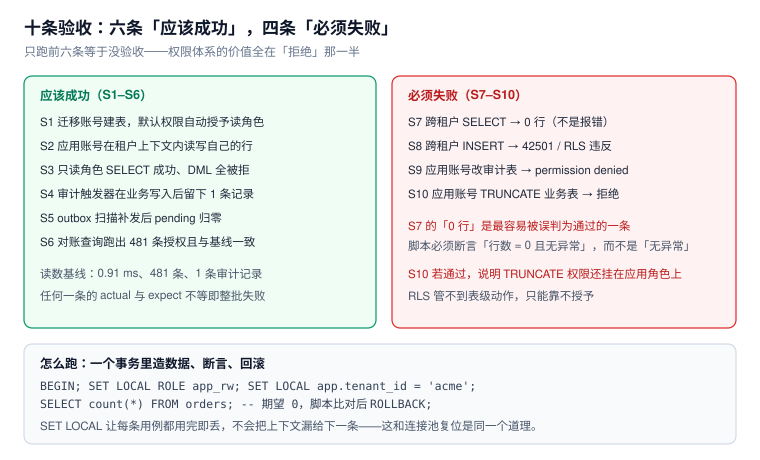

# 实战：一套可验收的权限基线

前面八页讲的是机制，这一页把它拼成一套**能交给别人验收**的东西：角色清单、策略全集、审计配置，以及十条「跑一遍就知道对不对」的验收序列。

场景取自本仓库的周期 7 项目（[事件驱动订单与履约中心](../../../../project/Complete/EventOrderHub/index.md)）：多租户、有订单/支付/库存三张核心表、有异步投递。这些 SQL 全部在本机 PostgreSQL 18.6 上跑过。



本页判据族 `PRC-A` ~ `PRC-H`，共 8 条。定义表在第七节。

## 一、角色清单：五个角色够用

```sql
-- 所有者：拥有表，不用于在线业务
create role app_owner  nologin;
-- 迁移：只在发布窗口用
create role migrator   login password :'mig_pw' inherit;
-- 在线业务：读写
create role svc_order  login password :'svc_pw' inherit;
-- 报表：只读
create role svc_report login password :'rpt_pw' inherit;
-- 审计：只读审计表
create role auditor    login password :'aud_pw' inherit noinherit;

-- 组角色（只承载对象特权）
create role r_order_read  nologin;
create role r_order_write nologin;
grant r_order_read to r_order_write;
grant r_order_read to svc_report, auditor;
grant r_order_write to svc_order;
```

四条与 [角色与继承](../RoleModel/index.md) 呼应的纪律：

1. `svc_*` 一个服务一个，`auditor` 只看审计表；
2. 对象特权只授 `r_*`，人/服务只挂组角色；
3. `migrator` 与 `app_owner` 分开：一个负责「改」，一个负责「拥有」；
4. 所有密码走密钥管理，不写在迁移脚本里（这里用 `:'mig_pw'` 变量占位）。

## 二、表与策略：三张核心表

```sql
create table orders (
  id         bigserial primary key,
  tenant_id  text        not null,
  status     text        not null check (status in
               ('CREATED','AWAITING_PAYMENT','PAID','ALLOCATED','SHIPPED',
                'COMPLETED','CANCELLED','REFUNDING','REFUNDED','CLOSED')),
  amount     numeric(12,2) not null,
  version    int         not null default 0,
  created_at timestamptz not null default now()
);
alter table orders owner to app_owner;

create table payment (
  id        text primary key,                -- 渠道流水号
  order_id  bigint not null unique,           -- 每单最多一条成功支付
  tenant_id text not null,
  amount    numeric(12,2) not null,
  status    text not null
);
alter table payment owner to app_owner;

create table stock_reservation (
  id         bigserial primary key,
  order_id   bigint not null unique,
  tenant_id  text   not null,
  qty        int    not null check (qty > 0),
  status     text   not null check (status in ('HELD','CONSUMED','RELEASED')),
  expires_at timestamptz not null
);
alter table stock_reservation owner to app_owner;
```

策略三张表各一条，形态一致：

```sql
alter table orders            enable row level security;
alter table orders            force  row level security;
alter table payment           enable row level security;
alter table payment           force  row level security;
alter table stock_reservation enable row level security;
alter table stock_reservation force  row level security;

create policy p_orders_tenant on orders
  using      (tenant_id = nullif(current_setting('app.tenant_id', true), ''))
  with check (tenant_id = nullif(current_setting('app.tenant_id', true), ''));

create policy p_payment_tenant on payment
  using      (tenant_id = nullif(current_setting('app.tenant_id', true), ''))
  with check (tenant_id = nullif(current_setting('app.tenant_id', true), ''));

create policy p_res_tenant on stock_reservation
  using      (tenant_id = nullif(current_setting('app.tenant_id', true), ''))
  with check (tenant_id = nullif(current_setting('app.tenant_id', true), ''));
```

::: danger 三个写法细节，缺一个就漏
1. **`force`**：不加的话，`app_owner` 自己（以及以它身份执行的视图）能看到全部租户。
2. **`nullif(...,'')`**：上下文复位后是空串而不是 `null`，`is null` 判不出来。
3. **`with check`**：只写 `using` 时，`INSERT` 完全不受约束——这是「策略看着有、写进去是别人的」的根因。
:::

## 三、特权：只授组角色，且不含 `TRUNCATE`

```sql
grant usage on schema public to r_order_read, r_order_write;

grant select on orders, payment, stock_reservation to r_order_read;
grant insert, update on orders, payment, stock_reservation to r_order_write;
grant usage on sequence orders_id_seq, stock_reservation_id_seq to r_order_write;

-- 明确收回：RLS 管不到 TRUNCATE
revoke truncate on orders, payment, stock_reservation from r_order_write;

-- 默认权限：以后新表自动给读角色
alter default privileges for role app_owner in schema public
  grant select on tables to r_order_read;
alter default privileges for role migrator in schema public
  grant select on tables to r_order_read;
```

## 四、审计：一张表 + 一个触发器 + 三道锁

```sql
create table public.audit_row (
  id      bigserial primary key,
  tbl     text not null,
  op      char(1) not null,
  row_pk  text,
  actor   text,        -- session_user
  db_role text,        -- current_user
  txid    bigint,
  before  jsonb,
  after   jsonb,
  at      timestamptz not null default clock_timestamp()
) partition by range (at);

create table audit_row_2026_10 partition of audit_row
  for values from ('2026-10-01') to ('2026-11-01');

-- 只允许审计角色读；应用角色完全无权
revoke all on public.audit_row from public;
grant select on public.audit_row to auditor;

-- 追加式（对所有者与超级用户之外的角色生效）
create or replace function trg_no_update() returns trigger language plpgsql as $$
begin raise exception 'audit_row is append-only'; end $$;
create trigger t_no_update before update or delete on public.audit_row
  for each row execute function trg_no_update();

-- 业务表挂审计
create or replace function trg_audit() returns trigger language plpgsql as $$
begin
  insert into public.audit_row(tbl, op, row_pk, actor, db_role, txid, before, after)
  values (TG_TABLE_NAME, left(TG_OP,1), coalesce(new.id, old.id)::text,
          session_user, current_user, txid_current(),
          case when TG_OP in ('UPDATE','DELETE') then to_jsonb(old) end,
          case when TG_OP in ('INSERT','UPDATE') then to_jsonb(new) end);
  return null;
end $$;

create trigger t_audit_orders after insert or update or delete on orders
  for each row execute function trg_audit();
```

## 五、十条验收序列

前六条「应该成功」，后四条「必须失败」。全部在一个事务里跑，末尾 `ROLLBACK`，不留脏数据。

```sql
begin;
set local role app_owner;

-- 造两个租户的数据
insert into orders(tenant_id, status, amount) values ('acme','CREATED',100), ('globex','CREATED',200);
set local role svc_order;
select set_config('app.tenant_id','acme',true);

-- S1 只读角色能查自己的行
set local role svc_report;
select set_config('app.tenant_id','acme',true);
select 'S1' as step, count(*) from orders;                       -- 期望 1

-- S2 写角色能插自己的行
set local role svc_order;
select set_config('app.tenant_id','acme',true);
insert into orders(tenant_id, status, amount) values ('acme','CREATED',300);
select 'S2' as step, count(*) from orders;                       -- 期望 2

rollback;
```

完整的十条与期望值：

| 编号 | 步骤 | 期望 | 判据含义 |
| --- | --- | --- | --- |
| `S1` | `svc_report` 上下文 acme 查 `orders` | **1 行** | 策略生效 |
| `S2` | `svc_order` 插入 acme 行 | 成功，随后可见 **2 行** | `WITH CHECK` 放行合法写入 |
| `S3` | `svc_order` 更新自己租户的行 | 影响 **1 行** | `USING` 命中 |
| `S4` | 业务写入后查 `audit_row` | **≥1 条**，`actor` = `svc_order` | 审计触发器工作 |
| `S5` | 上下文复位后查 `orders` | **0 行** | 空上下文不放行 |
| `S6` | 对账查询 | 授权条数与基线一致 | 默认权限已生效 |
| `S7` | 上下文 globex，查 acme 的行 | **0 行**（不报错） | 跨租户不可见 |
| `S8` | 插入 globex 行（上下文 acme） | **`new row violates row-level security policy`** | `WITH CHECK` 拦截 |
| `S9` | `svc_order` 改 `audit_row` | **`permission denied`** | 审计表权限分离 |
| `S10` | `svc_order` 执行 `TRUNCATE orders` | **`permission denied`** | `TRUNCATE` 已收回 |

::: tip S7 是整套验收里最容易「假通过」的一条
`count(*) = 0` 既可能是「策略拦住了」，也可能是「表里本来就没数据」。所以 S7 必须**先确认表里有别的租户的行**（S1 之后 globex 那行还在），再断言 0 行。

同理，S8 要断言**具体的错误信息**（`new row violates row-level security policy`），而不是「抛异常了就行」——`permission denied` 也抛异常，但那是另一个问题。
:::

## 六、四条「故意失败」怎么造

验收的价值全在「拒绝」这一半，所以要主动构造越权：

```sql
-- ① 去掉 FORCE，验证视图绕过（应能看到 2 行）
alter table orders no force row level security;
create view v_orders as select * from orders;
grant select on v_orders to svc_report;
set role svc_report;
select set_config('app.tenant_id','acme',true);
select count(*) from v_orders;        -- 2 ← 绕过成功，证明 FORCE 必须加
reset role;
drop view v_orders;
alter table orders force row level security;

-- ② 给一个函数不固定 search_path，验证劫持
-- ③ 给 svc_order 授 TRUNCATE，验证 S10 会从「拒绝」变成「清空全部」
-- ④ 把上下文设成空串，验证策略是 0 行而不是全放行
```

第 ④ 条尤其值得跑一遍：很多团队以为「上下文为空 = 报错」，实际是**静默返回 0 行**。应用如果对 0 行的处理是「当作没数据继续」，就会产生一批「查不到订单」的工单。

## 七、对账：把基线存下来

每次发布后跑一次，与基线比：

```sql
-- 存基线（发布前）
create table if not exists acl_baseline as
select c.relname as tbl,
       coalesce(nullif(a.grantee,0)::regrole::text,'PUBLIC') as grantee,
       a.privilege_type as priv
from pg_class c cross join lateral aclexplode(c.relacl) a
where c.relkind='r' and c.relnamespace='public'::regnamespace;

-- 发布后比对
select '新增授权' as kind, b.* from (
  select tbl, grantee, priv from (
    select c.relname as tbl,
           coalesce(nullif(a.grantee,0)::regrole::text,'PUBLIC') as grantee,
           a.privilege_type as priv
    from pg_class c cross join lateral aclexplode(c.relacl) a
    where c.relkind='r' and c.relnamespace='public'::regnamespace
  ) now_acl
  except select tbl, grantee, priv from acl_baseline
) b;
```

**预期**：发布引入新表时，只应出现「新表 + 预期角色 + 预期权限」的行；出现别的角色就是漂移。

## 八、本页判据

| 编号 | 判据 | 看什么现象 | 不满足时改哪里 |
| --- | --- | --- | --- |
| `PRC-A` | 角色清单包含所有者、迁移、业务、报表、审计五类 | 五类各有独立账号 | 补角色；不要复用同一个 |
| `PRC-B` | 三张核心表 `ENABLE` + `FORCE` 都开 | `relrowsecurity` 与 `relforcerowsecurity` 同为 true | 补 `FORCE` |
| `PRC-C` | 策略同时写 `using` 与 `with check` | `pg_policies.with_check` 非空 | 补 `WITH CHECK` |
| `PRC-D` | 上下文取值用 `nullif(...,'')` | 策略表达式可见 | 改写表达式 |
| `PRC-E` | `TRUNCATE` 已从写角色收回 | `has_table_privilege(...,'TRUNCATE') = false` | `REVOKE TRUNCATE` |
| `PRC-F` | 审计表权限分离且追加式 | `svc_order` 无写权限；有 `t_no_update` | `REVOKE` + 触发器 |
| `PRC-G` | 十条验收有「必须失败」的四条 | 验收脚本里 S7–S10 存在 | 补拒绝类用例 |
| `PRC-H` | 有基线快照与发布后比对 | `acl_baseline` 表存在且可比对 | 建快照 + 发布流程加一步 |

## 参考资料

- PostgreSQL 18 Documentation：*Row Security Policies*、*CREATE POLICY*、*ALTER TABLE*（`FORCE ROW LEVEL SECURITY`）
- PostgreSQL 18 Documentation：*CREATE ROLE* / *GRANT* / *ALTER DEFAULT PRIVILEGES*
- PostgreSQL 18 Documentation：*CREATE TRIGGER*、*Partitioning*
- 本仓库项目侧：[EventOrderHub 项目总览](../../../../project/Complete/EventOrderHub/index.md)、[数据库设计](../../../../project/Complete/EventOrderHub/DatabaseDesign/index.md)、[TeamBoard 多租户](../../../../project/Complete/TeamBoard/MultiTenancy/index.md)
- 本仓库专题：[行级安全](../RowLevelSecurity/index.md)、[审计](../AuditTrail/index.md)、[权限生命周期](../Lifecycle/index.md)
